# Linux 内核数据结构和算法分析

## 目录

1. [概述](#1-概述)
   - 1.1 [覆盖范围与图解约定](#11-覆盖范围与图解约定)
2. [列表结构](#2-列表结构)
   - 2.1 [双向循环链表 (list_head)](#21-双向循环链表-list_head)
   - 2.2 [哈希链表 (hlist_head)](#22-哈希链表-hlist_head)
   - 2.3 [无锁链表 (llist)](#23-无锁链表-llist)
   - 2.4 [Nulls 哈希链表 (hlist_nulls)](#24-nulls-哈希链表-hlist_nulls)
   - 2.5 [位锁哈希链表 (hlist_bl)](#25-位锁哈希链表-hlist_bl)
   - 2.6 [优先级链表 (plist)](#26-优先级链表-plist)
   - 2.7 [引用计数链表 (klist)](#27-引用计数链表-klist)
3. [树结构](#3-树结构)
   - 3.1 [红黑树 (rb_node)](#31-红黑树-rb_node)
   - 3.2 [基数树 (Radix Tree)](#32-基数树-radix-tree)
   - 3.3 [Maple Tree](#33-maple-tree)
   - 3.4 [B树变体](#34-b树变体)
   - 3.5 [区间树 (interval_tree)](#35-区间树-interval_tree)
4. [哈希表](#4-哈希表)
   - 4.6 [可扩容哈希表 (rhashtable)](#46-可扩容哈希表-rhashtable)
5. [堆与优先队列](#5-堆与优先队列)
   - 5.1 [实时调度优先级队列](#51-实时调度优先级队列)
   - 5.2 [定时器时间轮](#52-定时器时间轮)
   - 5.3 [二叉堆 (min_heap)](#53-二叉堆-min_heap)
6. [查找与索引结构](#6-查找与索引结构)
   - 6.1 [位图 (bitmap)](#61-位图-bitmap)
   - 6.2 [sbitmap（可扩展位图）](#62-sbitmap可扩展位图)
   - 6.3 [Trie树（前缀树）](#63-trie树前缀树)
   - 6.4 [关联数组 (assoc_array)](#64-关联数组-assoc_array)
7. [映射与关联结构](#7-映射与关联结构)
   - 7.1 [IDR](#71-idr)
   - 7.2 [XArray](#72-xarray)
   - 7.3 [eBPF Maps](#73-ebpf-maps)
8. [队列与缓冲区](#8-队列与缓冲区)
   - 8.1 [环形缓冲区 (kfifo)](#81-环形缓冲区-kfifo)
   - 8.2 [工作队列](#82-工作队列)
9. [伙伴系统 (Buddy System)](#9-伙伴系统-buddy-system)
10. [引用计数 (kref)](#10-引用计数-kref)
    - 10.7 [refcount_t](#107-refcount_t)
11. [核心思想：权衡与优化](#11-核心思想权衡与优化)
12. [附录：关键文件索引](#12-附录关键文件索引)

---

## 1. 概述

Linux 内核作为一个大型系统软件，在其各个子系统中广泛使用了多种经典的数据结构和算法。这些数据结构经过精心设计，满足了内核在性能、内存占用和实时性等方面的严格要求。

内核设计数据结构时的核心权衡是**时间和空间的平衡**：

- **链表**：遍历慢，但插入/删除快（O(1)），适合动态变化频繁的场景
- **哈希表**：查找/插入/删除近乎 O(1)，但需要处理哈希冲突
- **树结构**：操作 O(log n)，且有顺序性优势
- **位图**：空间极小，适合表示大量"有/无"状态

本文档按**算法类别**对内核中的核心数据结构和算法进行系统性分析，涵盖其实现原理、核心数据结构定义、关键操作函数以及在内核中的典型应用场景。

### 1.1 覆盖范围与图解约定

内核里的"数据结构"可以分为两层：一层是 `include/linux/` 与 `lib/` 中提供的**通用容器/索引结构**，可被任意子系统复用；另一层是各子系统私有的数据组织（如 `sk_buff`、`bio`、`dentry`、`folio` 等），它们通常与具体业务语义绑定，已在对应子系统章节分析。本章覆盖前者，并在本次修订中补齐了此前遗漏的通用结构：

| 类别        | 覆盖的通用数据结构                                                                       | 章节       |
| ----------- | ---------------------------------------------------------------------------------------- | ---------- |
| 链表        | `list_head`、`hlist`、`llist`、`hlist_nulls`、`hlist_bl`、`plist`、`klist` | 2.1–2.7   |
| 树          | 红黑树、基数树、Maple Tree、B 树变体、区间树                                             | 3.1–3.5   |
| 哈希        | 静态哈希表（`hashtable.h`）、可扩容哈希表 `rhashtable`                               | 4.1–4.6   |
| 堆/优先队列 | 实时调度优先级队列、定时器时间轮、`min_heap`                                           | 5.1–5.3   |
| 查找/索引   | `bitmap`、`sbitmap`、Trie/LC-Trie、`assoc_array`                                   | 6.1–6.4   |
| 映射        | IDR、XArray、eBPF Maps                                                                   | 7.1–7.3   |
| 队列/缓冲   | `kfifo`、工作队列                                                                      | 8.1–8.2   |
| 页框分配    | 伙伴系统                                                                                 | 9          |
| 引用计数    | `kref`、`refcount_t`                                                                 | 10.1–10.7 |

本章所有结构体定义、函数签名与调用点均以当前 Linux 7.2 源码树为准。为便于理解操作过程，各节直接内嵌 `plantuml` 围栏代码块，由 `mdbook-plantuml` 预处理器在构建时渲染；`mdbook serve` 会在保存 Markdown 后自动重新渲染，无需手工生成图片。

> 说明：`hashtable.h`、`list.h` 等提供的宏是**内联实现**；`rhashtable`、`maple_tree`、`xarray` 等则在 `lib/` 中有独立实现文件。图中只画关键指针/索引变化，省略了锁、RCU 赋值和内存屏障等细节。

---

## 2. 列表结构

### 2.1 双向循环链表 (list_head)

#### 2.1.1 概述

`list_head` 是 Linux 内核中最基础、最广泛使用的数据结构。它是一个双向循环链表，所有操作的时间复杂度均为 O(1)。通过将 `list_head` 嵌入到自定义结构体中，借助 `container_of` 宏实现类型无关的通用链表操作。

**内核实现 vs 传统实现的差异**

传统链表（如 C++ STL `std::list<T>`）是**非侵入式**的：链表节点存储的是数据的副本，数据本身不包含链表链接信息。内核的 `list_head` 是**侵入式**的：数据结构体内部嵌入 `list_head` 成员，链表操作直接操作嵌入的节点指针。

| 特性       | 内核侵入式 (`list_head`)               | 传统非侵入式                       |
| ---------- | ---------------------------------------- | ---------------------------------- |
| 内存布局   | 节点指针在数据内部                       | 数据在节点内部                     |
| 内存分配   | 一次 `kmalloc` 即可                    | 需要额外分配节点包装器             |
| 空链表开销 | 1 个 `list_head`（16 字节）            | 1 个哨兵节点（通常 24+ 字节）      |
| 删除操作   | 不需要数据地址，只需 `list_del(&node)` | 需要从数据找到节点容器             |
| 类型安全   | 通过 `container_of` 实现               | 模板/泛型实现                      |
| 数据移动   | 节点指针不变，链表关系不变               | 移动数据需要更新链表（或额外封装） |

#### 2.1.2 核心数据结构

```c
// include/linux/types.h
struct list_head {
    struct list_head *next, *prev;
};
```

**节点结构与关键字段**

| 字段     | 类型                   | 作用                                                         |
| -------- | ---------------------- | ------------------------------------------------------------ |
| `next` | `struct list_head *` | 指向后一个节点；在头节点中指向第一个元素；空链表时指向自身   |
| `prev` | `struct list_head *` | 指向前一个节点；在头节点中指向最后一个元素；空链表时指向自身 |

`list_head` 本身不带数据，通常作为成员嵌入宿主结构体，再用 `container_of()` 找回宿主。头节点是一个**哨兵**，不存业务数据，使插入/删除不需要特判空链表。

**链接图**

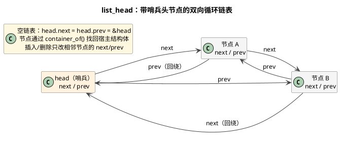

*结构图：`head` 是哨兵；`next` 正向成环，`prev` 反向成环。*

#### 2.1.3 初始化

```c
// 静态初始化
#define LIST_HEAD_INIT(name) { &(name), &(name) }
#define LIST_HEAD(name) struct list_head name = LIST_HEAD_INIT(name)

// 动态初始化
static inline void INIT_LIST_HEAD(struct list_head *list)
{
    WRITE_ONCE(list->next, list);
    WRITE_ONCE(list->prev, list);
}
```

#### 2.1.4 核心操作函数

**插入操作**

```c
// 在头部插入 — 在 head 之后插入 new
static inline void list_add(struct list_head *new, struct list_head *head)
{
    __list_add(new, head, head->next);
}

// 在尾部插入 — 在 head 之前插入 new
static inline void list_add_tail(struct list_head *new, struct list_head *head)
{
    __list_add(new, head->prev, head);
}

// 内部实现：在 prev 和 next 之间插入 new
static inline void __list_add(struct list_head *new,
                              struct list_head *prev,
                              struct list_head *next)
{
    if (!__list_add_valid(new, prev, next))
        return;
    next->prev = new;
    new->next = next;
    new->prev = prev;
    WRITE_ONCE(prev->next, new);
}
```

**删除操作**

```c
// 删除节点（节点内存不会被释放）
static inline void list_del(struct list_head *entry)
{
    __list_del(entry->prev, entry->next);
    entry->next = LIST_POISON1;
    entry->prev = LIST_POISON2;
}

// 删除并重新初始化
static inline void list_del_init(struct list_head *entry)
{
    __list_del(entry->prev, entry->next);
    INIT_LIST_HEAD(entry);
}

// 内部实现
static inline void __list_del(struct list_head *prev, struct list_head *next)
{
    next->prev = prev;
    WRITE_ONCE(prev->next, next);
}
```

**移动与合并**

```c
// 将 list 移动到新头部
static inline void list_move(struct list_head *list, struct list_head *head)
{
    __list_del(list->prev, list->next);
    list_add(list, head);
}

// 将 list 移动到新尾部
static inline void list_move_tail(struct list_head *list, struct list_head *head)
{
    __list_del(list->prev, list->next);
    list_add_tail(list, head);
}

// 判断链表是否为空
static inline int list_empty(const struct list_head *head)
{
    return READ_ONCE(head->next) == head;
}

// 拼接两个链表
static inline void list_splice(struct list_head *list, struct list_head *head)
{
    if (!list_empty(list))
        __list_splice(list, head, head->next);
}
```

**图解：插入与删除的指针改写**

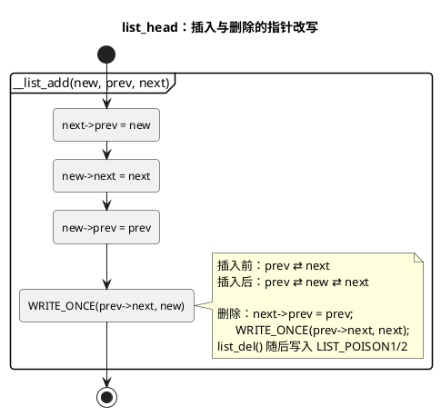

*图 2-1：`__list_add()` 先建立新节点的双向链接，最后用 `WRITE_ONCE(prev->next, new)` 发布；`list_del()` 则把前后节点直接对接。*

#### 2.1.5 遍历宏

```c
// 遍历链表节点（返回 list_head 指针）
#define list_for_each(pos, head) \
    for (pos = (head)->next; !list_is_head(pos, (head)); pos = pos->next)

// 安全遍历（支持删除操作）
#define list_for_each_safe(pos, n, head) \
    for (pos = (head)->next, n = pos->next; \
         !list_is_head(pos, (head)); \
         pos = n, n = pos->next)

// 遍历并获取宿主结构体
#define list_for_each_entry(pos, head, member)                          \
    for (pos = list_first_entry(head, typeof(*pos), member);            \
         !list_entry_is_head(pos, head, member);                        \
         pos = list_next_entry(pos, member))

// 反向遍历
#define list_for_each_entry_reverse(pos, head, member)                  \
    for (pos = list_last_entry(head, typeof(*pos), member);             \
         !list_entry_is_head(pos, head, member);                        \
         pos = list_prev_entry(pos, member))
```

#### 2.1.6 关键辅助宏

```c
// 从 list_head 指针获取宿主结构体
#define list_entry(ptr, type, member) \
    container_of(ptr, type, member)

// 获取第一个/最后一个宿主结构体
#define list_first_entry(ptr, type, member) \
    list_entry((ptr)->next, type, member)
#define list_last_entry(ptr, type, member) \
    list_entry((ptr)->prev, type, member)
```

#### 2.1.7 完整 API 参考

| 函数/宏                                            | 功能                   | 时间复杂度 |
| -------------------------------------------------- | ---------------------- | ---------- |
| `list_add(new, head)`                            | 在头部插入             | O(1)       |
| `list_add_tail(new, head)`                       | 在尾部插入             | O(1)       |
| `list_del(entry)`                                | 删除节点               | O(1)       |
| `list_del_init(entry)`                           | 删除并重新初始化       | O(1)       |
| `list_replace(old, new)`                         | 替换节点               | O(1)       |
| `list_move(list, head)`                          | 移动到头部             | O(1)       |
| `list_move_tail(list, head)`                     | 移动到尾部             | O(1)       |
| `list_is_last(pos, head)`                        | 判断是否为最后一个节点 | O(1)       |
| `list_empty(head)`                               | 判断是否为空           | O(1)       |
| `list_is_head(pos, head)`                        | 判断是否为头节点       | O(1)       |
| `list_cut_position(head, list, entry)`           | 从 entry 处切割        | O(n)       |
| `list_splice(list, head)`                        | 拼接链表到头部         | O(1)       |
| `list_splice_tail(list, head)`                   | 拼接链表到尾部         | O(1)       |
| `list_splice_init(list, head)`                   | 拼接并初始化原链表     | O(1)       |
| `list_bulk_move_tail(head, first, last)`         | 批量移动节点到尾部     | O(1)       |
| `list_for_each(pos, head)`                       | 遍历（list_head 指针） | O(n)       |
| `list_for_each_safe(pos, n, head)`               | 安全遍历（支持删除）   | O(n)       |
| `list_for_each_entry(pos, head, member)`         | 遍历宿主结构体         | O(n)       |
| `list_for_each_entry_safe(pos, n, head, member)` | 安全遍历宿主结构体     | O(n)       |
| `list_for_each_entry_reverse(pos, head, member)` | 反向遍历               | O(n)       |
| `list_for_each_prev(pos, head)`                  | 反向遍历 list_head     | O(n)       |
| `list_first_entry_or_null(ptr, type, member)`    | 取第一个或 NULL        | O(1)       |
| `list_entry_is_head(pos, head, member)`          | 判断是否到头           | O(1)       |
| `list_rotate_to_front(head, entry)`              | 将 entry 旋转到头部    | O(1)       |
| `list_rotate_left(head)`                         | 链表左旋               | O(1)       |

#### 2.1.8 完整使用示例

```c
#include <linux/list.h>
#include <linux/slab.h>
#include <linux/printk.h>

// 定义一个嵌入 list_head 的结构体
struct my_task {
    int id;
    char name[32];
    struct list_head node;  // 嵌入 list_head
};

// 创建链表头
static LIST_HEAD(task_list);

// 创建并添加节点
void add_task(int id, const char *name)
{
    struct my_task *task = kmalloc(sizeof(*task), GFP_KERNEL);
    if (!task)
        return;
    task->id = id;
    strncpy(task->name, name, sizeof(task->name) - 1);
    list_add_tail(&task->node, &task_list);  // 尾部插入
}

// 遍历所有节点
void print_all_tasks(void)
{
    struct my_task *pos;
    list_for_each_entry(pos, &task_list, node) {
        pr_info("task id=%d, name=%s\n", pos->id, pos->name);
    }
}

// 查找并删除
void remove_task_by_id(int id)
{
    struct my_task *pos, *n;
    list_for_each_entry_safe(pos, n, &task_list, node) {
        if (pos->id == id) {
            list_del(&pos->node);  // 从链表移除
            kfree(pos);            // 释放内存
            return;
        }
    }
}

// 移动到尾部（重新排序）
void move_to_tail(int id)
{
    struct my_task *pos;
    list_for_each_entry(pos, &task_list, node) {
        if (pos->id == id) {
            list_move_tail(&pos->node, &task_list);
            return;
        }
    }
}

// 原子地取出第一个节点
struct my_task *pop_first_task(void)
{
    struct my_task *task = list_first_entry_or_null(&task_list, typeof(*task), node);
    if (task)
        list_del(&task->node);
    return task;
}
```

#### 2.1.9 应用场景

`list_head` 在内核中无处不在，典型应用包括：

- **进程链表**：`task_struct` 中的 `tasks` 字段将所有进程链接为双向循环链表
- **文件系统**：目录项缓存（dentry）、inode 链表
- **内存管理**：空闲页链表（`free_area.free_list`）、LRU 链表
- **设备驱动**：设备模型中的各种链表

---

### 2.2 哈希链表 (hlist_head)

#### 2.2.1 概述

`hlist_head` 是内核专门为哈希表实现设计的链表结构。与 `list_head` 不同，`hlist_head` 只有一个指向第一个节点的 `first` 指针（而非双向循环），从而节省哈希表数组的内存开销。`hlist_node` 使用 `pprev`（二级指针）实现高效的删除操作。

**内核实现 vs 传统实现（`list_head`）的差异**

| 特性         | `hlist_head`                                 | `list_head`              |
| ------------ | ---------------------------------------------- | -------------------------- |
| 头节点大小   | 1 指针（8 字节）                               | 2 指针（16 字节）          |
| 普通节点大小 | 2 指针（16 字节）                              | 2 指针（16 字节）          |
| 遍历方向     | 单向                                           | 双向                       |
| 删除操作     | 通过 `pprev` 二级指针实现                    | 直接操作 `prev`/`next` |
| 适用场景     | 哈希表桶数组（大量桶时空间减半）               | 通用双向链表               |
| 空间效率     | 桶数组：`N × 8` 字节                        | 桶数组：`N × 16` 字节   |
| 优点         | 节省大量内存（哈希表可能有数千个桶）           | 操作更灵活，支持反向遍历   |
| 缺点         | 反向遍历需要重新从头开始，删除需 `hlist_del` | 作为哈希表桶时浪费一半空间 |

#### 2.2.2 核心数据结构

```c
// include/linux/types.h
struct hlist_head {
    struct hlist_node *first;
};

struct hlist_node {
    struct hlist_node *next, **pprev;
};
```

`pprev` 是指向上一个节点的 `next` 指针（或 `hlist_head.first`）的指针。这种设计使得删除节点时无需遍历链表来查找前驱节点。

**节点结构与关键字段**

| 字段                 | 类型                     | 作用                                                                       |
| -------------------- | ------------------------ | -------------------------------------------------------------------------- |
| `hlist_head.first` | `struct hlist_node *`  | 桶/链表的第一个节点；空链为 `NULL`                                       |
| `hlist_node.next`  | `struct hlist_node *`  | 指向下一个节点；链尾为 `NULL`                                            |
| `hlist_node.pprev` | `struct hlist_node **` | 指向"前驱的 `next` 字段"或 `head.first`；删除时直接改 `*pprev`，O(1) |

**链接图**

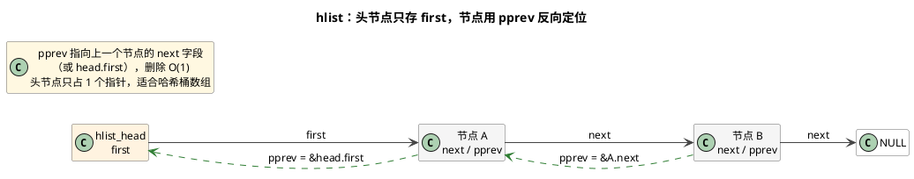

*结构图：实线是 `next` 正向链，虚线是 `pprev` 反向定位；头节点只占 1 个指针。*

#### 2.2.3 初始化

```c
#define HLIST_HEAD_INIT { .first = NULL }
#define HLIST_HEAD(name) struct hlist_head name = { .first = NULL }

static inline void INIT_HLIST_HEAD(struct hlist_head *h)
{
    h->first = NULL;
}

static inline void INIT_HLIST_NODE(struct hlist_node *h)
{
    h->next = NULL;
    h->pprev = NULL;
}
```

#### 2.2.4 核心操作函数

```c
// 判断链表是否为空
static inline int hlist_empty(const struct hlist_head *h)
{
    return !READ_ONCE(h->first);
}

// 在头部插入
static inline void hlist_add_head(struct hlist_node *n, struct hlist_head *h)
{
    struct hlist_node *first = h->first;
    WRITE_ONCE(n->next, first);
    if (first)
        WRITE_ONCE(first->pprev, &n->next);
    WRITE_ONCE(h->first, n);
    WRITE_ONCE(n->pprev, &h->first);
}

// 删除节点
static inline void hlist_del(struct hlist_node *n)
{
    __hlist_del(n);
    WRITE_ONCE(n->next, LIST_POISON1);
    WRITE_ONCE(n->pprev, LIST_POISON2);
}

static inline void __hlist_del(struct hlist_node *n)
{
    struct hlist_node *next = n->next;
    struct hlist_node **pprev = n->pprev;
    WRITE_ONCE(*pprev, next);
    if (next)
        WRITE_ONCE(next->pprev, pprev);
}
```

**图解：`pprev` 如何实现 O(1) 删除**

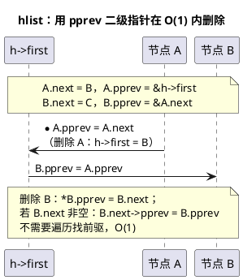

*图 2-2：`pprev` 指向"指向前驱 next 的指针"（可能是 `h->first`，也可能是前驱的 `next` 字段），因此删除节点时不需要遍历找前驱。*

#### 2.2.5 遍历宏

```c
#define hlist_for_each_entry(pos, head, member)                         \
    for (pos = hlist_entry_safe((head)->first, typeof(*(pos)), member); \
         pos;                                                           \
         pos = hlist_entry_safe((pos)->member.next, typeof(*(pos)), member))

#define hlist_for_each_entry_safe(pos, n, head, member)                 \
    for (pos = hlist_entry_safe((head)->first, typeof(*pos), member);   \
         pos && ({ n = pos->member.next; 1; });                        \
         pos = hlist_entry_safe(n, typeof(*pos), member))
```

#### 2.2.6 完整 API 参考

| 函数/宏                                             | 功能                    | 时间复杂度 |
| --------------------------------------------------- | ----------------------- | ---------- |
| `hlist_add_head(n, h)`                            | 插入到头部              | O(1)       |
| `hlist_add_before(n, next)`                       | 在指定节点前插入        | O(1)       |
| `hlist_add_behind(n, prev)`                       | 在指定节点后插入        | O(1)       |
| `hlist_del(n)`                                    | 删除节点                | O(1)       |
| `hlist_del_init(n)`                               | 删除并重新初始化        | O(1)       |
| `hlist_move_list(old, new)`                       | 移动整个链表            | O(1)       |
| `hlist_unhashed(n)`                               | 判断节点是否未被哈希    | O(1)       |
| `hlist_empty(h)`                                  | 判断链表是否为空        | O(1)       |
| `hlist_for_each(pos, head)`                       | 遍历（hlist_node 指针） | O(n)       |
| `hlist_for_each_entry(pos, head, member)`         | 遍历宿主结构体          | O(n)       |
| `hlist_for_each_entry_safe(pos, n, head, member)` | 安全遍历                | O(n)       |
| `hlist_entry(ptr, type, member)`                  | 获取宿主结构体          | O(1)       |

#### 2.2.7 完整使用示例

```c
#include <linux/list.h>
#include <linux/slab.h>
#include <linux/jhash.h>

// 定义一个嵌入 hlist_node 的结构体
struct my_cache_entry {
    u32 key;
    void *data;
    struct hlist_node node;  // 哈希链表节点
};

// 定义哈希表（256 个桶）
#define MY_BITS 8
static DEFINE_HASHTABLE(my_cache, MY_BITS);

// 哈希函数
static inline u32 my_hash(u32 key)
{
    return jhash_1word(key, 0xdeadbeef);
}

// 插入缓存项
void cache_add(u32 key, void *data)
{
    struct my_cache_entry *entry = kmalloc(sizeof(*entry), GFP_KERNEL);
    if (!entry)
        return;
    entry->key = key;
    entry->data = data;
    // 插入到哈希表
    hash_add(my_cache, &entry->node, my_hash(key));
}

// 查找缓存项
void *cache_lookup(u32 key)
{
    struct my_cache_entry *entry;
    // 只在对应桶中遍历
    hash_for_each_possible(my_cache, entry, node, my_hash(key)) {
        if (entry->key == key)
            return entry->data;
    }
    return NULL;
}

// 删除缓存项
void cache_remove(u32 key)
{
    struct my_cache_entry *entry;
    struct hlist_node *tmp;
    hash_for_each_possible_safe(my_cache, entry, tmp, node, my_hash(key)) {
        if (entry->key == key) {
            hash_del(&entry->node);
            kfree(entry);
            return;
        }
    }
}

// 遍历所有缓存项
void cache_dump(void)
{
    struct my_cache_entry *entry;
    int bkt;

    hash_for_each(my_cache, bkt, entry, node) {
        pr_info("bucket %d: key=%u\n", bkt, entry->key);
    }
}
```

#### 2.2.8 应用场景

- **文件系统**：dentry 哈希缓存、inode 哈希表
- **网络子系统**：连接跟踪表、路由缓存
- **进程管理**：PID 哈希表（`pid_hash`）
- **内存管理**：页缓存哈希查找

---

### 2.3 无锁链表 (llist)

#### 2.3.1 概述

`llist`（lock-less list）是**单向**链表，只支持在头部压入、从头部弹出或一次性摘走整条链。它用 `cmpxchg` 原子地更新 `head->first`，因此多个 CPU 可以并发 `llist_add()`，不需要自旋锁，也不会睡眠。代价是：不支持在链表中间插入/删除，也不支持反向遍历。

| 特性       | `llist`                | `list_head` / `hlist` |
| ---------- | ------------------------ | ------------------------- |
| 链接方向   | 单向                     | 双向 / 单向               |
| 插入       | 仅头部，`cmpxchg` 无锁 | 任意位置，需调用者加锁    |
| 删除       | 仅头部或整链             | 任意节点 O(1)             |
| 并发       | 多生产者、多消费者均安全 | 需外部锁或 RCU            |
| 内存开销   | 每节点 1 指针            | 每节点 2 指针             |
| 典型上下文 | NMI、硬中断、RCU 回调    | 进程上下文为主            |

#### 2.3.2 核心数据结构

```c
// include/linux/llist.h
struct llist_head {
    struct llist_node *first;
};

struct llist_node {
    struct llist_node *next;
};

#define LLIST_HEAD_INIT(name)   { NULL }
#define LLIST_HEAD(name)        struct llist_head name = LLIST_HEAD_INIT(name)
```

**节点结构与关键字段**

| 字段                 | 类型                    | 作用                                                                                |
| -------------------- | ----------------------- | ----------------------------------------------------------------------------------- |
| `llist_head.first` | `struct llist_node *` | 栈顶节点；`llist_add()` 用 `cmpxchg` 更新它                                     |
| `llist_node.next`  | `struct llist_node *` | 指向下一个节点；链尾为 `NULL`；`init_llist_node()` 会把它指向自身表示"不在链上" |

**链接图**

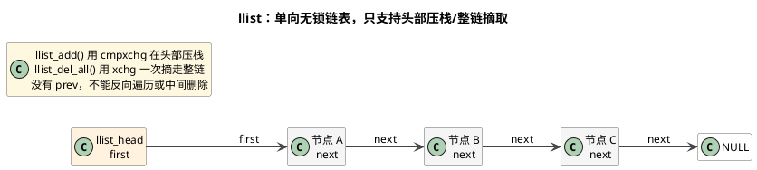

*结构图：只有 `next`，因此只能头部压栈、整链摘取或从头部弹出。*

`init_llist_node()` 把 `node->next` 指向节点自身，用来表示"该节点不在任何链表中"，因此 `llist_on_list()` 可以据此判断节点状态：

```c
static inline void init_llist_node(struct llist_node *node)
{
    WRITE_ONCE(node->next, node);
}

static inline bool llist_on_list(const struct llist_node *node)
{
    return READ_ONCE(node->next) != node;
}
```

#### 2.3.3 核心操作

```c
// 批量压栈：new_first..new_last 是已经串好的一条子链
static inline bool llist_add_batch(struct llist_node *new_first,
                                   struct llist_node *new_last,
                                   struct llist_head *head)
{
    struct llist_node *first = READ_ONCE(head->first);

    do {
        new_last->next = first;
    } while (!try_cmpxchg(&head->first, &first, new_first));

    return !first;   /* 返回插入前链表是否为空 */
}

static inline bool llist_add(struct llist_node *new, struct llist_head *head)
{
    return llist_add_batch(new, new, head);
}

// 一次性摘走整条链，返回最新的节点（后进先出）
static inline struct llist_node *llist_del_all(struct llist_head *head)
{
    return xchg(&head->first, NULL);
}

// 只弹出第一个节点，用 cmpxchg 与并发 add 竞争
struct llist_node *llist_del_first(struct llist_head *head);
```

`llist_del_all()` 返回的顺序是**新→旧**；如果需要按加入顺序处理，可调用 `llist_reverse_order()` 反转。`llist_del_first()` 适合"多消费者各自取一个"的场景，但要求调用者处理好"取出后 `next` 仍指向旧链"的语义。

**图解：无锁压栈**

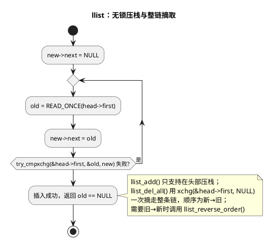

*图 2-3：`llist_add()` 在 `cmpxchg` 失败时重新读取 `head->first` 并重试；`llist_del_all()` 用一次 `xchg` 摘走整条链。*

#### 2.3.4 使用约束与应用

- **NMI 安全**：`llist` 依赖 `cmpxchg`。在不支持 NMI-safe `cmpxchg` 的架构上，NMI 处理程序不能使用它（需要 `CONFIG_ARCH_HAVE_NMI_SAFE_CMPXCHG`）。
- **节点生命周期**：`llist_del_all()` 之后，原链表节点仍由调用者持有；在 RCU 场景中通常配合 `kfree_rcu()` 延迟释放。
- **典型用户**：
  - `kernel/irq_work.c`：每个 CPU 的 `raised_list` / `lazy_list`，中断上下文压入，软中断或专用线程消费。
  - `kernel/rcu/tree.c`： expedited grace period 的 `srs_next` 队列。
  - `kernel/task_work.c`、`kernel/rcu/rcuscale.c` 等。

---

### 2.4 Nulls 哈希链表 (hlist_nulls)

#### 2.4.1 概述

`hlist_nulls` 是 `hlist` 的一个变体：链尾不是 `NULL`，而是一个**最低位为 1 的标记值** `NULLS_MARKER(value)`。这样做的核心目的是支持 **RCU 无锁遍历 + 哈希表扩容**：

- 删除节点时，`hlist_nulls_del_rcu()` 不会把 `next` 改为 `NULL`，而是保留旧链指针，读路径仍可继续走完。
- 扩容时，同一个桶的链可能被迁移到新表。链尾标记携带原桶号，读者走完整条链后发现 `get_nulls_value(pos) != 当前桶号`，就知道自己读到了被迁移的链，应重新计算桶并重试。

#### 2.4.2 核心数据结构

```c
// include/linux/list_nulls.h
struct hlist_nulls_head {
    struct hlist_nulls_node *first;
};

struct hlist_nulls_node {
    struct hlist_nulls_node *next, **pprev;
};

#define NULLS_MARKER(value) (1UL | (((long)value) << 1))

static inline int is_a_nulls(const struct hlist_nulls_node *ptr)
{
    return ((unsigned long)ptr & 1);
}

static inline unsigned long get_nulls_value(const struct hlist_nulls_node *ptr)
{
    return ((unsigned long)ptr) >> 1;
}

static inline void hlist_nulls_add_head(struct hlist_nulls_node *n,
                                        struct hlist_nulls_head *h)
{
    struct hlist_nulls_node *first = h->first;

    n->next = first;
    WRITE_ONCE(n->pprev, &h->first);
    h->first = n;
    if (!is_a_nulls(first))
        WRITE_ONCE(first->pprev, &n->next);
}
```

**节点结构与关键字段**

| 字段                       | 类型                           | 作用                                                               |
| -------------------------- | ------------------------------ | ------------------------------------------------------------------ |
| `hlist_nulls_head.first` | `struct hlist_nulls_node *`  | 链头；空链时是 `NULLS_MARKER(bucket)` 而不是 `NULL`            |
| `hlist_nulls_node.next`  | `struct hlist_nulls_node *`  | 指向下一个节点，或链尾的 nulls 标记；删除时保留旧值供 RCU 读者走完 |
| `hlist_nulls_node.pprev` | `struct hlist_nulls_node **` | 指向前驱 `next` 或 `head.first`；删除 O(1)                     |
| 低 bit 编码                | `unsigned long`              | 最低位为 1 表示标记；高位右移一位得到桶号 `get_nulls_value()`    |

**链接图**

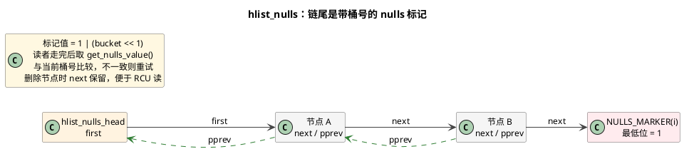

*结构图：链尾不是 `NULL`，而是携带桶号的标记；读者据此判断是否走完了"当前桶"的链。*

节点指针对齐到 4/8 字节，最低位天然为 0；`NULLS_MARKER` 把桶号左移一位后置最低位，因此不会与真实节点指针混淆。`hlist_nulls_del()` 只清 `pprev`，`next` 保留，正是为了 RCU 读者能走完旧链。

#### 2.4.3 图解：查找与迁移检测

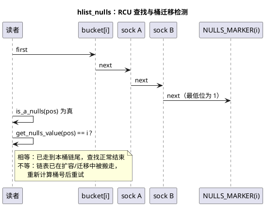

*图 2-4：读路径用 `hlist_nulls_for_each_entry_rcu()` 遍历；遇到最低位为 1 的标记即到达链尾。若标记中的桶号与当前桶不一致，说明链表已被扩容迁移，需要重试。*

#### 2.4.4 典型应用：UDP 哈希表

本树 `include/net/udp.h` 中每个 `udp_hslot` 都使用 `hlist_nulls_head`：

```c
INIT_HLIST_NULLS_HEAD(&table->hash4[i].nulls_head, i);
```

`net/ipv4/udp.c` 的 `udp4_lib_lookup2()` 在遍历完后检查：

```c
udp_lrpa_for_each_entry_rcu(up, node, &hslot4->nulls_head) {
    ...
}

/* 链尾标记与桶号不一致：说明查找期间发生了 rehash，重试 */
if (get_nulls_value(node) != slot)
    goto begin;
```

同样的模式也用于 `inet_hashinfo`、netfilter 连接跟踪等"RCU 读 + 可扩容哈希"的场景。

---

### 2.5 位锁哈希链表 (hlist_bl)

#### 2.5.1 概述

`hlist_bl` 在 `hlist` 的基础上，把**桶锁**编码进 `hlist_bl_head.first` 的最低 bit。这样一个桶只需要一个指针的空间，不需要额外的 `spinlock_t`，非常适合 dentry 这类桶数量很大的哈希表。

#### 2.5.2 核心数据结构

```c
// include/linux/list_bl.h
struct hlist_bl_head {
    struct hlist_bl_node *first;   /* 最低位为 1 表示已加锁 */
};

struct hlist_bl_node {
    struct hlist_bl_node *next, **pprev;
};

#if defined(CONFIG_SMP) || defined(CONFIG_DEBUG_SPINLOCK)
#define LIST_BL_LOCKMASK   1UL
#else
#define LIST_BL_LOCKMASK   0UL
#endif

static inline struct hlist_bl_node *hlist_bl_first(struct hlist_bl_head *h)
{
    return (struct hlist_bl_node *)
        ((unsigned long)h->first & ~LIST_BL_LOCKMASK);
}

static inline void hlist_bl_set_first(struct hlist_bl_head *h,
                                      struct hlist_bl_node *n)
{
    LIST_BL_BUG_ON((unsigned long)n & LIST_BL_LOCKMASK);
    h->first = (struct hlist_bl_node *)
        ((unsigned long)n | LIST_BL_LOCKMASK);
}
```

`hlist_bl_lock()` / `hlist_bl_unlock()` 通过 `bit_spin_lock(0, &h->first)` 操作这个低位；所有修改链表的操作都必须在持锁状态下进行。

**节点结构与关键字段**

| 字段                    | 类型                        | 作用                                                                          |
| ----------------------- | --------------------------- | ----------------------------------------------------------------------------- |
| `hlist_bl_head.first` | `struct hlist_bl_node *`  | 首节点指针；最低位是桶锁标志（`LIST_BL_LOCKMASK`）                          |
| `hlist_bl_node.next`  | `struct hlist_bl_node *`  | 指向下一个节点；链尾为 `NULL`                                               |
| `hlist_bl_node.pprev` | `struct hlist_bl_node **` | 指向前驱 `next` 或 `head.first`；删除 O(1)                                |
| 锁位                    | `unsigned long` 最低位    | `hlist_bl_lock()` 用 `bit_spin_lock` 置位；取节点时用 `first & ~1` 屏蔽 |

**链接图**

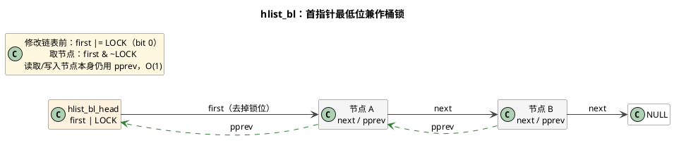

*结构图：`first` 同时承担"首节点指针"和"桶锁"两个角色，省掉每桶一个 `spinlock_t`。*

#### 2.5.3 图解与典型应用

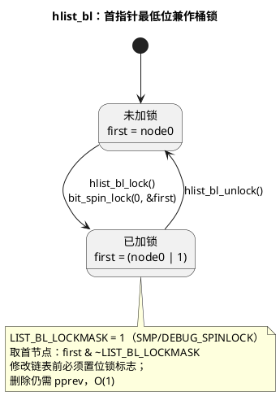

*图 2-5：未加锁时 `first` 直接指向首节点；加锁后最低位置 1。取节点时必须用 `first & ~LIST_BL_LOCKMASK` 屏蔽锁位。*

本树 `fs/dcache.c` 的 dentry 哈希表就是该结构：

```c
static struct hlist_bl_head *dentry_hashtable __ro_after_init __used;

static inline struct hlist_bl_head *d_hash(unsigned long hashlen)
{
    return runtime_const_ptr(dentry_hashtable) +
        ((hashlen) % (dentry_hashtable_size >> 1));
}

/* __d_lookup_rcu() 等读路径 */
struct hlist_bl_head *b = d_hash(dentry->d_name.hash);
hlist_bl_lock(b);
...
hlist_bl_unlock(b);
```

---

### 2.6 优先级链表 (plist)

#### 2.6.1 概述

`plist` 是"按优先级排序的双向链表"，同时维护两条链：

- `prio_list`：每个优先级只保留一个代表节点，按 `prio` 升序，**不含重复优先级**。
- `node_list`：包含所有节点，按 `prio` 升序；同一优先级内部保持 **FIFO**。

`INT_MIN` 表示最高优先级，`INT_MAX` 表示最低优先级。插入时先在 `prio_list` 中定位，再到 `node_list` 中插入；删除时若删掉的是该优先级的代表节点，需要让同优先级的后继节点接替它在 `prio_list` 中的位置。

#### 2.6.2 核心数据结构

```c
// include/linux/plist_types.h
struct plist_head {
    struct list_head node_list;
};

struct plist_node {
    int                 prio;
    struct list_head    prio_list;
    struct list_head    node_list;
};
```

**节点结构与关键字段**

| 字段                     | 类型                 | 作用                                                |
| ------------------------ | -------------------- | --------------------------------------------------- |
| `plist_head.node_list` | `struct list_head` | 所有节点的有序链（按 `prio` 升序，同优先级 FIFO） |
| `plist_node.prio`      | `int`              | 优先级；`INT_MIN` 最高，`INT_MAX` 最低          |
| `plist_node.prio_list` | `struct list_head` | 只挂"每个优先级的代表节点"，用于快速定位插入点      |
| `plist_node.node_list` | `struct list_head` | 挂到 `plist_head.node_list` 的节点                |

**链接图**

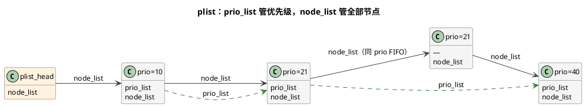

*结构图：`prio_list` 只保留每个优先级的一个代表（绿色虚线）；`node_list` 包含全部节点，同优先级按 FIFO 排列。*

#### 2.6.3 图解：插入过程

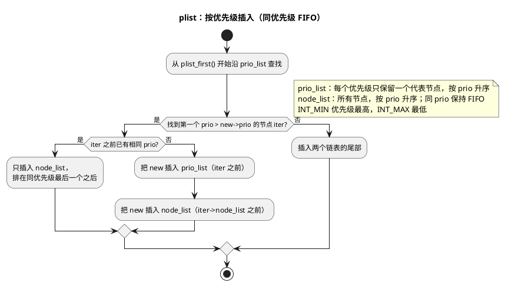

*图 2-6：`plist_add()` 在 `prio_list` 中找到第一个 `prio` 更大的节点；若同优先级已存在，只插入 `node_list` 尾部，从而保持 FIFO；否则同时插入两条链。*

#### 2.6.4 核心 API 与应用

```c
void plist_add(struct plist_node *node, struct plist_head *head);
void plist_del(struct plist_node *node, struct plist_head *head);
void plist_requeue(struct plist_node *node, struct plist_head *head);

static inline struct plist_node *plist_first(const struct plist_head *head);
static inline struct plist_node *plist_last(const struct plist_head *head);
```

典型用户：

- **PM QoS**：`kernel/power/qos.c` 用 `plist` 按延迟/吞吐量约束排序，`plist_first()` 取最严格约束。
- **实时调度 pushable tasks**：`kernel/sched/rt.c` 的 `rt_rq->pushable_tasks` 用优先级链维护可推送任务。
- **Futex PI 等待队列**：`kernel/futex/core.c` 的 `futex_hash_bucket.chain` 用 `plist` 按优先级挂等待者。

---

### 2.7 引用计数链表 (klist)

#### 2.7.1 概述

`klist` 是"带引用计数的链表"，解决的是**遍历期间节点被删除**的问题：迭代器在取节点时增加引用；节点被 `klist_del()` 后只是标记为 dead 并丢掉初始引用，真正从链表摘除要等最后一个引用 `put`（`klist_release()`）。设备模型的 `device`、`driver`、`class` 等对象就使用它。

#### 2.7.2 核心数据结构

```c
// include/linux/klist.h
struct klist {
    spinlock_t          k_lock;
    struct list_head    k_list;
    void                (*get)(struct klist_node *);
    void                (*put)(struct klist_node *);
} __attribute__ ((aligned (sizeof(void *))));

struct klist_node {
    void                *n_klist;   /* 最低位 KNODE_DEAD */
    struct list_head    n_node;
    struct kref         n_ref;
};

struct klist_iter {
    struct klist        *i_klist;
    struct klist_node   *i_cur;
};
```

**节点结构与关键字段**

| 字段                   | 类型                 | 作用                                                           |
| ---------------------- | -------------------- | -------------------------------------------------------------- |
| `klist.k_lock`       | `spinlock_t`       | 保护 `k_list` 的链表锁                                       |
| `klist.k_list`       | `struct list_head` | 节点链                                                         |
| `klist.get/put`      | 函数指针             | 迭代器取/放节点时对宿主对象加/减引用                           |
| `klist_node.n_klist` | `void *`           | 指向所属 `klist`；最低位 `KNODE_DEAD` 表示已删除           |
| `klist_node.n_node`  | `struct list_head` | 挂到 `k_list` 的链表节点                                     |
| `klist_node.n_ref`   | `struct kref`      | 节点引用计数；归零时 `klist_release()` 才真正 `list_del()` |

**链接图**

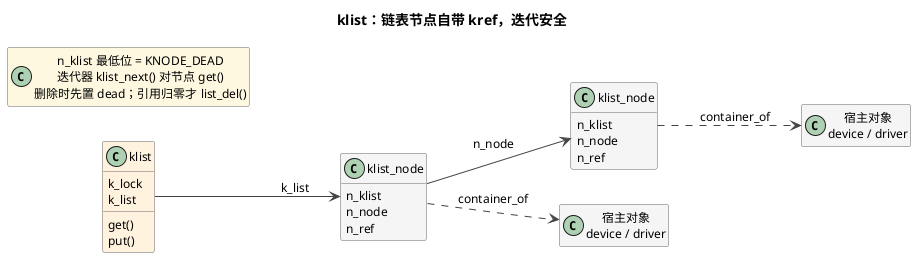

*结构图：`klist_node` 内嵌 `kref`；迭代器持有引用期间，即使节点被 `klist_del()` 也不会立即释放。*

`n_klist` 的最低 bit 是 `KNODE_DEAD` 标志，迭代器通过 `knode_dead()` 跳过已删除节点。

#### 2.7.3 图解：生命周期

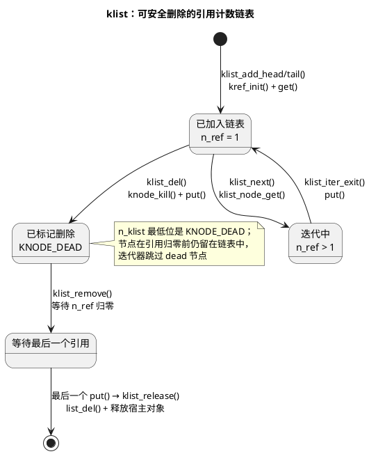

*图 2-7：`klist_add_*()` 初始化 `kref=1` 并调用 `get`；迭代器 `klist_next()` 增加引用；`klist_del()` 置 dead 并 `put`，最后一个引用释放时 `klist_release()` 才真正 `list_del()`；`klist_remove()` 等待引用归零。*

#### 2.7.4 核心 API

```c
void klist_init(struct klist *k, void (*get)(struct klist_node *),
                void (*put)(struct klist_node *));
void klist_add_head(struct klist_node *n, struct klist *k);
void klist_add_tail(struct klist_node *n, struct klist *k);
void klist_add_before(struct klist_node *n, struct klist_node *pos);
void klist_add_behind(struct klist_node *n, struct klist_node *pos);

void klist_del(struct klist_node *n);     /* 标记删除，异步释放 */
void klist_remove(struct klist_node *n);  /* 等待所有引用释放 */

int klist_node_attached(struct klist_node *n);

void klist_iter_init(struct klist *k, struct klist_iter *i);
void klist_iter_init_node(struct klist *k, struct klist_iter *i,
                          struct klist_node *n);
void klist_iter_exit(struct klist_iter *i);
struct klist_node *klist_next(struct klist_iter *i);
struct klist_node *klist_prev(struct klist_iter *i);
```

典型用户：`drivers/base/core.c` 的 `klist_children`、`drivers/base/class.c` 的 `klist_class_dev_get/put`、`drivers/base/attribute_container.c` 等。

---

## 3. 树结构

### 3.1 红黑树 (rb_node)

#### 3.1.1 概述

红黑树是一种自平衡二叉查找树，Linux 内核使用它来管理需要有序存储的数据。红黑树的特性保证插入、删除和查找操作的时间复杂度均为 O(log n)。内核中红黑树的实现不包含搜索和插入逻辑（这些由使用者实现），只提供颜色管理和平衡旋转等核心操作。

**内核实现 vs 传统实现的差异**

内核红黑树采用**分离式接口**设计：将"查找插入位置"（由调用者负责）和"插入后平衡修复"（由内核负责）明确分开。这与传统库（如 C++ STL `std::map`）的封装式设计不同。

| 特性           | 内核实现 (分离式)                                                                       | 传统实现 (封装式, 如 `std::map`)                |
| -------------- | --------------------------------------------------------------------------------------- | ------------------------------------------------- |
| 插入流程       | 两步：① 调用者用 while 循环找位置并 `rb_link_node`；② 调用 `rb_insert_color` 修复 | 一步：`map.insert(key, value)` 内部完成全部操作 |
| 比较逻辑       | 调用者用自定义 `if/else` 实现，可嵌入复杂逻辑（如区间匹配、模糊查找）                 | 通过模板比较器或 `operator<`，固定为全序比较    |
| 查找策略       | 完全自定义，可支持非标准查找（如查找最接近的、查找范围）                                | 固定为精确查找或 `lower_bound`/`upper_bound`  |
| 对调用者的要求 | 必须理解红黑树插入语义，否则可能跳过 `rb_insert_color` 导致树不平衡                   | 无需了解内部实现                                  |
| 优点           | 灵活可控，适合需要特殊查找逻辑的场景（如内核 VMA 查找：按地址区间匹配）                 | 使用简单、安全，不易出错                          |
| 缺点           | 容易出错（忘记平衡修复、比较逻辑错误），代码模板化重复                                  | 灵活性不足，不适合需要自定义查找策略的场景        |

#### 3.1.2 红黑树性质

1. 每个节点是红色或黑色
2. 根节点是黑色
3. 所有叶子节点（NIL）是黑色
4. 红色节点的两个子节点都是黑色（即不能有连续红色节点）
5. 从任一节点到其每个叶子节点的所有路径包含相同数量的黑色节点

#### 3.1.3 核心数据结构

```c
// include/linux/rbtree.h
struct rb_node {
    unsigned long  __rb_parent_color;  // 父节点指针和颜色编码（低2位）
    struct rb_node *rb_right;
    struct rb_node *rb_left;
} __attribute__((aligned(sizeof(long))));

struct rb_root {
    struct rb_node *rb_node;
};
```

**节点结构与关键字段**

| 字段                           | 类型                 | 作用                                                                 |
| ------------------------------ | -------------------- | -------------------------------------------------------------------- |
| `__rb_parent_color`          | `unsigned long`    | 父节点指针（高位）+ 颜色（最低位）；`rb_parent()` 屏蔽低位取父指针 |
| `rb_left`                    | `struct rb_node *` | 左子节点                                                             |
| `rb_right`                   | `struct rb_node *` | 右子节点                                                             |
| `rb_root.rb_node`            | `struct rb_node *` | 根节点指针；空树为 `NULL`                                          |
| `rb_root_cached.rb_leftmost` | `struct rb_node *` | 缓存最左节点，使 `rb_first()` 为 O(1)                              |

**链接图**

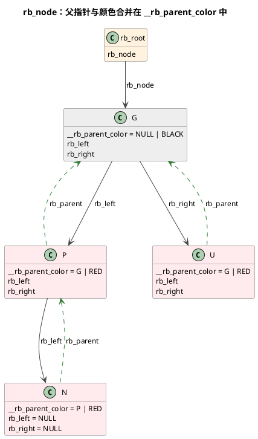

*结构图：红黑树节点通过 `rb_left`/`rb_right` 组织成二叉搜索树，虚线是编码在 `__rb_parent_color` 中的父指针；节点颜色也放在该字段最低位。*

**关键设计**：`__rb_parent_color` 字段将父节点指针和颜色标志位编码在一个 `unsigned long` 中。由于 `rb_node` 按 `sizeof(long)` 对齐，地址的低 2 位始终为 0，可用于存储颜色信息（红/黑）。

#### 3.1.4 辅助宏和内联函数

```c
// 获取父节点指针（屏蔽低2位）
#define rb_parent(r)   ((struct rb_node *)((r)->__rb_parent_color & ~3))

// 获取/设置颜色
#define rb_color(r)     __rb_color((r)->__rb_parent_color)
#define rb_is_red(r)    __rb_is_red((r)->__rb_parent_color)
#define rb_is_black(r)  __rb_is_black((r)->__rb_parent_color)
#define rb_set_red(r)   __rb_set_red(&(r)->__rb_parent_color)
#define rb_set_black(r) __rb_set_black(&(r)->__rb_parent_color)

// 设置父节点
static inline void rb_link_node(struct rb_node *node, struct rb_node *parent,
                                struct rb_node **rb_link)
{
    node->__rb_parent_color = (unsigned long)parent;
    node->rb_left = node->rb_right = NULL;
    *rb_link = node;
}
```

#### 3.1.5 核心操作函数

**插入后颜色修复**

```c
extern void rb_insert_color(struct rb_node *, struct rb_root *);
```

插入新节点后，调用 `rb_insert_color` 修复红黑树性质。该函数在 `lib/rbtree.c` 中实现，主要处理以下情况：

- 叔节点为红色：颜色翻转
- 叔节点为黑色：旋转操作

**删除操作**

```c
extern void rb_erase(struct rb_node *, struct rb_root *);
```

**增强删除**（缓存了最左节点，适用于频繁删除场景）

```c
extern void rb_erase_cached(struct rb_node *node, struct rb_root_cached *root);
```

#### 3.1.6 查找和遍历

```c
// 查找树中最左边的节点（最小值）
static inline struct rb_node *rb_first(const struct rb_root *root)
{
    struct rb_node *n = root->rb_node;
    if (!n)
        return NULL;
    while (n->rb_left)
        n = n->rb_left;
    return n;
}

// 查找后继节点（中序遍历的下一个）
static inline struct rb_node *rb_next(const struct rb_node *node)
{
    struct rb_node *parent;
    if (node->rb_right) {
        node = node->rb_right;
        while (node->rb_left)
            node = node->rb_left;
        return (struct rb_node *)node;
    }
    while ((parent = rb_parent(node)) && node == parent->rb_right)
        node = parent;
    return parent;
}

// 查找前驱节点
static inline struct rb_node *rb_prev(const struct rb_node *node)
{
    // ... 对称实现
}
```

#### 3.1.7 插入与删除的平衡原理

**插入平衡（`rb_insert_color`）**

插入新节点时，新节点总是被着色为红色。然后根据父节点和叔节点的颜色进行修复：

```
Case 1: 父节点是黑色
        → 直接插入，无需修复（红黑树性质仍满足）

Case 2: 父节点是红色，叔节点是红色
        → 颜色翻转：将父节点和叔节点变黑，祖父节点变红
        → 递归检查祖父节点（可能产生新的冲突）

Case 3: 父节点是红色，叔节点是黑色（LL / LR / RL / RR 型）
        → 旋转操作，消除连续红色节点
        ┌──────────────────────────────────────────────┐
        │  插入场景        旋转类型        操作          │
        ├──────────────────────────────────────────────┤
        │  父是左子，新是左子  LL → 右旋祖父节点        │
        │  父是左子，新是右子  LR → 先左旋父，再右旋祖父 │
        │  父是右子，新是右子  RR → 左旋祖父节点        │
        │  父是右子，新是左子  RL → 先右旋父，再左旋祖父 │
        └──────────────────────────────────────────────┘
```

**删除平衡（`rb_erase`）**

删除节点时，如果删除的节点是黑色，会破坏红黑性质 5（黑色路径长度相等）。修复函数通过以下方式恢复平衡：

```
Case 1: 兄弟节点是红色
        → 将兄弟变黑，父变红，旋转父节点
        → 转化为兄弟是黑色的情况

Case 2: 兄弟节点是黑色，兄弟的两个子节点都是黑色
        → 将兄弟变红，问题向上推给父节点

Case 3: 兄弟节点是黑色，兄弟的左子是红色，右子是黑色
        → 将兄弟变红，左子变黑，右旋兄弟节点
        → 转化为 Case 4

Case 4: 兄弟节点是黑色，兄弟的右子是红色
        → 将兄弟设为父的颜色，父变黑，兄弟右子变黑，左旋父节点
        → 修复完成
```

**图解：插入修复的循环与旋转**

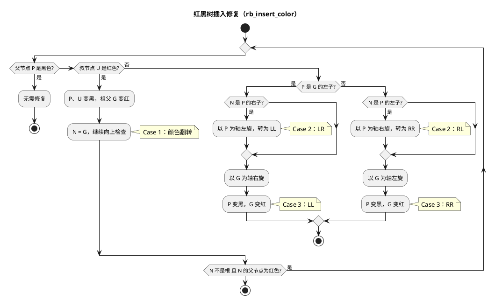

*图 3-1：Case 1 颜色翻转后把 `N` 上移到祖父继续检查；Case 2/3 通过一次或两次旋转结束修复。*

**图解：删除修复的四种情形**

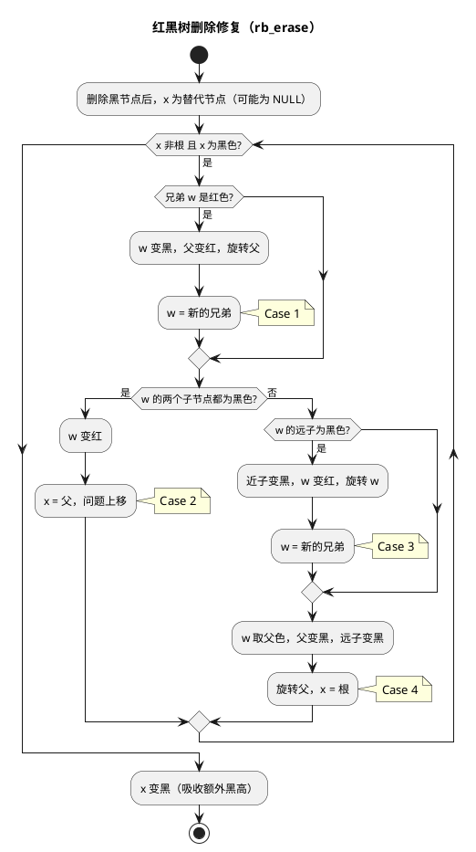

*图 3-2：删除黑节点后，`x` 带有"额外一重黑高"；Case 1 转化为兄弟为黑，Case 2 上移，Case 3 转化为 Case 4，Case 4 结束。*

#### 3.1.8 完整 API 参考

| 函数/宏                                    | 功能           | 时间复杂度 |
| ------------------------------------------ | -------------- | ---------- |
| `rb_insert_color(node, root)`            | 插入后修复颜色 | O(log n)   |
| `rb_erase(node, root)`                   | 删除节点       | O(log n)   |
| `rb_erase_cached(node, root)`            | 从缓存根中删除 | O(log n)   |
| `rb_link_node(node, parent, rb_link)`    | 链接节点到树中 | O(1)       |
| `rb_replace_node(old, new, root)`        | 替换节点       | O(1)       |
| `rb_replace_node_cached(old, new, root)` | 在缓存根中替换 | O(1)       |
| `rb_first(root)`                         | 查找最小值     | O(log n)   |
| `rb_last(root)`                          | 查找最大值     | O(log n)   |
| `rb_next(node)`                          | 查找后继节点   | O(1) avg   |
| `rb_prev(node)`                          | 查找前驱节点   | O(1) avg   |
| `rb_find(addr, root, cmp)`               | 二叉查找       | O(log n)   |
| `rb_find_add(node, root, cmp)`           | 查找并插入     | O(log n)   |
| `rb_add(node, root, cmp)`                | 简单插入       | O(log n)   |
| `rb_add_cached(node, root, less)`        | 插入到缓存根   | O(log n)   |
| `rb_first_postorder(root)`               | 后序遍历第一个 | O(log n)   |
| `rb_next_postorder(node)`                | 后序遍历下一个 | O(1)       |
| `rb_entry(ptr, type, member)`            | 获取宿主结构体 | O(1)       |
| `RB_EMPTY_ROOT(root)`                    | 判断树是否为空 | O(1)       |
| `RB_CLEAR_NODE(node)`                    | 清除节点状态   | O(1)       |
| `rbtree_postorder_for_each_entry_safe`   | 安全后序遍历   | O(n)       |

#### 3.1.9 增强根节点

```c
// 缓存最左节点（最小值），加速某些场景
struct rb_root_cached {
    struct rb_node *rb_node;
    struct rb_node *rb_leftmost;
};
```

#### 3.1.10 完整使用示例

```c
#include <linux/rbtree.h>
#include <linux/slab.h>
#include <linux/printk.h>

// 定义需要按 key 排序的结构体
struct my_node {
    u32 key;
    struct rb_node node;  // 嵌入 rb_node
};

// 插入（标准模式）
int my_insert(struct rb_root *root, struct my_node *new)
{
    struct rb_node **link = &root->rb_node;
    struct rb_node *parent = NULL;
    struct my_node *entry;

    while (*link) {
        parent = *link;
        entry = rb_entry(parent, struct my_node, node);
        if (new->key < entry->key)
            link = &parent->rb_left;
        else if (new->key > entry->key)
            link = &parent->rb_right;
        else
            return -EEXIST;  // 键已存在
    }
    rb_link_node(&new->node, parent, link);
    rb_insert_color(&new->node, root);
    return 0;
}

// 插入（使用辅助宏 rb_add，更简洁）
static bool my_less(struct rb_node *a, const struct rb_node *b)
{
    return rb_entry(a, struct my_node, node)->key <
           rb_entry(b, struct my_node, node)->key;
}

int my_insert_simple(struct rb_root *root, struct my_node *new)
{
    struct rb_node *dup = rb_add(&new->node, root, my_less);
    if (dup)
        return -EEXIST;  // 重复键
    return 0;
}

// 查找
struct my_node *my_search(struct rb_root *root, u32 key)
{
    struct rb_node *node = root->rb_node;
    while (node) {
        struct my_node *entry = rb_entry(node, struct my_node, node);
        if (key < entry->key)
            node = node->rb_left;
        else if (key > entry->key)
            node = node->rb_right;
        else
            return entry;
    }
    return NULL;
}

// 查找（使用 rb_find 辅助函数）
static int my_cmp(const void *key, const struct rb_node *node)
{
    u32 k = *(u32 *)key;
    struct my_node *entry = rb_entry(node, struct my_node, node);
    if (k < entry->key) return -1;
    if (k > entry->key) return 1;
    return 0;
}

struct my_node *my_search_v2(struct rb_root *root, u32 key)
{
    struct rb_node *node = rb_find(&key, root, my_cmp);
    return node ? rb_entry(node, struct my_node, node) : NULL;
}

// 中序遍历（按 key 升序）
void my_print_all(struct rb_root *root)
{
    struct rb_node *node;
    for (node = rb_first(root); node; node = rb_next(node)) {
        struct my_node *entry = rb_entry(node, struct my_node, node);
        pr_info("key=%u\n", entry->key);
    }
}

// 删除
void my_delete(struct rb_root *root, u32 key)
{
    struct my_node *entry = my_search(root, key);
    if (entry) {
        rb_erase(&entry->node, root);
        kfree(entry);
    }
}
```

#### 3.1.11 应用场景

- **CFS 调度器**：用红黑树管理可运行进程，以 `vruntime` 为键值，每次选择 `vruntime` 最小的进程运行
- **内存管理**：VMA（虚拟内存区域）管理，以地址为键值实现快速查找
- **文件系统**：inode 缓存管理
- **网络子系统**：TCP 连接管理、路由表

---

### 3.2 基数树 (Radix Tree)

#### 3.2.1 概述

基数树（Radix Tree，又称 Patricia Trie）是一种按位索引的压缩树结构。它通过将键值按位拆分，构建多级树来高效管理稀疏的整数索引映射。在内核中，基数树曾被广泛用于**页缓存管理**和 **IDR 分配器**，但在现代内核中已被 XArray 替代。

#### 3.2.2 核心数据结构

```c
// include/linux/radix-tree.h (历史实现)
struct radix_tree_root {
    spinlock_t              xa_lock;     // 与 XArray 兼容
    gfp_t                   gfp_mask;
    struct radix_tree_node  *rnode;      // 根节点指针
};

struct radix_tree_node {
    unsigned char   shift;       // 当前节点对应的偏移位数
    unsigned char   offset;      // 在父节点中的 slot 索引
    unsigned int    count;       // 非空子节点计数
    union {
        struct list_head private_list;  // 内部节点链表
        struct rcu_head rcu_head;       // RCU 回收
    };
    void __rcu      *slots[RADIX_TREE_MAP_SIZE];  // 子节点指针数组（64个）
    unsigned long    tags[RADIX_TREE_MAX_TAGS][BITS_TO_LONGS(RADIX_TREE_MAP_SIZE)];
};
```

**节点结构与关键字段**

| 字段                         | 类型                         | 作用                                                     |
| ---------------------------- | ---------------------------- | -------------------------------------------------------- |
| `shift`                    | `unsigned char`            | 当前节点对应的索引位偏移；根节点最大，叶节点为 0         |
| `offset`                   | `unsigned char`            | 本节点在父节点 `slots[]` 中的下标                      |
| `count`                    | `unsigned int`             | 非空子项计数，用于判断节点是否为空                       |
| `slots[64]`                | `void __rcu *`             | 64 个槽位：内部节点指针或条目指针；低位编码内部节点      |
| `tags[3][1]`               | `unsigned long`            | 每个 slot 的标记位（脏、回写等），用于快速查找带标记条目 |
| `radix_tree_root.rnode`    | `struct radix_tree_node *` | 根节点；空树为 `NULL`                                  |
| `radix_tree_root.gfp_mask` | `gfp_t`                    | 节点分配标志                                             |

**链接图**

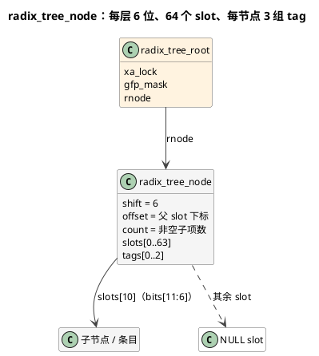

*结构图：`radix_tree_root` 指向根节点；每个节点有 64 个 slot，按索引的 6 位一段向下；`tags` 与 `slots` 平行，记录每个槽位的标记。*

#### 3.2.3 关键设计

- **层级结构**：每层处理 6 位（`RADIX_TREE_MAP_SHIFT = 6`），即每个节点有 64 个 slot
- **标记系统**：每个节点维护 tags 位图，用于标记页面的脏、回写等状态
- **RCU 安全**：支持 RCU 无锁读取

**图解：按索引位逐层下降**

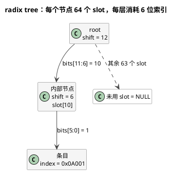

*图 3-3：插入索引 `0x0A001` 时，按每 6 位一段从根向下创建内部节点，最后把条目放到叶 slot；未使用的 slot 保持 `NULL`，因此稀疏索引不会浪费整棵子树。*

#### 3.2.4 历史地位

基数树是 XArray 的前身，XArray 保留了其多级树的核心结构，但提供了更简洁的 API 和更好的 RCU 安全保证。在 Linux 4.20+ 内核中，`address_space.i_pages` 已从 `radix_tree_root` 迁移为 `struct xarray`。

#### 3.2.5 应用场景

- **页缓存**：管理文件页的索引（已被 XArray 替代）
- **IDR 分配器**：整数 ID 到指针的映射（已被 XArray 替代）

---

### 3.3 Maple Tree

#### 3.3.1 概述

Maple Tree 是 Linux 6.1+ 引入的、为**范围查询优化**的 B-Tree 变体，正在逐步替代红黑树和基数树，用于管理进程地址空间的 VMA。其核心优势在于范围查找效率更高，且天然支持 RCU 无锁读取。

**Maple Tree vs 红黑树（传统范围管理方式）的差异**

| 特性          | Maple Tree                             | 红黑树                           |
| ------------- | -------------------------------------- | -------------------------------- |
| 存储单元      | 区间 `[start, last]`                 | 单点 `key → value`            |
| 范围查找      | 直接区间匹配 O(log n)                  | 需要遍历找到包含该地址的节点     |
| 区间插入/删除 | 天然支持，可合并/分割区间              | 需要额外逻辑处理区间重叠         |
| 节点扇出      | 每个节点多个 slot（类似 B-Tree）       | 每个节点 1 个元素                |
| 树高度        | 较低（大扇出）                         | 较高（二叉）                     |
| RCU 安全      | 内建支持                               | 需要外部 RCU 保护                |
| 空间局部性    | 好（节点内连续存储）                   | 差（分散的节点分配）             |
| 优点          | 范围操作高效，RCU 安全，缓存友好       | 实现简单成熟，理论验证充分       |
| 缺点          | 实现复杂，较新（6.1+），工具链支持有限 | 范围操作需要额外逻辑，内存碎片化 |

#### 3.3.2 核心数据结构

```c
// include/linux/maple_tree.h
struct maple_tree {
    spinlock_t ma_lock;       // 保护树的锁
    unsigned int ma_flags;    // 标志位
    void __rcu *ma_root;      // 根节点（RCU 保护）
};

// 内部节点结构（简化）
struct maple_node {
    unsigned long type;       // 节点类型（叶/内部）
    struct maple_metadata *parent;
    union {
        struct {
            struct maple_slot *slots;  // 子节点 slot 数组
            unsigned long *pivots;     // 区间分割点
        };
        struct {
            void *data;                // 叶节点数据
            unsigned long end;         // 区间结束
        };
    };
};
```

**节点结构与关键字段**

| 字段                            | 类型                     | 作用                        |
| ------------------------------- | ------------------------ | --------------------------- |
| `maple_tree.ma_lock`          | `spinlock_t`           | 保护写操作                  |
| `maple_tree.ma_flags`         | `unsigned int`         | 树标志（如分配范围模式）    |
| `maple_tree.ma_root`          | `void __rcu *`         | 根节点；低位编码节点类型    |
| `ma_state.index` / `last`   | `unsigned long`        | 当前操作区间的起点/终点     |
| `ma_state.node`               | `struct maple_enode *` | 当前节点（编码指针）        |
| `ma_state.min` / `max`      | `unsigned long`        | 当前节点覆盖的最小/最大索引 |
| `ma_state.depth` / `offset` | `unsigned char`        | 下降深度 / 节点内槽位       |
| 内部节点 `pivots[]`           | `unsigned long`        | 区间分割点                  |
| 内部节点 `slots[]`            | `void *`               | 子节点或区间条目            |
| 叶节点 `[start, last]`        | `unsigned long`        | 该条目覆盖的区间            |

**链接图**

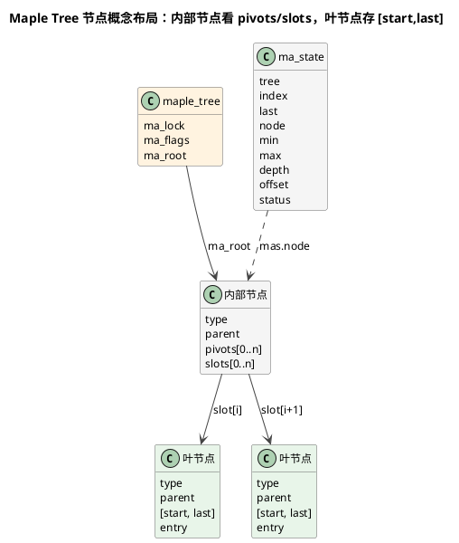

*结构图：内部节点用 `pivots[]` 划分范围、`slots[]` 指向子节点/条目；叶条目直接保存 `[start, last]`。`ma_state` 是遍历/写入时的游标。*

#### 3.3.3 核心操作

```c
// 初始化
void mt_init(struct maple_tree *mt);
#define MT_FLAGS_ALLOC_RANGE  // 启用 IDA 风格分配

// 查找
void *mt_find(struct maple_tree *mt, unsigned long *index, unsigned long max);
void *mt_find_after(struct maple_tree *mt, unsigned long *index, unsigned long max);

// 区间存储（核心优势）
int mt_store_range(struct maple_tree *mt, unsigned long start,
                   unsigned long last, void *entry, gfp_t gfp);

// 单点操作
int mt_insert(struct maple_tree *mt, unsigned long index, void *entry, gfp_t gfp);
void *mt_erase(struct maple_tree *mt, unsigned long index);

// 遍历
void *mt_first(struct maple_tree *mt, unsigned long *index);
void *mt_next(struct maple_tree *mt, void *entry, unsigned long max);
void *mt_last(struct maple_tree *mt, unsigned long *index);
void *mt_prev(struct maple_tree *mt, void *entry, unsigned long min);

// 区间操作
void *mt_find_range(struct maple_tree *mt, unsigned long *start,
                    unsigned long *last, unsigned long min, unsigned long max);
void *mt_find_within(struct maple_tree *mt, struct ma_state *mas,
                     unsigned long *index, unsigned long *last, unsigned long min, unsigned long max);

// 遍历宏
#define mt_for_each(mt, entry, index, max)  // 遍历所有条目
#define mas_for_each(mas, entry, max)       // 使用 maple state 遍历

// 分配 ID（IDA 风格）
int mt_alloc_range(struct maple_tree *mt, unsigned long *start,
                   unsigned long *last, unsigned long min, unsigned long max, gfp_t gfp);
int mt_alloc_cyclic(struct maple_tree *mt, unsigned long *start,
                    unsigned long *last, unsigned long min, unsigned long max, gfp_t gfp);
```

#### 3.3.4 原理细节：B-Tree 风格的区间管理

Maple Tree 的核心创新在于将 B-Tree 的区间管理能力与 RCU 安全结合：

**节点结构**

```
每个内部节点有 2 个关键数组：
  pivots[] = [10, 30, 60, MAX]         ← 区间分割点
  slots[]  = [child0, child1, ...]     ← 对应子节点

查找地址 25 的过程：
  pivots[0]=10, pivots[1]=30 → 25 在 (10, 30] 之间 → 进入 slot[1]
```

**范围存储而非单点**

传统红黑树存储的是单个键值对，存储一个区间 `[start, end]` 需要两个节点或特殊处理。Maple Tree 天然支持以区间为单元的存储和查找：

```
红黑树：  key=0x1000 → 指向 VMA1
         key=0x2000 → 指向 VMA2

Maple Tree:  range [0x1000, 0x1FFF] → VMA1
             range [0x2000, 0x3FFF] → VMA2
```

这意味着查找 `addr=0x1500` 时，红黑树需要遍历找到包含该地址的节点，而 Maple Tree 直接用区间匹配即可。

**RCU 无锁读取**

- 写操作通过 COW（Copy-on-Write）方式更新节点
- 读操作在 RCU 临界区内可以直接访问旧版本或新版本
- 节点回收通过 RCU 回调延迟释放

**图解：区间查找与 pivots**

```plantuml
@startuml
title Maple Tree：pivots 划分区间，叶子直接保存 [start, last] 条目
top to bottom direction
skinparam defaultFontName WenQuanYi Zen Hei
skinparam defaultFontSize 12
skinparam ArrowColor #444444
skinparam class {
  BackgroundColor #F5F5F5
  BorderColor #666666
  RoundCorner 8
}
hide empty members

class "根节点" as root {
  pivots: 10 | 30 | MAX
  slots: 0 | 1 | 2
}
class "[0, 9]\nVMA1" as v0
class "[10, 29]\nVMA2" as v1
class "[30, MAX]\nVMA3" as v2

root --> v0 : addr < 10
root --> v1 : 10 ≤ addr < 30
root --> v2 : addr ≥ 30

class "查找 addr=25：\n25 落在 pivot[1]=30 之前、pivot[0]=10 之后\n→ 进入 slot[1]，返回 VMA2\n\n插入/删除导致区间变化时，\n分裂或合并叶子并更新 pivots" as note1 #FFF8E1
@enduml
```

*图 3-4：内部节点的 `pivots[]` 划分地址范围，`slots[]` 指向子节点或区间条目；查找 `addr=25` 时只需在 pivots 中定位到 `slot[1]`。区间变化时分裂/合并叶子并更新 pivots。*

#### 3.3.5 完整使用示例

```c
#include <linux/maple_tree.h>
#include <linux/slab.h>
#include <linux/printk.h>

// 定义 Maple Tree（VMA 管理场景）
static struct maple_tree vma_tree;
static DEFINE_SPINLOCK(vma_lock);

// 初始化
void vma_init(void)
{
    mt_init(&vma_tree);
}

// 添加 VMA 映射（区间映射）
int vma_add(unsigned long start, unsigned long end, void *vma)
{
    int ret;

    // 加锁保护写操作
    mas_lock(&vma_tree);
    ret = mt_store_range(&vma_tree, start, end - 1, vma, GFP_KERNEL);
    mas_unlock(&vma_tree);
    return ret;
}

// 查找某个地址所属的 VMA
void *vma_find(unsigned long addr)
{
    unsigned long index = addr;
    void *entry;

    // RCU 读锁保护
    rcu_read_lock();
    entry = mt_find(&vma_tree, &index, ULONG_MAX);
    rcu_read_unlock();
    return entry;
}

// 删除 VMA
void *vma_remove(unsigned long addr)
{
    void *entry;

    mas_lock(&vma_tree);
    entry = mt_erase(&vma_tree, addr);
    mas_unlock(&vma_tree);
    return entry;
}

// 遍历所有 VMA 区间
void vma_dump_all(void)
{
    unsigned long index = 0;
    void *entry;

    rcu_read_lock();
    mt_for_each(&vma_tree, entry, index, ULONG_MAX) {
        pr_info("vma at %lx\n", index);
    }
    rcu_read_unlock();
}
```

#### 3.3.6 应用场景

- **VMA 管理**：`mm_struct` 中的 `mm_mt` 字段，替代了旧的红黑树实现
- **地址空间区间查找**：快速查找某个地址所属的 VMA

---

### 3.4 B树变体

#### 3.4.1 概述

B-Tree（及其变体 B+Tree）是文件系统和存储场景的核心数据结构。与红黑树每个节点仅存一个键值不同，B-Tree 每个节点可以包含多个键值，具有很大的扇出（fanout），大幅减少树的高度和磁盘 I/O 次数。

**B-Tree 与 B+Tree 的核心区别**

| 特性         | B-Tree                             | B+Tree                               |
| ------------ | ---------------------------------- | ------------------------------------ |
| 数据存储     | 内部节点和叶节点都存储数据         | 仅叶节点存储数据，内部节点只存键     |
| 键的冗余     | 键不重复，每个键唯一存在           | 键在内部节点中冗余，叶节点包含所有键 |
| 叶节点链表   | 无                                 | 叶节点形成双向链表，支持范围扫描     |
| 内部节点扇出 | 较小（因为要存数据指针）           | 更大（只存键，节点可容纳更多条目）   |
| 范围查询     | 需中序遍历，跨节点复杂             | 叶节点链表顺序扫描，高效             |
| 查找稳定性   | 任何节点找到即返回，不稳定         | 必须到叶节点，路径长度恒定           |
| 空间利用率   | 较差（节点分裂后内部节点可能空闲） | 更好（内部节点只存键，密度高）       |

**内核 B-Tree 变体的设计权衡**

内核中 B-Tree 变体的设计遵循一个核心原则：**根据数据访问模式选择最合适的 B-Tree 形态**。具体来说：

- **磁盘 vs 内存**：磁盘场景追求高扇出（4K 大节点）以减少 I/O 次数；内存场景追求缓存友好（小节点 128~256 字节）
- **写时复制 vs 原地更新**：COW 变体（Btrfs）支持快照和事务回滚，但写放大更大；原地更新（Ext4 Htree、XFS）写放大较小
- **通用 vs 专用**：通用实现（`lib/btree.c`、XFS On-Disk）需要适配多种场景，灵活性高但优化空间有限；专用实现（XFS In-Core Extent）针对特定场景极致优化
- **哈希 vs 有序**：Ext4 Htree 用哈希值作为键，查找快但无法范围查询；有序 B+Tree 支持范围扫描和顺序访问

内核中出现了多种 B-Tree 变体实现，各有侧重。

#### 3.4.2 内核 B-Tree 变体分类

| 变体                         | 位置                                         | 用途               | 核心特点                                                            |
| ---------------------------- | -------------------------------------------- | ------------------ | ------------------------------------------------------------------- |
| **通用 B+Tree**        | `lib/btree.c` — `include/linux/btree.h` | 通用的内存 B+Tree  | 纯内存实现，支持 u32/u64/128bit 键，基于 mempool 的节点分配         |
| **Btrfs COW B-Tree**   | `fs/btrfs/`                                | 文件系统元数据管理 | **Copy-on-Write** 写时复制，支持事务、快照，节点大小 4K~64K   |
| **Ext4 Htree**         | `fs/ext4/namei.c`                          | 目录项索引         | 哈希 B-Tree 变体，将文件名哈希为键，最多 2 层                       |
| **XFS In-Core B+Tree** | `fs/xfs/libxfs/xfs_iext_tree.c`            | 内存中 extent 映射 | 专用 B+Tree，节点大小 256 字节，叶节点形成双向链表                  |
| **XFS On-Disk B+Tree** | `fs/xfs/libxfs/xfs_btree*.c`               | 通用磁盘 B+Tree    | 通用 B+Tree 框架，支持多种类型（inode、空闲空间、映射、引用计数等） |

#### 3.4.3 通用 B+Tree 实现（`lib/btree.c`）

##### 3.4.3.1 概述

`lib/btree.c` 提供了一种**纯内存**的通用 B+Tree 实现，用于需要稀疏地址空间查找的场景。它通过 `btree_geo`（几何结构）定义键长度和每节点条目数，支持 32 位、64 位和 128 位键。

##### 3.4.3.2 核心数据结构

```c
// include/linux/btree.h

// B+Tree 句柄
struct btree_head {
    unsigned long *node;      // 根节点指针
    mempool_t *mempool;       // 节点分配内存池
    int height;               // 树高度
};

// 几何结构（定义键长和扇出）
struct btree_geo {
    int keylen;               // 键长（unsigned long 为单位）
    int no_pairs;             // 每个节点的键值对数量
    int no_longs;             // 节点中 key 区域占用的 unsigned long 数
};

// 预定义几何结构
extern struct btree_geo btree_geo32;   // 32 位键
extern struct btree_geo btree_geo64;   // 64 位键
extern struct btree_geo btree_geo128;  // 128 位键（2 × u64）
```

| 结构体/字段            | 作用                                                              |
| ---------------------- | ----------------------------------------------------------------- |
| `btree_head.node`    | 根节点指针；节点本身是一段 `unsigned long` 数组，不额外包结构体 |
| `btree_head.mempool` | 节点内存池；分裂/插入时从这里取新节点，避免在内存紧张时分配失败   |
| `btree_head.height`  | 树高；结合几何结构可算出从根到叶要下降多少层                      |
| `btree_geo.keylen`   | 键长（以 `unsigned long` 为单位），32/64/128 位键分别为 1/1/2   |
| `btree_geo.no_pairs` | 每个节点最多容纳的键值对数，决定扇出                              |
| `btree_geo.no_longs` | 每个节点占用的 `unsigned long` 总数，用于计算节点边界           |
| `btree_geo32/64/128` | 预定义几何结构，按键宽选择不同的节点布局                          |

节点内部布局见下一小节内嵌的 PlantUML 结构图。

##### 3.4.3.3 节点布局

```c
// 节点大小：max(L1_CACHE_BYTES, 128)，通常为 128 字节
// 以 64 位系统、btree_geo64 为例：
//   keylen = 1, no_pairs = NODESIZE / sizeof(long) / 2 = 8
//   每个节点 = 8 个 key + 8 个 val = 16 个 long = 128 字节

// 节点内部布局：
// [key1] [key2] ... [keyN] [val1] [val2] ... [valN]
//  key 区域：从 node[0] 到 node[no_longs-1]
//  val 区域：从 node[no_longs] 到 node[2*no_longs-1]
//  N = no_pairs = 8（每个节点最多 8 个键值对）

// 约定：最小键值在最右侧，未使用的槽填 NULL
// 查找时顺序遍历，遇到第一个 NULL 键终止
```

**节点结构与关键字段**

| 字段                   | 类型                | 作用                                |
| ---------------------- | ------------------- | ----------------------------------- |
| `btree_head.node`    | `unsigned long *` | 根节点；空树为 `NULL`             |
| `btree_head.mempool` | `mempool_t *`     | 节点内存池，保证内存压力下仍可分配  |
| `btree_head.height`  | `int`             | 树高；叶节点层为 0                  |
| `btree_geo.keylen`   | `int`             | 键长（以 `unsigned long` 为单位） |
| `btree_geo.no_pairs` | `int`             | 每个节点最多容纳的键值对数          |
| `btree_geo.no_longs` | `int`             | 节点中 key 区占用的 long 数         |
| 节点 `key[]`         | `unsigned long`   | 节点前半部分：排序键                |
| 节点 `val[]`         | `void *`          | 节点后半部分：键对应的值/子节点指针 |

**链接图**

```plantuml
@startuml
title lib/btree 节点布局：一个节点内先存 keys，再存 vals
left to right direction
skinparam defaultFontName WenQuanYi Zen Hei
skinparam defaultFontSize 12
skinparam ArrowColor #444444
skinparam class {
  BackgroundColor #F5F5F5
  BorderColor #666666
  RoundCorner 8
}
hide empty members

class "btree_head" as head #FFF3E0 {
  node
  mempool
  height
}
class "btree_geo" as geo {
  keylen
  no_pairs
  no_longs
}
class "节点（128 字节）" as nd {
  key[0]
  key[1]
  …
  key[no_pairs-1]
  val[0]
  val[1]
  …
  val[no_pairs-1]
}

head --> nd : node
geo ..> nd : 决定槽位数
@enduml
```

*结构图：`btree_head` 只有根指针、内存池和高度；节点是 `key[] + val[]` 的连续布局，没有父指针，分裂时由上层路径维护。*

##### 3.4.3.4 核心 API

```c
// 初始化/销毁
int btree_init(struct btree_head *head);                         // 创建内部 mempool
void btree_init_mempool(struct btree_head *head, mempool_t *mp); // 使用外部 mempool
void btree_destroy(struct btree_head *head);                     // 销毁 mempool

// 查找
void *btree_lookup(struct btree_head *head, struct btree_geo *geo,
                   unsigned long *key);                          // 精确查找
void *btree_last(struct btree_head *head, struct btree_geo *geo,
                 unsigned long *key);                            // 最后一个条目
void *btree_get_prev(struct btree_head *head, struct btree_geo *geo,
                     unsigned long *key);                        // 前一个条目

// 插入/删除
int btree_insert(struct btree_head *head, struct btree_geo *geo,
                 unsigned long *key, void *val, gfp_t gfp);      // 插入（键不能已存在）
int btree_update(struct btree_head *head, struct btree_geo *geo,
                 unsigned long *key, void *val);                 // 更新已有键的值
void *btree_remove(struct btree_head *head, struct btree_geo *geo,
                   unsigned long *key);                          // 删除

// 遍历
void btree_visit(struct btree_head *head, struct btree_geo *geo,
                 void (*func)(void *elem));                      // 遍历所有值

// 类型特化
#define btree_for_each_safe64(head, key, val)  // 安全遍历 64 位 B+Tree
```

##### 3.4.3.5 实现要点

```c
// lib/btree.c 核心逻辑

// 1. 查找（btree_lookup）：从根节点逐层向下
//    每层遍历所有键，找到第一个大于等于目标键的槽
//    叶节点中直接返回 val

// 2. 插入（btree_insert）：先查找到叶节点应插入位置
//    如果叶节点已满（no_pairs 个槽全满），则分裂：
//    a. 分配新节点
//    b. 将原节点后半部分键值对移到新节点
//    c. 在父节点中插入新键和指针
//    d. 如需分裂递归向上

// 3. 删除（btree_remove）：先找到目标条目
//    如果叶节点条目数低于阈值，尝试从兄弟节点借用或合并

// 键比较（longcmp）：逐 unsigned long 比较，支持多字键
static int longcmp(const unsigned long *l1, const unsigned long *l2, size_t n)
{
    for (size_t i = 0; i < n; i++) {
        if (l1[i] < l2[i]) return -1;
        if (l1[i] > l2[i]) return  1;
    }
    return 0;
}

// 辅助函数：获取节点中第 n 个键的指针
static unsigned long *bkey(struct btree_geo *geo, unsigned long *node, int n)
{
    return &node[n * geo->keylen];
}

// 辅助函数：获取节点中第 n 个值的指针
static void *bval(struct btree_geo *geo, unsigned long *node, int n)
{
    return (void *)node[geo->no_longs + n];
}
```

##### 3.4.3.6 注意点

- **无二分查找**：节点内使用线性扫描（`longcmp` 逐个比较），而非二分查找。文档注释明确说明 "we currently do not use binary search"，这是因为节点尺寸小（128 字节），线性扫描的缓存局部性更好
- **NULL 值不可存储**：lookup 返回 NULL 表示未找到，因此不能存储 NULL 指针
- **内存池**：节点通过 mempool 分配，保证在内存压力下仍能分配节点（可能阻塞等待）

**图解：B+Tree 叶节点分裂**

```plantuml
@startuml
title B+Tree 叶节点分裂：中间键提升到父节点
top to bottom direction
skinparam defaultFontName WenQuanYi Zen Hei
skinparam defaultFontSize 12
skinparam ArrowColor #444444
skinparam class {
  BackgroundColor #F5F5F5
  BorderColor #666666
  RoundCorner 8
}
hide empty members

package "分裂前：叶节点已满（8 个键）" as before {
  class "叶节点" as pb {
    k1
    k2
    k3
    k4
    k5
    k6
    k7
    k8
    next
  }
}
package "插入 k9 后：分裂为两个叶节点，k5 提升" as after {
  class "父节点" as pa {
    …
    k5
    …
  }
  class "左叶" as la {
    k1
    k2
    k3
    k4
    next
  }
  class "右叶" as lb {
    k5
    k6
    k7
    k8
    k9
    next
  }
}

pa --> la : ＜ k5
pa --> lb : ≥ k5
la ..> lb : 叶链
pb -[hidden]- pa
@enduml
```

*图 3-5：叶节点满后分裂为左右两半，中间键提升到父节点；叶节点之间仍用链表相连，范围扫描不穿越父节点。`lib/btree.c` 的分裂逻辑在此基础上递归向上。*

#### 3.4.4 Btrfs COW B-Tree

##### 3.4.4.1 概述

Btrfs 的 B-Tree 实现是最复杂的变体，其核心特点是 **Copy-on-Write（写时复制）**：每次修改节点时，不直接覆盖原节点，而是写入新的块，然后更新父节点指针。这为快照、事务回滚和数据校验提供了基础。

##### 3.4.4.2 核心数据结构

```c
// include/uapi/linux/btrfs_tree.h

// ---------- 键（Key） ----------
// 三元组 (objectid, type, offset) 唯一标识一条记录
struct btrfs_disk_key {
    __le64 objectid;     // 对象 ID（如 inode 号、块号）
    __u8   type;         // 键类型（如 INODE_ITEM、EXTENT_ITEM、DIR_ITEM）
    __le64 offset;       // 偏移量（如文件偏移、块组偏移）
} __attribute__ ((__packed__));

// 内存中的键（与磁盘格式一致，小端时无需转换）
struct btrfs_key {
    __u64 objectid;
    __u8  type;
    __u64 offset;
} __attribute__ ((__packed__));

// ---------- 树节点 ----------
// 所有树块（叶节点和非叶节点）以相同头部开始
struct btrfs_header {
    __u8  csum[BTRFS_CSUM_SIZE];         // 校验和
    __u8  fsid[BTRFS_FSID_SIZE];          // 文件系统 UUID
    __le64 bytenr;                        // 块物理地址
    __le64 flags;                         // 标志位
    __u8  chunk_tree_uuid[BTRFS_UUID_SIZE];
    __le64 generation;                    // 事务世代号
    __le64 owner;                         // 所属树根对象 ID
    __le32 nritems;                       // 条目数
    __u8  level;                          // 层级（0 = 叶节点）
} __attribute__ ((__packed__));

// 内部节点：键 + 指针数组
struct btrfs_key_ptr {
    struct btrfs_disk_key key;    // 子节点中最小键
    __le64 blockptr;              // 子节点块地址
    __le64 generation;            // 子节点世代号
} __attribute__ ((__packed__));

struct btrfs_node {
    struct btrfs_header header;
    struct btrfs_key_ptr ptrs[];  // 变长数组
} __attribute__ ((__packed__));

// 叶节点：条目数组（条目本身存储在数据区）
struct btrfs_item {
    struct btrfs_disk_key key;    // 条目键
    __le32 offset;                // 数据区偏移
    __le32 size;                  // 数据大小
} __attribute__ ((__packed__));

struct btrfs_leaf {
    struct btrfs_header header;
    struct btrfs_item items[];    // 变长数组
} __attribute__ ((__packed__));

// 叶节点布局：
// [item0][item1]...[itemN] [free space] [dataN]...[data1][data0]
//  item 区从头部向尾部增长
//  data 区从尾部向头部增长
//  item 中的 offset 指向数据区，size 标记数据大小

// ---------- 路径（Path）----------
// 搜索路径：从根到叶的完整路径，用于避免重复遍历
// fs/btrfs/ctree.h
struct btrfs_path {
    struct extent_buffer *nodes[BTRFS_MAX_LEVEL];  // 每层节点
    int slots[BTRFS_MAX_LEVEL];                    // 每层当前槽位
    u8 locks[BTRFS_MAX_LEVEL];                     // 锁定状态
    u8 reada;                                      // 预读策略
    u8 lowest_level;                               // 最低锁定层级
    // ... 其他标志位
};
```

| 结构体/字段                                      | 作用                                                                        |
| ------------------------------------------------ | --------------------------------------------------------------------------- |
| `btrfs_header.csum` / `fsid`                 | 块校验和与文件系统 UUID，用于识别和校验树块                                 |
| `btrfs_header.bytenr` / `generation`         | 本块物理地址与事务世代号；COW 时新块获得新地址和世代                        |
| `btrfs_header.owner` / `level` / `nritems` | 所属树根、层级（0 为叶）、条目数                                            |
| `btrfs_key_ptr.key` / `blockptr`             | 内部节点中：子节点最小键与子节点块地址                                      |
| `btrfs_item.key` / `offset` / `size`       | 叶节点中：条目键、数据区偏移、数据长度；item 区从头部增长，数据区从尾部增长 |
| `btrfs_path.nodes[]` / `slots[]`             | 缓存根到叶的路径和各层槽位，`btrfs_search_slot()` 沿路径下降并加锁        |

##### 3.4.4.3 树结构

```
Btrfs 文件系统包含多个 B-Tree，通过 btrfs_fs_info 管理：

  btrfs_fs_info
  ├── tree_root      → 根树（存储所有子卷的根节点信息）
  ├── chunk_root     → 块组树（逻辑块→物理块映射）
  ├── dev_root       → 设备树
  ├── fs_root        → 文件系统根（子卷入口）
  ├── csum_root      → 校验和树
  ├── extent_root    → 扩展分配树（空闲空间管理）
  ├── quota_root     → 配额树
  ├── uuid_root      → UUID 树
  ├── block_group_root → 块组树
  └── log_root_tree  → 日志树

每个 B-Tree 由 btrfs_root 管理：
  struct btrfs_root {
      struct extent_buffer *node;     // 根节点（内存中）
      struct btrfs_root_item root_item; // 根信息（磁盘格式）
      struct btrfs_key root_key;       // 根键
      // ...
  };
```

##### 3.4.4.4 核心操作：`btrfs_search_slot`

`btrfs_search_slot` 是 Btrfs B-Tree 最核心的查找函数，它从根节点出发沿路径向下搜索，找到目标键应该插入的位置。

```
btrfs_search_slot(trans, root, key, path, ins_len, cow)
  │
  ├─ 1. 从 root->node 开始，level = root_level
  │
  ├─ 2. 对每个层级：
  │     ├─ 如果 cow（写时复制），调用 btrfs_cow_block() 复制当前节点
  │     │  └─ 分配新 extent_buffer，复制旧数据，更新父节点指针
  │     ├─ 在节点中执行二分查找（btrfs_bin_search）
  │     │  └─ 找到第一个大于等于 key 的槽位，存入 slots[level]
  │     └─ 如果 level > 0（非叶节点）：
  │        ├─ 设置 path->nodes[level] = 当前节点
  │        ├─ 通过 ptrs[slot].blockptr 获取子节点块地址
  │        └─ 下降到下一层：level--
  │
  ├─ 3. 到达叶节点（level = 0）：
  │     ├─ path->nodes[0] = 叶节点
  │     ├─ path->slots[0] = 目标槽位
  │     └─ 返回：
  │        0  = 精确匹配（key 已存在）
  │        1  = 未匹配（slot 指向第一个大于 key 的条目，即插入位置）
  │
  └─ 4. 如果 ins_len > 0（插入操作），节点可能分裂：
        └─ btrfs_insert_empty_item() → 如果空间不足 → btrfs_split_item()
           └─ 分裂后递归向上插入新键/指针
```

##### 3.4.4.5 COW 写时复制机制

```c
// btrfs_cow_block 是 COW 的核心实现
// 当需要修改一个节点时，不直接覆盖原块，而是：
//
// 1. 分配一个新的 extent_buffer
// 2. 复制原节点内容到新节点
// 3. 在新节点上修改（原节点保持不变）
// 4. 更新父节点中的指针，指向新节点
// 5. 原节点等待被垃圾回收（当再无引用时）

// 这个机制带来的特性：
// - 快照（Snapshot）：只需复制根节点指针，即可获得整个树的快照
// - 事务回滚：未提交的修改只影响新节点，原数据完整保留
// - 数据校验：每次写入都计算 checksum，保证数据完整性

// 涉及的关键函数：
int btrfs_cow_block(struct btrfs_trans_handle *trans,
                    struct btrfs_root *root,
                    struct extent_buffer *buf,        // 原节点
                    struct extent_buffer *parent,     // 父节点
                    int parent_slot,                  // 在父节点中的槽位
                    struct extent_buffer **cow_ret,   // 输出：新节点
                    enum btrfs_lock_nesting nest);
```

##### 3.4.4.6 节点分裂过程

```
叶节点分裂示例（假设节点容量为 4 个条目）：

分裂前（叶节点已满）：
  [item1][item2][item3][item4]  ← 满
  [data1][data2][data3][data4]

分裂后：
  左叶节点：          [item1][item2]
                      [data1][data2]
  右叶节点：          [item3][item4]
                      [data3][data4]
  父节点中插入新键：  [key(item3)] → 指向右叶节点

如果父节点也满了，递归向上分裂，最终可能增加树高度。
```

##### 3.4.4.7 关键参数

```c
// 节点大小 = 文件系统块大小（通常 4K 或 16K）
// 节点扇出（每个非叶节点可容纳的子节点指针数）：
BTRFS_NODEPTRS_PER_BLOCK(info) = BTRFS_LEAF_DATA_SIZE(info) / sizeof(struct btrfs_key_ptr)
// 4K 块时：约 (4096 - sizeof(btrfs_header)) / sizeof(btrfs_key_ptr) ≈ (4096-93)/29 ≈ 138
// 即每个内部节点可以指向约 138 个子节点

// 树高度计算：
// 扇出 138，如果根节点是叶节点 → 高度 1
// 137^2 ≈ 19000 个条目 → 高度 2
// 137^3 ≈ 260 万个条目 → 高度 3
// 137^4 ≈ 3.6 亿个条目 → 高度 4
// 一般文件系统树的层级为 2~4 层
```

#### 3.4.5 Ext4 Htree（哈希树目录索引）

##### 3.4.5.1 概述

Ext4 的 Htree（Hash Tree）是一种**哈希 B-Tree 变体**，专门用于目录项的高效查找。它将文件名通过哈希函数转为哈希值，然后以哈希值作为键在 B-Tree 中索引，实现大规模目录下的 O(log N) 查找。

##### 3.4.5.2 核心数据结构

```c
// fs/ext4/namei.c

// Htree 索引块（根节点或中间节点）
struct dx_root {
    struct fake_dirent fake;              // 伪装成目录项（'.' 和 '..'）
    struct dx_root_info {
        __le32 reserved_zero;
        __u8 hash_version;                // 哈希函数版本（TEA/SIPHASH 等）
        __u8 info_length;                 // 信息长度
        __u8 indirect_levels;             // 间接层数（0 或 1）
        __u8 unused_flags;
    } info;
    struct dx_entry entries[];            // 索引条目数组
};

// 索引条目（一个槽位）
struct dx_entry {
    __le32 hash;                          // 哈希值（键）
    __le32 block;                         // 逻辑块号（值）
};

// 帧：搜索路径中的一层
struct dx_frame {
    struct buffer_head *bh;               // 索引块的缓冲区头
    struct dx_entry *entries;             // 条目数组起始
    struct dx_entry *at;                  // 当前命中的条目
};

// 校验和尾部（位于每个索引块末尾）
struct dx_tail {
    __u32 dt_reserved;
    __le32 dt_checksum;                   // CRC32C 校验和
};

// 内部节点（非根中间节点）
struct dx_node {
    struct fake_dirent fake;
    struct dx_entry entries[];
};

// 哈希信息
struct dx_hash_info {
    __u32 hash;                           // 当前哈希值
    __u32 minor_hash;                     // 次要哈希（用于 64 位哈希）
    // ...
};
```

| 结构体/字段                            | 作用                                                               |
| -------------------------------------- | ------------------------------------------------------------------ |
| `dx_root.info.indirect_levels`       | 索引层数；0 表示根块直接指向叶块，1 表示还有一层内部节点           |
| `dx_root.info.hash_version`          | 文件名哈希算法版本（TEA、SIPHASH 等），查找时按它重算哈希          |
| `dx_entry.hash` / `block`          | 哈希键与目标块号；条目数组按 `hash` 升序，支持二分查找           |
| `dx_node`                            | 非根内部节点，布局与根块类似，但没有 `dx_root_info` 和伪装目录项 |
| `dx_frame.bh` / `entries` / `at` | 搜索路径的一层：索引块缓冲、条目数组起点、当前命中条目             |
| `dx_tail.dt_checksum`                | 索引块末尾的 CRC32C 校验和（启用 metadata_csum 时）                |

##### 3.4.5.3 树结构

```
Htree 目录索引结构（最多 2 层）：

根块（block 0）：
  [fake dirent '.' 和 '..'] [dx_root_info] [dx_entry...]
  │                                                  │
  └─────── 指向叶块（或内部节点） ──────────────────┘
              │
              ↓
        叶块（存放实际目录项）：
          [ext4_dir_entry_2...] [ext4_dir_entry_2...]
          按哈希值排序存储

大目录时（超过 1 个块）：
  根块（1 层索引）→ 内部节点（2 层索引）→ 叶块

  实际中 htree 的 indirect_levels 通常为 0 或 1
  最多支持 EXT4_HTREE_LEVEL = 2 层索引
```

##### 3.4.5.4 查找过程：`dx_probe`

```c
// ext4_dx_find_entry → dx_probe → 二分查找索引条目

// dx_probe 实现要点：
// 1. 计算文件名哈希值：hash = dx_hack_hash(name, len)
// 2. 在根块的 dx_entry 数组中用二分查找定位目标条目
// 3. 如果 indirect_levels > 0，递归向下查找
// 4. 最终找到目标叶块，在其中线性搜索目录项

// 二分查找的关键代码：
p = entries + 1;
q = entries + count - 1;
while (p <= q) {
    m = p + (q - p) / 2;
    if (dx_get_hash(m) > hash)
        q = m - 1;
    else
        p = m + 1;
}
at = p - 1;  // 找到第一个不大于 hash 的条目
// 通过 at->block 获取目标叶块号
```

##### 3.4.5.5 分裂过程

```c
// ext4_dx_add_entry 处理目录项插入

// 当叶块已满时：
// 1. 将叶块中的条目按哈希值分成两组
// 2. 分配新块，将后一半条目移到新块
// 3. 在父索引块中插入新 dx_entry（指向新块）
// 4. 如果父索引块也满，递归向上分裂
// 5. 如果根索引块也满，增加 indirect_levels

// 如果所有层级的索引块都满，且 indirect_levels 已达上限：
// 返回 -ENOSPC，认为目录太大
```

##### 3.4.5.6 哈希函数

```c
// Ext4 支持多种哈希版本：
// DX_HASH_LEGACY       — TEA 哈希（传统）
// DX_HASH_HALF_MD4     — 半 MD4
// DX_HASH_TEA          — TEA 扩展
// DX_HASH_SIPHASH      — SipHash（现代，防 hash-DoS）

// 哈希种子存储于超级块，防止被预测
```

#### 3.4.6 XFS B+Tree

##### 3.4.6.1 概述

XFS 使用了两种 B+Tree 实现：

1. **In-Core Extent B+Tree**（`xfs_iext_tree.c`）：内存中的 extent 映射管理，用于快速查找文件逻辑块到物理块的映射
2. **On-Disk B+Tree**（`xfs_btree*.c`）：通用的磁盘 B+Tree 框架，用于管理多种元数据（inode、空闲空间、引用计数等）

##### 3.4.6.2 In-Core Extent B+Tree

```c
// fs/xfs/libxfs/xfs_iext_tree.c

// 节点大小固定为 256 字节
#define NODE_SIZE       256
#define KEYS_PER_NODE   NODE_SIZE / (sizeof(uint64_t) + sizeof(void *))
#define RECS_PER_LEAF   (NODE_SIZE - 2 * sizeof(struct xfs_iext_leaf *)) / \
                        sizeof(struct xfs_iext_rec)

// 叶子节点：存储 extent 记录，形成双向链表
struct xfs_iext_leaf {
    struct xfs_iext_rec recs[RECS_PER_LEAF];  // extent 记录数组
    struct xfs_iext_leaf *prev;                // 前一个叶节点
    struct xfs_iext_leaf *next;                // 后一个叶节点
};

// 内部节点：存储键和指针
struct xfs_iext_node {
    uint64_t keys[KEYS_PER_NODE];              // 键数组
    void *ptrs[KEYS_PER_NODE];                 // 指针数组
};

// extent 记录：64 位低 + 64 位高，紧凑编码
struct xfs_iext_rec {
    uint64_t lo;    // 低 54 位 = startoff，高 10 位 = startblock 低 10 位
    uint64_t hi;    // 低 21 位 = length，位 21 = unwritten，高 42 位 = startblock 高 42 位
};

// 节点布局：
// 叶节点：  [rec1][rec2]...[recN][prev_ptr][next_ptr]
// 内部节点：[key1][key2]...[keyN][ptr1][ptr2]...[ptrN]
```

| 结构体/字段                       | 作用                                                                               |
| --------------------------------- | ---------------------------------------------------------------------------------- |
| `xfs_iext_leaf.recs[]`          | 叶节点中的 extent 记录数组，按文件逻辑偏移排序                                     |
| `xfs_iext_leaf.prev` / `next` | 叶节点双向链表；范围扫描时沿 `next` 前进，不必回到父节点                         |
| `xfs_iext_node.keys[]`          | 内部节点的分隔键，用于二分/线性定位子节点                                          |
| `xfs_iext_node.ptrs[]`          | 与 `keys[]` 平行的子节点指针，指向下一层 node 或 leaf                            |
| `xfs_iext_rec.lo`               | 低 54 位保存 `startoff`，高 10 位保存 `startblock` 的低 10 位                  |
| `xfs_iext_rec.hi`               | 低 21 位保存 `length`，bit 21 为 `unwritten`，其余高位保存 `startblock` 高位 |

**查找过程**：

```
xfs_iext_lookup_extent(inode, ifp, offset, &irec)
  │
  ├─ 1. 从根节点开始
  ├─ 2. 如果是内部节点：
  │     └─ 线性扫描 keys，找到第一个大于等于 offset 的键
  │        └─ 进入对应的 ptrs 指向的子节点
  ├─ 3. 如果是叶节点：
  │     └─ 线性扫描 recs，找到匹配的 extent 记录
  └─ 4. 返回找到的 extent 映射
```

**插入/分裂**：

```
xfs_iext_insert(inode, &irec)
  │
  ├─ 1. 找到目标叶节点
  ├─ 2. 如果叶节点未满，插入记录，保持排序
  ├─ 3. 如果叶节点已满：
  │    └─ 分裂：分配新叶节点，将后半部分记录移到新节点
  │       └─ 在父节点中插入新键和指针
  │          └─ 递归向上，直到根节点
  └─ 4. 更新叶节点链表的 prev/next 指针
```

##### 3.4.6.3 On-Disk B+Tree 框架

XFS 的 On-Disk B+Tree 是一个**通用 B+Tree 框架**，通过函数指针表（`xfs_btree_ops`）抽象出各类型 B-Tree 的差异，使得同一套查找/插入/删除/分裂/合并代码可以服务于多种不同的元数据管理需求。

**磁盘块格式**

```c
// fs/xfs/libxfs/xfs_format.h

// 磁盘上的 B+Tree 块（每个块 = 文件系统块大小，通常 4K）
struct xfs_btree_block {
    __be32  bb_magic;      // 魔数（标识 B-Tree 类型，如 BMBT、ABTB、IBTB 等）
    __be16  bb_level;      // 层级（0 = 叶节点）
    __be16  bb_numrecs;    // 当前条目数

    union {
        // short form（32 位指针，用于 AG 内 B-Tree）
        struct xfs_btree_block_shdr {
            __be32  bb_leftsib;    // 左兄弟块
            __be32  bb_rightsib;   // 右兄弟块
            __be64  bb_blkno;      // 块编号（用于 CRC 校验）
            __be64  bb_lsn;        // 日志序列号
            uuid_t  bb_uuid;       // 文件系统 UUID
            __be32  bb_owner;      // 所属 AG 编号
            __le32  bb_crc;        // CRC32C 校验和
        } s;

        // long form（64 位指针，用于文件内 B-Tree 如 BMBT）
        struct xfs_btree_block_lhdr {
            __be64  bb_leftsib;    // 左兄弟块
            __be64  bb_rightsib;   // 右兄弟块
            __be64  bb_blkno;
            __be64  bb_lsn;
            uuid_t  bb_uuid;
            __be64  bb_owner;      // 所属 inode 编号
            __le32  bb_crc;
            __be32  bb_pad;        // 对齐填充
        } l;
    } bb_u;
};

// 块布局：
// +------------------+  ← 0
// | xfs_btree_block  |  块头（固定大小，short form ~56B，long form ~72B）
// +------------------+
// | keys[0..N-1]     |  键数组（从低地址到高地址递增）
// +------------------+
// | ptrs[0..N-1]     |  指针数组（内部节点）或
// | recs[0..N-1]     |  记录数组（叶节点）
// +------------------+  ← 块大小（通常 4K）
```

**Cursor 机制**

```c
// fs/xfs/libxfs/xfs_btree.h

// 每层上下文
struct xfs_btree_level {
    struct xfs_buf  *bp;       // 缓冲区指针（磁盘块在内存中的缓存）
    uint16_t        ptr;       // 当前槽位号（1-based，指向当前正在处理的键/记录）
    uint16_t        ra;        // 预读标志
};

// B-Tree 游标：封装一次查找/插入/删除操作的完整路径
struct xfs_btree_cur {
    struct xfs_trans            *bc_tp;        // 当前事务
    struct xfs_mount            *bc_mp;        // 文件系统挂载点
    const struct xfs_btree_ops  *bc_ops;       // 类型相关操作函数表
    unsigned int                bc_flags;      // 标志位
    union xfs_btree_irec        bc_rec;        // 当前查找/插入的记录值
    uint8_t                     bc_nlevels;    // 当前树的高度
    uint8_t                     bc_maxlevels;  // 最大允许高度

    // 类型相关信息
    union {
        // 文件 B-Tree（BMBT）：与 inode 关联
        struct {
            struct xfs_inode    *ip;
            short               forksize;
            char                whichfork;
        } bc_ino;
        // AG B-Tree（AGBT/IOBT/RMAP/REFC）：与 AG 关联
        struct {
            struct xfs_buf      *agbp;         // AG 头缓冲区
        } bc_ag;
    };

    // 每层状态（变长数组，按树高度分配）
    struct xfs_btree_level  bc_levels[];       // 从根到叶的完整路径
};

// 操作函数表（约 20 个函数指针，抽象出类型差异）
struct xfs_btree_ops {
    // 块读取与写入
    int     (*get_block)(struct xfs_btree_cur *cur, union xfs_btree_ptr *ptr,
                         struct xfs_btree_block **block, struct xfs_buf **bpp);
    void    (*init_ptr_from_cur)(struct xfs_btree_cur *cur,
                                 union xfs_btree_ptr *ptr);
    // 键/记录比较
    int     (*key_diff)(struct xfs_btree_cur *cur, union xfs_btree_key *key);
    int     (*recs_inorder)(struct xfs_btree_cur *cur,
                            const union xfs_btree_rec *r1,
                            const union xfs_btree_rec *r2);
    // 键/记录/指针 的获取/设置
    union xfs_btree_key *(*get_keys)(struct xfs_btree_cur *cur,
                            struct xfs_btree_block *block, int n);
    union xfs_btree_rec *(*get_recs)(struct xfs_btree_cur *cur,
                            struct xfs_btree_block *block, int n);
    // 块分配与释放
    int     (*alloc_block)(struct xfs_btree_cur *cur,
                           union xfs_btree_ptr *start,
                           union xfs_btree_ptr *new, int *stat);
    // 更新父节点键
    void    (*update_cursor)(struct xfs_btree_cur *src,
                             struct xfs_btree_cur *dst);
    // ...
};
```

**查找操作：`xfs_btree_lookup`**

```
xfs_btree_lookup(cur, dir, &stat)
  // dir: XFS_LOOKUP_EQ (=), XFS_LOOKUP_LE (≤), XFS_LOOKUP_GE (≥)
  │
  ├─ 1. 从根节点开始（level = bc_nlevels - 1）
  │
  ├─ 2. 对每个层级：
  │     ├─ xfs_btree_lookup_get_block(cur, level, pp, &block)
  │     │  └─ 从磁盘读取块到缓冲区（或从缓存获取）
  │     │
  │     ├─ while (low <= high) {   // 二分查找
  │     │     keyno = (low + high) >> 1;
  │     │     kp = ops->get_keys(cur, block, keyno);
  │     │     cmp_r = ops->key_diff(cur, kp);  // 比较键
  │     │     if (cmp_r > 0)      // 目标键 > 当前键 → 向右
  │     │         low = keyno + 1;
  │     │     else if (cmp_r < 0) // 目标键 < 当前键 → 向左
  │     │         high = keyno - 1;
  │     │     else                // 相等
  │     │         break;
  │     │ }
  │     │
  │     ├─ 设置 cur->bc_levels[level].ptr = keyno
  │     │
  │     └─ 如果 level > 0（非叶节点）：
  │         └─ 通过 ptrs[keyno] 获取子节点指针
  │            └─ level--，继续下一层
  │
  └─ 3. 到达叶节点（level = 0）：
        └─ cur->bc_levels[0].ptr 指向目标记录位置
        └─ *stat = 1（找到）或 0（未找到）
```

**插入操作：`xfs_btree_insert`**

```
xfs_btree_insert(cur, &stat)
  │
  ├─ 1. xfs_btree_lookup(cur, XFS_LOOKUP_LE, &stat)
  │     └─ 找到插入位置（叶节点中第一个 ≤ 目标键的槽位 + 1）
  │
  ├─ 2. xfs_btree_insrec(cur, 0, &ptr, &rec, &key, &ncur, &stat)
  │     ├─ 获取叶节点块
  │     ├─ 检查是否已满（numrecs == maxrecs）
  │     │  ├─ 未满 → 将条目右移，插入新记录
  │     │  └─ 已满 → xfs_btree_make_block_unfull()
  │     │     └─ 触发分裂（__xfs_btree_split）
  │     │
  │     └─ 插入记录到叶节点
  │
  └─ 3. 如果出现了分裂，递归向上插入新键/指针
        └─ 如果到达根节点且根节点也满 → xfs_btree_new_root()
           └─ 分配新根节点，树高度 +1
```

**分裂过程：`__xfs_btree_split`**

```
__xfs_btree_split(cur, level, &nptr, &nkey, &ncur, &stat)
  │
  ├─ 1. 获取当前块（左块）和缓冲区
  │
  ├─ 2. xfs_btree_alloc_block(cur, &lptr, &rptr, &stat)
  │     └─ 分配新块（右块），通过 ops->alloc_block 回调
  │
  ├─ 3. 计算分裂点：
  │     lrecs = xfs_btree_get_numrecs(left);  // 当前条目数
  │     rrecs = lrecs / 2;                     // 右块条目数
  │     if ((lrecs & 1) && cur->ptr <= rrecs + 1)
  │         rrecs++;  // 确保插入位置在正确的一侧
  │     src_index = (lrecs - rrecs + 1);       // 复制起始位置
  │
  ├─ 4. 将左块后半部分复制到右块：
  │     ├─ 内部节点：复制 keys + ptrs
  │     └─ 叶节点：复制 recs
  │
  ├─ 5. 更新左右块的兄弟指针：
  │     right->bb_rightsib = left->bb_rightsib;
  │     left->bb_rightsib = right 的块号;
  │     right->bb_leftsib = left 的块号;
  │
  ├─ 6. 更新磁盘（标记缓冲区脏）
  │
  └─ 7. 向上递归：
        └─ 在父节点中插入新键（右块第一个键）和指针（右块块号）
           └─ 如果父节点也满 → 继续分裂，递归向上
```

**删除操作：`xfs_btree_delete`**

```
xfs_btree_delete(cur, &stat)
  │
  ├─ 1. for (level = 0, i = 2; i == 2; level++)
  │     └─ xfs_btree_delrec(cur, level, &i)
  │        ├─ 从叶节点删除指定槽位的记录
  │        ├─ 检查是否需要合并（条目数低于阈值）
  │        │  ├─ 尝试从兄弟节点借用
  │        │  │  └─ 从兄弟节点移动一个条目到当前节点
  │        │  └─ 如果兄弟节点也不够 → 合并两个节点
  │        │     └─ 释放一个兄弟块
  │        │     └─ 返回 2（需要继续处理上层）
  │        └─ 如果不需要合并 → 返回 0（完成）
  │
  ├─ 2. 如果发生了合并，更新父节点的高键（overlapping B-Tree 需要）
  │
  └─ 3. 如果根节点条目数为 0 → 释放根节点，树高度 -1
```

**XFS On-Disk B+Tree 的类型支持**

| B-Tree 类型                              | 指针格式       | 用途                               | 每个 AG         | 关键键                   |
| ---------------------------------------- | -------------- | ---------------------------------- | --------------- | ------------------------ |
| **BMBT** (Block Map Tree)          | Long (64-bit)  | 文件 extent 映射（逻辑块→物理块） | 每个文件一个    | (startoff, blockcount)   |
| **AGBT** (Allocation Group B-Tree) | Short (32-bit) | 空闲空间管理（按块号和大小）       | 2 棵（bno+cnt） | (blockno, length)        |
| **IOBT** (Inode B-Tree)            | Short (32-bit) | inode 分配管理                     | 1 棵            | (inode #)                |
| **RMAP** (Reverse Mapping B-Tree)  | Short (32-bit) | 反向映射（物理块→所有者）         | 1 棵            | (blockno, owner, offset) |
| **REFC** (Reference Count B-Tree)  | Short (32-bit) | 引用计数（reflink/dedupe）         | 1 棵            | (blockno, refcount)      |

**B-Tree 类型专用操作函数示例**

```c
// fs/xfs/libxfs/xfs_alloc.c — 空闲空间 B-Tree 的查找封装

// 查找第一个 ≥ [bno, len] 的记录
int xfs_alloc_lookup_ge(struct xfs_btree_cur *cur,
                        xfs_agblock_t bno, xfs_extlen_t len, int *stat)
{
    cur->bc_rec.a.ar_startblock = bno;
    cur->bc_rec.a.ar_blockcount = len;
    return xfs_btree_lookup(cur, XFS_LOOKUP_GE, stat);
}

// 查找第一个 ≤ [bno, len] 的记录
int xfs_alloc_lookup_le(struct xfs_btree_cur *cur,
                        xfs_agblock_t bno, xfs_extlen_t len, int *stat)
{
    cur->bc_rec.a.ar_startblock = bno;
    cur->bc_rec.a.ar_blockcount = len;
    return xfs_btree_lookup(cur, XFS_LOOKUP_LE, stat);
}

// 精确查找
int xfs_alloc_lookup_eq(struct xfs_btree_cur *cur,
                        xfs_agblock_t bno, xfs_extlen_t len, int *stat)
{
    cur->bc_rec.a.ar_startblock = bno;
    cur->bc_rec.a.ar_blockcount = len;
    return xfs_btree_lookup(cur, XFS_LOOKUP_LE, stat);
}

// 空闲空间分配中的典型操作序列：
// 1. xfs_alloc_lookup_ge(cnt_cur, needed, 1, &i)  // 按大小查找
// 2. xfs_btree_get_rec(cnt_cur, &rec, &i)         // 获取记录
// 3. xfs_btree_delete(cnt_cur, &i)                // 删除原记录
// 4. 如果剩余空间 > 0 → xfs_btree_insert(cnt_cur, &i)  // 插入剩余部分
```

#### 3.4.7 内核 B-Tree 变体的实际调用栈

##### 3.4.7.1 Btrfs 文件读取路径

```
read() → sys_read() → vfs_read() → btrfs_file_read_iter()
  │
  └─ btrfs_buffered_read() → btrfs_get_blocks_snap()
       │
       ├─ btrfs_lookup_file_extent()           // 查找文件 extent
       │    └─ btrfs_search_slot()              // B-Tree 查找
       │         ├─ btrfs_cow_block()           // COW 复制（写入时）
       │         ├─ btrfs_bin_search()          // 二分查找
       │         └─ 沿路径下降至叶节点
       │
       ├─ btrfs_map_block()                     // 逻辑块→物理块映射
       └─ submit_extent_page()                  // 提交 IO
```

##### 3.4.7.2 Btrfs 文件写入路径

```
write() → sys_write() → vfs_write() → btrfs_file_write_iter()
  │
  └─ btrfs_buffered_write() → btrfs_prealloc_file_range()
       │
       ├─ btrfs_insert_reserved_file_extent()   // 插入 extent 记录
       │    ├─ btrfs_search_slot(ins_len > 0)    // 查找插入位置（COW 模式）
       │    ├─ btrfs_insert_empty_item()         // 插入空条目
       │    │    └─ btrfs_search_slot() → 节点分裂
       │    └─ btrfs_setup_item_for_insert()     // 填充条目数据
       │
       ├─ btrfs_finish_ordered_io()             // 完成有序 IO
       │    └─ btrfs_search_slot() → btrfs_del_item()  // 更新校验和树
       │
       └─ btrfs_log_inode_parent()              // 日志记录
            └─ btrfs_search_slot() → 日志树操作
```

##### 3.4.7.3 Ext4 目录查找路径

```
open() → sys_open() → path_openat() → link_path_walk()
  │
  └─ ext4_lookup() → ext4_find_entry()
       │
       ├─ ext4_dx_find_entry()                  // Htree 查找
       │    ├─ dx_probe()                        // 二分查找索引块
       │    │    ├─ dx_hack_hash()               // 计算文件名哈希
       │    │    └─ 二分查找 dx_entry 数组
       │    │
       │    ├─ ext4_dx_find_entry()              // 在目标叶块中线性搜索
       │    │    └─ ext4_search_dir()            // 搜索实际目录项
       │    │
       │    └─ dx_release()                      // 释放索引帧
       │
       └─ [如果目录很小，使用传统线性搜索]
            └─ ext4_search_dir()                 // 块内线性搜索
```

##### 3.4.7.4 XFS 文件读取路径（In-Core Extent + On-Disk BMBT）

```
read() → sys_read() → vfs_read() → xfs_file_read_iter()
  │
  └─ xfs_file_buffered_read() → xfs_read_buftarg()
       │
       ├─ xfs_bmapi_read()                       // 逻辑块→物理块映射
       │    ├─ xfs_iext_lookup_extent()           // 内存中 In-Core B+Tree 查找
       │    │    └─ xfs_iext_find_level()         // 从根节点逐层下降
       │    │
       │    ├─ [如果内存中 extent 不在缓存中]
       │    │    └─ xfs_bmbt_read_extent()        // 从磁盘 BMBT 读取
       │    │         └─ xfs_btree_lookup()        // 磁盘 B+Tree 查找
       │    │
       │    └─ xfs_iext_insert()                  // 将磁盘读取的 extent 缓存到内存中
       │
       └─ iomap_readpage()                       // 提交 IO
```

##### 3.4.7.5 XFS 空闲空间分配路径（AGBT）

```
xfs_alloc_fix_freelist() → xfs_alloc_ag_vextent()
  │
  ├─ [按大小查找]
  │    ├─ xfs_alloc_lookup_ge(cnt_cur, needed, 1, &i)  // AGBT by-size 树查找
  │    ├─ xfs_btree_get_rec(cnt_cur, &rec, &i)         // 获取记录
  │    └─ xfs_btree_delete(cnt_cur, &i)                // 删除原记录
  │
  ├─ [按块号更新]
  │    ├─ xfs_alloc_lookup_eq(bno_cur, block, len, &i) // AGBT by-block 树查找
  │    └─ xfs_btree_delete(bno_cur, &i)                // 删除原记录
  │
  ├─ [插入剩余空间]
  │    └─ xfs_btree_insert(cnt_cur, &i)                // 将剩余空间插回 by-size 树
  │
  └─ [更新 AG 头]
       └─ xfs_alloc_update_agf()                       // 更新 AGF（AG 空闲空间头）
```

#### 3.4.8 各变体对比总结

| 维度                | 通用 B+Tree (`lib/btree.c`) | Btrfs COW B-Tree                | Ext4 Htree     | XFS In-Core Extent | XFS On-Disk B+Tree               |
| ------------------- | ----------------------------- | ------------------------------- | -------------- | ------------------ | -------------------------------- |
| **用途**      | 通用内存查找                  | 文件系统元数据                  | 目录索引       | 内存中 extent 映射 | 通用磁盘元数据                   |
| **存储**      | 纯内存                        | 磁盘 + 内存                     | 磁盘 + 内存    | 纯内存             | 磁盘 + 内存                      |
| **写时复制**  | 否                            | 是（核心特性）                  | 否             | 否                 | 否                               |
| **节点大小**  | 128 字节                      | 4K~64K（块大小）                | 4K（块大小）   | 256 字节           | 4K（块大小）                     |
| **扇出**      | 4~8（小扇出）                 | ~138（大扇出）                  | ~340 个条目/块 | 21 个条目/叶节点   | ~500+（大扇出）                  |
| **查找方式**  | 线性扫描                      | 二分查找                        | 二分查找       | 线性扫描           | 二分查找                         |
| **键类型**    | u32/u64/u128                  | 三元组 (objectid, type, offset) | 哈希值         | 文件 offset        | 多种（BMBT/AGBT/IOBT/RMAP/REFC） |
| **节点分裂**  | 等分键值对                    | 等分条目                        | 按哈希值等分   | 等分记录           | 等分条目（保证平衡）             |
| **事务支持**  | 无                            | 完整事务 + 日志                 | 日志 (jbd2)    | 无                 | 完整事务 + 日志                  |
| **快照/回滚** | 无                            | 原生支持                        | 不支持         | 不支持             | 不支持                           |
| **并发控制**  | 调用者负责                    | 节点级锁 + 路径锁               | 缓冲区锁       | 调用者负责         | 事务 + 缓冲区锁                  |
| **复杂度**    | 低                            | 高                              | 中             | 中                 | 高                               |
| **代码行数**  | ~500                          | ~10000+                         | ~1000          | ~1000              | ~5000+                           |

**B-Tree 与红黑树的选择权衡**

| 场景                    | 推荐结构           | 原因                                    |
| ----------------------- | ------------------ | --------------------------------------- |
| 内存中少量元素（<1000） | 红黑树 / B+Tree    | 红黑树实现简单，B-Tree 小扇出优势不明显 |
| 内存中大量元素          | B+Tree（小节点）   | 缓存局部性更好，访存次数更少            |
| 磁盘存储（元数据）      | B+Tree（大节点）   | 高扇出减少 I/O 次数，顺序访问高效       |
| 频繁插入/删除           | 红黑树             | B-Tree 分裂/合并开销大                  |
| 范围查询                | B+Tree             | 叶节点链表，顺序扫描高效                |
| 写时复制快照            | Btrfs COW B-Tree   | 专为 COW 优化                           |
| 通用磁盘元数据          | XFS On-Disk B+Tree | 通用框架，支持多种类型                  |
| 哈希索引                | Ext4 Htree         | 哈希 B-Tree，O(log N) 目录查找          |

---

### 3.5 区间树 (interval_tree)

#### 3.5.1 概述

区间树解决的是"**哪些区间与查询区间 [start, last] 重叠**"的问题。内核的 `interval_tree` 建立在红黑树之上，是一种**增强红黑树（augmented rbtree）**：每个节点除了 `start`/`last`，还维护 `__subtree_last`，表示**整棵子树中最大的 `last`**。

有了这个增强字段，查询可以在 `O(log n + k)` 内完成（k 为命中数）：

- 若左子树的 `__subtree_last < 查询 start`，则左子树所有区间都在查询区间左侧，整棵剪掉；
- 若当前节点的 `start > 查询 last`，则当前节点及其右子树都不可能重叠，直接返回；
- 否则检查当前节点是否满足 `start <= node->last && node->start <= last`。

#### 3.5.2 核心数据结构

```c
// include/linux/interval_tree.h
struct interval_tree_node {
    struct rb_node  rb;
    unsigned long   start;          /* 区间起点（含） */
    unsigned long   last;           /* 区间终点（含） */
    unsigned long   __subtree_last; /* 子树中最大的 last */
};

void interval_tree_insert(struct interval_tree_node *node,
                          struct rb_root_cached *root);
void interval_tree_remove(struct interval_tree_node *node,
                          struct rb_root_cached *root);

struct interval_tree_node *
interval_tree_iter_first(struct rb_root_cached *root,
                         unsigned long start, unsigned long last);
struct interval_tree_node *
interval_tree_iter_next(struct interval_tree_node *node,
                        unsigned long start, unsigned long last);
```

**节点结构与关键字段**

| 字段                           | 类型                 | 作用                                |
| ------------------------------ | -------------------- | ----------------------------------- |
| `rb`                         | `struct rb_node`   | 挂入红黑树的链接（父/左/右/颜色）   |
| `start`                      | `unsigned long`    | 区间起点（含）                      |
| `last`                       | `unsigned long`    | 区间终点（含）                      |
| `__subtree_last`             | `unsigned long`    | 整棵子树中最大的 `last`，用于剪枝 |
| `rb_root_cached.rb_root`     | `struct rb_root`   | 红黑树根                            |
| `rb_root_cached.rb_leftmost` | `struct rb_node *` | 最左节点，加速区间查询起点          |

**链接图**

```plantuml
@startuml
title interval_tree_node：红黑树节点 + start/last + 子树最大 last
top to bottom direction
skinparam defaultFontName WenQuanYi Zen Hei
skinparam defaultFontSize 12
skinparam ArrowColor #444444
skinparam class {
  BackgroundColor #F5F5F5
  BorderColor #666666
  RoundCorner 8
}
hide empty members

class "rb_root_cached" as root #FFF3E0 {
  rb_root
  rb_leftmost
}
class "节点" as n8 #E8F5E9 {
  [8, 15]
  __subtree_last = 40
  rb_left/rb_right
}
class "节点" as n1 {
  [1, 6]
  __subtree_last = 10
  rb_left/rb_right
}
class "节点" as n20 {
  [20, 40]
  __subtree_last = 40
  rb_left/rb_right
}

root --> n8 : rb_root
n8 --> n1 : left
n8 --> n20 : right
n1 -[#2E7D32]..> n8 : rb parent
n20 -[#2E7D32]..> n8 : rb parent
@enduml
```

*结构图：每个节点是增强红黑树节点，`__subtree_last` 记录子树最大终点；查询时先看这个值决定能否整棵剪掉。*

#### 3.5.3 插入/删除时维护 `__subtree_last`

`lib/interval_tree.c` 通过 `INTERVAL_TREE_DEFINE()` 生成具体函数，插入路径上的每个祖先都会更新：

```c
/* include/linux/interval_tree_generic.h（宏展开后的核心逻辑） */
while (*link) {
    rb_parent = *link;
    parent = rb_entry(rb_parent, ITSTRUCT, ITRB);
    if (parent->ITSUBTREE < last)
        parent->ITSUBTREE = last;      /* 维护子树最大 last */
    if (start < ITSTART(parent))
        link = &parent->ITRB.rb_left;
    else
        link = &parent->ITRB.rb_right;
}

node->ITSUBTREE = last;
rb_link_node(&node->ITRB, rb_parent, link);
rb_insert_augmented_cached(&node->ITRB, root, leftmost,
                           &interval_tree_augment);
```

删除时 `rb_erase_augmented_cached()` 会回调 `RB_DECLARE_CALLBACKS_MAX` 生成的 augment 函数，自底向上重算 `__subtree_last`。

#### 3.5.4 图解：重叠查询与剪枝

```plantuml
@startuml
title 区间树：用子树最大 last 剪枝，查询 [12, 18]
top to bottom direction
skinparam defaultFontName WenQuanYi Zen Hei
skinparam defaultFontSize 12
skinparam ArrowColor #444444
skinparam class {
  BackgroundColor #F5F5F5
  BorderColor #666666
  RoundCorner 8
}
hide empty members

class "[8, 15]\nmax = 40" as root #E8F5E9
class "[1, 6]\nmax = 10" as left #EEEEEE
class "[20, 40]\nmax = 40" as right #FFEBEE
class "[3, 10]\nmax = 10" as ll #E3F2FD
class "[9, 12]\nmax = 12" as lr #E3F2FD

root --> left : start < 8
root --> right : start ≥ 8
left --> ll
left --> lr

class "查询 [12,18]：\n[1,6] 的 max=10 < 12 → 整棵左子树剪掉\n[20,40] 的 start=20 > 18 → 右子树剪掉\n[9,12] 与 [8,15] 命中\n复杂度 O(log n + k)" as note1 #FFF8E1
@enduml
```

*图 3-6：查询 [12, 18] 时，[1, 6] 子树的 `max=10 < 12`，整棵剪掉；[20, 40] 的 `start=20 > 18`，右子树剪掉；最终命中 [8, 15] 与 [9, 12]。*

#### 3.5.5 区间空隙迭代

除了"找重叠区间"，内核还提供 `interval_tree_span_iter`，用于把一段范围切分为"已使用区间"和"空洞区间"：

```c
struct interval_tree_span_iter {
    struct interval_tree_node *nodes[2];
    unsigned long first_index;
    unsigned long last_index;
    union {
        unsigned long start_hole;
        unsigned long start_used;
    };
    union {
        unsigned long last_hole;
        unsigned long last_used;
    };
    int is_hole;
};

void interval_tree_span_iter_first(struct interval_tree_span_iter *state,
                                   struct rb_root_cached *itree,
                                   unsigned long first_index,
                                   unsigned long last_index);
void interval_tree_span_iter_next(struct interval_tree_span_iter *state);
bool interval_tree_span_iter_done(struct interval_tree_span_iter *state);
```

它按地址顺序交替返回 `is_hole=1`（空洞）和 `is_hole=0`（被区间覆盖），并把连续相邻的节点合并成一个 span，适合"在地址空间中找可用空洞"的场景。

#### 3.5.6 典型应用

- **KVM 内存槽**：`virt/kvm/kvm_main.c` 的 `kvm_memory_slot` 用 `hva_tree` 按 HVA 区间查找内存槽。
- **内存错误恢复**：`mm/memory-failure.c` 用 `pfn_space_itree` 管理 PFN 地址空间。
- **VMA 的区间索引**：虽然进程主 VMA 树已迁移到 Maple Tree，`mm/vma.c` 中 `mapping->i_mmap` 和 `anon_vma` 仍使用区间树按地址区间查找 VMA。
- **IOMMU 地址空间**：`drivers/iommu/virtio-iommu.c`、`drivers/iommu/iommufd/` 的 `io_pagetable` 用区间树管理 IOVA 映射。

---

## 4. 哈希表

### 4.1 概述

哈希表（Hash Table）通过哈希函数将键映射到桶（bucket）中，实现近乎 O(1) 的查找、插入和删除操作。内核中哈希表的实现基于 `hlist_head`（见 2.2 节），桶数组通常静态分配，每个桶是一个哈希链表，用于处理哈希冲突。

**内核实现 vs 传统哈希表实现的差异**

| 特性       | 内核实现（拉链法 + `hlist_head`）        | 传统实现（如开放地址法）                         |
| ---------- | ------------------------------------------ | ------------------------------------------------ |
| 冲突解决   | 拉链法（`hlist_head` 链表）              | 开放地址法（线性探测、二次探测等）               |
| 内存分配   | 哈希表条目动态分配，`hlist_node` 嵌入    | 所有条目存储在桶数组本身                         |
| 删除操作   | 简单（`hlist_del`），O(1)                | 复杂（需要处理探测链断裂），需要标记删除         |
| 扩容       | 通常不自动扩容（桶大小在编译时确定）       | 负载因子达到阈值时自动扩容                       |
| 缓存局部性 | 差（链表节点分散在内存中）                 | 好（连续存储，遍历桶时缓存命中率高）             |
| 缺点       | 链表节点分散，缓存不友好，需要额外内存分配 | 删除复杂，扩容开销大，负载因子过高时性能急剧下降 |

**节点结构与关键字段**

静态哈希表本身不是独立结构体，而是 `struct hlist_head` 的数组；节点是嵌入宿主的 `struct hlist_node`：

| 组成     | 类型                                | 作用                                 |
| -------- | ----------------------------------- | ------------------------------------ |
| 桶数组   | `struct hlist_head ht[1 << bits]` | 每个桶只存一个首指针，节省内存       |
| 桶首指针 | `hlist_head.first`                | 指向该桶第一条冲突链节点             |
| 链节点   | `hlist_node.next` / `pprev`     | 正向链 + 反向定位；字段语义见 2.2 节 |

**链接图**见 4.5 节的“拉链法”图：桶数组 → 冲突链 → `NULL`。

### 4.2 哈希函数

内核提供多种哈希函数，适用于不同场景：

```c
// include/linux/jhash.h — Jenkins 哈希（通用、平台无关）
u32 jhash(const void *key, u32 length, u32 initval);
u32 jhash2(const u32 *k, u32 length, u32 initval);
u32 jhash_1word(u32 a, u32 initval);
u32 jhash_2words(u32 a, u32 b, u32 initval);
u32 jhash_3words(u32 a, u32 b, u32 c, u32 initval);

// include/linux/hash.h — 整型哈希（快速）
u32 hash_32(u32 val, unsigned int bits);
u64 hash_64(u64 val, unsigned int bits);

// include/linux/cryptohash.h — 加密级哈希
// 用于需要防 hashdos 攻击的场景

// 辅助宏：将哈希值压缩到指定位数
#define hash_min(val, bits) (sizeof(val) <= 4 ? hash_32(val, bits) : hash_64(val, bits))
```

### 4.3 完整 API 参考

| 宏/函数                                                        | 功能           |
| -------------------------------------------------------------- | -------------- |
| `DEFINE_HASHTABLE(name, bits)`                               | 静态定义哈希表 |
| `DECLARE_HASHTABLE(name, bits)`                              | 声明哈希表     |
| `hash_init(htable)`                                          | 初始化哈希表   |
| `hash_add(htable, node, key)`                                | 插入节点       |
| `hash_del(node)`                                             | 删除节点       |
| `hash_for_each(htable, bkt, obj, member)`                    | 遍历所有桶     |
| `hash_for_each_safe(htable, bkt, tmp, obj, member)`          | 安全遍历       |
| `hash_for_each_possible(htable, obj, member, key)`           | 在指定桶中遍历 |
| `hash_for_each_possible_safe(htable, obj, tmp, member, key)` | 安全遍历指定桶 |
| `hash_for_each_key(htable, obj, member, key)`                | 遍历指定键的桶 |

### 4.4 完整使用示例

```c
#include <linux/hashtable.h>
#include <linux/slab.h>
#include <linux/jhash.h>

// 定义哈希表（256 个桶，bits=8）
DEFINE_HASHTABLE(my_ht, 8);

// 哈希表条目结构体
struct my_entry {
    u32 id;
    char data[64];
    struct hlist_node node;  // 哈希链
};

// 插入
int ht_insert(u32 id, const char *data)
{
    struct my_entry *entry = kmalloc(sizeof(*entry), GFP_KERNEL);
    if (!entry)
        return -ENOMEM;
    entry->id = id;
    strncpy(entry->data, data, sizeof(entry->data) - 1);
    hash_add(my_ht, &entry->node, id);  // 直接以 id 为键
    return 0;
}

// 查找
struct my_entry *ht_lookup(u32 id)
{
    struct my_entry *entry;
    hash_for_each_possible(my_ht, entry, node, id) {
        if (entry->id == id)
            return entry;
    }
    return NULL;
}

// 删除
void ht_remove(u32 id)
{
    struct my_entry *entry;
    struct hlist_node *tmp;
    hash_for_each_possible_safe(my_ht, entry, tmp, node, id) {
        if (entry->id == id) {
            hash_del(&entry->node);
            kfree(entry);
            return;
        }
    }
}

// 遍历整个哈希表
void ht_dump(void)
{
    struct my_entry *entry;
    int bkt;

    hash_for_each(my_ht, bkt, entry, node) {
        pr_info("bucket %d: id=%u, data=%s\n", bkt, entry->id, entry->data);
    }
}
```

### 4.5 应用场景

- **网络连接跟踪 (conntrack)**：用哈希表管理海量网络连接状态，以五元组为键快速查找
- **文件系统 dentry 缓存**：通过哈希快速定位目录项，避免遍历目录
- **PID 查找**：`pid_hash[]` 数组，根据 PID 快速找到对应 `task_struct`
- **内存管理页缓存**：通过文件索引的哈希值快速定位缓存页
- **设备号管理**：`dev_name_hash` 用于设备查找

**图解：拉链法的插入与查找**

```plantuml
@startuml
title 拉链法哈希表：桶数组 + hlist
left to right direction
skinparam defaultFontName WenQuanYi Zen Hei
skinparam defaultFontSize 12
skinparam ArrowColor #444444
skinparam class {
  BackgroundColor #F5F5F5
  BorderColor #666666
  RoundCorner 8
}
hide empty members

class "bucket[0]" as b0
class "bucket[1]" as b1
class "bucket[2]" as b2
class "bucket[3]" as b3
class "key=17\nh=1" as n17
class "key=33\nh=1" as n33
class "key=58\nh=2" as n58
class "NULL" as null0 #FFFFFF
class "NULL" as null1 #FFFFFF
class "NULL" as null2 #FFFFFF

b0 --> null0
b1 --> n17
n17 --> n33
n33 --> null1 : 插入在头部
b2 --> n58
n58 --> null2
b2 -[hidden]- b3
@enduml
```

*图 4-1：`hash_add()` 把节点插入对应桶的 `hlist` 头部；查找时先算桶号，再在桶内逐个比较键。删除通过 `hlist_del()` 的 `pprev` 在 O(1) 完成。*

### 4.6 可扩容哈希表 (rhashtable)

#### 4.6.1 概述

`hashtable.h` 的桶数组大小在编译期固定，不能扩容。`rhashtable` 解决的是**运行期动态扩容/缩容**的问题，同时保证 RCU 读者在扩容过程中仍可无锁查找。它被 netfilter（nft set）、netlink、连接跟踪等需要承载大量动态条目的子系统使用。

| 特性     | `rhashtable`                            | 静态 `hashtable.h`      |
| -------- | ----------------------------------------- | ------------------------- |
| 桶数组   | 运行期分配，可增长/收缩                   | 编译期固定                |
| 读并发   | RCU 无锁                                  | 需外部锁/RCU              |
| 写并发   | 每桶锁 + 扩容互斥锁                       | 调用者自行加锁            |
| 扩容     | 负载 > 75% 自动扩容，逐桶 rehash          | 不支持                    |
| 元素定位 | `rht_obj()` 由 `head_offset` 反推宿主 | 调用者用 `container_of` |
| 典型场景 | nft set、netlink、conntrack               | PID 表、dentry 小表       |

#### 4.6.2 核心数据结构

```c
// include/linux/rhashtable-types.h
struct rhash_head {
    struct rhash_head __rcu *next;
};

struct bucket_table {
    unsigned int    size;        /* 桶数量，2 的幂 */
    unsigned int    nest;        /* 一级嵌套表位数 */
    u32             hash_rnd;
    struct list_head walkers;
    struct rcu_head rcu;
    struct bucket_table __rcu *future_tbl;  /* 扩容中的新表 */
    struct rhash_lock_head __rcu *buckets[] ____cacheline_aligned_in_smp;
};

struct rhashtable {
    struct bucket_table __rcu *tbl;
    unsigned int        key_len;
    unsigned int        max_elems;
    struct rhashtable_params p;
    bool                rhlist;
    struct work_struct  run_work;   /* 延迟扩容/缩容 */
    struct mutex        mutex;      /* 保护表切换 */
    spinlock_t          lock;       /* 保护 walker 链表 */
    atomic_t            nelems;
};

struct rhashtable_params {
    u16     nelem_hint;
    u16     key_len;
    u16     key_offset;
    u16     head_offset;
    unsigned int max_size;
    u16     min_size;
    bool    insecure_elasticity;
    bool    automatic_shrinking;
    rht_hashfn_t      hashfn;
    rht_obj_hashfn_t  obj_hashfn;
    rht_obj_cmpfn_t   obj_cmpfn;
};
```

**节点结构与关键字段**

| 字段                        | 类型                            | 作用                                                       |
| --------------------------- | ------------------------------- | ---------------------------------------------------------- |
| `rhash_head.next`         | `struct rhash_head __rcu *`   | 桶内冲突链指针；嵌入宿主对象                               |
| `bucket_table.size`       | `unsigned int`                | 桶数量，必须是 2 的幂                                      |
| `bucket_table.hash_rnd`   | `u32`                         | 哈希随机种子，防止哈希碰撞攻击                             |
| `bucket_table.future_tbl` | `struct bucket_table __rcu *` | 扩容中的新表；读者见到它会重试                             |
| `bucket_table.buckets[]`  | `rhash_lock_head __rcu *`     | 桶数组；每个桶含锁位/链头                                  |
| `rhashtable.tbl`          | `struct bucket_table __rcu *` | 当前表                                                     |
| `rhashtable.key_len`      | `unsigned int`                | 键长度                                                     |
| `rhashtable.p`            | `struct rhashtable_params`    | `key_offset`/`head_offset`/`hashfn`/`obj_cmpfn` 等 |
| `rhashtable.nelems`       | `atomic_t`                    | 元素计数，决定扩容/缩容                                    |
| `rhashtable.mutex`        | `struct mutex`                | 保护表切换                                                 |
| `rhashtable.run_work`     | `struct work_struct`          | 异步扩容/缩容 worker                                       |

**链接图**

```plantuml
@startuml
title rhashtable：bucket_table 的桶数组 + rhash_head 链
left to right direction
skinparam defaultFontName WenQuanYi Zen Hei
skinparam defaultFontSize 12
skinparam ArrowColor #444444
skinparam class {
  BackgroundColor #F5F5F5
  BorderColor #666666
  RoundCorner 8
}
hide empty members

class "rhashtable" as ht #FFF3E0 {
  tbl
  key_len
  p
  nelems
  mutex
  run_work
}
class "bucket_table" as tbl {
  size
  hash_rnd
  future_tbl
  buckets[]
}
class "bucket[i]\nrhash_lock_head" as b
class "宿主对象" as e {
  rhash_head.next
  key
  value
}
class "宿主对象" as e2 {
  rhash_head.next
  key
  value
}

ht --> tbl : tbl
tbl --> b : buckets[i]
b --> e : 链头
e --> e2 : next
@enduml
```

*结构图：`rhashtable.tbl` 指向 `bucket_table`；`buckets[i]` 是桶链头，冲突元素通过嵌入的 `rhash_head.next` 串起来；`future_tbl` 在扩容期间指向新表。*

#### 4.6.3 扩容与缩容

`rhashtable_insert_fast()` 在元素数超过桶数 75% 时排队 `run_work`；worker 在持有 `ht->mutex` 的情况下分配新表，把 `future_tbl` 挂到旧表上，然后**逐桶**迁移：锁住旧桶，摘下整条链，按新掩码重新插入新表。

```c
/* lib/rhashtable.c：worker 的判定逻辑 */
if (rht_grow_above_75(ht, tbl))
    err = rhashtable_rehash_alloc(ht, tbl, tbl->size * 2);
else if (ht->p.automatic_shrinking && rht_shrink_below_30(ht, tbl))
    err = rhashtable_shrink(ht);
else if (tbl->nest)
    err = rhashtable_rehash_alloc(ht, tbl, tbl->size);
```

缩容条件是元素数低于桶数 30%，且开启 `automatic_shrinking`；新大小取 `roundup_pow_of_two(nelems * 3 / 2)`，不低于 `min_size`。

**图解：扩容期间的读写并发**

```plantuml
@startuml
skinparam defaultFontName "WenQuanYi Zen Hei"
skinparam backgroundColor #FFFFFF
skinparam shadowing false
title rhashtable：扩容时逐桶 rehash，RCU 读不阻塞
participant "写者" as W
participant "old_tbl" as O
participant "new_tbl" as N
participant "RCU 读者" as R
W -> O : 分配 new_tbl（通常 2 倍）
W -> O : 发布 future_tbl
loop 每个旧桶
  W -> O : 加桶锁，摘下整条链
  W -> N : 按新掩码重新插入
end
W -> O : 全部迁移完成，切换 ht->tbl
R -> O : 读旧表仍可完成
note right of R
  查找时若发现链尾 nulls 标记与桶号不符，
  或遇到 future_tbl，则重新计算桶并重试；
  因此扩容期间读路径无需停止
end note
note over W
  阈值：元素数 > 75% 扩容；
  automatic_shrinking 且 < 30% 收缩
end note
@enduml
```

*图 4-2：写者逐桶迁移并最终切换 `ht->tbl`；RCU 读者可能仍在旧表上遍历，发现链尾标记/`future_tbl` 后重新计算桶并重试，因此读路径无需停止。*

#### 4.6.4 核心 API

```c
int rhashtable_init(struct rhashtable *ht,
                    const struct rhashtable_params *params);

void *rhashtable_lookup(struct rhashtable *ht, const void *key,
                        const struct rhashtable_params params);
void *rhashtable_lookup_get_insert_key(struct rhashtable *ht,
                        const void *key, struct rhash_head *obj,
                        const struct rhashtable_params params);

int rhashtable_insert_fast(struct rhashtable *ht, struct rhash_head *obj,
                           const struct rhashtable_params params);
int rhashtable_remove_fast(struct rhashtable *ht, struct rhash_head *obj,
                           const struct rhashtable_params params);
void rhashtable_walk_enter(struct rhashtable *ht, struct rhashtable_iter *iter);
void rhashtable_walk_exit(struct rhashtable_iter *iter);
void *rhashtable_walk_next(struct rhashtable_iter *iter);
```

`rhashtable_lookup()` 返回宿主对象指针（内部用 `rht_obj()` 从 `rhash_head` 反推）；`key_offset` / `head_offset` 就是为这种"嵌入节点"布局服务的。

#### 4.6.5 典型应用

- **nftables set**：`net/netfilter/nft_set_hash.c` 的 `nft_rhash_params`，用 `rhashtable_lookup()` / `rhashtable_remove_fast()` 管理集合元素。
- **netlink**：部分协议族用 `rhashtable` 管理端口 ID / socket 映射。
- **连接跟踪**：需要按五元组快速查找且条目数动态变化。

---

## 5. 堆与优先队列

### 5.1 实时调度优先级队列

#### 5.1.1 概述

实时调度器（`SCHED_FIFO` / `SCHED_RR`）为每个优先级（0~99）维护一个运行队列，整体上构成一个基于优先级的调度结构。

#### 5.1.2 核心数据结构

```c
// kernel/sched/sched.h
struct rt_prio_array {
    DECLARE_BITMAP(bitmap, MAX_RT_PRIO+1);  // 位图标记非空队列
    struct list_head queue[MAX_RT_PRIO];     // 每个优先级一个链表
};
```

**节点结构与关键字段**

| 字段                      | 类型                 | 作用                                                         |
| ------------------------- | -------------------- | ------------------------------------------------------------ |
| `bitmap[MAX_RT_PRIO+1]` | `DECLARE_BITMAP`   | 第 `prio` 位为 1 表示 `queue[prio]` 非空                 |
| `queue[MAX_RT_PRIO]`    | `struct list_head` | 每个优先级一条任务链；链头是 `task_struct.run_list` 的锚点 |

**链接图**

```plantuml
@startuml
title rt_prio_array：位图索引 + 每优先级一条链表
left to right direction
skinparam defaultFontName WenQuanYi Zen Hei
skinparam defaultFontSize 12
skinparam ArrowColor #444444
skinparam class {
  BackgroundColor #F5F5F5
  BorderColor #666666
  RoundCorner 8
}
hide empty members

class "rt_prio_array" as arr #FFF3E0 {
  bitmap[MAX_RT_PRIO+1]
  queue[MAX_RT_PRIO]
  ...
}
class "queue[99]\nlist_head" as q99
class "queue[98]\nlist_head" as q98
class "queue[0]\nlist_head" as q0
class "task_struct\nrun_list" as t1
class "task_struct\nrun_list" as t2

arr --> q99 : bit 99 = 1
arr --> q98 : bit 98 = 0
arr --> q0 : bit 0 = 1
q99 --> t1 : 链表头
t1 --> t2 : run_list
@enduml
```

*结构图：`rt_prio_array` 把位图和 100 条优先级链表放在一起；位图负责 O(1) 选最高优先级，链表负责同优先级 FIFO。*

#### 5.1.3 操作流程

```
选择最高优先级进程：
  1. 使用 sched_find_first_bit() 在位图中找到第一个置位位
  2. 对应 queue[prio] 链表头部即为下一个要运行的进程
  3. 时间复杂度：O(1)（位图扫描由硬件指令加速）
```

**图解：位图索引 + 每优先级链表**

```plantuml
@startuml
skinparam defaultFontName "WenQuanYi Zen Hei"
skinparam backgroundColor #FFFFFF
skinparam shadowing false
title 实时调度：位图 + 每优先级链表
start
:rt_prio_array.bitmap 标记非空队列;
:prio = sched_find_first_bit(bitmap);
:rq->curr = list_first_entry(&queue[prio]);
:list_del_init(&next->run_list);
if (queue[prio] 已空?) then (是)
  :clear_bit(prio, bitmap);
endif
note right
  bitmap：MAX_RT_PRIO+1 位，位号即优先级
  queue[prio]：同优先级任务的链表
  选择最高优先级 O(1)（硬件 ctz/位扫描）
  同一优先级内 FIFO（SCHED_FIFO）
end note
stop
@enduml
```

*图 5-1：`bitmap` 的第 `prio` 位表示 `queue[prio]` 非空；选择任务就是 `sched_find_first_bit()` 找到最高非空优先级，再从链表头取任务。*

#### 5.1.4 应用场景

- **实时任务调度**：`SCHED_FIFO`（先入先出，直到被更高优先级抢占或主动让出）
- **时间片轮转**：`SCHED_RR`（在 FIFO 基础上增加时间片轮转）
- **中断处理线程**：`irq/xxx` 内核线程以高实时优先级运行

---

### 5.2 定时器时间轮

#### 5.2.1 概述

内核定时器子系统使用**时间轮（Timing Wheel）**算法高效管理海量定时器。时间轮将时间划分为多个层级，每个层级是一个环形桶数组，定时器根据超时时间插入对应层级，到期时逐级"级联"（cascade）。

**内核分级时间轮 vs 简单时间轮（不分级）的差异**

| 特性         | 内核分级时间轮                                    | 简单时间轮（不分级）                            |
| ------------ | ------------------------------------------------- | ----------------------------------------------- |
| 定时器容量   | 无上限（通过级联扩展到任意超时时间）              | 受限于桶数组大小                                |
| 插入复杂度   | O(1)                                              | O(1)                                            |
| 到期处理     | 每个 tick O(1)（摊销），级联偶尔 O(n)             | 每个 tick O(1)                                  |
| 精度         | 恒定（1 tick）                                    | 随超时时间增加而降低（除非增加桶大小）          |
| 内存占用     | 固定大小（`LVL_DEPTH × 64` 个桶，通常 8/9 级） | 需要大量桶来支持长超时时间                      |
| 支持超时范围 | 任意大（通过级联上级桶）                          | 受限于桶数组大小（如 64 个桶只能支持 64 ticks） |
| 优点         | 内存占用固定，可支持任意超时时间，精度恒定        | 实现简单，无级联开销                            |
| 缺点         | 实现复杂，级联操作有瞬时开销（摊销 O(1)）         | 范围受限，内存和精度不可兼得                    |

#### 5.2.2 核心数据结构

```c
// kernel/time/timer.c（Linux 7.2 实际定义）
struct timer_base {
    raw_spinlock_t      lock;
    struct timer_list   *running_timer;
#ifdef CONFIG_PREEMPT_RT
    spinlock_t          expiry_lock;
    atomic_t            timer_waiters;
#endif
    unsigned long       clk;              // 入队基准时钟
    unsigned long       next_expiry;      // 下一个到期时间
    unsigned int        cpu;
    bool                next_expiry_recalc;
    bool                is_idle;
    bool                timers_pending;
    DECLARE_BITMAP(pending_map, WHEEL_SIZE); // 每个桶一个 bit
    struct hlist_head   vectors[WHEEL_SIZE]; // 所有层级的桶被拍平成一个数组
} ____cacheline_aligned;

struct timer_list {
    struct hlist_node   entry;            // 挂到 vectors[idx] 的 hlist
    unsigned long       expires;          // 到期 jiffies
    void                (*function)(struct timer_list *);
    u32                 flags;            // 状态位 + CPU + 桶索引
#ifdef CONFIG_LOCKDEP
    struct lockdep_map  lockdep_map;
#endif
};

// 每个层级 64 个桶，层级粒度逐级 ×8
#define LVL_BITS        6
#define LVL_SIZE        (1UL << LVL_BITS)        // 64
#define LVL_CLK_SHIFT   3                        // 粒度 ×8
#define LVL_DEPTH                                                     \
    (HZ > 100 ? 9 : 8)                           // 通常 9 级
#define WHEEL_SIZE      (LVL_SIZE * LVL_DEPTH)   // 576（HZ>100）或 512
```

**节点结构与关键字段**

| 字段                         | 类型                    | 作用                                                                                  |
| ---------------------------- | ----------------------- | ------------------------------------------------------------------------------------- |
| `timer_base.lock`          | `raw_spinlock_t`      | 保护本 CPU 的 `vectors` / `pending_map`                                           |
| `timer_base.running_timer` | `struct timer_list *` | 正在执行回调的定时器；删除它时需要特殊同步                                            |
| `timer_base.clk`           | `unsigned long`       | 入队时使用的基准时钟（到期处理时比 `jiffies` 略超前）                               |
| `timer_base.next_expiry`   | `unsigned long`       | 最早到期时间，供 idle/nohz 判断                                                       |
| `timer_base.pending_map`   | `DECLARE_BITMAP`      | `WHEEL_SIZE` 个 bit，标记哪个桶非空                                                 |
| `timer_base.vectors[]`     | `struct hlist_head`   | `WHEEL_SIZE` 个桶，按 `level * 64 + idx` 拍平存放                                 |
| `timer_list.entry`         | `struct hlist_node`   | 挂到 `vectors[idx]` 的链节点                                                        |
| `timer_list.expires`       | `unsigned long`       | 到期 jiffies                                                                          |
| `timer_list.function`      | 函数指针                | 到期回调                                                                              |
| `timer_list.flags`         | `u32`                 | `TIMER_MIGRATING`/`TIMER_DEFERRABLE`/`TIMER_PINNED` 等状态，以及 CPU 号与桶索引 |

**链接图**

```plantuml
@startuml
title timer_base / timer_list：分层时间轮的节点组织
left to right direction
skinparam defaultFontName WenQuanYi Zen Hei
skinparam defaultFontSize 12
skinparam ArrowColor #444444
skinparam class {
  BackgroundColor #F5F5F5
  BorderColor #666666
  RoundCorner 8
}
hide empty members

class "timer_base" as base #FFF3E0 {
  lock
  running_timer
  clk
  next_expiry
  cpu
  pending_map[WHEEL_SIZE]
  vectors[WHEEL_SIZE]
}
class "vectors[level*64 + idx]\nstruct hlist_head" as vec
class "timer_list" as t1 {
  entry: hlist_node
  expires
  function
  flags
}
class "timer_list" as t2 {
  entry: hlist_node
  expires
  function
  flags
}

base --> vec : vectors[]
vec --> t1 : hlist 链头
t1 --> t2 : entry.next
@enduml
```

*结构图：`timer_base.vectors[]` 是所有层级的桶数组（`level * 64 + idx`），每个桶是 `hlist_head`；`timer_list.entry` 把定时器挂进对应桶。*

#### 5.2.3 原理细节：级联（Cascade）机制

时间轮的核心思想是通过**分级 + 级联**在 O(1) 时间内完成定时器的插入和到期处理。当前内核每级 64 个桶，但**粒度逐级 ×8**（`LVL_CLK_SHIFT = 3`），层级数为 8 或 9（取决于 HZ）。

**插入算法**

```
定时器超时时间 = expires，当前时间 = clk
delta = expires - clk

if delta < LVL_START(1)       → Level 0（delta < 63）
else if delta < LVL_START(2)  → Level 1（< 504）
else if delta < LVL_START(3)  → Level 2（< 4032）
else if delta < LVL_START(4)  → Level 3（< 32256）
...
else                          → Level LVL_DEPTH-1
                                 （超大超时截到 WHEEL_TIMEOUT_MAX）

idx = LVL_OFFS(level) + (((expires >> (level * 3)) + 1) & 63)
    = level * 64 + bucket_in_level
```

`calc_index()` 会向上取整到该层粒度，保证定时器不会提前触发；`timer->flags` 中会记录 `idx`，后续 `mod_timer()` 可据此快速定位旧桶。

**级联过程**

```
每个 tick 处理当前到期桶：
  1. 从 pending_map 中找到到期桶，遍历其 vectors[idx] 链表
  2. 对每个定时器：若 expires 已到 → 执行回调
                    否则 → 按剩余 delta 重新插入低层
  3. 处理完一个桶后清 pending_map 对应 bit；
     若该桶属于高层（level > 0），其定时器会被级联到低层
  4. 下一次从 pending_map 找最近的非空桶
```

**复杂度分析**

| 操作                  | 时间复杂度     | 说明                                                    |
| --------------------- | -------------- | ------------------------------------------------------- |
| 插入定时器            | O(1)           | 计算层级与桶号，插入 `vectors[idx]` 头部              |
| 到期处理（每个 tick） | O(1) avg       | 通常只处理 `pending_map` 中最近的桶                   |
| 级联（偶尔发生）      | O(n) amortized | 高层桶中的定时器重新分发到低层，分摊到每个 tick 为 O(1) |

**图解：按超时距离选择层级**

```plantuml
@startuml
skinparam defaultFontName "WenQuanYi Zen Hei"
skinparam backgroundColor #FFFFFF
skinparam shadowing false
title 定时器时间轮：按 delta 选层级，桶号按层内索引计算
start
:delta = expires - clk;
if (delta < LVL_START(1) = 63?) then (是)
  :Level 0（1 jiffy 粒度）;
elseif (delta < LVL_START(2) = 504?) then (是)
  :Level 1（8 jiffy 粒度）;
elseif (delta < LVL_START(3) = 4032?) then (是)
  :Level 2（64 jiffy 粒度）;
elseif (delta < LVL_START(4)?) then (是)
  :Level 3（512 jiffy 粒度）;
else (否)
  :…继续向上，最多到 Level LVL_DEPTH-1;
  :超大超时截到 WHEEL_TIMEOUT_MAX;
endif
:idx = level * 64 + ((expires >> (level * 3)) + 1) & 63;
:插入 timer_base.vectors[idx];
note right
  每级 64 个桶；
  层级粒度逐级 ×8（LVL_CLK_SHIFT = 3）；
  pending_map 每个桶 1 bit，标记非空；
  到期时从最近的非空桶开始处理
end note
stop
@enduml
```

*图 5-2：`delta` 决定定时器进入哪一级；每级 64 个桶，粒度逐级 ×8。每个 tick 从 `pending_map` 找到最近的非空桶，高层桶到期后把定时器级联到低层。*

#### 5.2.4 核心 API

```c
// include/linux/timer.h

// 定时器结构体
struct timer_list {
    struct list_head entry;          // 在时间轮桶中的链表节点
    unsigned long expires;           // 超时时间（jiffies）
    void (*function)(struct timer_list *);  // 回调函数
    u32 flags;                       // 标志位
    ...
};

// 初始化
void timer_setup(struct timer_list *timer,
                 void (*callback)(struct timer_list *), u32 flags);
#define TIMER_INITIALIZER(_function, _flags)  // 静态初始化

// 添加定时器
void add_timer(struct timer_list *timer);
void add_timer_on(struct timer_list *timer, int cpu);  // 指定 CPU
int mod_timer(struct timer_list *timer, unsigned long expires);  // 修改超时时间

// 删除定时器
int del_timer(struct timer_list *timer);
int del_timer_sync(struct timer_list *timer);  // 等待其他 CPU 完成

// 定时器待处理状态
int timer_pending(const struct timer_list *timer);
```

#### 5.2.5 完整使用示例

```c
#include <linux/timer.h>
#include <linux/module.h>
#include <linux/printk.h>

// 定时器回调函数
static void my_timer_callback(struct timer_list *t)
{
    pr_info("timer expired at jiffies=%lu\n", jiffies);
}

// 定义定时器
static struct timer_list my_timer;

// 启动定时器
void start_my_timer(unsigned long delay_jiffies)
{
    // 初始化定时器
    timer_setup(&my_timer, my_timer_callback, 0);

    // 设置超时时间并添加
    my_timer.expires = jiffies + delay_jiffies;
    add_timer(&my_timer);

    pr_info("timer started, will expire at jiffies=%lu\n",
            my_timer.expires);
}

// 修改定时器（在到期前修改超时时间）
void reschedule_my_timer(unsigned long new_delay_jiffies)
{
    mod_timer(&my_timer, jiffies + new_delay_jiffies);
    pr_info("timer rescheduled to jiffies=%lu\n", my_timer.expires);
}

// 停止定时器
void stop_my_timer(void)
{
    int ret = del_timer_sync(&my_timer);  // 确保其他 CPU 上的回调已完成
    if (ret)
        pr_info("timer was pending and deleted\n");
    else
        pr_info("timer was not pending\n");
}
```

#### 5.2.6 应用场景

- **内核定时器**：`timer_list`、`hrtimer` 等定时器机制
- **TCP 超时**：重传定时器、保活定时器
- **调度器**：时间片调度、负载均衡定时

---

### 5.3 二叉堆 (min_heap)

#### 5.3.1 概述

前两节是"优先级队列"的两种内核实现：位图+链表用于 RT 调度，时间轮用于定时器。内核还提供了一个**通用二叉堆** `min_heap`（`include/linux/min_heap.h`、`lib/min_heap.c`），用于需要反复取最小值的场景。它本质上是数组实现的完全二叉树：

- 根节点 `data[0]` 是最小元素；
- 索引 `i` 的父节点是 `(i - 1) / 2`，左/右子节点是 `2i + 1`、`2i + 2`；
- `push` 从末尾上滤，`pop` 把末元素放到根后下滤，复杂度均为 O(log n)；
- `min_heapify_all()` 用 Floyd 算法在 O(n) 内建堆。

#### 5.3.2 核心数据结构

```c
// include/linux/min_heap.h
#define MIN_HEAP_PREALLOCATED(_type, _name, _nr)    \
struct _name {                                      \
    size_t  nr;                                     \
    size_t  size;                                   \
    _type   *data;                                  \
    _type   preallocated[_nr];                      \
}

#define DEFINE_MIN_HEAP(_type, _name) MIN_HEAP_PREALLOCATED(_type, _name, 0)

/* 以字节为单位操作堆的内部类型，便于宏对任意元素类型复用 */
typedef DEFINE_MIN_HEAP(char, min_heap_char) min_heap_char;

struct min_heap_callbacks {
    bool (*less)(const void *lhs, const void *rhs, void *args);
    void (*swp)(void *lhs, void *rhs, void *args);
};
```

`DEFINE_MIN_HEAP(struct task_struct *, run_heap)` 会生成一个 `struct run_heap`，其中 `data` 指向 `struct task_struct *` 数组；`preallocated` 可用于静态数组，避免额外分配。

**节点结构与关键字段**

| 字段               | 类型               | 作用                                                    |
| ------------------ | ------------------ | ------------------------------------------------------- |
| `nr`             | `size_t`         | 当前堆中元素个数；`nr == 0` 为空                      |
| `size`           | `size_t`         | `data` 指向数组的容量（元素个数）                     |
| `data`           | `element_type *` | 堆元素数组；下标即完全二叉树编号                        |
| `preallocated[]` | `element_type[]` | 静态预分配数组；`data == preallocated` 时无需额外内存 |

`min_heap_callbacks`：

| 字段     | 类型     | 作用                                                          |
| -------- | -------- | ------------------------------------------------------------- |
| `less` | 函数指针 | 比较两个元素，决定最小堆偏序                                  |
| `swp`  | 函数指针 | 交换两个元素；为 `NULL` 时按元素大小自动选择 8/4/1 字节交换 |

**链接图**

```plantuml
@startuml
title min_heap：结构体头 + 连续数组，数组下标即完全二叉树编号
top to bottom direction
skinparam defaultFontName WenQuanYi Zen Hei
skinparam defaultFontSize 12
skinparam ArrowColor #444444
skinparam class {
  BackgroundColor #F5F5F5
  BorderColor #666666
  RoundCorner 8
}
hide empty members

class "min_heap" as head #FFF3E0 {
  nr
  size
  data
  preallocated[]
}
class "0\n最小" as a0
class "1" as a1
class "2" as a2
class "3" as a3
class "4" as a4
class "5" as a5
class "6" as a6

head --> a0 : data
a0 --> a1
a0 --> a2
a1 --> a3
a1 --> a4
a2 --> a5
a2 --> a6

class "父：parent = (i - 1) / 2\n左子：2i + 1，右子：2i + 2\nnr = 当前元素数，size = 容量" as note1 #FFF8E1
@enduml
```

*结构图：`min_heap` 头 + 连续数组；数组下标 0 是根，`2i+1`/`2i+2` 是左右子。*

#### 5.3.3 核心操作

```c
// 初始化：data 为 NULL 时使用 preallocated
min_heap_init(&heap, data, size);

// 取最小值（不删除）
void *min_heap_peek(&heap);

// 插入 + 上滤
bool min_heap_push(&heap, &element, &callbacks, args);

// 删除根 + 末元素下滤
bool min_heap_pop(&heap, &callbacks, args);

// 删除指定位置：先用末元素填补，再视情况上滤/下滤
bool min_heap_del(&heap, idx, &callbacks, args);

// 弹出根并压入新元素（比 pop + push 少一次上滤）
bool min_heap_pop_push(&heap, &element, &callbacks, args);

// O(n) 建堆
void min_heapify_all(&heap, &callbacks, args);
```

上滤/下滤的实现都使用**字节偏移**而不是元素索引，这样同一套宏可以处理任意 `sizeof(element)`：

```c
/* 上滤：与父节点比较，父节点更大则交换 */
while (a) {
    b = parent(a, lsbit, elem_size);
    if (func->less(data + b, data + a, args))
        break;
    do_swap(data + a, data + b, elem_size, swp, args);
    a = b;
}
```

**图解：push 上滤与 pop 下滤**

```plantuml
@startuml
title min_heap：数组即完全二叉树，push 上滤 / pop 下滤
top to bottom direction
skinparam defaultFontName WenQuanYi Zen Hei
skinparam defaultFontSize 12
skinparam ArrowColor #444444
skinparam class {
  BackgroundColor #F5F5F5
  BorderColor #666666
  RoundCorner 8
}
hide empty members

package "push(3)：从末尾上滤" as pushpkg {
  class "5" as p0
  class "8" as p1 #FFEBEE
  class "9" as p2
  class "12" as p3
  class "3" as p4 #E8F5E9
  class "3 与 8 交换后：\n3 成为左子，3 > 5，停止" as pn #FFF8E1
}
package "pop()：5 出堆，末元素 12 移到根后下滤" as poppkg {
  class "8" as q0
  class "12" as q1
  class "9" as q2
  class "5\n已出堆" as q5 #FFEBEE
  class "12 从末尾移到根；\n子节点 8 < 9，12 与 8 交换；\n8 成为新根" as qn #FFF8E1
}

p0 --> p1
p0 --> p2
p1 --> p3
p1 ..> p4 : swap
p4 -[#2E7D32]..> p1 : 上滤
q0 --> q1 : 与较小 child 交换
q0 --> q2
q5 -[#C62828]..> q0 : pop
p0 -[hidden]- q0
@enduml
```

*图 5-3：`push(3)` 把 3 放到数组末尾，然后与父节点 8 比较并交换；`pop()` 把末元素 12 放到根，再与较小的子节点 8 交换，恢复堆序。*

#### 5.3.4 应用场景

- **perf 事件调度**：`kernel/events/core.c` 用 `DEFINE_MIN_HEAP(struct perf_event *, perf_event_min_heap)` 管理待调度事件。
- **dm-vdo**：`drivers/md/dm-vdo/` 用 `min_heap` 维护 slab depot 与修复队列。
- **测试**：`lib/tests/min_heap_kunit.c` 覆盖 push/pop/del/heapify 等路径。

---

## 6. 查找与索引结构

### 6.1 位图 (bitmap)

#### 6.1.1 概述

位图是内核中广泛使用的空间高效数据结构，用于表示大量二进制状态。其核心操作包括置位、清位、测试位以及位扫描等，时间复杂度为 O(1) 或 O(n/bits-per-word)。

#### 6.1.2 核心操作

```c
// include/linux/bitmap.h
// 声明位图
DECLARE_BITMAP(name, bits);  // 展开为 unsigned long name[BITS_TO_LONGS(bits)]

// 清零
void bitmap_zero(unsigned long *dst, unsigned int nbits);

// 全部置1
void bitmap_fill(unsigned long *dst, unsigned int nbits);

// 位操作
void set_bit(unsigned int nr, volatile unsigned long *p);
void clear_bit(unsigned int nr, volatile unsigned long *p);
int test_bit(unsigned int nr, const volatile unsigned long *p);

// 查找第一个置位/清零位
unsigned long find_first_bit(const unsigned long *addr, unsigned long size);
unsigned long find_first_zero_bit(const unsigned long *addr, unsigned long size);
unsigned long find_next_bit(const unsigned long *addr, unsigned long size,
                            unsigned long offset);
unsigned long find_next_zero_bit(const unsigned long *addr, unsigned long size,
                                 unsigned long offset);

// 位图运算
void bitmap_and(unsigned long *dst, const unsigned long *src1,
                const unsigned long *src2, unsigned int nbits);
void bitmap_or(unsigned long *dst, const unsigned long *src1,
               const unsigned long *src2, unsigned int nbits);
void bitmap_xor(unsigned long *dst, const unsigned long *src1,
                const unsigned long *src2, unsigned int nbits);
```

**节点结构与关键字段**

位图没有“节点”，其组织是连续的 `unsigned long` 数组：

| 组成                           | 类型                 | 作用                                                        |
| ------------------------------ | -------------------- | ----------------------------------------------------------- |
| `word[]`                     | `unsigned long[]`  | 每个 word 保存 `BITS_PER_LONG` 个 bit                     |
| `DECLARE_BITMAP(name, bits)` | 宏                   | 展开为 `unsigned long name[BITS_TO_LONGS(bits)]`          |
| 位号 `nr`                    | 整数                 | `word[nr / BITS_PER_LONG]` 的第 `nr % BITS_PER_LONG` 位 |
| 范围操作                       | `bitmap_set/clear` | 对起始位和长度做跨 word 的掩码处理                          |

**链接图**

```plantuml
@startuml
title bitmap：以 unsigned long 为单位的连续位数组
left to right direction
skinparam defaultFontName WenQuanYi Zen Hei
skinparam defaultFontSize 12
skinparam ArrowColor #444444
skinparam class {
  BackgroundColor #F5F5F5
  BorderColor #666666
  RoundCorner 8
}
hide empty members

class "DECLARE_BITMAP(name, bits)" as bm #FFF3E0 {
  word[0]：bit 0..63
  word[1]：bit 64..127
  word[2]：bit 128..191
  …
}
class "bit 编号 n：\n所在 word = n / BITS_PER_LONG\nword 内位号 = n % BITS_PER_LONG\n容器：cpumask、nodemask、页标志、ID 分配位图" as note1 #FFF8E1
@enduml
```

*结构图：bitmap 是一段连续 word；位号决定 word 下标和 word 内偏移，没有指针链接。*

**图解：置位、清位与位扫描**

```plantuml
@startuml
skinparam defaultFontName "WenQuanYi Zen Hei"
skinparam backgroundColor #FFFFFF
skinparam shadowing false
title 位图：置位、清位与扫描
start
:set_bit(nr, addr)\nword = addr[nr / BITS_PER_LONG]\n把 word 的第 (nr 对 BITS_PER_LONG 取模) 位置 1;
:clear_bit(nr, addr)\n把 word 的对应位清 0;
:find_first_bit(addr, size)\n从低地址 word 开始，第一个非零 word 用 ctz 定位;
:find_next_bit(addr, size, offset)\n从 offset 所在 word 开始，掩掉低位后继续扫描;
note right
  示例：bitmap = 0010 0100 1000 0001
  置位 0、7、10、14 后：
  find_first_bit() = 0
  find_next_bit(..., 1) = 7
  原子版本 test_and_set_bit() 返回旧值
end note
stop
@enduml
```

*图 6-1：`set_bit()`/`clear_bit()` 只修改目标 word 的某一位；`find_first_bit()`/`find_next_bit()` 从低地址 word 开始扫描，再用 `ctz`/`clz` 定位 word 内的位。*

#### 6.1.3 完整 API 参考

| 函数/宏                                           | 功能                       |
| ------------------------------------------------- | -------------------------- |
| `DECLARE_BITMAP(name, bits)`                    | 声明位图                   |
| `bitmap_zero(dst, nbits)`                       | 全部清零                   |
| `bitmap_fill(dst, nbits)`                       | 全部置 1                   |
| `bitmap_copy(dst, src, nbits)`                  | 复制位图                   |
| `bitmap_set(dst, start, nbits)`                 | 从 start 开始置 nbits 个 1 |
| `bitmap_clear(dst, start, nbits)`               | 从 start 开始清零 nbits 个 |
| `bitmap_shift_right(dst, src, shift, nbits)`    | 右移                       |
| `bitmap_shift_left(dst, src, shift, nbits)`     | 左移                       |
| `bitmap_and(dst, src1, src2, nbits)`            | 与运算                     |
| `bitmap_or(dst, src1, src2, nbits)`             | 或运算                     |
| `bitmap_xor(dst, src1, src2, nbits)`            | 异或运算                   |
| `bitmap_andnot(dst, src1, src2, nbits)`         | A & ~B                     |
| `bitmap_complement(dst, src, nbits)`            | 取反                       |
| `bitmap_weight(src, nbits)`                     | 统计置位个数               |
| `bitmap_empty(src, nbits)`                      | 判断是否全部清零           |
| `bitmap_full(src, nbits)`                       | 判断是否全部置 1           |
| `bitmap_equal(a, b, nbits)`                     | 判断是否相等               |
| `bitmap_intersects(a, b, nbits)`                | 判断是否有交集             |
| `bitmap_subset(a, b, nbits)`                    | 判断 a 是否为 b 的子集     |
| `bitmap_find_free_region(bitmap, nbits, order)` | 查找空闲区域               |
| `bitmap_allocate_region(bitmap, pos, order)`    | 分配区域                   |
| `bitmap_release_region(bitmap, pos, order)`     | 释放区域                   |
| `set_bit(nr, addr)`                             | 原子置位                   |
| `clear_bit(nr, addr)`                           | 原子清位                   |
| `change_bit(nr, addr)`                          | 原子翻转                   |
| `test_bit(nr, addr)`                            | 测试位                     |
| `test_and_set_bit(nr, addr)`                    | 原子置位并返回旧值         |
| `test_and_clear_bit(nr, addr)`                  | 原子清位并返回旧值         |
| `find_first_bit(addr, size)`                    | 找到第一个置位位           |
| `find_first_zero_bit(addr, size)`               | 找到第一个清零位           |
| `find_next_bit(addr, size, offset)`             | 找到下一个置位位           |
| `find_next_zero_bit(addr, size, offset)`        | 找到下一个清零位           |
| `find_last_bit(addr, size)`                     | 找到最后一个置位位         |
| `for_each_set_bit(bit, addr, size)`             | 遍历所有置位位             |
| `for_each_clear_bit(bit, addr, size)`           | 遍历所有清零位             |
| `for_each_set_bit_from(bit, addr, size)`        | 从指定位置开始遍历         |

#### 6.1.4 完整使用示例

```c
#include <linux/bitmap.h>
#include <linux/printk.h>

// 声明位图
DECLARE_BITMAP(my_bitmap, 128);  // 128 位

void bitmap_demo(void)
{
    // 全部清零
    bitmap_zero(my_bitmap, 128);
    pr_info("empty: %d\n", bitmap_empty(my_bitmap, 128));  // 1

    // 置位 0, 10, 20, 30
    set_bit(0, my_bitmap);
    set_bit(10, my_bitmap);
    set_bit(20, my_bitmap);
    set_bit(30, my_bitmap);
    pr_info("weight: %d\n", bitmap_weight(my_bitmap, 128));  // 4

    // 遍历所有置位位
    int bit;
    pr_info("set bits:");
    for_each_set_bit(bit, my_bitmap, 128) {
        pr_cont(" %d", bit);
    }
    pr_cont("\n");

    // 范围置位
    bitmap_set(my_bitmap, 50, 10);  // 置位 50~59
    pr_info("weight after set: %d\n", bitmap_weight(my_bitmap, 128));  // 14

    // 范围清零
    bitmap_clear(my_bitmap, 50, 10);  // 清空 50~59
    pr_info("weight after clear: %d\n", bitmap_weight(my_bitmap, 128));  // 4

    // 查找第一个置位位
    int first = find_first_bit(my_bitmap, 128);
    pr_info("first set bit: %d\n", first);  // 0

    // 位图运算
    DECLARE_BITMAP(bitmap_a, 64);
    DECLARE_BITMAP(bitmap_b, 64);
    DECLARE_BITMAP(bitmap_result, 64);

    bitmap_zero(bitmap_a, 64);
    bitmap_zero(bitmap_b, 64);
    set_bit(0, bitmap_a);
    set_bit(1, bitmap_a);
    set_bit(1, bitmap_b);
    set_bit(2, bitmap_b);

    bitmap_and(bitmap_result, bitmap_a, bitmap_b, 64);
    pr_info("intersection: weight=%d\n", bitmap_weight(bitmap_result, 64));  // 1 (bit 1)
}
```

#### 6.1.5 应用场景

- **CPU 位掩码**：`cpumask` 表示 CPU 集合，用于进程亲和性、中断绑定等
- **内存节点掩码**：`nodemask` 表示 NUMA 内存节点集合
- **物理内存管理**：伙伴系统用位图跟踪页框状态（空闲/已用）
- **中断号分配**：`irq_alloc_descs` 用位图管理中断号
- **实时调度器**：`rt_prio_array.bitmap` 标记非空优先级队列

---

### 6.2 sbitmap（可扩展位图）

#### 6.2.1 概述

`sbitmap`（Scalable Bitmap）是 Facebook 为 Linux 内核贡献的高性能位图实现，专为**多核高并发**场景设计。相比传统位图，sbitmap 通过以下设计解决缓存伪共享（cache line bouncing）问题：

- **按 CPU 缓存行对齐**：每个 `sbitmap_word` 独立占用一个缓存行，避免多核并发修改不同位时互相影响
- **Per-CPU 分配提示**：每个 CPU 维护自己的 `alloc_hint`，减少跨 CPU 的原子操作竞争
- **延迟清除**：`->cleared` 与 `->word` 分离，`sbitmap_put` 不直接清除位，而是记录到 `->cleared`，由后续分配者在 `sbitmap_deferred_clear` 中批量处理

**sbitmap vs 传统位图的差异**

| 特性       | sbitmap                                                  | 传统位图 (`DECLARE_BITMAP`)  |
| ---------- | -------------------------------------------------------- | ------------------------------ |
| 缓存行对齐 | 每个 word 独占缓存行（`____cacheline_aligned_in_smp`） | 连续存储，多核竞争时频繁伪共享 |
| 分配策略   | Per-CPU `alloc_hint`，分散到不同 word 起始搜索         | 全局搜索，每次从 0 开始        |
| 清除机制   | 延迟清除（`->cleared` + `sbitmap_deferred_clear`）   | 直接清除（`clear_bit`）      |
| 并发性能   | 高并发下线性扩展性好                                     | 高并发下因伪共享急剧下降       |
| 内存开销   | 高（每个 word 独占缓存行，align 到 64/128 字节）         | 极低（紧凑存储）               |
| 适用场景   | 多核 I/O 标签分配（blk-mq）、高并发资源分配              | 单线程或低并发位图操作         |
| 优点       | 多核可扩展性极好，支持批量分配和等待队列                 | 简单、内存高效、API 丰富       |
| 缺点       | 内存占用大，实现复杂                                     | 高并发下性能瓶颈明显           |

#### 6.2.2 核心数据结构

```c
// include/linux/sbitmap.h

// 每个 word 独占一个缓存行，避免伪共享
struct sbitmap_word {
    unsigned long word;           // 空闲位标记（0 = 空闲，1 = 已用）
    unsigned long cleared ____cacheline_aligned_in_smp;  // 延迟清除位
    raw_spinlock_t swap_lock;     // 保护 word 和 cleared 的批量交换
} ____cacheline_aligned_in_smp;

struct sbitmap {
    unsigned int depth;           // 总位数
    unsigned int shift;           // 每个 word 的位数 = 2^shift
    unsigned int map_nr;          // word 数量
    bool round_robin;             // 是否严格轮询
    struct sbitmap_word *map;     // word 数组
    unsigned int __percpu *alloc_hint;  // Per-CPU 分配提示
};

// 带等待队列的 sbitmap（用于需要在资源不足时休眠的场景）
struct sbitmap_queue {
    struct sbitmap sb;            // 底层位图
    unsigned int wake_batch;      // 每次唤醒的批大小
    atomic_t wake_index;          // 当前唤醒的等待队列索引（轮询）
    struct sbq_wait_state *ws;    // 8 个等待队列，分散锁竞争
    atomic_t ws_active;           // 活跃等待队列数
    unsigned int min_shallow_depth; // 最小浅分配深度
    atomic_t completion_cnt;      // 已完成释放的计数
    atomic_t wakeup_cnt;          // 已触发唤醒的计数
};
```

**节点结构与关键字段**

| 字段                         | 类型                        | 作用                                 |
| ---------------------------- | --------------------------- | ------------------------------------ |
| `sbitmap.depth`            | `unsigned int`            | 总位数                               |
| `sbitmap.shift`            | `unsigned int`            | 每个 word 的位数 = `2^shift`       |
| `sbitmap.map_nr`           | `unsigned int`            | word 数量                            |
| `sbitmap.map`              | `struct sbitmap_word *`   | word 数组；每个 word 独占缓存行      |
| `sbitmap.alloc_hint`       | `unsigned int __percpu *` | 每个 CPU 的搜索起点，分散竞争        |
| `sbitmap_word.word`        | `unsigned long`           | 已分配位图（1 = 已用）               |
| `sbitmap_word.cleared`     | `unsigned long`           | 延迟清除位图（1 = 已释放待清）       |
| `sbitmap_word.swap_lock`   | `raw_spinlock_t`          | 保护 `word`/`cleared` 的批量交换 |
| `sbitmap_queue.ws`         | `struct sbq_wait_state *` | 多个等待队列，分散唤醒锁竞争         |
| `sbitmap_queue.wake_batch` | `unsigned int`            | 每次唤醒的批大小                     |

**链接图**

```plantuml
@startuml
title sbitmap：每个 sbitmap_word 独占缓存行，alloc_hint 按 CPU 分散
left to right direction
skinparam defaultFontName WenQuanYi Zen Hei
skinparam defaultFontSize 12
skinparam ArrowColor #444444
skinparam class {
  BackgroundColor #F5F5F5
  BorderColor #666666
  RoundCorner 8
}
hide empty members

class "sbitmap" as sb #FFF3E0 {
  depth
  shift
  map_nr
  map
  alloc_hint
}
class "sbitmap_word" as w0 {
  word
  cleared
  swap_lock
  Cache Line 0
}
class "sbitmap_word" as w1 {
  word
  cleared
  swap_lock
  Cache Line 1
}
class "sbitmap_word" as w2 {
  word
  cleared
  swap_lock
  Cache Line 2
}
class "Per-CPU alloc_hint\nCPU0 / CPU1 / …" as hint

sb --> w0 : map[0]
sb --> w1 : map[1]
sb --> w2 : map[2]
sb ..> hint : alloc_hint
@enduml
```

*结构图：`sbitmap.map[]` 的每个 `sbitmap_word` 独立占一条缓存行，避免伪共享；`alloc_hint` 是 Per-CPU 的搜索提示。*

#### 6.2.3 原理细节：缓存行伪共享与延迟清除

**问题：伪共享（False Sharing）**

传统位图的所有 bit 存储在连续的 `unsigned long` 数组中。当两个 CPU 同时修改同一个缓存行中的不同位时，即使它们操作的是不同的 `unsigned long`，也会导致缓存行失效（cache line invalidation），触发昂贵的 MESI 协议同步。

**sbitmap 的解决方案**

```
传统位图布局（缓存行问题）：
  Cache Line 0: [word0] [word1] [word2] [word3]  ← 4 个 word 共享一个缓存行
  CPU0 写 word0 → 失效整行 → CPU1 读 word1 需要重新加载

sbitmap 布局（每个 word 独占缓存行）：
  Cache Line 0: [sbitmap_word0]
  Cache Line 1: [sbitmap_word1]
  Cache Line 2: [sbitmap_word2]
  ...
  CPU0 写 word0 → 不影响 CPU1 的 word1 缓存
```

**延迟清除（Deferred Clear）**

`word` 存储当前已分配位（1 = 已用），`cleared` 存储已释放位（1 = 待清除）：

```
初始状态：       word = 00000000,  cleared = 00000000
分配 bit 0:      word = 00000001,  cleared = 00000000
分配 bit 1:      word = 00000011,  cleared = 00000000
释放 bit 0:      word = 00000011,  cleared = 00000001  ← 不直接清除 word
下次分配时:
  sbitmap_deferred_clear:
    cleared = 00000001 → 交换清零
    word = word & ~cleared = 00000011 & 11111110 = 00000010
    然后分配可用位
```

这种设计的好处：

1. **释放操作（`sbitmap_put`）是轻量级的**：只需一个 `set_bit` 到 `cleared`，无需 CAS 循环
2. **批量清除减少原子操作**：多个释放累积后，一次 `xchg` + `atomic_long_andnot` 完成批量清除
3. **分配时顺带清除**：`sbitmap_find_bit_in_word` 在发现 word 满时自动调用 `sbitmap_deferred_clear`

**图解：分配路径与延迟清除**

```plantuml
@startuml
skinparam defaultFontName "WenQuanYi Zen Hei"
skinparam backgroundColor #FFFFFF
skinparam shadowing false
title sbitmap：Per-CPU 提示与延迟清除
start
:hint = this_cpu_read(*sb->alloc_hint);
:index = SB_NR_TO_INDEX(sb, hint);
repeat
  :free = ~word & ~cleared;
  if (free 非零?) then (是)
    :bit = ctz(free);
    :test_and_set_bit_lock(bit, &word);
    :返回全局位号;
    stop
  else (否)
    :sbitmap_deferred_clear():
      cleared 与 word 批量交换并清除;
  endif
  :切换到下一个 word（必要时回绕）;
repeat while (还有 word 可试?) is (是)
:所有 word 均满，返回 -1;
stop
note right
  释放路径 sbitmap_put() 只 set_bit(cleared)，
  不直接清 word，避免与分配者争用同一位；
  每个 sbitmap_word 独占缓存行，减少伪共享
end note
@enduml
```

*图 6-2：分配时从 Per-CPU `alloc_hint` 指定的 word 开始找空闲位；若当前 word 已满，先执行 `sbitmap_deferred_clear()` 把 `cleared` 中的释放位批量清掉，再重试。*

#### 6.2.4 完整 API 参考

**sbitmap 核心 API**

| 函数                                                                          | 功能                     |
| ----------------------------------------------------------------------------- | ------------------------ |
| `sbitmap_init_node(sb, depth, shift, flags, node, round_robin, alloc_hint)` | 初始化 sbitmap           |
| `sbitmap_free(sb)`                                                          | 释放内存                 |
| `sbitmap_resize(sb, depth)`                                                 | 调整大小（不重新分配）   |
| `sbitmap_get(sb)`                                                           | 分配一个空闲位           |
| `sbitmap_put(sb, bitnr)`                                                    | 释放位（延迟清除）       |
| `sbitmap_test_bit(sb, bitnr)`                                               | 测试位是否已分配         |
| `sbitmap_any_bit_set(sb)`                                                   | 检查是否有任何位被设置   |
| `sbitmap_weight(sb)`                                                        | 统计已分配且未清除的位数 |
| `sbitmap_for_each_set(sb, fn, data)`                                        | 遍历所有已设置位         |
| `sbitmap_show(sb, m)`                                                       | 打印调试信息             |

**sbitmap_queue 核心 API**

| 函数                                                                     | 功能                       |
| ------------------------------------------------------------------------ | -------------------------- |
| `sbitmap_queue_init_node(sbq, depth, shift, round_robin, flags, node)` | 初始化带等待队列的 sbitmap |
| `sbitmap_queue_free(sbq)`                                              | 释放内存                   |
| `sbitmap_queue_resize(sbq, depth)`                                     | 调整大小                   |
| `__sbitmap_queue_get(sbq)`                                             | 分配位（需已禁用抢占）     |
| `__sbitmap_queue_get_batch(sbq, nr_tags, offset)`                      | 批量分配多个连续位         |
| `sbitmap_queue_get_shallow(sbq, shallow_depth)`                        | 浅分配（限制最大使用量）   |
| `sbitmap_queue_clear(sbq, nr, cpu)`                                    | 释放位并唤醒等待者         |
| `sbitmap_queue_wake_up(sbq, nr)`                                       | 手动触发唤醒               |
| `sbitmap_queue_wake_all(sbq)`                                          | 唤醒所有等待者             |
| `sbitmap_prepare_to_wait(sbq, ws, sbq_wait, state)`                    | 准备等待                   |
| `sbitmap_finish_wait(sbq, ws, sbq_wait)`                               | 结束等待                   |
| `sbitmap_queue_min_shallow_depth(sbq, depth)`                          | 设置最小浅分配深度         |
| `sbitmap_queue_show(sbq, m)`                                           | 打印调试信息               |

#### 6.2.5 分配算法详解

```
sbitmap_get(sb)
  ├─ 1. update_alloc_hint_before_get()
  │    从 percpu alloc_hint 读取 hint，确保 hint < depth
  │
  ├─ 2. __sbitmap_get(sb, hint)
  │    ├─ index = SB_NR_TO_INDEX(sb, hint)  // hint → word 索引
  │    ├─ if round_robin: alloc_hint = SB_NR_TO_BIT(sb, hint)
  │    │  else: alloc_hint = 0              // 非轮询模式从 0 开始搜索
  │    │
  │    └─ sbitmap_find_bit(sb, ..., index, alloc_hint, wrap)
  │         for i = 0..map_nr:              // 遍历所有 word
  │           ├─ sbitmap_find_bit_in_word()
  │           │   do {
  │           │     ├─ __sbitmap_get_word()  // find_next_zero_bit + test_and_set_bit_lock
  │           │     └─ if fail: sbitmap_deferred_clear()  // 批量清除并重试
  │           │   } while (1)
  │           └─ if found: return global bit nr
  │
  └─ 3. update_alloc_hint_after_get()
        ├─ if nr == -1: hint = 0            // 全满，重置 hint
        └─ else: hint = nr + 1               // 更新 hint 到下一个可能位置
```

#### 6.2.6 完整使用示例

```c
#include <linux/sbitmap.h>
#include <linux/printk.h>

// 1. 基本 sbitmap 使用
static struct sbitmap my_sb;

int init_sbitmap_example(void)
{
    // 初始化：1024 位，每个 word 64 位（由 shift=6 指定）
    // 最终 map_nr = 1024 / 64 = 16 个 word
    return sbitmap_init_node(&my_sb, 1024, 6,
                             GFP_KERNEL, NUMA_NO_NODE,
                             false, true);
}

void sbitmap_alloc_free_example(void)
{
    int bit;

    // 分配一个位
    bit = sbitmap_get(&my_sb);
    if (bit >= 0) {
        pr_info("allocated bit %d\n", bit);

        // 使用位...
        // 使用完后释放
        sbitmap_put(&my_sb, bit);
        pr_info("freed bit %d\n", bit);
    }

    // 遍历所有已分配位
    sbitmap_for_each_set(&my_sb, my_callback, NULL);
}

static bool my_callback(struct sbitmap *sb, unsigned int bitnr, void *data)
{
    pr_info("bit %d is set\n", bitnr);
    return true;  // 继续遍历
}

// 2. sbitmap_queue 使用（带等待队列，典型 blk-mq 场景）
static struct sbitmap_queue my_tag_queue;

int init_tag_queue(void)
{
    // 初始化：128 个标签，自动计算 shift
    return sbitmap_queue_init_node(&my_tag_queue, 128, -1,
                                   false, GFP_KERNEL, NUMA_NO_NODE);
}

int get_tag(void)
{
    // 分配标签（必须在禁用抢占的上下文中调用）
    int tag = __sbitmap_queue_get(&my_tag_queue);
    if (tag < 0) {
        // 没有可用标签，可能需要等待
        pr_info("no tags available, need to wait\n");
    }
    return tag;
}

void put_tag(int tag, int cpu)
{
    // 释放标签并唤醒等待者
    sbitmap_queue_clear(&my_tag_queue, tag, cpu);
}

// 3. 批量分配
unsigned int get_tag_batch(int nr_tags)
{
    unsigned int offset;
    unsigned long mask;

    mask = __sbitmap_queue_get_batch(&my_tag_queue, nr_tags, &offset);
    if (mask) {
        // 成功分配了 hweight(mask) 个连续标签，起始于 offset
        pr_info("batch allocated %lu tags starting at %u\n",
                hweight_long(mask), offset);
    }
    return mask;
}
```

#### 6.2.7 应用场景

- **blk-mq 标签分配**：块设备多队列（Multi-Queue）的 I/O 标签管理，每个硬件队列需要独立的高并发位图
- **virtio 队列**：virtio 虚拟队列的描述符索引分配
- **多核网络设备**：高吞吐量网络设备的缓冲区描述符管理
- **任何需要高并发位图操作的场景**：当传统位图因伪共享成为性能瓶颈时

#### 6.2.8 sbitmap_queue 唤醒机制详解

`sbitmap_queue` 在底层 `sbitmap` 基础上增加了**等待-唤醒**能力，用于资源不足时挂起任务、资源可用时唤醒。其核心设计目标是避免高并发下等待队列自旋锁的竞争。

**等待队列数组（8 路分散）**

```
SBQ_WAIT_QUEUES = 8 个等待队列

  sbq->ws[0]  sbq->ws[1]  ...  sbq->ws[7]
    ↓            ↓                  ↓
  waitqueue   waitqueue          waitqueue
  (cacheline) (cacheline)        (cacheline)

每个 ws 独占一个缓存行（____cacheline_aligned_in_smp），避免伪共享
```

**滚动唤醒（Rolling Wakeups）**

为避免所有等待者都挤在同一个等待队列上，`sbitmap_queue` 使用 `wake_index` 原子变量实现轮询唤醒：

```c
// 唤醒流程：__sbitmap_queue_wake_up(sbq, nr)
//
// 1. 从 wake_index 指向的 ws 开始
// 2. 唤醒最多 nr 个等待者
// 3. 如果该队列的等待者不够 nr 个，继续唤醒下一个 ws
// 4. 更新 wake_index 到最后一个被唤醒的 ws 的下一个

wake_index = atomic_read(&sbq->wake_index);
for (i = 0; i < SBQ_WAIT_QUEUES; i++) {
    ws = &sbq->ws[wake_index];
    wake_index = sbq_index_inc(wake_index);  // 先推进索引，再唤醒

    if (waitqueue_active(&ws->wait)) {
        woken = wake_up_nr(&ws->wait, nr);
        if (woken == nr) break;
        nr -= woken;
    }
}
atomic_set(&sbq->wake_index, wake_index);
```

**批唤醒阈值（wake_batch）**

`wake_batch` 决定每释放多少个位才触发一次唤醒，避免频繁的唤醒操作：

```c
// 初始化时：wake_batch = max(1, min(depth, min_shallow_depth) / 8)
// 上限：SBQ_WAKE_BATCH = 8
// 例如 depth=128 时，wake_batch = 128/8 = 16

// 唤醒条件判断（sbitmap_queue_wake_up）：
// completion_cnt - wakeup_cnt >= wake_batch
// 即：累计释放的位数 - 已触发的唤醒次数 × wake_batch ≥ wake_batch
//
// 例如 wake_batch=16：
//   第 1 次释放 16 位 → completion_cnt=16, wakeup_cnt=0 → 触发唤醒
//   第 2 次释放 16 位 → completion_cnt=32, wakeup_cnt=16 → 触发唤醒
//   第 3 次释放 8 位  → completion_cnt=40, wakeup_cnt=32 → 不触发（差 8 位）

void sbitmap_queue_wake_up(struct sbitmap_queue *sbq, int nr)
{
    atomic_add(nr, &sbq->completion_cnt);
    wakeups = atomic_read(&sbq->wakeup_cnt);

    do {
        if (atomic_read(&sbq->completion_cnt) - wakeups < wake_batch)
            return;  // 未达到阈值，不唤醒
    } while (!atomic_try_cmpxchg(&sbq->wakeup_cnt,
                                 &wakeups, wakeups + wake_batch));

    __sbitmap_queue_wake_up(sbq, wake_batch);
}
```

**等待者生命周期**

```
任务需要资源但资源不足时：

  1. sbitmap_prepare_to_wait(sbq, ws, sbq_wait, TASK_UNINTERRUPTIBLE)
     ├─ ws_active++ (标记该等待队列有活跃等待者)
     └─ prepare_to_wait_exclusive(&ws->wait, &sbq_wait->wait, state)

  2. 再次尝试分配资源（__sbitmap_queue_get）
     ├─ 成功 → sbitmap_finish_wait() → 取消等待，继续执行
     └─ 失败 → schedule() → 睡眠，等待唤醒

  3. 被唤醒后：
     ├─ sbitmap_finish_wait(sbq, ws, sbq_wait)
     │  └─ finish_wait() + 如果 sbq_wait->sbq 非空则 ws_active--
     └─ 再次尝试分配
```

**ws_active 优化**

`ws_active` 原子变量标记是否有等待队列中有活跃等待者。`sbitmap_queue_wake_up` 首先检查 `ws_active`，如果为 0 则直接返回，避免在无等待者时走完整的唤醒路径。

#### 6.2.9 批量分配与浅分配机制

**批量分配（__sbitmap_queue_get_batch）**

批量分配用于 I/O 场景中一次分配多个连续标签（如 blk-mq 的多个 I/O 请求）。它使用 `cmpxchg` 循环而非 `test_and_set_bit` 来减少原子操作次数：

```c
// 调用示例：
// mask = __sbitmap_queue_get_batch(&sbq, 4, &offset);
// 成功时 mask 的二进制表示中连续 1 的个数即为分配到的标签数

// 实现流程：
//
// 1. 遍历所有 word（从 alloc_hint 对应的 word 开始）
// 2. 对每个 word：
//    a. sbitmap_deferred_clear() — 先延迟清除
//    b. 读取 word 当前值 val
//    c. 如果 word 已满（val == (1<<map_depth) - 1），跳过
//    d. 找到第一个空闲位 nr
//    e. 检查是否有连续 nr_tags 个空闲位：nr + nr_tags <= map_depth
//    f. 构造 get_mask = ((1<<nr_tags) - 1) << nr
//    g. 使用 atomic_long_try_cmpxchg 原子设置所有位
//    h. 返回实际分配到的 mask（可能因并发竞争少于请求数）

// 关键代码：
for (i = 0; i < sb->map_nr; i++) {
    sbitmap_deferred_clear(map, 0, 0, 0);
    val = READ_ONCE(map->word);
    if (val == (1UL << (map_depth - 1)) - 1)
        goto next;  // word 已满

    nr = find_first_zero_bit(&val, map_depth);
    if (nr + nr_tags <= map_depth) {
        get_mask = ((1UL << nr_tags) - 1) << nr;
        while (!atomic_long_try_cmpxchg(ptr, &val, get_mask | val))
            ;  // CAS 循环，直到成功或 val 被其他线程修改
        get_mask = (get_mask & ~val) >> nr;
        if (get_mask) {
            *offset = nr + (index << sb->shift);
            return get_mask;  // 返回实际分配数
        }
    }
next:
    // 跳转到下一个 word
}
```

**注意**：批量分配不支持 `round_robin` 模式，如果设置了 `round_robin` 则直接返回 0。

**浅分配（sbitmap_queue_get_shallow）**

浅分配机制允许不同优先级类别的使用者限制各自的分配深度，防止低优先级类耗尽所有资源：

```c
// 场景：两个用户共享同一个 sbitmap_queue
// 高优先级用户 → sbitmap_queue_get() → 可分配任意深度
// 低优先级用户 → sbitmap_queue_get_shallow(sbq, depth/2) → 最多分配一半

// 原理：
// 每个 word 的可分配深度被比例缩小：
//   shallow_word_depth = word_depth * shallow_depth / sb->depth
// 例如 depth=128, map_nr=2, 每个 word 64 位
//   浅分配 depth=64 时，每个 word 可用 64*64/128 = 32 位
//   即低优先级用户在每个 word 中最多使用 32 位

// 最小浅分配深度保护：
// sbitmap_queue_min_shallow_depth(sbq, min_depth)
// 设置后，所有 sbitmap_queue_get_shallow 的 shallow_depth 不得低于此值
// 这用于防止 min_shallow_depth 被设置得太低，导致唤醒阈值计算异常
```

#### 6.2.10 内存屏障与清除路径

sbitmap 的清除路径包含精心设计的内存屏障，确保多核并发下的正确性。

**sbitmap_queue_clear 单路清除**

```c
void sbitmap_queue_clear(struct sbitmap_queue *sbq, unsigned int nr,
                         unsigned int cpu)
{
    // ① 释放屏障：确保在清除位之前，所有对该位关联对象的读写已完成
    // 这与 __sbitmap_get_word 中 test_and_set_bit_lock 的 acquire 语义配对
    smp_mb__before_atomic();

    // ② 延迟清除：将位设置到 cleared，而非直接清除 word
    sbitmap_deferred_clear_bit(&sbq->sb, nr);

    // ③ 获取屏障：确保 cleared 的写入在 waitqueue_active 检查之前可见
    // 与 set_current_state() 中的内存屏障配对
    smp_mb__after_atomic();

    // ④ 触发唤醒
    sbitmap_queue_wake_up(sbq, 1);

    // ⑤ 更新 Per-CPU alloc_hint 到当前 CPU
    sbitmap_update_cpu_hint(&sbq->sb, cpu, nr);
}
```

**sbitmap_queue_clear_batch 批量清除**

```c
// 批量清除多个标签，优化：将同一 word 中的多个清除合并为一次原子操作
void sbitmap_queue_clear_batch(struct sbitmap_queue *sbq, int offset,
                               int *tags, int nr_tags)
{
    // 遍历所有标签，对同一 word 的标签合并为一张 mask
    for (i = 0; i < nr_tags; i++) {
        tag = tags[i] - offset;
        this_addr = &sb->map[SB_NR_TO_INDEX(sb, tag)].word;

        if (!addr) {
            addr = this_addr;              // 首个 word
        } else if (addr != this_addr) {
            // 切换到另一个 word，先清除当前累积的 mask
            atomic_long_andnot(mask, (atomic_long_t *)addr);
            mask = 0;
            addr = this_addr;
        }
        mask |= (1UL << SB_NR_TO_BIT(sb, tag));
    }

    if (mask)
        atomic_long_andnot(mask, (atomic_long_t *)addr);
    // 所有清除完成后，统一触发唤醒
    sbitmap_queue_wake_up(sbq, nr_tags);
}
```

**关键内存屏障配对关系**

| 操作                      | 屏障                                  | 配对操作                                                        | 保证                                                                            |
| ------------------------- | ------------------------------------- | --------------------------------------------------------------- | ------------------------------------------------------------------------------- |
| `sbitmap_queue_clear`   | `smp_mb__before_atomic()`           | `__sbitmap_get_word` 中的 `test_and_set_bit_lock` (acquire) | 确保释放者对关联对象的写入在清除位之前完成，避免分配者看到未初始化的对象        |
| `sbitmap_queue_clear`   | `smp_mb__after_atomic()`            | `set_current_state()` 中的屏障                                | 确保 `cleared` 位的设置在检查 `waitqueue_active` 之前全局可见，避免丢失唤醒 |
| `sbitmap_queue_wake_up` | `atomic_try_cmpxchg` 隐含的完整屏障 | `sbitmap_prepare_to_wait` 中的 `prepare_to_wait_exclusive`  | 确保 `completion_cnt` 的更新和 `waitqueue_active` 的检查正确排序            |

---

### 6.3 Trie树（前缀树）

#### 6.3.1 概述

Trie 树（又称前缀树）是一种按字符串前缀组织的树结构，用于高效的前缀匹配。内核中主要使用 **LPC-Trie（LC-Trie）** 变体实现路由查找。

#### 6.3.2 核心数据结构

```c
// net/ipv4/fib_trie.c (IPv4 路由表)
struct trie {
    struct key_vector kv[1];    // 根节点（柔性数组，按需扩展）
#ifdef CONFIG_IP_FIB_TRIE_STATS
    struct trie_use_stats __percpu *stats;
#endif
};

typedef unsigned int t_key;

struct key_vector {
    t_key key;                  // 该节点覆盖的键前缀
    unsigned char pos;          // 当前位位置
    unsigned char bits;         // 本层处理的位数（0 表示叶节点）
    unsigned char slen;         // 前缀长度（用于最长前缀匹配）
    union {
        struct hlist_head leaf; // bits == 0 时：路由条目链
        DECLARE_FLEX_ARRAY(struct key_vector __rcu *, tnode); // bits > 0：子节点数组
    };
};
```

**节点结构与关键字段**

| 字段        | 类型                            | 作用                                                  |
| ----------- | ------------------------------- | ----------------------------------------------------- |
| `key`     | `t_key`                       | 该节点覆盖的键前缀（IP 地址的网络字节序片段）         |
| `pos`     | `unsigned char`               | 当前节点从第几位开始比较                              |
| `bits`    | `unsigned char`               | 本层消耗的位数；`0` 表示叶节点，`>0` 表示内部节点 |
| `slen`    | `unsigned char`               | 前缀长度，用于最长前缀匹配                            |
| `leaf`    | `struct hlist_head`           | `bits == 0` 时有效：挂 `fib_alias` 路由条目       |
| `tnode[]` | `struct key_vector __rcu *[]` | `bits > 0` 时有效：`2^bits` 个子节点指针          |

**链接图**

```plantuml
@startuml
title key_vector：叶子看 leaf 链表，内部节点看 tnode 数组
top to bottom direction
skinparam defaultFontName WenQuanYi Zen Hei
skinparam defaultFontSize 12
skinparam ArrowColor #444444
skinparam class {
  BackgroundColor #F5F5F5
  BorderColor #666666
  RoundCorner 8
}
hide empty members

class "key_vector" as root #FFF3E0 {
  key
  pos
  bits
  slen
  leaf: hlist_head
  tnode: key_vector[]
}
class "key_vector" as child {
  key
  pos
  bits
  slen
  …
}
class "fib_alias\nhlist_node" as leaf #E8F5E9
class "fib_alias\nhlist_node" as leaf2 #E8F5E9

root --> child : tnode[i]
child --> leaf : leaf.first
leaf --> leaf2 : next
@enduml
```

*结构图：`trie.kv` 是根 `key_vector`；内部节点通过柔性数组 `tnode[]` 指向子节点，叶节点通过 `leaf` 链表挂路由条目。*

#### 6.3.3 原理细节：最长前缀匹配（LPM）

Trie 树在内核中最核心的应用是路由表查找，实现最长前缀匹配（Longest Prefix Match, LPM）：

```
IP 地址 192.168.1.0/24 的路由查找过程：

输入：192.168.1.55 (二进制 11000000 10101000 00000001 00110111)

  Level 0: 按位 0-7 匹配 → 11000000 → 节点 192
  Level 1: 按位 8-15 匹配 → 10101000 → 节点 168
  Level 2: 按位 16-23 匹配 → 00000001 → 节点 1
  Level 3: 按位 24-31 匹配 → 00110111 → 叶节点（路由条目）
                         ↑ 匹配到 /24 时命中路由
                         如果还有更长的 /32 路由，继续匹配
```

**LPC-Trie（LC-Trie）优化**

- **多比特匹配**：每层处理多个比特位，而非单个比特，减少树深度
- **路径压缩**：跳过无分支的中间节点，直接指向分叉点
- **叶节点数组**：连续存储叶节点，改善缓存局部性

#### 6.3.4 核心 API（路由表查找示例）

```c
// net/ipv4/fib_trie.c — 基于 Trie 的路由查找

// 路由查找核心函数
struct fib_result *fib_table_lookup(struct fib_table *tb,
                                    const struct flowi4 *flp,
                                    struct fib_result *res, int flags);

// 遍历前缀树
int trie_leaf_remove(struct trie *t, t_key key);
struct trie *fib_trie_unmerge(struct fib_table *main_tb);

// 统计信息
void fib_trie_seq_show(struct seq_file *seq, struct trie *trie);
```

**图解：最长前缀匹配**

```plantuml
@startuml
title LC-Trie 最长前缀匹配：192.168.1.55
top to bottom direction
skinparam defaultFontName WenQuanYi Zen Hei
skinparam defaultFontSize 12
skinparam ArrowColor #444444
skinparam class {
  BackgroundColor #F5F5F5
  BorderColor #666666
  RoundCorner 8
}
hide empty members

class "根\nbits 0..7" as root
class "192\nbits 8..15" as a
class "168\nbits 16..23" as b
class "1\nbits 24..31" as c
class "路由 192.168.1.0/24" as leaf24 #E8F5E9
class "路由 192.168.1.55/32" as leaf32 #E3F2FD

root --> a
a --> b
b --> c
c --> leaf24 : 先命中 /24
c --> leaf32 : 继续匹配到 /32
leaf24 ..> leaf32 : 更长前缀优先
@enduml
```

*图 6-3：路由查找沿前缀逐层下降；如果 `/24` 和 `/32` 同时存在，先命中较短前缀，但继续下降可得到更长前缀，最终返回最长匹配。*

#### 6.3.5 应用场景

- **路由表查找**：IPv4/IPv6 路由表，实现最长前缀匹配（LPM）
- **设备命名空间管理**：设备路径的前缀匹配
- **网络过滤**：iptables/nftables 规则匹配

---

### 6.4 关联数组 (assoc_array)

#### 6.4.1 概述

`assoc_array` 是"用任意长度索引键查找对象"的关联数组，结构上是一棵 **16 路 Trie**：每个内部节点有 16 个 slot，每层消耗 `ilog2(16) = 4` 位键；如果某段键没有分叉，则用 **shortcut 节点**跳过若干层，避免为长公共前缀创建空节点。

它和哈希表的区别是：不计算哈希、不处理冲突，查找路径完全由键的位决定，最坏复杂度为 O(键长/4)；和普通 Trie 的区别是：节点扇出固定为 16，且用 shortcut 压缩单分支路径。

#### 6.4.2 核心数据结构

```c
// include/linux/assoc_array.h
struct assoc_array {
    struct assoc_array_ptr *root;
    unsigned long           nr_leaves_on_tree;
};

struct assoc_array_ops {
    unsigned long (*get_key_chunk)(const void *index_key, int level);
    unsigned long (*get_object_key_chunk)(const void *object, int level);
    bool (*compare_object)(const void *object, const void *index_key);
    int  (*diff_objects)(const void *object, const void *index_key);
    void (*free_object)(void *object);
};
```

内部节点与 shortcut 的定义在 `include/linux/assoc_array_priv.h`：

```c
#define ASSOC_ARRAY_FAN_OUT     16
#define ASSOC_ARRAY_LEVEL_STEP  (ilog2(ASSOC_ARRAY_FAN_OUT))   /* 4 */

struct assoc_array_node {
    struct assoc_array_ptr  *back_pointer;
    u8                      parent_slot;
    struct assoc_array_ptr  *slots[ASSOC_ARRAY_FAN_OUT];
    unsigned long           nr_leaves_on_branch;
};

struct assoc_array_shortcut {
    struct assoc_array_ptr  *back_pointer;
    int                     parent_slot;
    int                     skip_to_level;
    struct assoc_array_ptr  *next_node;
    unsigned long           index_key[];
};
```

指针最低位编码类型：`0` 表示叶对象，`1` 表示元数据（节点或 shortcut）；第二位再区分节点与 shortcut。

**节点结构与关键字段**

| 字段                                     | 类型                         | 作用                                |
| ---------------------------------------- | ---------------------------- | ----------------------------------- |
| `assoc_array.root`                     | `struct assoc_array_ptr *` | 根指针；低 2 位编码叶/节点/shortcut |
| `assoc_array.nr_leaves_on_tree`        | `unsigned long`            | 叶对象总数                          |
| `assoc_array_node.back_pointer`        | `struct assoc_array_ptr *` | 指回父节点/shortcut                 |
| `assoc_array_node.parent_slot`         | `u8`                       | 本节点在父节点中的 slot 下标        |
| `assoc_array_node.slots[16]`           | `struct assoc_array_ptr *` | 16 个子项：空、叶、节点或 shortcut  |
| `assoc_array_node.nr_leaves_on_branch` | `unsigned long`            | 本子树叶子数，用于 GC/统计          |
| `assoc_array_shortcut.skip_to_level`   | `int`                      | 跳过多少层；压缩公共前缀            |
| `assoc_array_shortcut.next_node`       | `struct assoc_array_ptr *` | shortcut 指向的下一节点             |
| `assoc_array_shortcut.index_key[]`     | `unsigned long[]`          | 被跳过的键片段，查找时校验          |

**链接图**

```plantuml
@startuml
title assoc_array 节点：16 路 node、shortcut、leaf 三类指针
top to bottom direction
skinparam defaultFontName WenQuanYi Zen Hei
skinparam defaultFontSize 12
skinparam ArrowColor #444444
skinparam class {
  BackgroundColor #F5F5F5
  BorderColor #666666
  RoundCorner 8
}
hide empty members

class "assoc_array" as array #FFF3E0 {
  root
  nr_leaves_on_tree
}
class "assoc_array_node" as nd {
  back_pointer
  parent_slot
  slots[16]
  nr_leaves_on_branch
}
class "assoc_array_shortcut" as sc #FFF3E0 {
  back_pointer
  parent_slot
  skip_to_level
  next_node
  index_key[]
}
class "leaf 对象\n（keyring 中为 struct key）" as leaf #E8F5E9

array --> nd : root（低 2 位编码类型）
nd --> leaf : slot[i]（类型 0）
nd --> sc : slot[j]（类型 1，subtype 1）
sc --> nd : next_node
@enduml
```

*结构图：`assoc_array` 根指针低 2 位区分类型；16 路 node 的 slot 可指向叶对象、下一层 node 或 shortcut；shortcut 用 `skip_to_level` 跳过无分叉的层。*

#### 6.4.3 插入：先构造 edit，再原子发布

`assoc_array_insert()` 不会直接改树，而是返回一个 `struct assoc_array_edit`，其中记录了需要替换的指针、需要新增的节点、需要摘除的子树等。调用者在持有写锁时执行 `assoc_array_apply_edit()`，通过 `rcu_assign_pointer()` 一次性发布；如果中途放弃，则调用 `assoc_array_cancel_edit()` 释放预分配节点。

```c
struct assoc_array_edit *assoc_array_insert(struct assoc_array *array,
                                            const struct assoc_array_ops *ops,
                                            const void *index_key,
                                            void *object);
void assoc_array_insert_set_object(struct assoc_array_edit *edit, void *object);
void assoc_array_apply_edit(struct assoc_array_edit *edit);
void assoc_array_cancel_edit(struct assoc_array_edit *edit);
```

这种"预构造 + 发布"的模式把复杂的节点分裂/合并逻辑放在编辑阶段，发布阶段只做少量指针替换，便于 RCU 读者无锁遍历。

**图解：插入导致节点分裂与 shortcut 生成**

```plantuml
@startuml
title assoc_array：16 路节点、shortcut 压缩公共前缀
top to bottom direction
skinparam defaultFontName WenQuanYi Zen Hei
skinparam defaultFontSize 12
skinparam ArrowColor #444444
skinparam class {
  BackgroundColor #F5F5F5
  BorderColor #666666
  RoundCorner 8
}
hide empty members

package "插入前：两个 key 共享前缀，只有叶节点" as before {
  class "root" as r1
  class "叶：key 0x1234…" as l1
  class "叶：key 0x1235…" as l2
}
package "插入第三个 key 后：公共前缀用 shortcut 跳过" as after {
  class "root" as r2
  class "shortcut\nskip_to_level = 3" as sc #FFF3E0
  class "节点" as nd {
    slot 0..15
  }
  class "叶 0x1234…" as a1
  class "叶 0x1235…" as a2
  class "叶 0x1236…" as a3
}

r1 --> l1
r1 --> l2
r2 --> sc
sc --> nd
nd --> a1
nd --> a2
nd --> a3
r1 -[hidden]- r2
@enduml
```

*图 6-4：两个 key 共享长前缀时，先由叶节点直接挂在根上；插入第三个 key 后，公共前缀用 shortcut 跳过，分叉层创建 16 路节点，三个叶对象落到不同 slot。*

#### 6.4.4 典型应用：keyring

`security/keys/keyring.c` 用 `assoc_array` 保存 keyring 中的密钥。keyring 本身也是 `struct key`，其 union 中嵌入 `assoc_array`：

```c
// include/linux/key.h（keyring 专用字段）
struct key {
    ...
    union {
        union key_payload payload;
        struct {
            struct list_head name_link;
            struct assoc_array keys;   /* keyring：key 指针的关联数组 */
        };
    };
};
```

keyring 的索引键包含类型、描述等字段，`keyring_assoc_array_ops` 提供 `get_key_chunk()`、`compare_object()`、`diff_objects()` 等回调。由于 keyring 读多写少，且需要在 RCU 读侧无锁遍历，`assoc_array` 的"编辑-发布"模型非常合适。

---

## 7. 映射与关联结构

### 7.1 IDR

#### 7.1.1 概述

IDR（ID Radix Tree）是将整数 ID 映射到指针的结构。它曾直接基于基数树实现，用于管理设备号、PID 等 ID 分配。在当前内核中，`struct idr` 通过兼容别名 `radix_tree_root` 内嵌 `struct xarray`，由 XArray 的多级树完成实际存储。

#### 7.1.2 核心数据结构

```c
// include/linux/idr.h
struct idr {
    struct radix_tree_root idr_rt;   // 兼容别名，实际类型为 struct xarray
    unsigned int           idr_base; // ID 空间的起始偏移
    unsigned int           idr_next; // cyclic 分配的下一个候选 ID
};
```

| 字段         | 类型                                               | 作用                                                                                          |
| ------------ | -------------------------------------------------- | --------------------------------------------------------------------------------------------- |
| `idr_rt`   | `struct radix_tree_root`（即 `struct xarray`） | 保存 `ID → 指针` 的多级树；树的 `IDR_FREE` 标记记录某棵子树是否还有空 slot，加速 ID 分配 |
| `idr_base` | `unsigned int`                                   | ID 偏移；内部索引为 `id - idr_base`，使 ID 可以从非 0 的编号开始                            |
| `idr_next` | `unsigned int`                                   | `idr_alloc_cyclic()` 的游标；每次成功后指向下一个 ID，回绕后从 `idr_base` 继续扫描        |

```plantuml
@startuml
title IDR：在 XArray 的整数索引空间上分配 ID
left to right direction
skinparam defaultFontName WenQuanYi Zen Hei
skinparam defaultFontSize 12
skinparam ArrowColor #444444
skinparam class {
  BackgroundColor #F5F5F5
  BorderColor #666666
  RoundCorner 8
}
hide empty members

class "idr" as idr #FFF3E0 {
  idr_rt
  idr_base
  idr_next
}
class "xarray" as xa {
  xa_lock
  xa_flags
  xa_head
}
class "内部索引 = id - idr_base\n→ 对象指针" as entry #E8F5E9

idr --> xa : idr_rt（radix_tree_root\n是 xarray 的兼容别名）
xa --> entry : xa_store(index, ptr)
@enduml
```

*结构图：`idr` 内嵌 `xarray`（旧名 `radix_tree_root`）；`xa_head` 指向多级 `xa_node` 树，叶 slot 中存放对象指针。*

#### 7.1.3 完整 API 参考

```c
// include/linux/idr.h
// 初始化
void idr_init(struct idr *idr);
#define IDR_INIT(name)    // 静态初始化

// 分配 ID 并存储指针
int idr_alloc(struct idr *idr, void *ptr, int start, int end, gfp_t gfp);
int idr_alloc_u32(struct idr *idr, void *ptr, u32 *nextid, u32 max, gfp_t gfp);
int idr_alloc_cyclic(struct idr *idr, void *ptr, int start, int end, gfp_t gfp);

// 查找
void *idr_find(const struct idr *idr, unsigned long id);
void *idr_get_next(struct idr *idr, int *nextid);  // 获取下一个有效 ID

// 删除
void *idr_remove(struct idr *idr, unsigned long id);
void idr_destroy(struct idr *idr);  // 销毁所有条目
void idr_preload(gfp_t gfp);       // 预分配（用于原子上下文）

// 遍历
#define idr_for_each_entry(idr, entry, id)          // 遍历所有条目
#define idr_for_each_entry_continue(idr, entry, id)  // 从指定 ID 继续遍历
#define idr_for_each_entry_ul(idr, entry, id)        // 使用 unsigned long 版本

// 辅助宏
#define idr_is_empty(idr)   // 判断是否为空
```

#### 7.1.4 完整使用示例

```c
#include <linux/idr.h>
#include <linux/slab.h>
#include <linux/printk.h>

// 定义 IDR
static DEFINE_IDR(my_idr);

// 分配 ID 并存储对象
int my_idr_alloc(void *data)
{
    // 在原子上下文分配前需要预加载
    idr_preload(GFP_KERNEL);
    int id = idr_alloc(&my_idr, data, 0, INT_MAX, GFP_ATOMIC);
    idr_preload_end();
    return id;
}

// 根据 ID 查找对象
void *my_idr_find(int id)
{
    return idr_find(&my_idr, id);
}

// 删除 ID 映射
void *my_idr_remove(int id)
{
    return idr_remove(&my_idr, id);
}

// 遍历所有条目
void my_idr_dump(void)
{
    unsigned long id = 0;
    void *entry;

    idr_for_each_entry_ul(&my_idr, entry, id) {
        pr_info("id=%lu, entry=%p\n", id, entry);
    }
}
```

**图解：IDR 分配与 XArray 存储**

```plantuml
@startuml
skinparam defaultFontName "WenQuanYi Zen Hei"
skinparam backgroundColor #FFFFFF
skinparam shadowing false
title IDR：在 XArray 中分配最小空闲 ID
start
:idr_preload(GFP_KERNEL)（原子上下文需要）;
:从 idr_next 或 start 开始扫描;
:xa_alloc() 在 [start, end) 中寻找空槽;
if (找到空槽?) then (是)
  :xa_store(index, ptr);
  :idr_next = index + 1（循环模式取模）;
  :返回 id;
else (否)
  :扩展 XArray 层级;
  :重新扫描;
endif
:idr_preload_end();
stop
note right
  IDR 只是 XArray 之上的一层 ID 分配策略：
  XArray 负责 index → pointer 的存储，
  IDR 负责寻找空闲 index、循环分配与批量遍历
end note
@enduml
```

*图 7-1：`idr_alloc()` 在 XArray 的索引空间中寻找空闲 slot；找到后把对象指针 `xa_store()` 进去，并更新 `idr_next`。`idr_remove()` 只是把该索引清空。*

#### 7.1.5 应用场景

- **设备号管理**：`MKDEV(ma, mi)` 到设备对象的映射
- **PID 分配**：PID 到 `task_struct` 的映射
- **IPC 对象**：信号量、共享内存的 ID 管理

---

### 7.2 XArray

#### 7.2.1 概述

XArray 是 Linux 内核中用于替代传统基数树（radix tree）和 IDR 的可扩展数组实现。它支持稀疏索引、范围操作和标记功能，提供了更简洁的 API 和更好的 RCU 安全保证。XArray 是内核中整数键值映射的现代化解决方案。

**XArray vs 传统基数树（Radix Tree）的差异**

| 特性     | XArray                                                                     | 传统基数树                                                                |
| -------- | -------------------------------------------------------------------------- | ------------------------------------------------------------------------- |
| API 设计 | 统一、简洁（`xa_load`/`xa_store`/`xa_erase`）                        | 分散（`radix_tree_insert`/`radix_tree_delete`/`radix_tree_lookup`） |
| 标记操作 | 集成在 API 中（`xa_set_mark`/`xa_clear_mark`/`xa_get_mark`）         | 单独的函数（`radix_tree_tag_set`/`radix_tree_tag_clear`）             |
| 内部实现 | 基于相同的多级树结构，但优化了节点编码                                     | 直接暴露节点结构                                                          |
| 条目类型 | 内部编码（使用指针低位标记特殊条目）                                       | 需要调用者自行处理空条目                                                  |
| 迭代器   | 多种迭代器（`xa_for_each`/`xa_for_each_range`/`xa_for_each_marked`） | 有限的迭代支持                                                            |
| 锁管理   | 统一的锁原语（`xa_lock`/`xa_unlock`）                                  | 调用者需自行管理锁                                                        |
| 兼容性   | 向前兼容，可替代 IDR 和 radix tree                                         | 被逐步淘汰                                                                |
| 优点     | API 统一简洁，RCU 集成更好，标记操作更直观                                 | 历史悠久，文档和工具链支持成熟                                            |
| 缺点     | 相对较新（4.20+），部分旧代码不兼容                                        | API 分散，使用复杂，维护成本高                                            |

#### 7.2.2 核心数据结构

```c
// include/linux/xarray.h
struct xarray {
    spinlock_t xa_lock;       // 保护 XArray 的锁
    gfp_t xa_flags;           // 内存分配标志
    void __rcu *xa_head;      // 头节点指针（RCU 保护）
};
```

| 字段         | 类型             | 作用                                                                                       |
| ------------ | ---------------- | ------------------------------------------------------------------------------------------ |
| `xa_lock`  | `spinlock_t`   | 写路径锁；读路径可只持 RCU 读锁，实现无锁查找                                              |
| `xa_flags` | `gfp_t`        | 节点分配标志，同时携带根标记（如 `XA_FLAGS_ALLOC`、`ROOT_IS_IDR`）                     |
| `xa_head`  | `void __rcu *` | 根条目：`NULL` 表示空树；低位非 0 时表示直接存放的条目或特殊条目；否则指向根 `xa_node` |

树节点 `xa_node` 的定义（同上文件）：

```c
struct xa_node {
    unsigned char shift;      // 本节点下面还剩多少位索引（每层 -XA_CHUNK_SHIFT）
    unsigned char offset;     // 本节点在父节点 slots[] 中的下标
    unsigned char count;      // 子树中的条目总数
    unsigned char nr_values;  // 子树中的非 NULL 条目数
    struct xa_node __rcu *parent;  // 父节点，根节点为 NULL
    struct xarray *array;          // 所属的 XArray
    union {
        struct list_head private_list;  // 树使用者可用
        struct rcu_head  rcu_head;      // 释放节点时使用
    };
    void __rcu *slots[XA_CHUNK_SIZE];   // 64（或 16）个子节点/条目
    union {
        unsigned long tags[XA_MAX_MARKS][XA_MARK_LONGS];  // 每个 slot 的标记位
        unsigned long marks[XA_MAX_MARKS][XA_MARK_LONGS];
    };
};
```

| 字段                      | 作用                                                                                           |
| ------------------------- | ---------------------------------------------------------------------------------------------- |
| `shift`                 | 当前节点覆盖的索引位宽；查找时用 `(index >> shift) & (XA_CHUNK_SIZE - 1)` 选 slot            |
| `offset`                | 本节点在父节点 `slots[]` 中的位置，用于回溯和标记向上传播                                    |
| `count` / `nr_values` | 子树条目总数 / 实际值条目数；为 0 时可回收节点，也用于快速判断空子树                           |
| `parent` / `array`    | 父节点指针和所属 XArray，支持从叶向根传播标记、以及 RCU 替换时定位根                           |
| `slots[]`               | 子节点指针或条目；低位编码区分内部节点、普通指针、`XA_ZERO_ENTRY`、`XA_RETRY_ENTRY`        |
| `tags[][]`              | 每个 slot 的标记位图，`xa_set_mark()` 会沿 `parent` 链向上置位，`xa_find()` 据此整棵跳过 |

```plantuml
@startuml
title xa_node：多级节点，slots 存条目，tags 存标记
top to bottom direction
skinparam defaultFontName WenQuanYi Zen Hei
skinparam defaultFontSize 12
skinparam ArrowColor #444444
skinparam class {
  BackgroundColor #F5F5F5
  BorderColor #666666
  RoundCorner 8
}
hide empty members

class "xarray" as xa #FFF3E0 {
  xa_lock
  xa_flags
  xa_head
}
class "xa_node" as nd {
  shift
  offset
  count
  nr_values
  parent
  array
  slots[64]
  tags[3][1]
}
class "条目指针\n（低位编码类型）" as entry #E8F5E9
class "下一级 xa_node" as child

xa --> nd : xa_head
nd --> child : slots[i]
nd --> entry : slots[j]
@enduml
```

*结构图：`xa_head` 指向根 `xa_node`；每层 `slots[]` 按 6 位索引下降，叶 slot 直接存条目；`tags` 与 `slots` 平行，标记沿 `parent` 向上汇总。*

#### 7.2.3 初始化

```c
// 静态初始化
#define XARRAY_INIT(name, flags) {                     \
    .xa_lock = __SPIN_LOCK_UNLOCKED(name.xa_lock),     \
    .xa_flags = flags,                                 \
    .xa_head = NULL,                                   \
}

// 动态初始化
static inline void xa_init(struct xarray *xa)
{
    xa_init_flags(xa, 0);
}
```

#### 7.2.4 核心操作函数

```c
// 查找
void *xa_load(struct xarray *xa, unsigned long index);

// 存储
void *xa_store(struct xarray *xa, unsigned long index, void *entry, gfp_t gfp);

// 删除
void *xa_erase(struct xarray *xa, unsigned long index);

// 条件更新
void *xa_cmpxchg(struct xarray *xa, unsigned long index,
                 void *old, void *entry, gfp_t gfp);

// 插入（不覆盖已有值）
void *xa_insert(struct xarray *xa, unsigned long index,
                void *entry, gfp_t gfp);
```

#### 7.2.5 标记（Mark）操作

```c
// 设置标记
bool xa_set_mark(struct xarray *xa, unsigned long index, xa_mark_t mark);

// 清除标记
bool xa_clear_mark(struct xarray *xa, unsigned long index, xa_mark_t mark);

// 测试标记
bool xa_get_mark(struct xarray *xa, unsigned long index, xa_mark_t mark);

// 查找带特定标记的条目
void *xa_find(struct xarray *xa, unsigned long *index,
              unsigned long max, xa_mark_t filter);
```

#### 7.2.6 遍历

```c
#define xa_for_each(xa, index, entry) \
    xa_for_each_start(xa, index, entry, 0)

#define xa_for_each_range(xa, index, entry, start, last) \
    for (index = 0, entry = xa_find(xa, &index, last, XA_PRESENT); \
         entry; \
         entry = xa_find_after(xa, &index, last, XA_PRESENT))
```

#### 7.2.7 完整 API 参考

| 函数/宏                                              | 功能             |
| ---------------------------------------------------- | ---------------- |
| `xa_init(xa)` / `xa_init_flags(xa, flags)`       | 初始化           |
| `xa_load(xa, index)`                               | 加载条目         |
| `xa_store(xa, index, entry, gfp)`                  | 存储条目         |
| `xa_erase(xa, index)`                              | 删除条目         |
| `xa_cmpxchg(xa, index, old, entry, gfp)`           | 条件更新         |
| `xa_insert(xa, index, entry, gfp)`                 | 不覆盖插入       |
| `xa_alloc(xa, id, entry, limit, gfp)`              | 分配 ID 并存储   |
| `xa_alloc_cyclic(xa, id, entry, limit, gfp)`       | 循环分配 ID      |
| `xa_set_mark(xa, index, mark)`                     | 设置标记         |
| `xa_clear_mark(xa, index, mark)`                   | 清除标记         |
| `xa_get_mark(xa, index, mark)`                     | 测试标记         |
| `xa_find(xa, index, max, filter)`                  | 查找带标记的条目 |
| `xa_find_after(xa, index, max, filter)`            | 查找下一个       |
| `xa_extract(xa, dst, start, max, n, filter)`       | 批量提取         |
| `xa_for_each(xa, index, entry)`                    | 遍历所有条目     |
| `xa_for_each_range(xa, index, entry, start, last)` | 遍历指定范围     |
| `xa_for_each_marked(xa, index, entry, filter)`     | 遍历带标记的条目 |
| `xa_destroy(xa)`                                   | 销毁所有条目     |
| `xa_lock(xa)` / `xa_unlock(xa)`                  | 加锁/解锁        |
| `xa_lock_irqsave(xa, flags)`                       | 中断安全加锁     |

#### 7.2.8 内部实现

XArray 内部使用多级树结构：

- **叶节点**：直接存储条目指针
- **内部节点**：包含指向子节点的指针数组（64 个 slot）
- **节点编码**：指针的低位用于标记条目类型
- **RCU 安全**：读操作可无锁并发

**图解：索引路径与内部条目**

```plantuml
@startuml
title XArray：多级节点 + 内部条目编码
top to bottom direction
skinparam defaultFontName WenQuanYi Zen Hei
skinparam defaultFontSize 12
skinparam ArrowColor #444444
skinparam class {
  BackgroundColor #F5F5F5
  BorderColor #666666
  RoundCorner 8
}
hide empty members

class "xa_head" as root {
  shift = 12
}
class "内部节点" as mid {
  shift = 6
  slots[0..63]
}
class "内部节点" as leaf {
  shift = 0
  slots[0..63]
}
class "index 0x123\n→ 指针" as e1 #E8F5E9
class "index 0x124\n→ XA_ZERO_ENTRY" as e2 #FFF3E0
class "空槽\nNULL" as e3 #FFFFFF

root --> mid : bits[17:12]
mid --> leaf : bits[11:6]
leaf --> e1 : bits[5:0] = 0x23
leaf --> e2 : 0x24
leaf ..> e3

class "条目低位编码类型：\n00 普通指针\n10 内部条目（如 ZERO/NULL/RETRY）\n读路径 RCU 无锁；\n标记位随路径逐级传播" as note1 #FFF8E1
@enduml
```

*图 7-2：XArray 按每 6 位一层下降；叶/内部节点中的条目低位编码类型（普通指针、`XA_ZERO_ENTRY`、`XA_RETRY_ENTRY` 等）。标记位（marks）随路径逐级向上传播，`xa_find()` 可据此快速跳过整棵子树。*

#### 7.2.9 完整使用示例

```c
#include <linux/xarray.h>
#include <linux/slab.h>
#include <linux/printk.h>

// 定义 XArray
static DEFINE_XARRAY(my_xa);

// 存储条目
int xa_store_entry(unsigned long index, void *data)
{
    void *old = xa_store(&my_xa, index, data, GFP_KERNEL);
    if (xa_is_err(old))
        return xa_err(old);  // 返回负的错误码
    return 0;
}

// 查找条目
void *xa_load_entry(unsigned long index)
{
    return xa_load(&my_xa, index);
}

// 删除条目
void *xa_remove_entry(unsigned long index)
{
    return xa_erase(&my_xa, index);
}

// 使用标记：标记索引 0-100 为"脏"
void xa_mark_dirty(void)
{
    unsigned long i;
    for (i = 0; i < 100; i++)
        xa_set_mark(&my_xa, i, XA_MARK_0);
}

// 遍历所有脏条目
void xa_process_dirty(void)
{
    unsigned long index = 0;
    void *entry;

    xa_for_each_marked(&my_xa, index, entry, XA_MARK_0) {
        pr_info("dirty entry at index %lu\n", index);
        // 处理完后清除标记
        xa_clear_mark(&my_xa, index, XA_MARK_0);
    }
}

// 使用 IDR 风格的自动 ID 分配
int xa_alloc_id(void *data)
{
    u32 id;
    return xa_alloc(&my_xa, &id, data, XA_LIMIT(0, U32_MAX), GFP_KERNEL);
}

// 遍历所有条目
void xa_dump_all(void)
{
    unsigned long index = 0;
    void *entry;

    xa_for_each(&my_xa, index, entry) {
        pr_info("index=%lu, entry=%p\n", index, entry);
    }
}
```

#### 7.2.10 应用场景

- **文件系统页缓存**：`address_space.i_pages`（替代 radix tree）
- **文件描述符表**：`struct fdtable.fd_array` 的扩展存储
- **IDR 分配器**：XArray 替代了旧的 IDR 实现
- **内存管理**：管理文件页的缓存状态和脏/回写标记

---

### 7.3 eBPF Maps

#### 7.3.1 概述

eBPF Maps 是内核提供的通用键值存储结构，允许用户空间和 eBPF 程序之间共享数据。eBPF Maps 支持多种底层实现，包括哈希表、数组、LRU、红黑树等。

#### 7.3.2 支持的 Map 类型

| Map 类型                     | 底层实现       | 特点               |
| ---------------------------- | -------------- | ------------------ |
| `BPF_MAP_TYPE_HASH`        | 哈希表         | 通用键值存储       |
| `BPF_MAP_TYPE_ARRAY`       | 数组           | 固定大小，访问快   |
| `BPF_MAP_TYPE_LRU_HASH`    | LRU + 哈希表   | 限制大小，自动淘汰 |
| `BPF_MAP_TYPE_PERCPU_HASH` | Per-CPU 哈希表 | 减少锁竞争         |
| `BPF_MAP_TYPE_STACK`       | 栈             | LIFO 操作          |
| `BPF_MAP_TYPE_QUEUE`       | FIFO 队列      | 先进先出           |
| `BPF_MAP_TYPE_RINGBUF`     | 环形缓冲区     | 高性能数据传递     |

#### 7.3.3 内核侧核心数据结构

所有 Map 类型都以内嵌的 `struct bpf_map` 作为公共头，`ops` 指向该类型的操作表；具体实现再在公共头之后追加自己的字段和元素布局。

```c
// include/linux/bpf.h
struct bpf_map {
    const struct bpf_map_ops *ops;      // 类型特定操作表（lookup/update/delete...）
    enum bpf_map_type map_type;         // BPF_MAP_TYPE_HASH / ARRAY / ...
    u32 key_size;                       // 键大小（字节）
    u32 value_size;                     // 值大小（字节）
    u32 max_entries;                    // 最大条目数
    atomic64_t refcnt;                  // Map 引用计数
    atomic64_t usercnt;                 // 用户空间引用计数
    ...
};

// kernel/bpf/hashtab.c
struct bpf_htab {
    struct bpf_map map;                 // 公共头，必须位于起始位置
    struct bucket *buckets;             // 桶数组，每个 bucket 是 hlist_nulls + 锁
    void *elems;                        // 预分配元素区
    ...
    u32 n_buckets;                      // 桶数量
    u32 elem_size;                      // 每个元素的字节数
    u32 hashrnd;                        // 哈希随机种子
};

struct htab_elem {
    struct hlist_nulls_node hash_node;  // 桶链节点
    ...
    u32 hash;                           // 缓存的哈希值
    char key[] __aligned(8);            // 键；value 紧跟在 key 之后
};

// include/linux/bpf.h
struct bpf_array {
    struct bpf_map map;
    u32 elem_size;                      // 每个 value 的大小
    u32 index_mask;                     // max_entries - 1，用于快速取模
    struct bpf_array_aux *aux;
    union {
        DECLARE_FLEX_ARRAY(char, value) __aligned(8);          // 普通数组
        DECLARE_FLEX_ARRAY(void *, ptrs) __aligned(8);         // 指针数组
        DECLARE_FLEX_ARRAY(void __percpu *, pptrs) __aligned(8); // Per-CPU 数组
    };
};
```

| 结构体        | 关键字段                                        | 作用                                                                              |
| ------------- | ----------------------------------------------- | --------------------------------------------------------------------------------- |
| `bpf_map`   | `ops`                                         | 把不同 Map 类型的操作统一到函数表，`bpf_map_lookup_elem()` 等 helper 最终调用它 |
| `bpf_map`   | `key_size` / `value_size` / `max_entries` | 在创建时固定元素布局和容量，HASH 用它计算 `elem_size`，ARRAY 用它划分 value 区  |
| `bpf_map`   | `refcnt` / `usercnt`                        | 分别跟踪内核对象引用和用户 fd 引用，最后一个引用释放时才销毁 Map                  |
| `bpf_htab`  | `buckets` / `n_buckets`                     | 哈希桶数组；桶内用 `hlist_nulls_head` 串元素，桶锁保护并发更新                  |
| `bpf_htab`  | `elems` / `elem_size`                       | 预分配元素池；非预分配模式下元素来自 `bpf_mem_alloc`                            |
| `htab_elem` | `hash_node` / `hash`                        | `hash_node` 把元素挂进桶链，`hash` 避免查找时重复计算                         |
| `htab_elem` | `key[]`                                       | 键和值连续存放（`value = key + key_size`），一次分配即可存放整个元素            |
| `bpf_array` | `index_mask`                                  | 下标 `key & index_mask` 直接定位 value，省去取模                                |
| `bpf_array` | `value` / `ptrs` / `pptrs`                | 柔性数组：普通数组、指针数组、Per-CPU 指针数组三种布局复用同一结构                |

```plantuml
@startuml
title eBPF Map：bpf_map 是公共头，HASH/ARRAY 各有自己的节点布局
left to right direction
skinparam defaultFontName WenQuanYi Zen Hei
skinparam defaultFontSize 12
skinparam ArrowColor #444444
skinparam class {
  BackgroundColor #F5F5F5
  BorderColor #666666
  RoundCorner 8
}
hide empty members

class "bpf_map" as map #FFF3E0 {
  ops
  map_type
  key_size
  value_size
  max_entries
  refcnt
}
class "bpf_htab" as htab {
  map
  buckets
  n_buckets
  elem_size
  count
}
class "bucket\nhlist_nulls_head + rqspinlock_t" as bucket
class "htab_elem" as elem {
  hash_node
  hash
  key[]
  value[]
}
class "bpf_array" as array {
  map
  elem_size
  index_mask
  value[] / ptrs[]
}

map --> htab : HASH
htab --> bucket : buckets[]
bucket --> elem : 链头
map --> array : ARRAY
@enduml
```

*结构图：`bpf_map` 是公共头；HASH Map 通过 `bpf_htab.buckets[]` 指向桶链，`htab_elem.hash_node` 串成 `hlist_nulls`；ARRAY Map 则把 value 直接放在 `bpf_array` 后面的柔性数组中。*

#### 7.3.4 核心 API（用户空间）

```c
#include <bpf/bpf.h>
#include <bpf/libbpf.h>

// 创建 Map
int bpf_map_create(enum bpf_map_type type, const char *name,
                   __u32 key_size, __u32 value_size,
                   __u32 max_entries, const struct bpf_map_create_opts *opts);

// 查找
int bpf_map_lookup_elem(int fd, const void *key, void *value);

// 更新
int bpf_map_update_elem(int fd, const void *key, const void *value,
                        __u64 flags);

// 删除
int bpf_map_delete_elem(int fd, const void *key);

// 遍历（获取下一个键）
int bpf_map_get_next_key(int fd, const void *key, void *next_key);

// 批量操作
int bpf_map_lookup_batch(int fd, void *in_batch, void *out_batch,
                         void *keys, void *values, __u32 *count,
                         struct bpf_map_batch_opts *opts);
int bpf_map_update_batch(int fd, void *keys, void *values,
                         __u32 *count, struct bpf_map_batch_opts *opts);
int bpf_map_delete_batch(int fd, void *keys, __u32 *count,
                         struct bpf_map_batch_opts *opts);
```

#### 7.3.5 核心 API（eBPF 程序内部）

```c
// 在 eBPF 程序中访问 Map
// 查找
static __always_inline void *bpf_map_lookup_elem(struct bpf_map *map,
                                                  const void *key);

// 更新
static __always_inline long bpf_map_update_elem(struct bpf_map *map,
                                                 const void *key,
                                                 const void *value,
                                                 __u64 flags);

// 删除
static __always_inline long bpf_map_delete_elem(struct bpf_map *map,
                                                 const void *key);

// 遍历
static __always_inline long bpf_for_each_map_elem(struct bpf_map *map,
                                                   void *callback_fn,
                                                   void *callback_ctx,
                                                   __u64 flags);
```

**图解：HASH Map 的查找/更新**

```plantuml
@startuml
skinparam defaultFontName "WenQuanYi Zen Hei"
skinparam backgroundColor #FFFFFF
skinparam shadowing false
title eBPF Map（HASH）：查找与更新
start
:h = hash(key);
:bucket = htab->buckets[h & (n_buckets - 1)];
:在 bucket 的 hlist 中比较 key;
if (找到元素?) then (是)
  :返回 value 指针;
  note right
    eBPF 程序内调用 bpf_map_lookup_elem()；
    返回的指针有效期仅限于当前程序执行
  end note
else (否)
  :lookup 返回 NULL;
endif
if (update 且 key 不存在?) then (是)
  :分配新元素并插入桶头;
  note right
    BPF_ANY / BPF_NOEXIST / BPF_EXIST
    决定覆盖与插入语义
  end note
endif
stop
@enduml
```

*图 7-3：`bpf_map_lookup_elem()` 先算哈希、定位桶，再在桶内比较键；`bpf_map_update_elem()` 在键不存在且允许插入时分配新元素并插入桶头。*

#### 7.3.6 完整使用示例

**eBPF 内核侧程序**

```c
// my_kern.c
#include <linux/bpf.h>
#include <bpf/bpf_helpers.h>

// 定义哈希表 Map
struct {
    __uint(type, BPF_MAP_TYPE_HASH);
    __uint(max_entries, 1024);
    __type(key, u32);
    __type(value, u64);
} my_map SEC(".maps");

// 定义数组 Map
struct {
    __uint(type, BPF_MAP_TYPE_ARRAY);
    __uint(max_entries, 64);
    __type(key, u32);
    __type(value, u64);
} my_array SEC(".maps");

// 跟踪点程序：记录系统调用次数
SEC("tracepoint/syscalls/sys_enter_write")
int count_write(void *ctx)
{
    u32 key = 0;
    u64 *count, new_count = 1;

    count = bpf_map_lookup_elem(&my_map, &key);
    if (count)
        new_count = *count + 1;

    bpf_map_update_elem(&my_map, &key, &new_count, BPF_ANY);
    return 0;
}
```

**用户空间加载程序**

```c
// my_user.c
#include <bpf/libbpf.h>
#include <bpf/bpf.h>
#include "my_kern.skel.h"

int main(void)
{
    struct my_kern *skel;
    int err;
    u32 key = 0;
    u64 value;

    // 加载并附加 BPF 程序
    skel = my_kern__open_and_load();
    if (!skel)
        return 1;

    err = my_kern__attach(skel);
    if (err)
        goto cleanup;

    // 读取 Map 中的值
    bpf_map_lookup_elem(bpf_map__fd(skel->maps.my_map), &key, &value);
    printf("write count: %lu\n", value);

    // 写入 Map
    u64 new_val = 42;
    bpf_map_update_elem(bpf_map__fd(skel->maps.my_map), &key, &new_val, BPF_ANY);

cleanup:
    my_kern__destroy(skel);
    return 0;
}
```

#### 7.3.7 应用场景

- **跟踪和性能分析**：存储统计数据和事件
- **网络过滤**：存储过滤规则和连接状态
- **安全监控**：存储进程白名单、系统调用过滤规则

---

## 8. 队列与缓冲区

### 8.1 环形缓冲区 (kfifo)

#### 8.1.1 概述

kfifo 是内核中实现的无锁环形缓冲区（Ring Buffer），用于单生产者/单消费者场景下的高效数据传输。其设计充分利用了无符号整数溢出和 2 的幂次对齐的特性，使得队列满/空判断和指针移动操作非常简洁。

**内核实现 vs 传统环形缓冲区的差异**

| 特性       | 内核 kfifo                             | 传统环形缓冲区                     |
| ---------- | -------------------------------------- | ---------------------------------- |
| 满/空判断  | `(in - out) == size` 利用无符号溢出  | 通常使用额外标志位或预留一个空位   |
| 指针移动   | `in & (size - 1)` 位运算代替取模     | 通常使用 `in % size` 取模运算    |
| 缓冲区大小 | 必须是 2 的幂次（强制约束）            | 任意大小                           |
| 并发安全   | 单生产者/单消费者无需加锁              | 通常需要加锁或使用 CAS             |
| 无符号溢出 | 利用溢出特性，`in` 永远递增          | 通常对 `size` 取模，手动处理回绕 |
| 优点       | 无锁高性能，无分支的指针运算，简洁优雅 | 缓冲区大小灵活，通用性强           |
| 缺点       | 大小必须为 2 的幂次（浪费少量空间）    | 取模运算性能较差，满/空判断复杂    |

#### 8.1.2 核心数据结构

kfifo 的公共头是 `struct __kfifo`；`DEFINE_KFIFO()` / `DECLARE_KFIFO()` 再把它与类型化的 `buf[]` 包成一个结构：

```c
// include/linux/kfifo.h
struct __kfifo {
    unsigned int in;     // 写入计数，单调递增
    unsigned int out;    // 读取计数，单调递增
    unsigned int mask;   // size - 1，用于 & 回绕
    unsigned int esize;  // 每个元素的大小
    void *data;          // 缓冲区起始地址
};

// DEFINE_KFIFO(name, type, size) 展开后的布局（简化）
struct {
    union {
        struct __kfifo kfifo;
        type *type;
        ...
    };
    type buf[size];      // 内联缓冲区，size 必须是 2 的幂
} name;
```

动态分配的 `struct kfifo` 是 `__STRUCT_KFIFO_PTR(unsigned char, 0, void)` 的兼容类型：`data` 指向 `kfifo_alloc()` 分配的缓冲区，`buf[]` 为空。

| 字段      | 作用                                                                                    |
| --------- | --------------------------------------------------------------------------------------- |
| `in`    | 生产者游标：指向下一次写入位置；只由生产者递增，回绕由无符号溢出自然完成                |
| `out`   | 消费者游标：指向下一次读取位置；只由消费者递增                                          |
| `mask`  | `size - 1`；实际下标为 `counter & mask`，把取模换成位与                             |
| `esize` | 元素大小；`kfifo_in()` 等按元素个数增减 `in/out`，字节操作时按 `len / esize` 换算 |
| `data`  | 缓冲区指针；内联模式下指向 `buf[]`，动态模式下指向 `kfifo_alloc()` 分配的内存       |

已用元素数为 `in - out`，可用空间为 `size - (in - out)`；空是 `in == out`，满是 `in - out == size`。

```plantuml
@startuml
title kfifo 结构体与环形 buffer
left to right direction
skinparam defaultFontName WenQuanYi Zen Hei
skinparam defaultFontSize 12
skinparam ArrowColor #444444
skinparam class {
  BackgroundColor #F5F5F5
  BorderColor #666666
  RoundCorner 8
}
hide empty members

class "__kfifo" as fifo #FFF3E0 {
  in
  out
  mask
  esize
  data
}
class "data[0..mask]" as buf {
  slot0
  slot1
  …
  slotN
}

fifo --> buf : data

class "in：下一次写入的单调计数\nout：下一次读取的单调计数\nmask = size - 1，esize = 元素大小\n实际下标 = counter & mask\n已用 = in - out，空：in == out，满：in - out == size\nDEFINE_KFIFO() 把 __kfifo 与 buf[size] 包成类型化结构" as note1 #FFF8E1
@enduml
```

*结构图：`__kfifo` 只保存 `in/out/mask/esize/data` 五个字段；`data` 指向环形缓冲区，索引通过 `counter & mask` 回绕，不存在头尾指针或哨兵节点。*

#### 8.1.3 核心操作

```c
// 初始化
int kfifo_alloc(struct kfifo *fifo, unsigned int size, gfp_t gfp);

// 入队
unsigned int kfifo_in(struct kfifo *fifo, const void *from, unsigned int len);

// 出队
unsigned int kfifo_out(struct kfifo *fifo, void *to, unsigned int len);

// 查看队列头（不出队）
unsigned int kfifo_out_peek(struct kfifo *fifo, void *to, unsigned int len);

// 判断空/满
static inline bool kfifo_is_empty(const struct kfifo *fifo);
static inline bool kfifo_is_full(const struct kfifo *fifo);

// 获取可读/可写长度
unsigned int kfifo_len(const struct kfifo *fifo);
unsigned int kfifo_avail(const struct kfifo *fifo);
```

#### 8.1.4 完整 API 参考

| 函数/宏                                        | 功能                 |
| ---------------------------------------------- | -------------------- |
| `kfifo_alloc(fifo, size, gfp)`               | 分配并初始化 kfifo   |
| `kfifo_init(fifo, buffer, size)`             | 使用现有缓冲区初始化 |
| `kfifo_free(fifo)`                           | 释放 kfifo 缓冲区    |
| `kfifo_in(fifo, buf, len)`                   | 入队                 |
| `kfifo_out(fifo, buf, len)`                  | 出队                 |
| `kfifo_out_peek(fifo, buf, len)`             | 查看（不出队）       |
| `kfifo_in_spinlocked(fifo, buf, len, lock)`  | 加锁入队             |
| `kfifo_out_spinlocked(fifo, buf, len, lock)` | 加锁出队             |
| `kfifo_skip(fifo, len)`                      | 跳过 len 字节数据    |
| `kfifo_avail(fifo)`                          | 获取剩余可写空间     |
| `kfifo_len(fifo)`                            | 获取已用数据长度     |
| `kfifo_is_empty(fifo)`                       | 判断是否为空         |
| `kfifo_is_full(fifo)`                        | 判断是否为满         |
| `kfifo_size(fifo)`                           | 获取缓冲区总大小     |
| `kfifo_reset(fifo)`                          | 重置（丢弃所有数据） |
| `kfifo_to_user(fifo, to, len, copied)`       | 出队到用户空间       |
| `kfifo_from_user(fifo, from, len, copied)`   | 从用户空间入队       |

#### 8.1.5 无锁原理

```
关键设计：size 为 2 的幂次，in/out 为无符号整数

in & (size - 1)  // 等价于 in % size（利用位运算）
(in - out)        // 已用长度（利用无符号溢出）
size - (in - out) // 剩余空间

满：in - out == size
空：in == out
```

**图解：环形缓冲区的 in/out**

```plantuml
@startuml
title kfifo：2 的幂次环形缓冲区，in/out 单调递增
left to right direction
skinparam defaultFontName WenQuanYi Zen Hei
skinparam defaultFontSize 12
skinparam ArrowColor #444444
skinparam class {
  BackgroundColor #F5F5F5
  BorderColor #666666
  RoundCorner 8
}
hide empty members

class "slot0\n(data)" as s0
class "slot1\n(data)" as s1
class "slot2\n(data)" as s2
class "slot3" as s3
class "slot4" as s4
class "slot5\n(data)" as s5
class "slot6" as s6
class "slot7" as s7
class "in = 6" as in1 #FFFFFF
class "out = 2" as out1 #FFFFFF

in1 --> s6 : 下一次写入
out1 --> s2 : 下一次读取
s0 -[hidden]- s1
s1 -[hidden]- s2
s2 -[hidden]- s3
s3 -[hidden]- s4
s4 -[hidden]- s5
s5 -[hidden]- s6
s6 -[hidden]- s7

class "已用长度 = in - out\n索引 = in & (size - 1)\n满：in - out == size\n空：in == out\nsize 必须是 2 的幂" as note1 #FFF8E1
@enduml
```

*图 8-1：`in` 和 `out` 单调递增，实际索引用 `& (size - 1)` 回绕；已用长度直接由 `in - out` 得到，满/空判断不需要额外标志位。*

#### 8.1.6 完整使用示例

```c
#include <linux/kfifo.h>
#include <linux/slab.h>
#include <linux/printk.h>

// 定义 kfifo（静态方式）
static DEFINE_KFIFO(my_fifo, unsigned char, 64);  // 64 字节的 FIFO

// 生产者
void producer(void)
{
    unsigned char data[10];
    int i;

    for (i = 0; i < 10; i++) {
        data[i] = i;
    }
    // 入队
    unsigned int written = kfifo_in(&my_fifo, data, 10);
    pr_info("producer: wrote %u bytes, avail=%u\n",
            written, kfifo_avail(&my_fifo));
}

// 消费者
void consumer(void)
{
    unsigned char buf[5];
    unsigned int read;

    // 出队
    read = kfifo_out(&my_fifo, buf, sizeof(buf));
    pr_info("consumer: read %u bytes:", read);
    for (unsigned int i = 0; i < read; i++)
        pr_cont(" %02x", buf[i]);
    pr_cont("\n");
}

// 动态分配方式
struct my_driver {
    struct kfifo fifo;
    spinlock_t lock;
};

int my_driver_init(struct my_driver *drv)
{
    spin_lock_init(&drv->lock);
    return kfifo_alloc(&drv->fifo, PAGE_SIZE, GFP_KERNEL);
}

void my_driver_exit(struct my_driver *drv)
{
    kfifo_free(&drv->fifo);
}

// 加锁安全的入队/出队
void my_driver_write(struct my_driver *drv, const void *data, size_t len)
{
    kfifo_in_spinlocked(&drv->fifo, data, len, &drv->lock);
}

void my_driver_read(struct my_driver *drv, void *buf, size_t len)
{
    kfifo_out_spinlocked(&drv->fifo, buf, len, &drv->lock);
}
```

#### 8.1.7 应用场景

- **内核日志 (dmesg)**：`__log_buf` 使用环形缓冲区存储内核日志
- **驱动数据传输**：串口、网络设备驱动中的数据缓冲
- **CPU 间通信**：`trace_printk` 的 per-CPU 缓冲区
- **eBPF Ringbuf**：`BPF_MAP_TYPE_RINGBUF` 基于环形缓冲区

---

### 8.2 工作队列

#### 8.2.1 概述

工作队列（Workqueue）是一种将延迟任务排队的机制，由内核线程异步处理。它本质上是**生产者-消费者队列**，生产者提交工作项，消费者（内核线程）从队列中取出并执行。

#### 8.2.2 核心数据结构

```c
// include/linux/workqueue_types.h
struct work_struct {
    atomic_long_t data;      // 低若干位是状态标志，其余位存放 pool id 或 pwq 指针
    struct list_head entry;  // 挂到 worker_pool->worklist 的链表节点
    work_func_t func;        // 工作回调函数
#ifdef CONFIG_LOCKDEP
    struct lockdep_map lockdep_map;
#endif
};

// kernel/workqueue.c
struct worker_pool {
    raw_spinlock_t      lock;        // 保护 pool 的队列与计数
    int                 cpu;         // 绑定的 CPU；-1 表示 unbound
    int                 node;        // 所属 NUMA 节点
    int                 id;          // pool ID
    int                 nr_running;  // 正在运行的工作项数
    struct list_head    worklist;    // 待处理工作项链表
    int                 nr_workers;  // 工作线程总数
    int                 nr_idle;     // 空闲工作线程数
    struct list_head    idle_list;   // 空闲 worker 链
    struct list_head    workers;     // 所有 worker
    ...
};

// kernel/workqueue_internal.h
struct worker {
    union {
        struct list_head entry;      // 空闲时挂在 idle_list
        struct hlist_node hentry;    // 忙碌时挂在 busy_hash
    };
    struct work_struct *current_work;  // 当前执行的工作项
    work_func_t         current_func;
    struct task_struct *task;          // worker 内核线程
    struct worker_pool *pool;
    ...
};
```

| 结构体/字段                                           | 作用                                                                                                                                                                                        |
| ----------------------------------------------------- | ------------------------------------------------------------------------------------------------------------------------------------------------------------------------------------------- |
| `work_struct.data`                                  | 位打包字段：`WORK_STRUCT_PENDING_BIT` 表示已入队，`WORK_STRUCT_PWQ_BIT` 表示其余位是 `pool_workqueue` 指针，否则存放 pool id；`test_and_set_bit()` 用它实现"同一工作项只能入队一次" |
| `work_struct.entry`                                 | 挂入 `worker_pool.worklist`（或 `pool_workqueue` 的延迟链）的节点，一个工作项同时只能出现在一条队列上                                                                                   |
| `work_struct.func`                                  | worker 线程取出后调用的回调，参数是 `work_struct *` 本身，宿主用 `container_of()` 找回                                                                                                  |
| `worker_pool.lock`                                  | 保护 `worklist`、`nr_running` 和 worker 状态转移的自旋锁                                                                                                                                |
| `worker_pool.worklist`                              | 待执行工作项队列；worker 从头部取，`queue_work()` 从尾部/头部插入                                                                                                                         |
| `worker_pool.nr_running`                            | 已取出但尚未执行完的工作项数，用于判断是否需要唤醒新 worker                                                                                                                                 |
| `worker_pool.workers` / `idle_list` / `nr_idle` | 管理 worker 线程池：空闲线程挂在 `idle_list`，需要时唤醒，长时间空闲则回收                                                                                                                |
| `worker.current_work` / `pool`                    | 当前正在执行的工作项及其所属 pool；`current_func` 用于 stall 检测和调试输出                                                                                                               |

```plantuml
@startuml
title workqueue：worker_pool 的 worklist 与 work_struct 节点
left to right direction
skinparam defaultFontName WenQuanYi Zen Hei
skinparam defaultFontSize 12
skinparam ArrowColor #444444
skinparam class {
  BackgroundColor #F5F5F5
  BorderColor #666666
  RoundCorner 8
}
hide empty members

class "worker_pool" as pool #FFF3E0 {
  lock
  cpu / node
  nr_running
  worklist
  nr_workers
  workers
  idle_list
  nr_idle
}
class "work_struct" as w1 {
  data
  entry
  func
}
class "work_struct" as w2 {
  data
  entry
  func
}
class "worker" as worker {
  current_work
  current_func
  pool
  task
}

pool --> w1 : worklist
w1 --> w2 : entry
worker ..> w1 : current_work
@enduml
```

*结构图：`worker_pool.worklist` 是 `work_struct.entry` 组成的双向链表；`worker` 通过 `current_work` 指向正在执行的工作项，执行期间该工作项已从 `worklist` 摘下。*

#### 8.2.3 操作流程

```
schedule_work(work)
  └─ __queue_work()
       ├─ 选择目标 worker_pool
       ├─ 将 work 加入 pool->worklist 链表
       └─ 唤醒 worker 内核线程

worker 线程：
  while (1) {
      work = list_first_entry(&pool->worklist, ...);
      list_del(&work->entry);
      work->func(work);        // 执行工作函数
  }
```

**图解：工作项的生命周期**

```plantuml
@startuml
skinparam defaultFontName "WenQuanYi Zen Hei"
skinparam backgroundColor #FFFFFF
skinparam shadowing false
title workqueue：工作项从提交到执行
participant "调用者" as C
participant "worker_pool" as P
participant "worker 内核线程" as W
C -> P : queue_work() / schedule_work()
P -> P : 选择 pool（当前 CPU 或 unbound）
P -> P : list_add_tail(&work->entry, &pool->worklist)
P -> W : 唤醒 worker
W -> P : list_first_entry(&pool->worklist)
W -> W : work->func(work)
note right of W
  执行期间 work 已从 worklist 摘下；
  若在 func 内再次 queue_work()，
  会重新排到队尾，实现周期性任务
end note
@enduml
```

*图 8-2：`queue_work()` 把 `work_struct` 挂到目标 `worker_pool` 的 `worklist`，worker 线程取出并执行；执行期间工作项已不在队列中，可在回调内重新入队实现周期性任务。*

#### 8.2.4 应用场景

- **延迟任务执行**：中断下半部、定时回调
- **驱动编程**：设备初始化、I/O 完成处理
- **系统管理**：内存回收、文件系统同步

---

## 9. 伙伴系统 (Buddy System)

### 9.1 概述

伙伴系统是 Linux 内核物理内存管理的核心算法。它通过管理 2^order 个连续页框（page frame）的块，实现高效的分配和回收。当释放内存时，伙伴系统会尝试合并相邻的空闲块，减少外部碎片。

**内核实现 vs 传统伙伴系统的差异**

| 特性         | 内核伙伴系统                                             | 传统伙伴系统                                 |
| ------------ | -------------------------------------------------------- | -------------------------------------------- |
| 迁移类型     | 按 `MIGRATE_TYPES` 分区管理（可移动/不可移动/可回收）  | 无分区，所有页框统一管理                     |
| Per-CPU 缓存 | 使用 `pcp`（per-CPU pages）缓存单页，减少锁竞争        | 通常无 per-CPU 优化                          |
| 避免碎片     | 通过迁移类型将不同寿命的页分开，减少不可移动页导致的碎片 | 碎片问题严重，长期运行后无法分配大块连续内存 |
| 内存回收     | 集成 kswapd 和 direct reclaim，内存不足时回收            | 通常只返回分配失败                           |
| 页迁移       | 支持 `MIGRATE_MOVABLE` 页的迁移（内存规整 compact）    | 不支持                                       |
| 优点         | 碎片控制能力强，支持内存规整，per-CPU 缓存提高性能       | 实现简单，易于理解                           |
| 缺点         | 实现复杂，内存管理策略高度耦合                           | 碎片问题严重，不适合长期运行                 |

### 9.2 核心数据结构

**空闲页链表**

```c
// include/linux/mmzone.h
struct free_area {
    struct list_head    free_list[MIGRATE_TYPES];  // 按迁移类型划分的空闲链表
    unsigned long       nr_free;                   // 当前 order 的空闲页块数
};

struct zone {
    ...
    struct free_area    free_area[NR_PAGE_ORDERS]; // 每个 order 一个 free_area
    ...
};

// 最大 order：默认 10，可由 CONFIG_ARCH_FORCE_MAX_ORDER 覆盖
#define MAX_PAGE_ORDER 10
#define NR_PAGE_ORDERS (MAX_PAGE_ORDER + 1)  // order 0..10，共 11 个 free_area
```

**页描述符中的伙伴系统字段**

```c
// include/linux/mm_types.h
struct page {
    unsigned long flags;           // 标志位；空闲块在伙伴系统中时 PageBuddy 置位
    union {
        struct {
            union {
                struct list_head lru;        // 页缓存/匿名页的 LRU 链
                struct list_head buddy_list; // 空闲页块在伙伴系统中的链表节点
                ...
            };
            ...
            unsigned long private;  // PageBuddy 时保存该页块的 order
        };
        ...
    };
    ...
};
```

| 结构体/字段               | 作用                                                                                                                |
| ------------------------- | ------------------------------------------------------------------------------------------------------------------- |
| `free_area.free_list[]` | 按迁移类型分链；每一条链上的页块 order 相同，`MIGRATE_MOVABLE`/`UNMOVABLE`/`RECLAIMABLE` 等分开管理以抑制碎片 |
| `free_area.nr_free`     | 该 order 的空闲页块总数（跨所有迁移类型）；分配/释放/合并时同步增减                                                 |
| `zone.free_area[]`      | 下标即 order；分配从请求 order 向上找，释放时向下合并                                                               |
| `page.buddy_list`       | 页块空闲时充当 `free_list` 节点；与 `lru` 共用同一联合体，`list_del()` 摘链即表示该块被分配                   |
| `page.private`          | `PageBuddy` 置位时保存页块的 order，合并时用它校验伙伴阶数（`buddy_order()` 即读此字段）                        |
| `page.flags`            | `PageBuddy` 表示页块位于伙伴系统；释放时用它判断伙伴是否空闲                                                      |
| `NR_PAGE_ORDERS`        | `free_area[]` 的数组长度，决定伙伴系统可管理的最大块（默认 order 10，即 1024 页）                                 |

```plantuml
@startuml
title 伙伴系统：zone → free_area[order] → 按迁移类型分链的页块
left to right direction
skinparam defaultFontName WenQuanYi Zen Hei
skinparam defaultFontSize 12
skinparam ArrowColor #444444
skinparam class {
  BackgroundColor #F5F5F5
  BorderColor #666666
  RoundCorner 8
}
hide empty members

class "zone" as zone #FFF3E0 {
  free_area[NR_PAGE_ORDERS]
  …
}
class "free_area[2]" as fa2 {
  free_list[MIGRATE_TYPES]
  nr_free
}
class "free_area[1]" as fa1 {
  free_list[MIGRATE_TYPES]
  nr_free
}
class "free_area[0]" as fa0 {
  free_list[MIGRATE_TYPES]
  nr_free
}
class "页块（2^order 页）\npage->private = order\npage->buddy_list 挂入 free_list\npage->flags 中 PageBuddy 置位" as block

zone --> fa2 : order=2
zone --> fa1 : order=1
zone --> fa0 : order=0
fa2 --> block : free_list[migratetype]
block --> block : buddy = pfn ^ (1<<order)
@enduml
```

*结构图：`zone.free_area[order]` 是数组，每项再按迁移类型分成多条 `free_list`；空闲页块用 `page->buddy_list`（与 `lru` 共用联合体）串链，`page->private` 记录 order，`PageBuddy` 标志表示块处于空闲状态。*

### 9.3 核心辅助函数

```c
// mm/internal.h
// 获取伙伴页框的 PFN
static inline unsigned long __find_buddy_pfn(unsigned long page_pfn,
                                             unsigned int order)
{
    return page_pfn ^ (1 << order);
}

// 判断是否为伙伴页
static inline bool page_is_buddy(struct page *page, struct page *buddy,
                                 unsigned int order)
{
    if (!page_is_guard(buddy) && !PageBuddy(buddy))
        return false;
    if (buddy_order(buddy) != order)
        return false;
    if (page_zone_id(page) != page_zone_id(buddy))
        return false;
    VM_BUG_ON_PAGE(page_count(buddy) != 0, buddy);
    return true;
}

// 获取页块的阶数
static inline unsigned int buddy_order(struct page *page)
{
    return page_private(page);
}
```

### 9.4 分配算法

```c
// mm/page_alloc.c
struct page *__rmqueue_smallest(struct zone *zone, unsigned int order,
                                int migratetype)
{
    unsigned int current_order;
    struct free_area *area;
    struct page *page;

    // 从请求的 order 开始向上查找
    for (current_order = order; current_order < NR_PAGE_ORDERS; ++current_order) {
        area = &(zone->free_area[current_order]);
        page = get_page_from_free_area(area, migratetype);
        if (!page)
            continue;
        // 从空闲链表中删除
        del_page_from_free_area(page, area);
        // 如果分配的块比请求的大，将剩余部分拆分并加入低阶链表
        expand(zone, page, order, current_order, migratetype);
        return page;
    }
    return NULL;
}
```

**分配流程**

```
alloc_pages(gfp_mask, order)
  └─ __alloc_pages()
       └─ get_page_from_freelist()
            └─ rmqueue()
                 └─ __rmqueue_smallest()
                      ├─ 从 order 开始向上查找空闲块
                      ├─ 找到后从空闲链表移除
                      └─ 如果块过大，调用 expand() 拆分
```

### 9.5 释放算法

```c
// mm/page_alloc.c
static inline void __free_one_page(struct page *page,
        unsigned long pfn, struct zone *zone, unsigned int order,
        int migratetype, bool fpi_skip_pcp)
{
    unsigned long buddy_pfn;
    unsigned long combined_pfn;
    struct page *buddy;

    // 尝试反复合并伙伴块
    while (order < MAX_PAGE_ORDER) {
        buddy_pfn = __find_buddy_pfn(pfn, order);
        buddy = page + (buddy_pfn - pfn);
        if (!page_is_buddy(page, buddy, order))
            break;  // 伙伴不可用，停止合并

        // 从空闲链表移除伙伴
        del_page_from_free_area(buddy, &zone->free_area[order]);
        // 合并：取两个块中较小的 PFN
        combined_pfn = buddy_pfn & pfn;
        page = page + (combined_pfn - pfn);
        pfn = combined_pfn;
        order++;
    }

    // 将合并后的块加入对应 order 的空闲链表
    set_page_order(page, order);
    add_page_to_free_area(page, &zone->free_area[order], migratetype);
}
```

**释放流程**

```
__free_pages(page, order)
  └─ __free_one_page()
       ├─ 循环检查伙伴是否可以合并
       ├─ 合并后将 order 提升
       └─ 将最终块加入空闲链表
```

### 9.6 伙伴关系示例

```
order 0:  [0] [1] [2] [3] [4] [5] [6] [7] ...
order 1:  [0-1]     [2-3]     [4-5]     [6-7]     ...
order 2:  [0-3]                 [4-7]                 ...

伙伴对：
- order 0: (0,1), (2,3), (4,5), (6,7), ...
- order 1: (0-1, 2-3), (4-5, 6-7), ...
- order 2: (0-3, 4-7), ...
```

**图解：分配拆分与释放合并**

```plantuml
@startuml
skinparam defaultFontName "WenQuanYi Zen Hei"
skinparam backgroundColor #FFFFFF
skinparam shadowing false
title 伙伴系统：分配拆分与释放合并
start
partition "分配 order=2" {
  :从 free_area[2] 开始向上找;
  if (当前 order 有空闲块?) then (是)
    :摘下该块;
  else (否)
    :order++，继续找更大的块;
  endif
  while (块 order > 请求 order?) is (是)
    :把块对半拆开;
    :后一半挂到 free_area[order-1];
    :order--;
  endwhile
  :返回前一半;
}
partition "释放 order=0" {
  while (伙伴存在且空闲?) is (是)
    :从 free_area[order] 摘下伙伴;
    :合并为 order+1 的块;
    :order++;
  endwhile
  :把最终块挂回 free_area[order];
}
note right
  伙伴 PFN = pfn ^ (1 << order)
  合并时取两个 PFN 中较小者作为新块起点
  free_area[order] 内按迁移类型分链表
end note
stop
@enduml
```

*图 9-1：申请 `order=2` 但只有更大的空闲块时，反复对半拆分，把后一半挂到低阶 `free_area`；释放时若伙伴空闲则逐级合并，直到伙伴不空闲或到达 `MAX_PAGE_ORDER`。*

### 9.7 迁移类型

为了减少碎片，伙伴系统引入了迁移类型（MIGRATE_TYPES）：

```c
enum migratetype {
    MIGRATE_UNMOVABLE,      // 不可移动页（内核分配）
    MIGRATE_MOVABLE,        // 可移动页（用户空间分配）
    MIGRATE_RECLAIMABLE,    // 可回收页（文件缓存）
    MIGRATE_PCPTYPES,       // Per-CPU 页类型
    MIGRATE_HIGHATOMIC,     // 高优先级原子分配保留
    MIGRATE_TYPES
};
```

### 9.8 完整 API 参考

| 函数/宏                               | 功能                                |
| ------------------------------------- | ----------------------------------- |
| `alloc_pages(gfp_mask, order)`      | 分配 2^order 个连续页框             |
| `alloc_page(gfp_mask)`              | 分配单个页框（order=0）             |
| `__get_free_pages(gfp_mask, order)` | 分配并返回虚拟地址                  |
| `__get_free_page(gfp_mask)`         | 分配单个页框并返回虚拟地址          |
| `get_zeroed_page(gfp_mask)`         | 分配清零的页框                      |
| `__free_pages(page, order)`         | 释放页框                            |
| `__free_page(page)`                 | 释放单个页框                        |
| `free_pages(addr, order)`           | 按虚拟地址释放                      |
| `free_page(addr)`                   | 按虚拟地址释放单个页框              |
| `alloc_pages_exact(size, gfp_mask)` | 分配指定大小的连续页（非 2 的幂次） |
| `free_pages_exact(addr, size)`      | 释放 `alloc_pages_exact` 分配的页 |
| `__get_dma_pages(gfp_mask, order)`  | 分配 DMA 兼容的页框                 |
| `PageBuddy(page)`                   | 判断页框是否在伙伴系统空闲链表中    |
| `set_page_order(page, order)`       | 设置页框的伙伴阶数                  |
| `split_page(page, order)`           | 手动拆分大页块                      |

### 9.9 完整使用示例

```c
#include <linux/gfp.h>
#include <linux/mm.h>
#include <linux/printk.h>

// 分配 4 个连续页框（order=2，即 16KB）
struct page *alloc_big_buffer(void)
{
    struct page *pages;
    void *addr;

    // 分配 2^2 = 4 个连续页框
    pages = alloc_pages(GFP_KERNEL, 2);
    if (!pages)
        return NULL;

    // 获取虚拟地址
    addr = page_address(pages);
    pr_info("allocated 4 pages at %p (pfn=%lu)\n",
            addr, page_to_pfn(pages));
    return pages;
}

// 释放
void free_big_buffer(struct page *pages)
{
    __free_pages(pages, 2);
}

// 使用 __get_free_pages（直接返回虚拟地址）
void *alloc_small_buffer(void)
{
    void *addr = (void *)__get_free_pages(GFP_KERNEL, 0);  // 1 页
    if (!addr)
        return NULL;
    pr_info("allocated 1 page at %p\n", addr);
    return addr;
}

void free_small_buffer(void *addr)
{
    free_pages((unsigned long)addr, 0);
}

// 分配非 2 的幂次大小（如 3 页）
void *alloc_exact_3pages(void)
{
    void *addr = alloc_pages_exact(3 * PAGE_SIZE, GFP_KERNEL);
    if (!addr)
        return NULL;
    pr_info("allocated 3 pages at %p\n", addr);
    return addr;
}

void free_exact_3pages(void *addr)
{
    free_pages_exact(addr, 3 * PAGE_SIZE);
}
```

### 9.10 应用场景

- **物理页框分配**：`alloc_pages`、`__get_free_pages` 等接口的底层实现
- **Slab 分配器**：从伙伴系统获取连续页框作为 slab 缓存
- **DMA 缓冲区**：分配连续的 DMA 缓冲区
- **内核镜像**：启动时分配连续内存

---

## 10. 引用计数 (kref)

### 10.1 概述

`kref` 是内核中通用的引用计数机制，用于管理对象的生命周期。当引用计数降为 0 时，释放对象。

### 10.2 核心数据结构

```c
// include/linux/kref.h
struct kref {
    refcount_t refcount;
};

// include/linux/refcount_types.h
typedef struct refcount_struct {
    atomic_t refs;
} refcount_t;
```

| 结构体/字段         | 作用                                                                                                              |
| ------------------- | ----------------------------------------------------------------------------------------------------------------- |
| `kref.refcount`   | 唯一的计数成员；`kref_get()`/`kref_put()` 分别转调 `refcount_inc()`/`refcount_dec_and_test()`             |
| `refcount_t.refs` | 底层 `atomic_t` 计数；正常范围 `1 … REFCOUNT_MAX`，溢出/下溢/0 上递增会饱和到 `REFCOUNT_SATURATED` 并 WARN |
| 宿主对象            | 把 `kref` 作为成员嵌入，`release()` 中用 `container_of()` 从 `kref *` 找回宿主并释放                      |

`kref` 本身不带指针、不带锁，也不带析构数据；它只要求调用者约定"计数归零时调用 `release`"。

```plantuml
@startuml
title kref / refcount_t：对象内嵌计数
left to right direction
skinparam defaultFontName WenQuanYi Zen Hei
skinparam defaultFontSize 12
skinparam ArrowColor #444444
skinparam class {
  BackgroundColor #F5F5F5
  BorderColor #666666
  RoundCorner 8
}
hide empty members

class "宿主对象" as obj #FFF3E0 {
  …
  kref refcount
  …
}
class "kref" as kref {
  refcount_t refcount
}
class "refcount_t" as ref {
  atomic_t refs
}

obj --> kref : 内嵌
kref --> ref : refs

class "kref_init() → 1\nkref_get() → refcount_inc()\nkref_put() → refcount_dec_and_test()\n0 时回调 release()" as note1 #FFF8E1
@enduml
```

*结构图：宿主对象内嵌 `kref`，`kref` 内嵌 `refcount_t`，最内层只有一个 `atomic_t refs`；计数与对象在同一块内存中，没有额外的引用节点或全局表。*

### 10.3 核心操作

```c
// 初始化
void kref_init(struct kref *kref);

// 获取引用（递增计数）
void kref_get(struct kref *kref);

// 释放引用（递减计数，若为 0 则调用 release 回调）
int kref_put(struct kref *kref, void (*release)(struct kref *kref));

// 安全获取（如果计数已为 0，则不递增）
int kref_get_unless_zero(struct kref *kref);
```

**图解：kref 生命周期**

```plantuml
@startuml
skinparam defaultFontName "WenQuanYi Zen Hei"
skinparam backgroundColor #FFFFFF
skinparam shadowing false
title kref：引用计数生命周期
state "refcount = 1\n对象已创建" as One
state "refcount = N\n被多处引用" as Many
state "refcount = 0\nrelease 已调用" as Dead
[*] --> One : kref_init()\nrefcount_set(1)
One --> Many : kref_get()
Many --> Many : kref_get()
Many --> One : kref_put()\nN → 1
One --> Dead : kref_put()\n1 → 0\nrelease(kref)
Dead --> [*]
note right of Dead
  kref 内部就是 refcount_t；
  kref_get_unless_zero() 只能在
  确认对象仍存活时把 0 挡在门外
end note
@enduml
```

*图 10-1：`kref_init()` 把计数设为 1；`kref_get()` 递增；`kref_put()` 递减到 0 时调用 `release`。`kref_get_unless_zero()` 用于"弱引用"场景，避免在对象已释放时把 0 加回 1。*

### 10.4 完整 API 参考

| 函数                                      | 功能                             |
| ----------------------------------------- | -------------------------------- |
| `kref_init(kref)`                       | 初始化引用计数为 1               |
| `kref_read(kref)`                       | 读取当前引用计数                 |
| `kref_get(kref)`                        | 递增引用计数（必须确保对象存活） |
| `kref_get_unless_zero(kref)`            | 安全递增（计数为 0 则不操作）    |
| `kref_put(kref, release)`               | 递减，若为 0 则调用 release      |
| `kref_put_mutex(kref, release, mutex)`  | 在 mutex 保护下 put              |
| `kref_put_lock(kref, release, lock)`    | 在 spinlock 保护下 put           |
| `kref_sub(kref, count, release)`        | 一次性递减多个计数               |
| `kref_mutex_init(kref, release, mutex)` | 初始化并关联 mutex               |

### 10.5 完整使用示例

```c
#include <linux/kref.h>
#include <linux/slab.h>
#include <linux/module.h>

// 引用计数管理的数据结构
struct my_object {
    struct kref refcount;  // 必须作为第一个字段（或使用 container_of）
    int id;
    void *data;
};

// 释放回调
static void my_object_release(struct kref *ref)
{
    struct my_object *obj = container_of(ref, struct my_object, refcount);
    pr_info("releasing object id=%d\n", obj->id);
    kfree(obj);
}

// 初始化（引用计数 = 1）
struct my_object *my_object_alloc(int id)
{
    struct my_object *obj = kmalloc(sizeof(*obj), GFP_KERNEL);
    if (!obj)
        return NULL;
    obj->id = id;
    kref_init(&obj->refcount);  // refcount = 1
    return obj;
}

// 获取引用
void my_object_get(struct my_object *obj)
{
    kref_get(&obj->refcount);  // 原子递增
}

// 释放引用
void my_object_put(struct my_object *obj)
{
    kref_put(&obj->refcount, my_object_release);  // 原子递减，到 0 时调用 release
}

// 使用场景示例
void usage_example(void)
{
    struct my_object *obj = my_object_alloc(42);
    if (!obj)
        return;

    // 当前引用计数 = 1

    my_object_get(obj);  // 引用计数 = 2
    // ... 在其他线程中并发使用 ...
    my_object_put(obj);  // 引用计数 = 1
    my_object_put(obj);  // 引用计数 = 0 → 调用 release → kfree
}
```

### 10.6 应用场景

- **设备模型**：`struct device` 的生命周期管理
- **文件系统**：`struct file`、`struct inode` 的引用计数
- **网络协议栈**：socket 对象的引用管理

---

### 10.7 refcount_t

#### 10.7.1 概述

`kref` 是"引用计数 + 释放回调"的封装，它内部的计数就是 `refcount_t`。`refcount_t` 不是普通的 `atomic_t`，而是**带溢出/下溢检测的加固计数器**：正常计数范围是 `1 … REFCOUNT_MAX`，一旦检测到"0 上递增"、"加法溢出"或"减法下溢"，就把计数器饱和到 `REFCOUNT_SATURATED` 并触发一次 WARN，而不是继续回绕。

```c
// include/linux/refcount_types.h
typedef struct refcount_struct {
    atomic_t refs;
} refcount_t;

// include/linux/refcount.h
#define REFCOUNT_INIT(n)        { .refs = ATOMIC_INIT(n) }
#define REFCOUNT_MAX            INT_MAX
#define REFCOUNT_SATURATED      (INT_MIN / 2)

enum refcount_saturation_type {
    REFCOUNT_ADD_NOT_ZERO_OVF,
    REFCOUNT_ADD_OVF,
    REFCOUNT_ADD_UAF,
    REFCOUNT_SUB_UAF,
    REFCOUNT_DEC_LEAK,
};
```

#### 10.7.2 核心 API

```c
void refcount_set(refcount_t *r, int n);
unsigned int refcount_read(const refcount_t *r);

void refcount_inc(refcount_t *r);
bool refcount_inc_not_zero(refcount_t *r);
void refcount_add(int i, refcount_t *r);
bool refcount_add_not_zero(int i, refcount_t *r);

void refcount_dec(refcount_t *r);
bool refcount_dec_and_test(refcount_t *r);
bool refcount_sub_and_test(int i, refcount_t *r);
bool refcount_dec_if_one(refcount_t *r);

bool refcount_dec_and_lock(refcount_t *r, spinlock_t *lock);
bool refcount_dec_and_mutex_lock(refcount_t *r, struct mutex *mutex);
```

内存序比普通 `atomic_t` 更宽松：递增是 relaxed，递减带 release，`dec_and_test()` 成功时带 acquire。只有在 `SLAB_TYPESAFE_BY_RCU` 等需要二次验证的场景，才使用 `refcount_*_acquire()` / `refcount_set_release()`。

#### 10.7.3 图解：饱和状态迁移

```plantuml
@startuml
skinparam defaultFontName "WenQuanYi Zen Hei"
skinparam backgroundColor #FFFFFF
skinparam shadowing false
title refcount_t：溢出/下溢饱和与告警
state "正常计数\n1 … REFCOUNT_MAX" as N
state "0\n对象可释放" as Z
state "饱和\nREFCOUNT_SATURATED" as S
[*] --> N : refcount_set(n)
N --> N : refcount_inc()\nrefcount_add()
N --> Z : refcount_dec_and_test()\n1 → 0
N --> S : 加法溢出\ninc(0) / 减法下溢
Z --> S : refcount_inc()\nUSE-AFTER-FREE 告警
S --> S : 后续操作保持饱和
note right of S
  REFCOUNT_MAX = INT_MAX
  REFCOUNT_SATURATED = INT_MIN / 2
  refcount_warn_saturate() 一次性 WARN，
  并阻止计数继续回绕
end note
@enduml
```

*图 10-2：正常计数在 1 与 `REFCOUNT_MAX` 之间；`dec_and_test()` 使 1→0 时对象可释放；任何溢出、下溢或在 0 上递增都会进入 `REFCOUNT_SATURATED` 并 WARN。*

#### 10.7.4 kref、refcount_t 与 percpu_ref 的分工

| 机制           | 计数位置              | 释放语义                                                                   | 典型场景                                 |
| -------------- | --------------------- | -------------------------------------------------------------------------- | ---------------------------------------- |
| `kref`       | 对象内 `refcount_t` | `kref_put()` 到 0 自动调用 `release`                                   | 设备、文件、socket 等对象生命周期        |
| `refcount_t` | 对象内 `atomic_t`   | 只提供计数，释放由调用者处理                                               | 需要自定义释放逻辑或与锁配合的场景       |
| `percpu_ref` | Per-CPU 计数 + 汇总   | `percpu_ref_kill()` 切换到 atomic 模式并阻止新引用，确认旧读者退出后释放 | 读多写少的热路径（block cgroup、aio 等） |

`kref` 的每个操作最终都落到 `refcount_t` 上，因此同样具备溢出/下溢保护；区别只在于 `kref` 多了 `release` 回调约定。

---

## 11. 核心思想：权衡与优化

### 11.1 时间与空间的权衡

内核设计数据结构和算法时，始终在**时间**和**空间**之间做权衡：

| 数据结构                      | 查找         | 插入/删除                | 空间开销              | 适用场景               |
| ----------------------------- | ------------ | ------------------------ | --------------------- | ---------------------- |
| 双向链表                      | O(n)         | O(1)                     | 2 指针/节点           | 动态变化频繁的集合     |
| `llist`                     | O(n)         | O(1)（仅头部）           | 1 指针/节点           | NMI/中断上下文无锁压栈 |
| `plist`                     | O(n)         | O(k)（k 为不同优先级数） | 2 条链表/节点         | 按优先级排列的等待队列 |
| 哈希表                        | O(1) avg     | O(1)                     | 桶数组 + 链表         | 快速精确查找           |
| `rhashtable`                | O(1) avg     | O(1) avg                 | 桶数组 + 链表，可扩容 | 动态规模、RCU 读       |
| 红黑树                        | O(log n)     | O(log n)                 | 3 指针/节点           | 需要有序性             |
| 区间树                        | O(log n + k) | O(log n)                 | rbtree + max          | 区间重叠查询           |
| 基数树/XArray                 | O(k)         | O(k)                     | 多级节点              | 稀疏整数索引           |
| 16 路 Trie（`assoc_array`） | O(键长/4)    | O(键长/4)                | 16 指针/节点          | 任意长度键、RCU 读     |
| 位图                          | O(1)         | O(1)                     | 1 bit/元素            | 大量"有/无"状态        |
| 二叉堆（`min_heap`）        | O(1) 取最小  | O(log n)                 | 1 数组                | 反复取最小值           |
| 伙伴系统                      | O(log n)     | O(log n)                 | 链表数组              | 连续内存管理           |

### 11.2 演进趋势

Linux 内核数据结构在不断演进，核心趋势是**向范围查询优化和缓存友好方向**发展：

- **Maple Tree 替代红黑树**：VMA 管理从红黑树迁移到 Maple Tree，范围查找效率更高
- **XArray 替代基数树**：页缓存管理从 radix tree 迁移到 XArray，API 更简洁、RCU 安全更好
- **eBPF Maps 统一化**：提供多种底层实现的通用键值接口
- **无锁和 RCU 化**：越来越多的数据结构支持 RCU 无锁读取，适应多核扩展

### 11.3 选择指南

在内核开发中选择数据结构时，遵循以下原则：

1. **需要有序集合**？ → 红黑树（Maple Tree 正在成为新标准）
2. **需要快速精确查找**？ → 哈希表；规模动态变化时选 `rhashtable`
3. **需要范围查询**？ → Maple Tree / B-Tree / 区间树
4. **需要动态插入/删除**？ → 链表；中断上下文且只压栈时选 `llist`
5. **需要稀疏整数索引**？ → XArray / IDR
6. **需要连续内存分配**？ → 伙伴系统
7. **需要大量二进制状态**？ → 位图；多核高并发分配选 `sbitmap`
8. **需要生产者-消费者通信**？ → kfifo / 工作队列
9. **需要按优先级等待**？ → `plist`
10. **需要反复取最小值**？ → `min_heap`
11. **需要用长索引键查找对象**？ → `assoc_array`
12. **需要防止引用计数回绕**？ → `refcount_t`（`kref` 已内置）

---

## 12. 附录：关键文件索引

| 数据结构/算法                | 头文件                                              | 实现文件                |
| ---------------------------- | --------------------------------------------------- | ----------------------- |
| 双向链表 (list_head)         | `include/linux/list.h`                            | 内联实现                |
| 哈希链表 (hlist_head)        | `include/linux/list.h`                            | 内联实现                |
| 无锁链表 (llist)             | `include/linux/llist.h`                           | `lib/llist.c`         |
| Nulls 哈希链表 (hlist_nulls) | `include/linux/list_nulls.h`、`rculist_nulls.h` | 内联实现                |
| 位锁哈希链表 (hlist_bl)      | `include/linux/list_bl.h`                         | 内联实现                |
| 优先级链表 (plist)           | `include/linux/plist.h`                           | `lib/plist.c`         |
| 引用计数链表 (klist)         | `include/linux/klist.h`                           | `lib/klist.c`         |
| 哈希表                       | `include/linux/hashtable.h`                       | 内联实现                |
| 可扩容哈希表 (rhashtable)    | `include/linux/rhashtable.h`                      | `lib/rhashtable.c`    |
| 红黑树 (rb_node)             | `include/linux/rbtree.h`                          | `lib/rbtree.c`        |
| 区间树 (interval_tree)       | `include/linux/interval_tree.h`                   | `lib/interval_tree.c` |
| 基数树 (历史)                | `include/linux/radix-tree.h`                      | `lib/radix-tree.c`    |
| XArray                       | `include/linux/xarray.h`                          | `lib/xarray.c`        |
| Maple Tree                   | `include/linux/maple_tree.h`                      | `lib/maple_tree.c`    |
| 关联数组 (assoc_array)       | `include/linux/assoc_array.h`                     | `lib/assoc_array.c`   |
| 二叉堆 (min_heap)            | `include/linux/min_heap.h`                        | `lib/min_heap.c`      |
| 伙伴系统                     | `include/linux/mmzone.h`                          | `mm/page_alloc.c`     |
| 位图                         | `include/linux/bitmap.h`                          | `lib/bitmap.c`        |
| sbitmap                      | `include/linux/sbitmap.h`                         | `lib/sbitmap.c`       |
| 引用计数 (kref)              | `include/linux/kref.h`                            | `lib/kref.c`          |
| 加固引用计数 (refcount_t)    | `include/linux/refcount.h`                        | `lib/refcount.c`      |
| IDR                          | `include/linux/idr.h`                             | `lib/idr.c`           |
| kfifo                        | `include/linux/kfifo.h`                           | `lib/kfifo.c`         |
| 工作队列                     | `include/linux/workqueue.h`                       | `kernel/workqueue.c`  |
| eBPF Maps                    | `include/linux/bpf.h`                             | `kernel/bpf/`         |
| 时间轮定时器                 | `include/linux/timer.h`                           | `kernel/time/timer.c` |
| 实时调度队列                 | `kernel/sched/sched.h`                            | `kernel/sched/rt.c`   |
| 路由 Trie                    | `include/net/fib_trie.h`                          | `net/ipv4/fib_trie.c` |
| RCU 链表                     | `include/linux/rculist.h`                         | 内联实现                |

---

## 数据结构关系图

```
                    +------------------+
                    |  物理内存管理     |
                    |  (伙伴系统)       |
                    +--------+---------+
                             |
              +--------------+--------------+
              |              |              |
         +----v---+   +-----v----+   +-----v----+
         | 页缓存 |   | Slab分配器|   | VMA管理  |
         | (XArray)|   | (list_head)|  |(MapleTree)|
         +--------+   +----------+   +----------+
              |              |              |
              v              v              v
         +--------+   +----------+   +----------+
         | 文件系统 |   | 内核对象 |   | 进程地址  |
         | 页缓存 |   | 缓存管理 |   | 空间管理  |
         +--------+   +----------+   +----------+

         +-------------------+   +-------------------+
         | 进程调度          |   | 文件系统 dentry   |
         | CFS: 红黑树       |   | 哈希表管理路径缓存 |
         | 实时: 位图+链表   |   +-------------------+
         | 定时器: 时间轮    |
         +-------------------+

         +-------------------+   +-------------------+
         | 网络子系统        |   | 驱动与通信        |
         | 路由表: Trie树    |   | kfifo: 环形缓冲区 |
         | conntrack: 哈希表 |   | 工作队列: 延迟执行 |
         | TCP: 红黑树       |   | eBPF Maps: 键值对 |
         +-------------------+   +-------------------+
```

---
