# NAND Flash 解密

> 原文：黄梦良，2022-11-24。由 `nand-flash.docx` 转换为 Markdown。

## NAND Flash 底层原理

### Cell结构

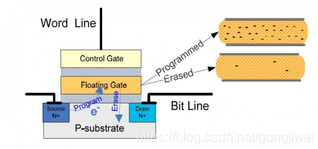

Erase过程就是把Floating Gate中的电子赶出去，Program过程就是向Floating Gate吸入电子。

### SLC/MLC/TLC/QLC区别

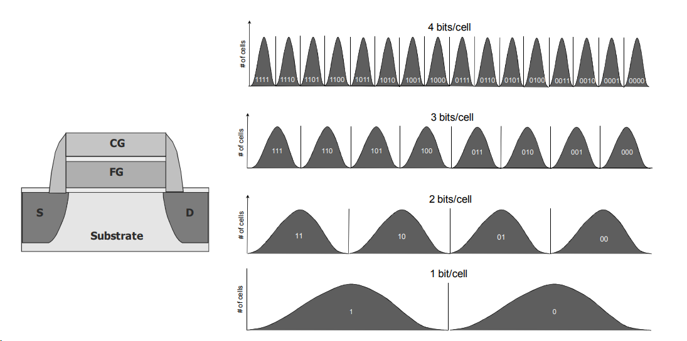

SLC：每个cell表示1bit；

MLC: 每个cell表示2bit；

TLC：每个cell表示3bit；

QLC：每个cell表示4bit。

Cell划分的level数量区分不同nand颗粒类型，SLC划分两个level，MLC划分4个level，TLC划分8个level，QLC划分16个level。每个SLC cell属于1个page，MLC属于2个page，TLC属于3个page。

TLC page编程顺序，lower page->middle page->upper page。

### Nand Flash内部组织

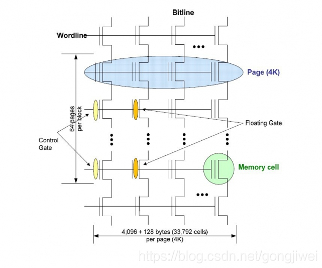

每条wordline，对于SLC，包含一个page，MLC两个page，TLC 3个page，原因就是根据每个cell表示几个bit。例如TLC，每条wordline包含lower, middle, upper三个page。

Wordline连接control gate，bitline连接源级和漏极。

### Block结构

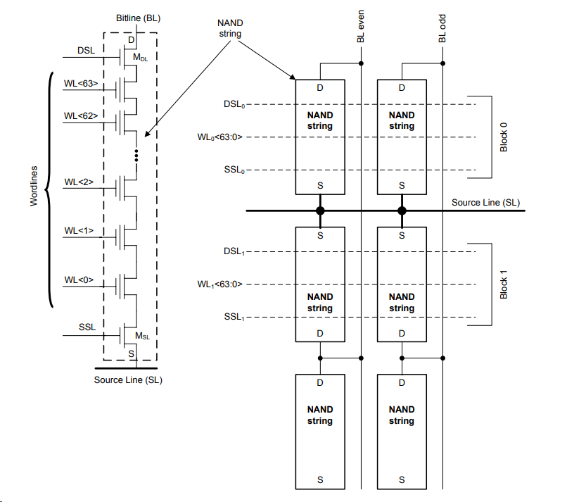

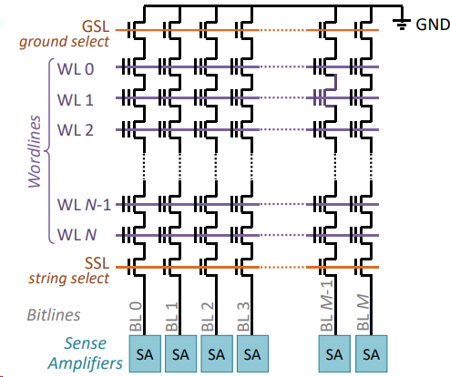

每个block包含一组wordline，每组wordline相同BL编号的cell构成一个string。

每组wordline一根source line，相邻分组的wordline共用一根source line。

Bitline和source line形成回路。

Bitline接放大器，读取操作时放大信号。

### Nand Flash组织结构

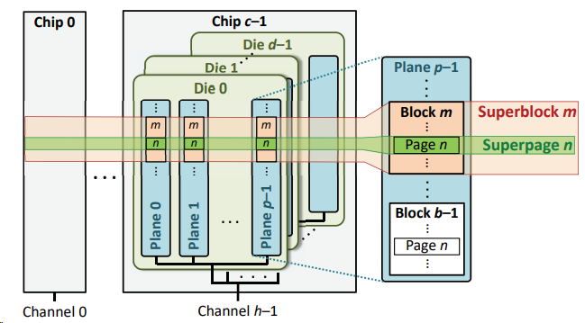

## Nand Flash操作

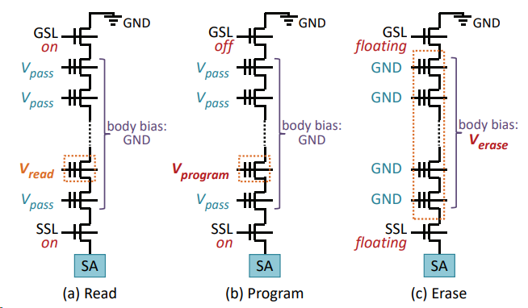

### Erase

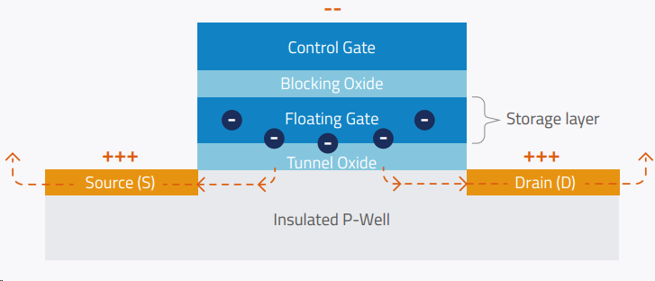

衬底加高电压或者control gate加负电压，大小大约20V，bitline floating，把电子从Floating Gate赶出；

### Program

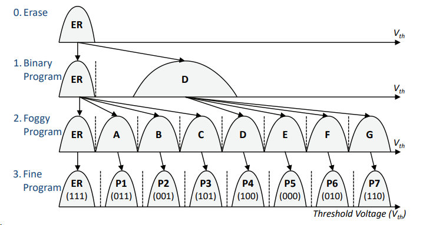

选中wordline施加20-25V编程电压Vprg，未选中wordline施加Vpass导通电压使三极管导通，bitline根据要写入的数据对漏极施加对应level的电压，向Floating Gate吸入相应的电子数量。

TLC一个cell属于3个page，如上图第一个bit属于lower page，第二个bit属于middle page，第三个bit属于upper page，其对应的阈值电压Vth依次升高。

Wordline施加的编程电压Vprg在TLC模式下对page从lower到upper连续编程时是依次拉高的。

### Read

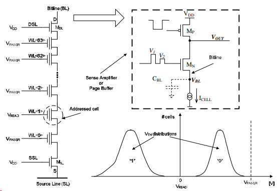

> 读取过程是被选中wordline施加Vread电压，一般0V，未选中wordline电压Vpass类似编程过程使源级漏极导通，bitline连接的外围电路利用floating gate和漏极形成的寄生电容，对电容预充电，并输出放电电压，放电电压处于某个level则对应于某个level数据。Vout要接放大器，因为输出信号比较弱。
>
> 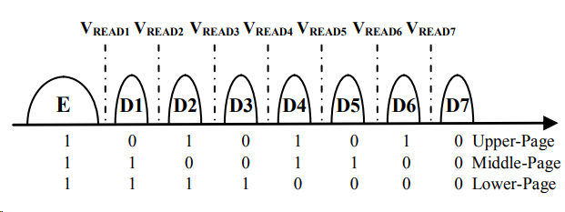
>
> TLC不同page类型编码如上图所示。

## Nand Flash数据完整性影响因素

### 自然泄露

量子隧穿效应：即使粒子能量小于阈值能量，很多粒子冲向势垒，一部分粒子反弹，还会有一些粒子能过去，好象有一个隧道，称作“量子隧道（quantum tunneling）”。可见，宏观上的确定性在微观上往往就具有不确定性。虽然在通常的情况下，隧道效应并不影响经典的宏观效应，因为隧穿几率极小，但在某些特定的条件下宏观的隧道效应也会出现。

根据量子隧穿效应，电子有概率越过氧化膜逃离floating gate，所以随着时间的增长，cell会慢慢漏电。

### 温度影响

温度升高会增加电子势能，增大电子隧穿距离和概率，因此高温会加剧cell漏电，避免Nand flash芯片长时间置于较高温度对减少数据损伤很重要，SSD高温测试表明长时间置于高温环境下数据会快速大量损坏。

### 氧化膜损伤原理

电子在穿越氧化膜的过程中，有概率卡在氧化膜内，随着使用的增加，卡住的电子越来越多。这些电子会影响control gate电压，并且这些电子会形成势垒，阻拦erase和program过程中电子穿过氧化膜。

### 读干扰

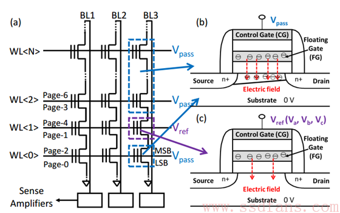

如果我们要读取一个Block当中的某个Page，需要在其它所有Wordline控制极上加一个Vpass电压，这样保证了其它晶体管都是导通的；对被读取的Page，需要在其所在Wordline的控制极上加参考电压Vref，可能加一次参考电压就能把数据读出来，也可能需要几次。

读操作时，衬底加电压是0，读取的page，控制极上的电压是Vref，而对其他Page，控制极上加的电压是Vpass。由于其他Page上加了一个Vpass，相对来说是一个比较大的电压，这样就会在浮栅极和衬底形成一个较强的电场，可能就把一些电子吸入浮栅极，有点轻微Program的意思。随着该Block上Page数据读的次数越来越多，没有被读到的page中的浮栅极电子进入越来越多，导致里面数据状态发生变化，也就意味着数据出错。

### 编程干扰

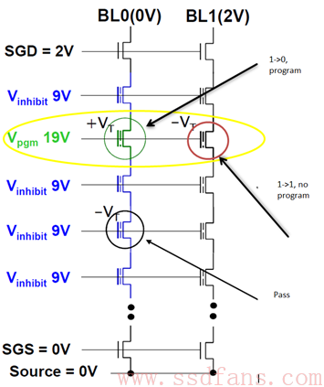

例子，编程时，对要编程的wordline施加19V电压，因为需要施加高电压把电子吸入floating gate，对未选中的wordline施加9V电压，要编程的bitline施加0V电压，保持状态1的bitline施加2V电压。

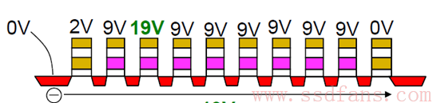

如上图，要program的那个存储单元，控制极电压是19V，衬底电压是0，就形成一个强电场，电子就被注入浮栅极。对该String中其它存储单元，它们控制极电压是9V，衬底电压是0，也会形成一个电场，但该电场强度不足以让电子轻松注入到其浮栅极。

但是不管怎样，这个电场还是有概率让电子进入到浮栅极，尤其是绝缘层隔绝性能比较差的时候（比如擦写次数过多）。因此，被Program的存储单元所在String上其它存储单元会一定程度上受该次Program影响，我们称之为Pass Disturb。该影响类似前面提到的Read Disturb，但由于一个Block擦除一次能写的次数有限（一个Block的page数），不像Read操作可以反复读取，所以，Pass Disturb对数据影响没有Read Disturb严重。

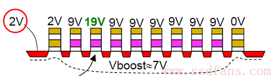

对Program Inhibit存储单元，我们在其所在String的Bitline上加了个2V电压，最终会在衬底产生一个7V的Vboost电压。因为bitline电势差2V，所以bitline是导通的，bitline和上面的9V的众多栅极构成等效电容。

对于Program Inhibit，控制极电压是19V，减去7V的Vboost电压，12V电势差，该电势差产生的电场不足以让电子轻松流入浮栅极，因此，存储单元基本还是保持擦除后的状态，即1还是1。

但是，这个12V电势差产生的电场，还是能让电子有概率进入到浮栅极，尤其是绝缘层隔绝性能比较差的时候。最坏的情况，可能我们不期望Program的存储单元，最后却做了真正的Program操作，即1->0，这是我们不期望的。我们称这种让Program Inhibit存储单元做了Program的现象，叫做Program Disturb。

### 擦除干扰

Erase过程对flash影响很小，因为是整个block擦除，block内wordline和bitline电压没有差异。擦除过程block的wordline接地，衬底加高电压，这个过程会对相邻的block造成弱erase效果，芯片行decoder一般会考虑到这个问题，影响不大。

但是电子通过氧化膜就会对氧化膜造成影响，擦除必然会影响nand flash寿命。

## Nand Flash命令

NAND 颗粒通过命令锁存使能（CLE）、地址锁存使能（ALE）、片选（CE#）、写使能（WE#）、读使能（RE#）等引脚复用同一组 I/O，按“命令 → 地址 → 数据”的顺序分时传输。典型命令集（以 ONFI 兼容颗粒为例）：

| 操作 | 命令序列 | 说明 |
|--|--|--|
| 复位 | `FFh` | 终止当前操作并回到就绪状态 |
| 读 ID | `90h` + 地址 `00h` | 读取厂商、型号、页/块参数 |
| 读状态 | `70h` | 返回状态寄存器，`SR[6]` 为 Busy/Ready |
| 页读 | `00h` + 列/行地址 + `30h` | 数据搬入页缓存后从 I/O 读出 |
| 页编程 | `80h` + 地址 + 数据 + `10h` | 数据写入页缓存，随后烧录到存储单元 |
| 块擦除 | `60h` + 行地址 + `D0h` | 以 block 为单位擦除 |
| 设置/读取特性 | `EFh` / `EEh` | 配置时序、驱动强度、ECC 等 |
| Copyback | `85h` + 地址 + `35h` | 片内搬移数据，用于 GC |

地址由列地址（页内偏移）和行地址（页号、块号、LUN）组成；TLC 颗粒一般需要 2 个列地址周期和 3 个行地址周期。命令 `30h`、`10h`、`D0h` 发出后，`SR[6]` 置忙，操作完成后自动转为就绪，固件通过 `70h` 轮询或 R/B# 引脚判断完成。

## FTL

FTL（Flash Translation Layer）位于主机块设备接口与 NAND 颗粒之间，负责把“读写扇区”的块设备语义翻译为“读页/写页/擦块”的闪存语义，并处理 NAND 的物理限制：写前必须擦除、擦除以 block 为单位、每块擦写次数有限。

### Wear-Leveling

磨损均衡让所有 block 的擦写次数尽量接近，避免热点块提前耗尽寿命：

- **动态磨损均衡**：新数据优先写入擦除次数少的空闲块，只在空闲块之间做均衡。
- **静态磨损均衡**：定期把长期不更新的冷数据从低擦写次数的块搬出，让这些块参与轮换。
- 实现上通常维护每个 block 的 EC（Erase Count），并在 GC 选块时结合擦写次数、无效页比例和读干扰程度综合打分。

### Garbage collection

GC 回收包含无效页的 block：

1. 按无效页比例挑选 victim block；
2. 把 victim 中仍有效的页读到内存，写入新的空闲 block；
3. 更新映射表（L2P）；
4. 擦除 victim block，放回空闲块池。

GC 会带来写放大（Write Amplification），写放大系数 ≈ 主机写入量 + GC 搬移量 / 主机写入量，与 OP（Over-Provisioning）和无效页分布直接相关。

### Bad Block Management

坏块分为出厂坏块和运行期坏块：

- 出厂坏块在块首页的 spare 区做标记，FTL 初始化时扫描并跳过；
- 运行期擦除/编程失败或 ECC 不可纠正的块被标记为坏块，不再分配；
- 通过预留块（spare blocks）替换坏块，并在映射表中把逻辑地址重定向到替换块；
- 坏块表通常同时保存在 NAND 的多个固定位置，避免单点丢失。

### Ecc

NAND 的读错误率随擦写次数和保持时间上升，必须由控制器做纠错：

- 常用编码为 BCH 与 LDPC，LDPC 在高误码率下更接近香农限；
- ECC 以扇区（如 512B/1KB/4KB）为单位计算，校验位存放在页的 spare/OOB 区；
- 读失败时依次尝试不同读参考电压（Read Retry）和软判决 LDPC；
- 当某块的 ECC 纠错次数或不可纠正错误超过阈值时，触发数据搬移（Scrub）并标记坏块。
