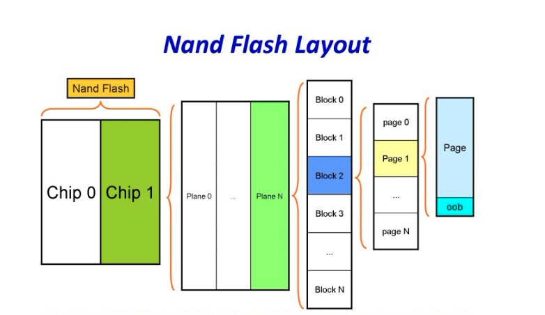
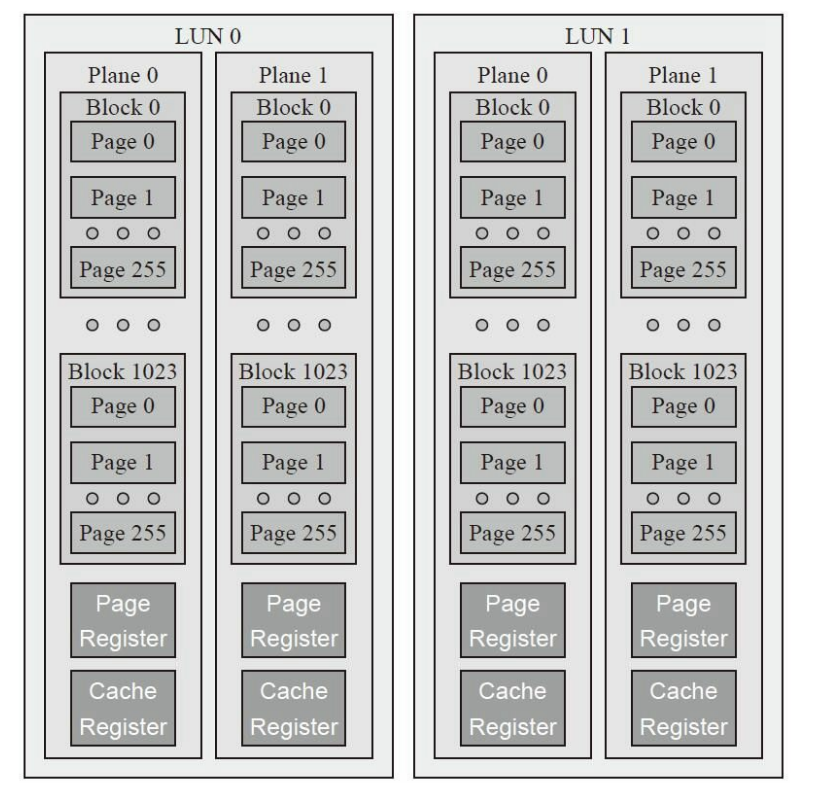
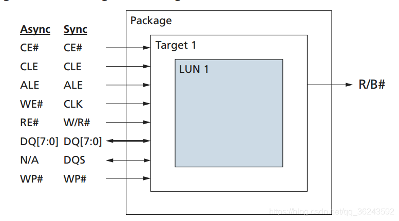
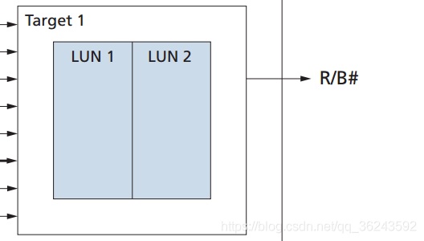
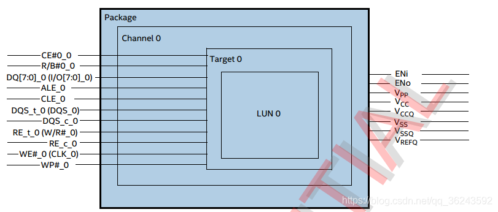
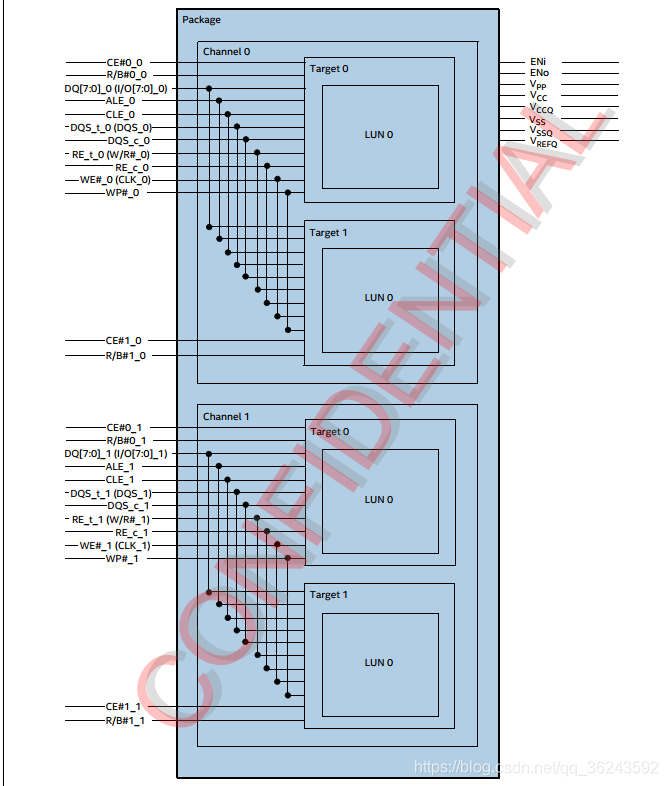
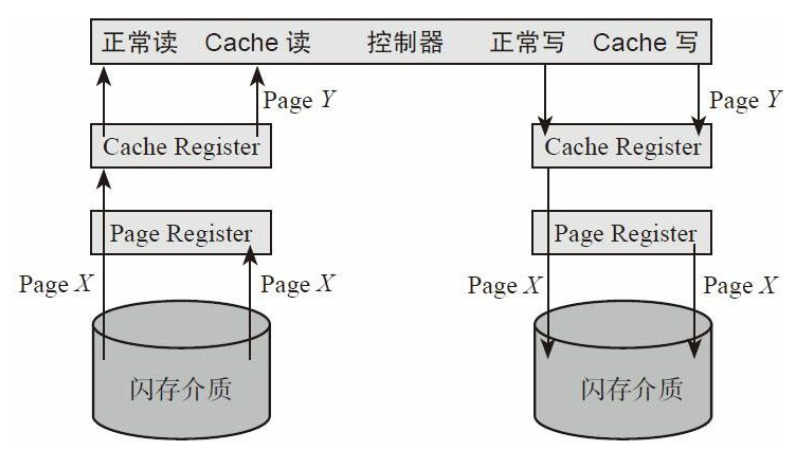
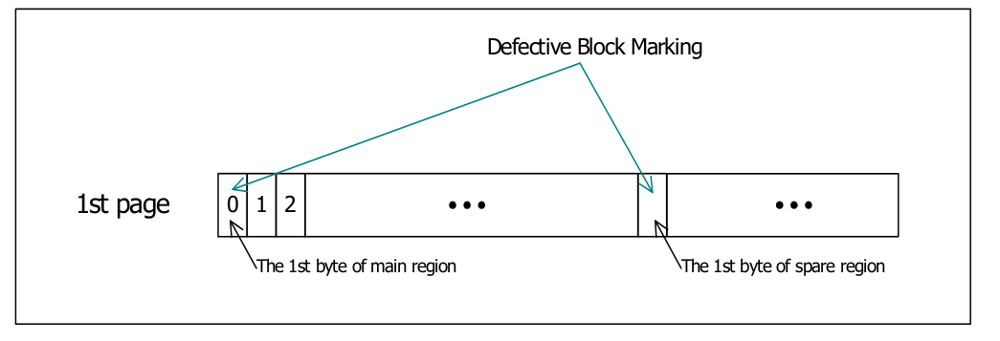
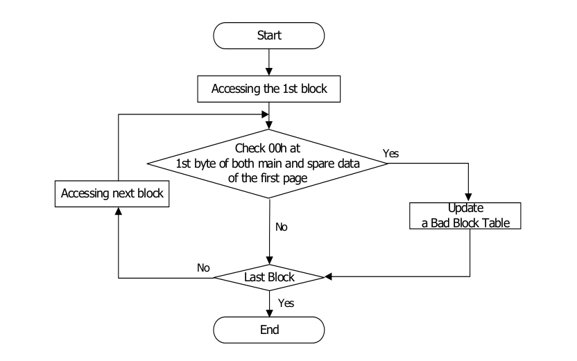

# NAND 内部结构

## 基本概念
        
NAND Flash是从原始的硅材料加工出来的，硅材料被加工成晶圆(Wafer)，一片晶圆上可以做出几百颗NAND FLASH芯片。芯片未封装前的晶粒成为Die，它是从Wafer上用激光切割而成的小片，每个Die就是一个独立的功能芯片，它由无数个晶体管电路组成，但最终可被作为一个单位封装起来成为闪存颗粒芯片。

NAND Flash的容量结构从大到小可以分为Device、Target、LUN、Plane、Block、Page、Cell。一个Device有若干个Die(或者叫LUN)，每个Die有若干个Plane，每个Plane有若干个Block，每个Block有若干个Page，每个Page对应着一个Wordline。



### 闪存内部基本结构


> 1. Device就是指单片NAND Flash，对外提供Package封装的芯片，通常包含1个或多个Target；
> 2. Target拥有独立片选的单元，可以单独寻址，通常包含1或多个LUN；
> 3. LUN: Logical Unit (最小可独立执行命令和上报状态的单元),通常包含多个plane;
> 4. Plane拥有独立的Page寄存器，通常Plane包含1K或2K个奇数Block或偶数Block；
> 5. Block是能够执行擦除操作的最小单元，通常由多个Page组成；
> 6. Page是能够执行编程和读操作的最小单元，通常大小为4KB/8KB/16KB/32KB等;
> 7. Cell是Page中的最小操作擦写读单元，对应一个浮栅晶体管，可以存储1bit或多bit数据，主要可颗粒类型。

### package


### target


### 什么是channel
channel 表示有几组ALE、CLE、IO[7:0]、DQS、RE、WE、WP信号线.

*只有一个channel*

*包含多个channel*


### cache page缓存


> 为什么需要Cache Register和Page Register两个缓存？主要目的是优化闪存的访问速度。闪存支持Cache读、写操作，如上图所示。Cach读支持在传输前一个Page数据给主控的时候（Cache Register→主控），可以从闪存介质读取下一个主控需要读的Page的数据到PageRegister（闪存介质→Page Register），这样数据在闪存总线传输的时间就可以隐藏在读闪存介质的时间里（或者相反，取决于哪个时间更长）；Cache Program也是如此，它支持闪存写前一个Page数据的同时（Page Register→闪存介质），传输下一个要写的数据到CacheRegister（主→Cache Register），这样数据在闪存总线传输可以隐藏在前一个Page的写时间里。

### 为什么闪存擦除最小单位为block
闪存的擦除是以Block为单位的。为什么呢？那是因为在组织结构上，一个Block当中的所有存储单元是共用一个衬底的（Substrate）。当你对某衬底施加强电压，那么上面所有浮栅极的电子都会被吸出来。

### 什么是OOB(out-of-band)
又叫空闲区域（spare area）/冗余区域（redundant area）
> 旧的小页, 512,每一页包含额外16个字节内容,不计入页大小.前三个字节存放ECC, 第六个字节标识是否坏块, 不是坏块之位0xff.
### 什么是ECC(Error Checking and Correction)
ECC的全称是Error Checking and Correction，是一种用于 Nand 的差错检测和修正算法。如果操作时序和电路稳定性不存在问题的话， NAND Flash 出错的时候一般不会造成整个 Block 或是 Page 不能读取或是全部出错，而是整个 Page （例如 512Bytes ）中只有一个或几个 bit 出错。 ECC 能纠正1 个比特错误和检测2 个比特错误，而且计算速度很快，但对 1 比特以上的错误无法纠正，对 2 比特以上的错误不保证能检测。

### 坏块处理
1. 替换表
此方法是将NAND存储空间中预留出一些块作为保留块，当遇到坏块时，在预留的保留块中选一个块来替换坏块，将原来写到坏块的数据写到替换块中；
2. BBT（Bad block table）
此方法核心是跳过坏块，但是跳过后需要在NAND闪存指定位置写入一个坏块表（Bad block table）

### flash出厂检测(skhynix海力士3D-V5)
检查每个block的main area第一个字节和spare area第一个字节是否为00h, 00h为坏块标识.


*检测流程*


## Page 的物理布局：main area 与 OOB

一个 page 由两部分组成：存放用户数据的 **main area**，以及存放冗余信息的 **spare area / OOB（Out Of Band）**。主机读写数据只关心 main area，但 ECC、坏块标记、FTL 元数据都藏在 OOB 里。

不同代际的典型组合如下（同一容量也可能有多种 OOB 大小，取决于厂商与 ECC 方案）：

| main area | OOB 大小 | 常见器件 |
|-----------|----------|----------|
| 512 B | 16 B | 早期小页 SLC |
| 2 KB | 64 B | 2D MLC/TLC |
| 4 KB | 128 B / 224 B | 2D/3D TLC |
| 8 KB | 448 B / 640 B | 3D TLC |
| 16 KB | 1 280 B 左右 | 高密度 3D TLC/QLC |

以 4 KB + 224 B 为例，逻辑布局可以画成：

```text
Page（4 KB + 224 B）
+----------------------------------------------------+-----------------------+
|                 main area  4096 B                  |   OOB / spare 224 B   |
|  [sector0 1KB][sector1 1KB][sector2 1KB][sector3]  | [BB][ECC s0][ECC s1]… |
+----------------------------------------------------+-----------------------+

OOB 逻辑布局（具体偏移由厂商定义）:
+---------+------------+------------+------------+--------+
| BB 标记 | ECC s0     | ECC s1     | ...        | 预留   |
+---------+------------+------------+------------+--------+
```

OOB 中通常包含以下几类信息：

| 区域 | 内容 | 说明 |
|------|------|------|
| 坏块标记 | 厂商写入的非 `0xFF` 值（常见 `00h`） | 位置通常在第一个 page 的 OOB 固定偏移 |
| ECC 校验 | 每个 sector 的 BCH/LDPC 校验位 | 占 OOB 的大部分，决定纠错能力 |
| 逻辑页号 | LPN / LBA 片段 | FTL 掉电恢复、GC 时识别数据归属 |
| 版本/序列号 | page 写入序号 | 判断同一 LPN 的新旧副本 |
| 元数据 | journal、标志位、预留 | 由 FTL 自定义 |

几个容易混淆的点：

- **OOB 不属于 main area 的地址空间**。读 OOB 需要把列地址继续往后偏移，或者在支持的模式下使用单独的 OOB 读命令；
- **ECC 校验位不是“整页一份”，而是按 sector 分布**。一页通常切成 4–16 个 sector，每个 sector 独立纠错；
- **坏块标记位于 OOB，而不是 main area**。这也是为什么擦除、编程时不能随意覆盖 OOB；
- 3D NAND 的 OOB 比例通常比 2D 小，但 LDPC 码字更长、译码更复杂。

## Block 的内部组织

Block 是擦除的最小单位。一个 block 包含若干 page，每个 page 对应一根 wordline；在 3D NAND 中，wordline 是立体的层，block 还包含多个 string 与层间连接。

```text
Block（一个 plane 内）
├─ WL0  ── Page0 (lower) / Page1 (middle) / Page2 (upper)   ← TLC 一根 WL 3 个 page
├─ WL1  ── Page3 / Page4 / Page5
├─ WL2  ── ...
├─ ...
└─ WLn  ── ...                                             共 128–512 个 page

3D 视角：
        WLn  ─────────────────────────
        WL2  ─────────────────────────
        WL1  ─────────────────────────
        WL0  ─────────────────────────
             │  │  │  │  │  │  │  │
          string 垂直穿过各层，共用 channel
```

关键性质：

- **一个 block 内的所有 cell 共享衬底/源极结构**（2D 为 p-well，3D 为公共源极与 select gate），擦除时无法只作用于某一页，这是块擦除的物理原因；
- **block 内任一 page 损坏，整个 block 就不能再作为整体使用**，因为擦除后无法保证其他页可靠；
- **page 的写入顺序有约束**：通常从 WL0 开始，按 wordline 递增；TLC 还要按 lower → middle → upper 的顺序写；
- 3D NAND 的 block 容量可达数 MB 到十几 MB，一次擦除耗时数毫秒，这决定了 GC 的基本代价。

Block 的容量可以简单估算：

```text
block_size ≈ page_size × pages_per_block
例如 16 KB × 512 = 8 MB
```

## Plane、Die 与并行性

Plane 是 Die 内可以并行操作的子单元，每个 Plane 拥有独立的 Page Register 与 sensing 电路。多 Plane 操作让同一个 Die 在一次忙等待中完成多个页的读/写/擦。

```text
Channel 0（共享 DQ/DQS/RE/WE）
├─ CE0 ─ Die0
│        ├─ Plane0 ─ Block0..BlockN
│        └─ Plane1 ─ Block0..BlockN
├─ CE1 ─ Die1
│        ├─ Plane0
│        └─ Plane1
└─ ...
```

并行层次与限制：

| 并行层次 | 能否同时进行 | 主要限制 |
|----------|--------------|----------|
| 不同 Channel | 可以 | 控制器通道数、PCB 布线 |
| 同 Channel 不同 CE | 可以（分时复用总线） | DQ 总线仲裁、命令/数据排队 |
| 同 Die 不同 Plane | 可以（multi-plane） | 地址需同 block 偏移，共享 R/B# |
| 同一 Plane | 不可以 | 只有一组 Page Register |

这解释了一个常见现象：**SSD 的顺序带宽和随机 IOPS 并不只由接口速率决定**。主控要把请求拆分、对齐到 page/plane/block，尽量让每个 Die 都忙起来，同时避免同一通道上的总线冲突。

在 `drivers/mtd/nand/raw/` 中，多 Plane 能力由控制器驱动与 `nand_chip` 的参数共同描述；是否真正启用 multi-plane，要看控制器是否支持、器件是否支持，以及上层是否把请求组织成对齐的页对。

## 坏块标记与 BBT

坏块的判定与记录分两个阶段：

### 出厂坏块

厂商在测试时把无法正常编程/擦除的 block 标记在 OOB 中。常见做法是：

- 检查 block 第一个 page 的 OOB 固定偏移（如 byte 0 或 byte 1）；
- 若值为 `0x00`（或任何非 `0xFF` 的厂商约定值），则该 block 为坏块；
- 有些器件还会在最后一个 page 写镜像标记，防止第一个 page 损坏导致误判。

这就是前面“flash 出厂检测”一节所描述的流程。

### 增长坏块

使用过程中出现以下情况，block 会被标记为增长坏块：

- 编程或擦除返回 `FAIL`；
- 读出的数据 ECC 无法纠正；
- 擦除后验证仍无法回到全 `1`；
- 编程后读回比对失败。

增长坏块的标记由 FTL 或 UBI 负责，通常写入 BBT，而不是直接改 OOB（因为改 OOB 需要额外的读-改-写）。

### BBT 的存放

BBT（Bad Block Table）是一张“哪些 block 是坏的”的位图。常见实现：

| 方案 | 位置 | 特点 |
|------|------|------|
| 扫描式 | 每次启动扫描所有 block 的 OOB | 简单、慢，适合小容量 |
| 存储式 BBT | NAND 末尾的若干 block，多份镜像 | 启动快，需预留块 |
| 厂商 BBT | 厂商在出厂时写入 | 只反映出厂坏块，不反映增长坏块 |

Linux 的 `drivers/mtd/nand/raw/nand_bbt.c` 实现了 BBT 的扫描、读写与镜像校验；UBI 则在 `drivers/mtd/ubi/` 中维护自己的坏块与擦除计数信息。

## Read Disturb、Program Disturb 与 Retention

NAND 的可靠性问题可以归结为“阈值电压被意外改变”或“电荷意外流失”。三类主要机理如下。

### Read Disturb

读某一页时，选中的 wordline 施加参考电压，未选中的 wordline 需要施加较高的 pass 电压（Vpass，通常数伏），让未被选中的 cell 导通。这个 Vpass 虽然低于编程电压，但仍会让未选中 cell 发生极轻微的电荷注入。读的次数越多，阈值漂移越明显，最终可能读错。

```text
WL0  ─── cell ───   Vpass（轻微编程）
WL1  ─── cell ───   Vref（选中读）
WL2  ─── cell ───   Vpass（轻微编程）
...
```

缓解手段：

- FTL 记录每个 block 的读计数；
- 超过阈值后触发 **read reclaim**：把该 block 的有效数据搬到新 block，再擦除旧块；
- 控制器使用 read retry / 软判决 LDPC，在误码升高时换参考电压重读。

### Program Disturb

编程时，选中的 wordline 施加高编程电压（Vpgm，十几到二十几伏），同一 string 上未选中的 wordline 施加 Vpass。未选中的 cell 可能被轻微编程，尤其是与选中 cell 相邻的 wordline。3D NAND 的立体结构还会带来层间耦合与 select gate 干扰。

缓解手段：

- 精确的 Vpass/Vpgm 时序与 verify；
- 写入顺序与预补偿；
- 更强的 ECC 与坏块退役。

### Retention

即使不通电，浮栅/电荷陷阱中的电荷也会随时间、温度缓慢泄漏。温度越高、P/E 越多、氧化层越薄，泄漏越快。消费级 SSD 通常标称断电保存 1 年（30°C 左右），企业级会有更严格的指标与巡检机制。

缓解手段：

- 上电时后台扫描（patrol read）与数据刷新；
- ECC 余量随 P/E 增加而动态调整；
- 避免长期高温存放。

### 其他干扰

| 机理 | 触发条件 | 影响 |
|------|----------|------|
| Cell-to-cell coupling | 相邻 cell 电荷变化 | 阈值漂移，MLC/TLC 更明显 |
| WL-to-WL coupling | 相邻 wordline 编程 | 已写页的阈值被拉偏 |
| 3D layer variation | 不同层刻蚀/沉积差异 | 各层误码率不一致 |
| 写错误 | 多 pass 写入时 lower page 已错 | upper page 写到错误状态 |

这些机理共同决定了：**NAND 的误码率不是常数，而是随 P/E、读次数、存放时间、温度变化的函数**。ECC 必须按最坏情况设计余量。

## Read Reclaim 与数据刷新

Read reclaim 是“因为读得太多而搬家”的机制，和 GC “因为空间不够而搬家”不同：

| 机制 | 触发原因 | 搬移对象 | 目标 |
|------|----------|----------|------|
| GC | 空闲块不足 / 写放大 | victim block 的有效页 | 回收空间 |
| Read reclaim | 某 block 读计数超阈值 | 该 block 的全部有效页 | 消除 read disturb |
| Retention refresh | 存放时间/温度超阈值 | 长期未访问的数据 | 恢复电荷余量 |
| Wear leveling | P/E 不均衡 | 冷数据 | 均衡磨损 |

Read reclaim 的阈值由固件根据 ECC 余量、P/E、温度动态调整。读密集负载（如数据库索引、元数据）容易触发，表现为“读着读着突然变慢”，因为后台在搬家。

## 垃圾回收（GC）

GC 的目标是把多个 block 中的有效页集中到新 block，从而腾出整块可擦除空间。

```text
GC 前:
 Block A: [V][V][I][V][I][I][V][I]   有效 4 页，无效 4 页
 Block B: [I][I][I][I][I][I][I][I]   空闲
 Block C: [V][I][V][I][I][V][I][I]   有效 3 页

GC 后:
 Block A: [I][I][I][I][I][I][I][I]   擦除后回到空闲池
 Block B: [V][V][V][V][V][V][V][ ]   7 个有效页集中在这里
 Block C: [I][I][I][I][I][I][I][I]   擦除后回到空闲池
```

典型步骤：

1. 从空闲块不足或写放大过高的信号触发；
2. 选择 victim block（有效页最少、年龄最老、擦除次数最少等综合评分）；
3. 读出 victim 中的有效页，写入新的目标块；
4. 更新 LBA → PPA 映射；
5. 擦除 victim，放回空闲池。

### 写放大

写放大（Write Amplification，WA）定义为：

```text
WA = 实际写入 NAND 的数据量 / 主机写入的数据量
   = (主机写入 + GC 搬移) / 主机写入
```

WA 越小越好：它直接放大 P/E 消耗、降低有效带宽。影响 WA 的因素：

- **随机写比例**：随机写产生的无效页分散，GC 搬移多；
- **预留空间（OP）**：OP 越大，GC 越从容，WA 越低；
- **TRIM/DISCARD**：及时告知无效 LBA，减少无效页搬移；
- **SLC 缓存**：先把随机写吸收到 SLC 区，再顺序折叠到 TLC；
- **GC 策略**：victim 选择与调度时机。

在最坏的纯随机写模型下，WA 与 OP 的关系可以粗略写成：

```text
WA ≈ 1 / OP        （OP 为预留比例，忽略 SLC 缓存与顺序性）
例如 OP=7%，WA 最坏可达 ~14
```

这也是为什么企业级 SSD 通常预留更多空间，并且依赖 TRIM 与顺序化写入来压低 WA。

## 磨损均衡策略

磨损均衡（Wear Leveling，WL）解决的是“P/E 分布不均”问题。它分为动态与静态两类：

### 动态磨损均衡

新写入的数据优先分配到 **P/E 计数较低** 的空闲块。热数据不断更新，会自然轮换到不同的块；冷数据一旦写入就不再移动，因此动态 WL 对冷数据无效。

### 静态磨损均衡

定期把长期不动的冷数据从 **P/E 较低** 的块搬到 **P/E 较高** 的块，让冷块也参与擦写轮换。静态 WL 会增加额外的搬移量，通常只在磨损差异超过阈值时触发。

| 策略 | 触发条件 | 优点 | 代价 |
|------|----------|------|------|
| 动态 WL | 每次分配空闲块 | 实现简单、无额外搬移 | 冷数据所在块磨损低 |
| 静态 WL | P/E 方差/极差超阈值 | 全盘寿命更均衡 | 额外写放大 |
| 热冷分离 | 数据温度识别 | 减少冷数据搬移 | 需要温度统计 |

寿命估算：

```text
TBW ≈ 容量 × P/E 次数 / WA
```

例如 1 TB TLC、P/E=3000、WA=2，理论 TBW ≈ 1.5 PB；若 WA 因随机写升到 10，则只剩 0.3 PB。可见 **WL 与 GC 共同决定了 SSD 的实际寿命**，而不只是颗粒标称的 P/E。

## 从 block 到 FTL：映射的粒度

FTL 需要把主机的 LBA 映射到 NAND 的物理页（PPA）。映射粒度直接影响内存开销与 GC 效率：

| 映射方式 | 映射表大小 | 随机写表现 | 说明 |
|----------|------------|------------|------|
| 页级映射 | 大（每页一项） | 好 | 现代 SSD 主流 |
| 块级映射 | 小 | 差 | 需整块搬移 |
| 混合映射 | 中等 | 较好 | 日志块 + 数据块 |

页级映射的映射表通常也存放在 NAND 中，启动时加载到 DRAM；掉电时必须能通过 OOB 中的 LPN/版本号重建或校验。这就是为什么 OOB 里的元数据如此重要。

更完整的 FTL 功能（地址转换、GC、WL、掉电恢复、并行调度）见 [FTL](ftl.md)；命令级细节见 [命令](cmd.md)；整体入门见 [NAND Flash 简介](README.md)。

## 与内核实现的衔接

| 主题 | 内核位置 | 说明 |
|------|----------|------|
| 坏块表 | `drivers/mtd/nand/raw/nand_bbt.c` | 扫描、读写、镜像校验 BBT |
| 通用 NAND 操作 | `drivers/mtd/nand/raw/nand_base.c` | 读/写/擦/状态/复位 |
| 器件参数 | `drivers/mtd/nand/raw/nand_ids.c` | 页大小、OOB、ECC 能力 |
| UBI 磨损均衡 | `drivers/mtd/ubi/wl.c` | 空闲块池、擦除计数、搬移 |
| UBI 坏块管理 | `drivers/mtd/ubi/` | 坏块识别、保留块 |
| UBIFS | `fs/ubifs/` | 日志结构、磨损感知 |

在 `CONFIG_PREEMPT_RT=y` 的内核上，GC/擦除这类长耗时操作应尽量放在可睡眠的后台线程中执行；NAND 控制器的 `R/B#` 等待也应由线程化中断或带超时的睡眠轮询处理，避免在原子上下文里忙等数毫秒。

## 小结

- page 由 main area + OOB 组成，OOB 承载 ECC、坏块标记与 FTL 元数据；
- block 是擦除单位，内部 page 共享衬底，任一 page 坏则整块退役；
- plane/die/channel 提供并行性，但受总线、地址对齐与共享 R/B# 约束；
- read disturb、program disturb、retention 是误码的主要来源，需要 read reclaim、刷新与强 ECC；
- GC 通过搬移有效页回收空间，WA 与 OP、随机写比例、TRIM 密切相关；
- 磨损均衡分动态与静态，最终决定 TBW；
- 这些机制在裸 NAND 上由 UBI/FTL 实现，在 SSD 内由固件对主机透明。