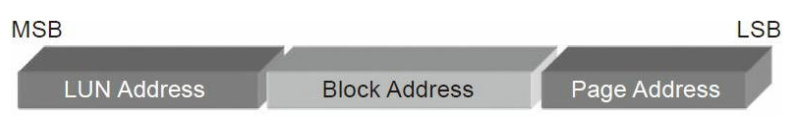
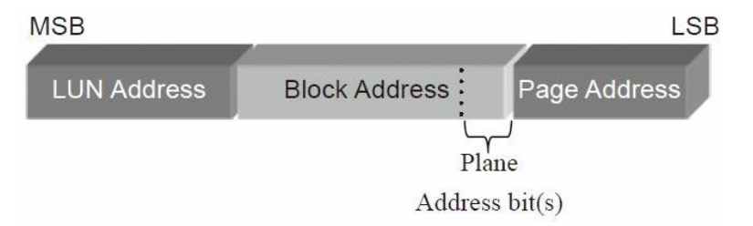
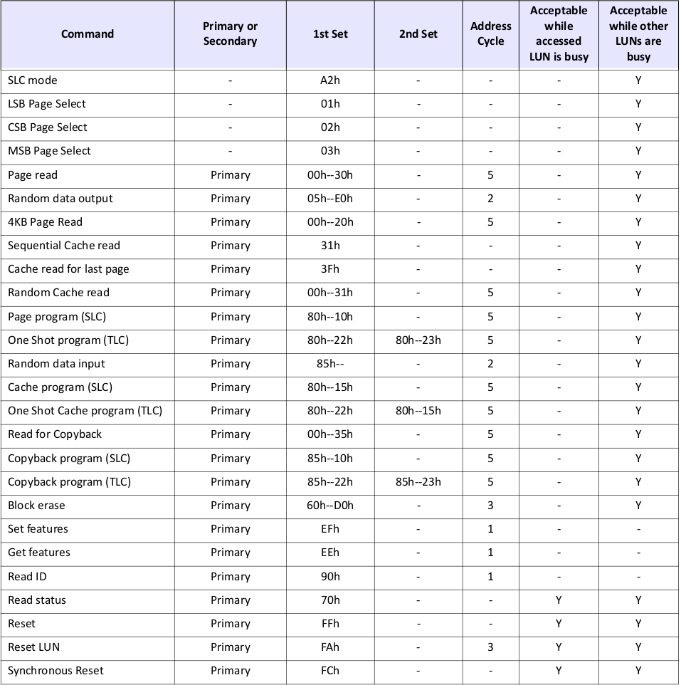
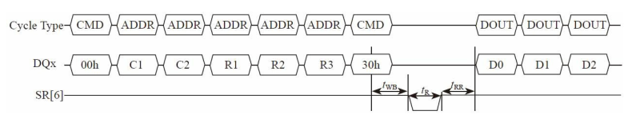
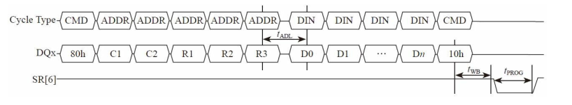
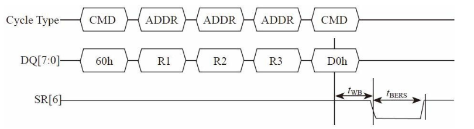
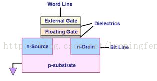

# NAND 操作命令

## nand flash操作基本命令
### 寻址
*概念*  
LSB(Least significant bit最低有效位)和MSB（Mostsignificant bit最高有效位）。
MSB是指一个n位二进制数字中的n-1位，具有最高的权值2^(n-1)，在大端序中，MSB即指最左端的位，LSB则相反。
#### 行寻址

*Multi-Plane寻址*

#### 列寻址
列地址为页内偏移
### 基本命令

### 读时序

> 在用户发送命令00～30h之间传输了所读的
地址，包括2个列地址和3个行地址。发完命令后，SR[6]（Status
Register，状态寄存器，bit 6）状态转为Busy，经过一段时间之后SR[6]
状态转为Ready，数据就可以读了。
### 写时序

> 用户发了80h命令之后，发送写地址，一般
列地址是0，因为要把一个Page写满，如果不从头开始写满一个Page，
往往会导致数据出错。发完地址tADL时间之后，开始传输数据到闪存
的缓存。数据传完，发送命令10h，闪存芯片开始向介质写入数据，
SR[6]状态为Busy，在写操作完成后状态转为Ready。
### 擦除时序

> 擦除比较简单，在命令60h和D0h之间发送LUN和
Block行地址即可（因为擦除是以Block为单位）。
### 编程和擦写原理


数据在Flash内存单元中是以电荷(electrical charge) 形式存储的。存储电荷的多少，取决于图中的外部门（external gate）所被施加的电压，其控制了是向存储单元中冲入电荷还是使其释放电荷。而数据的表示，以所存储的电荷的电压是否超过一个特定的阈值Vth来表示，因此，Flash的存储单元的默认值，不是0（其他常见的存储设备，比如硬盘灯，默认值为0），而是1，而如果将电荷释放掉，电压降低到一定程度，表述数字0。
擦除时,word line施加高电压, 电子会离开floating gate向下运动, 所有连接这个word line的page都会被清掉, 每个连接一个word line的page构成一个block,所以擦除是以block为单位.
编程时,是从word line的起始位置开始,所以, 页面要连续.
bit line只能对一个bit充电, 即 1->0, 不能针对一个bit放电, 所以编程时要先擦除, 及对block放电.

### ONFI与Toggle协议
nand flash接口协议

ONFI（Open NAND Flash Interface）与 Toggle 是并行 NAND 的两大接口规范。二者由不同厂商阵营推动，但**命令集高度兼容**：`00h-30h` 读、`80h-10h` 写、`60h-D0h` 擦除等操作码在两边含义基本一致，差异主要集中在物理层时钟方案与速率等级上。控制器厂商通常在同一颗主控里同时支持两种 PHY。

| 项目 | ONFI | Toggle |
|------|------|--------|
| 主要推动方 | Intel、Micron、SK hynix 等 | Samsung、Kioxia 等 |
| 时钟方式 | 同步接口，早期用 RE#/WE#，NV-DDR 后引入 W/R# 时钟对与 DQS | 源同步接口，用双向 DQS 选通，无独立时钟 |
| 典型速率演进 | SDR → NV-DDR → NV-DDR2 → NV-DDR3 | 133 → 400 → 800 → 1600 MT/s 级别 |
| 命令集 | 相同/兼容 | 相同/兼容 |
| 器件识别 | Parameter Page（`ECh`）、Read ID（`90h`） | Read ID，部分器件提供兼容参数页 |

> 速率数字是代际量级，同一代内还有多个 timing mode；实际可用速率由控制器、PCB 信号完整性与器件共同决定。

更早的并行 NAND 使用纯异步的 legacy 接口：只有 CLE/ALE/CE#/RE#/WE# 与 DQ，没有 DQS，靠 RE#/WE# 的脉冲宽度控制时序。ONFI SDR 模式兼容这种异步访问；ONFI NV-DDR 与 Toggle 则引入源同步的 DQS，把速率推到数百 MT/s 以上。写驱动时通常先按 legacy/SDR 完成 bring-up，再切到 DDR timing mode。

## 接口信号与三种周期

并行 NAND 的引脚可以按功能分为四组：

| 信号 | 方向 | 作用 |
|------|------|------|
| `CE#` | 主机 → 芯片 | 片选，低有效；一个通道上可挂多个芯片 |
| `CLE` | 主机 → 芯片 | 命令锁存使能 |
| `ALE` | 主机 → 芯片 | 地址锁存使能 |
| `WE#` | 主机 → 芯片 | 写使能，上升沿锁存 DQ 上的命令/地址/数据 |
| `RE#` | 主机 → 芯片 | 读使能，低有效时芯片输出数据 |
| `DQ[7:0]` | 双向 | 命令、地址、数据复用总线 |
| `DQS` | 双向 | NV-DDR/Toggle 下的数据选通 |
| `R/B#` | 芯片 → 主机 | 就绪/忙，开漏输出，可多个芯片线与 |
| `WP#` | 主机 → 芯片 | 写保护，低有效 |

所有信息都通过同一组 `DQ[7:0]` 分时传送，靠 `CLE`/`ALE` 区分当前是命令、地址还是数据：

```text
命令周期:  CLE=1, ALE=0, WE# 上升沿锁存 DQ 上的操作码
地址周期:  CLE=0, ALE=1, WE# 上升沿依次锁存地址字节
数据周期:  CLE=0, ALE=0, WE# 写 / RE# 读
```

```text
CLE  ‾‾‾‾\____________________________/‾‾‾‾\___________
ALE  ___________/‾‾‾‾\________________________/‾‾‾‾\___
WE#  _/‾\_/‾\_/‾\_/‾\_/‾\_/‾\_/‾\_/‾\_/‾\_/‾\_/‾\______
DQ   < CMD >< A0 >< A1 >< A2 >< A3 >< A4 >< DATA >...
       命令     地址周期（5 个）        数据
```

## 地址周期：列地址 + 行地址

一条读/写命令通常跟 **5 个地址周期**：前 2 个是列地址（column），后 3 个是行地址（row）。容量更大的器件可能扩展到 6 个周期。

```text
Column（2 周期，12–14 bit）
  └─ 页内字节偏移：0 .. page_size-1（含 OOB 时可继续偏移到 spare 区）

Row（3 周期，17–24 bit）
  ┌──────────┬────────────────┬─────────────────────┐
  │ plane    │ block 编号      │ block 内 page 编号   │
  └──────────┴────────────────┴─────────────────────┘
```

几个容易踩错的点：

- **列地址是字节偏移，不是页号**。要从页中间开始读，用列地址或 `05h-E0h` 改列命令；
- **行地址包含 block 与 page**，具体位段划分由器件容量决定，不能跨厂商硬编码；
- **多 plane 操作**需要为每个 plane 分别给出地址，plane 选择位可能编码在行地址中，也可能通过独立命令区分；
- 读写长度跨越页边界时，控制器必须拆成多条命令，NAND 不会自动进位到下一页。

## 命令集总表

下表列出 bring-up 与日常调试最常用的一组命令。`地址周期` 指命令后需要跟几个地址字节，`数据` 指主机侧的数据方向。

| 操作码 | 名称 | 地址周期 | 数据 | 说明 |
|--------|------|----------|------|------|
| `FFh` | Reset | 0 | 无 | 复位芯片，中止当前操作 |
| `90h` | Read ID | 1（`00h`） | 读 5 字节 | 厂商 ID、器件 ID、配置字节 |
| `70h` | Read Status | 0 | 读 1 字节 | 可连续读，轮询忙/失败位 |
| `00h` + `30h` | Read | 5 | 读 page+OOB | 最常用的整页读 |
| `00h` + `31h` | Cache Read Sequential | 5 | 读 page | 读当前页的同时预取下一页 |
| `3Fh` | Cache Read End | 0 | 无 | 结束 cache read 流水 |
| `05h` + `E0h` | Change Read Column | 2 | 读 | 在已打开的页内改列地址 |
| `80h` + `10h` | Program | 5 | 写 page | 整页编程，`10h` 触发 |
| `80h` + `15h` | Cache Program | 5 | 写 page | 写当前页的同时接收下一页 |
| `80h` + `11h` | Multi-plane Program | 5×N | 写 N 页 | 多个 plane 并行编程 |
| `60h` + `D0h` | Erase | 3 | 无 | 以 block 为单位擦除 |
| `60h` + `D1h` | Multi-plane Erase | 3×N | 无 | 多个 plane 并行擦除 |
| `35h` / `85h` + `10h` | Copyback Read/Program | 5 | 无 | 芯片内部搬移，不经主机总线 |
| `ECh` | Read Parameter Page | 1 或 3 | 读 256B×N | ONFI 参数页 |
| `EEh` / `EFh` | Get/Set Features | 1 | 读/写 4B | 时序模式、驱动强度、NV-DDR 配置等 |

## 读操作（00h-30h）

读是最常用的操作，完整序列如下：

```text
CLE  __/‾\______________________________________________________
ALE  _____/‾‾‾‾‾‾‾‾‾‾‾‾\________________________________________
DQ   <00h><C1><C2><R1><R2><R3>              <30h>       <D0><D1>...
WE#  _/‾\_/‾\_/‾\_/‾\_/‾\_/‾\_/‾\_________________/‾\______________
RE#                                                 \_/‾\_/‾\_/‾\_
R/B# ‾‾‾‾‾‾‾‾‾‾‾‾‾‾‾‾\_________________________________/‾‾‾‾‾‾‾‾‾
                          tR
```

1. 发 `00h`，进入读命令；
2. 发 5 个地址周期；
3. 发 `30h`，芯片开始从介质 sensing 到 Page Register，`R/B#` 拉低；
4. 等待 `tR`，`R/B#` 释放，或轮询 `70h` 的 bit6；
5. 连续拉低 `RE#`，从 `DQ` 读走整页数据；需要 OOB 时继续读 spare 区；
6. 若要在同一页内跳到另一个列地址，发 `05h` + 2 字节列地址 + `E0h`，然后继续读。

读操作不会改变数据，但每次读都会在未选中的 wordline 上施加 pass 电压，反复读同一 block 会累积 read disturb。SSD 固件因此维护读计数并触发 read reclaim，详见 [闪存内部结构原理](arch.md)。

## 状态寄存器（70h）

`70h` 之后，每读一次 `DQ` 就返回一次当前状态字节。主机可以反复读，直到忙位释放。Linux 的 `include/linux/mtd/rawnand.h` 给出了通用位定义：

| bit | Linux 宏 | 含义 |
|-----|----------|------|
| 0 | `NAND_STATUS_FAIL`（0x01） | 上一次编程/擦除失败 |
| 1 | `NAND_STATUS_FAIL_N1`（0x02） | cache program/erase 失败 |
| 5 | `NAND_STATUS_TRUE_READY`（0x20） | “真正就绪”，部分器件的内部操作尚未完全结束时 bit6 可能已置位 |
| 6 | `NAND_STATUS_READY`（0x40） | 1=就绪，0=忙 |
| 7 | `NAND_STATUS_WP`（0x80） | 写保护状态 |

使用要点：

- **不要只读一次状态就下结论**，忙位可能仍在翻转；
- **编程/擦除失败后，该 block 不能再信任**，应标记为坏块并重映射；
- 不同厂商、不同 ONFI 版本对 bit5/bit7 的命名与极性可能略有差异，写驱动时应以 datasheet 为准；
- `70h` 读状态本身不会清除失败位，下一次编程/擦除才会更新。

## 编程操作（80h-10h）

编程把 Cache Register 中的整页数据写入目标 wordline：

```text
CLE  __/‾\______________________________________________________
ALE  _____/‾‾‾‾‾‾‾‾‾‾‾‾\________________________________________
DQ   <80h><C1><C2><R1><R2><R3>   <D0><D1>...<Dn>        <10h>
WE#  _/‾\_/‾\_/‾\_/‾\_/‾\_/‾\_/‾\______________________/‾\______
R/B# ‾‾‾‾‾‾‾‾‾‾‾‾‾‾‾‾‾‾‾‾‾‾‾‾‾‾‾‾‾‾‾\________________/‾‾‾‾‾‾
                                         tPROG
```

1. 发 `80h`；
2. 发 5 个地址周期，列地址通常为 0；
3. 在 `tADL` 之后开始把整页数据写入 Cache Register；
4. 发 `10h`，芯片开始 program + verify，`R/B#` 拉低；
5. 等待 `tPROG`，发 `70h` 检查 bit0；
6. 失败则标记坏块，成功则该页可读。

编程的语义是“把 1 写成 0”：数据中的 1 对应保持擦除态，0 对应注入电荷。因此：

- **目标页必须已擦除**，否则会出现“1 写不回来”的错误；
- **一页要一次写满**，从列地址 0 开始，部分页写会显著提高误码率；
- 同一页不能反复编程；SLC 缓存、ZNS 的 zone append 等特殊模式除外；
- TLC/QLC 的 lower/middle/upper page 有写入顺序约束，通常由主控按 wordline 顺序编排。

## 擦除操作（60h-D0h）

擦除只需要 block 地址，页内地址位会被忽略：

```text
CLE  __/‾\_______________________________________/‾\____________
ALE  _____/‾‾‾‾‾‾‾‾‾‾‾‾\________________________________________
DQ   <60h><R1><R2><R3>                     <D0h>
WE#  _/‾\_/‾\_/‾\_/‾\_/‾\_______________________/‾\______________
R/B# ‾‾‾‾‾‾‾‾‾‾‾‾‾‾‾‾‾‾‾‾‾‾‾‾‾‾‾‾‾‾‾‾‾‾\______________/‾‾‾‾‾
                                        tBERS
```

1. 发 `60h`；
2. 发 3 个行地址周期（block 地址）；
3. 发 `D0h` 触发擦除；
4. 等待 `tBERS`，通常是毫秒级，远慢于读和写；
5. 发 `70h` 检查 bit0。擦除成功后整块所有 bit 为 1。

擦除是整个 NAND 系统里最“重”的操作：耗时最长、对氧化层损伤最大、粒度最大。GC、磨损均衡、写放大这些概念都源于此。

## Cache Read 与 Cache Program

普通读/写的瓶颈之一是总线传输与介质操作串行。NAND 内部有 Cache Register 与 Page Register 两级缓存，可以把两者重叠：

```text
普通读:    [ tR0 ][ 传 data0 ][ tR1 ][ 传 data1 ]...
Cache 读:  [ tR0 ][ tR1 重叠 data0 ][ tR2 重叠 data1 ]...
```

| 操作 | 命令序列 | 说明 |
|------|----------|------|
| Cache Read | `00h` + 地址 + `31h` | 把下一页读入 Page Register，同时主机读走当前页 |
| Cache Read End | `3Fh` | 结束流水，等待最后一次内部读完成 |
| Cache Program | `80h` + 地址 + 数据 + `15h` | 主机传下一页的同时，芯片编程上一页 |
| 最后一页 | `80h` + 地址 + 数据 + `10h` | 必须用 `10h` 收尾，否则最后一页可能未真正编程 |
| 状态检查 | `70h` | bit0 表示当前页失败，bit1 表示 cache 流水中有页失败 |

Cache Program 的坑在于：`15h` 只是“排队”，真正落盘要等后续页或最后的 `10h`。掉电时未 confirm 的页可能丢失，因此 FTL 的掉电恢复必须能识别这种“已写但未确认”的状态。

## 多 Plane 操作

一个 Die 通常有 2/4/8 个 Plane，每个 Plane 有独立的 Page Register。多 Plane 命令把多个 Plane 的操作合并成一次忙等待：

| 操作 | 典型序列 | 并行收益 |
|------|----------|----------|
| Multi-plane Program | `80h`+addr0+data0，`80h`+addr1+data1，…，`11h` | N 个页共享一次 `tPROG` |
| Multi-plane Erase | `60h`+addr0，`60h`+addr1，…，`D1h` | N 个块共享一次 `tBERS` |
| Multi-plane Read | 对每个 Plane 发读命令，最后一个命令触发 | N 个页共享一次 `tR` |

约束条件：

- 参与并行的 Plane 必须属于**同一个 Die**；
- 各 Plane 的 block 内偏移通常要求相同（同一 page 号）；
- 共享同一个 `R/B#`，任何一路失败都会体现在同一个状态位；
- 多 Plane 读的具体命令组合（`30h`/`32h` 等）随器件与 ONFI 版本不同，写驱动时不能想当然。

## Copyback

Copyback 用于 GC：把数据从源页读到芯片内部 Cache Register，再直接编程到目标页，不经过主机总线。

```text
35h + 源地址  →  tR  →  85h + 目标地址  →  10h  →  tPROG
```

优点是省掉一次主机侧 DMA 与总线传输；缺点是**复制的是原始数据，不经过 ECC 纠正**。如果源页已经接近 ECC 极限，copyback 会把错误一起搬过去。现代主控通常只在确认源页 ECC 干净时才使用 copyback，或干脆用“读到主机内存、纠错、再写”的方式。

## 复位、Read ID 与 Parameter Page

### 复位（FFh）

`FFh` 让芯片回到初始状态，中止进行中的读/写/擦。复位后需要等待 `tRST`。如果复位发生在编程或擦除过程中，目标 block 的状态不保证，FTL 应把它视为可疑块。

### Read ID（90h）

发 `90h` 后跟 1 字节地址 `00h`，连续读出 5 个字节：厂商 ID、器件 ID 及配置字节。内核用这张表匹配 `drivers/mtd/nand/raw/nand_ids.c` 中的器件参数（页大小、OOB 大小、ECC 能力等）。

### Parameter Page（ECh）

ONFI 器件在 `ECh` 后返回若干份 256 字节的参数页，包含：

- 厂商与型号字符串；
- 页大小、OOB 大小、每 block 页数；
- Plane 数量、multi-plane 能力；
- 支持的命令与 timing mode；
- ECC 能力、program/erase 时序。

内核的 `nand_read_param_page_op()` 会读取并校验参数页，用它覆盖 `nand_ids.c` 中的静态表。这是 ONFI 器件能够“免驱动适配”的关键。地址周期数随实现而异：内核示例发送 1 个地址周期（页索引），部分器件 datasheet 要求 3 个 `00h` 地址周期，写驱动时应以实际器件为准。

### Get/Set Features（EEh/EFh）

`EEh`/`EFh` 后跟 1 字节 feature 地址和 4 字节参数，用于配置：

| Feature 地址 | 用途 |
|--------------|------|
| `01h` | Timing Mode（SDR/NV-DDR 速率等级） |
| `02h` | NV-DDR 配置 |
| `03h`/`04h` | 输出驱动强度 |
| `10h` | 部分器件的 ECC 配置 |

## 接口时序参数

SDR 模式下常见的时序参数如下（具体值以 datasheet 为准）：

| 参数 | 含义 | 典型量级 |
|------|------|----------|
| `tCS` | CE# 建立时间 | 20–40 ns |
| `tCH` | CE#/CLE/ALE 保持时间 | 5–10 ns |
| `tCLS`/`tALS` | CLE/ALE 建立时间 | 10–20 ns |
| `tWP` | WE# 脉冲宽度 | 10–20 ns |
| `tWH` | WE# 高电平宽度 | 10 ns |
| `tRP`/`tREH` | RE# 脉冲宽度/高电平宽度 | 10–20 ns |
| `tWC` | 写周期时间 | 20–30 ns |
| `tADL` | 地址到数据加载时间 | 100–400 ns |
| `tWHR` | 写命令到读数据的切换时间 | 60–200 ns |
| `tRR` | 连续读的间隔 | 20–40 ns |
| `tWB` | 写脉冲到忙的保持 | 100–200 ns |
| `tRHW` | 读状态到下一次写命令 | 100–200 ns |

介质侧的时间则慢几个数量级：

| 参数 | 含义 | 典型量级 |
|------|------|----------|
| `tR` | 页读到 Page Register | 25–120 µs |
| `tPROG` | 页编程（含 verify） | 0.2–2 ms |
| `tBERS` | block 擦除 | 3–10 ms |
| `tRST` | 复位 | 1–10 µs |

这也是为什么 SSD 主控要拼命做并行：接口传输是纳秒级，介质操作是微秒到毫秒级，**并行度与调度才是性能的关键**。

## SPI-NAND 的命令差异

SPI-NAND 把并行 NAND 的引脚压缩成 SPI 的 CS/CLK/MOSI/MISO，命令集也换成了 SPI 事务。以常见的 Winbond/Micron 兼容器件为例：

| 操作 | SPI-NAND 操作码 | 对应并行 NAND |
|------|-----------------|---------------|
| Read ID | `9Fh` | `90h` |
| Get Feature | `0Fh` | `EEh` |
| Set Feature | `1Fh` | `EFh` |
| Page Read | `13h` | `00h-30h` |
| Read From Cache | `0Bh`/`03h` | `RE#` 读数据 |
| Write Enable | `06h` | 无独立命令 |
| Program Load | `02h` | `80h` 数据阶段 |
| Program Execute | `10h` | `10h` |
| Block Erase | `D8h` | `60h-D0h` |
| Reset | `FFh` | `FFh` |

内核在 `drivers/mtd/nand/spi/` 中实现 SPI-NAND，与 `drivers/mtd/nand/raw/` 共享 MTD 上层，但下层是 SPI 传输而不是并行时序。

## 与内核代码的对应

并行 NAND 的通用命令序列集中在 `drivers/mtd/nand/raw/nand_base.c`：

| 内核函数 | 发出的命令 | 作用 |
|----------|------------|------|
| `nand_reset_op()` | `FFh` | 复位芯片 |
| `nand_readid_op()` | `90h` | 读厂商/器件 ID |
| `nand_status_op()` | `70h` | 读状态寄存器 |
| `nand_read_page_op()` | `00h` + 地址 + `30h` | 读整页 |
| `nand_change_read_column_op()` | `05h` + 列地址 + `E0h` | 页内改列 |
| `nand_read_param_page_op()` | `ECh` | 读 ONFI 参数页 |
| `nand_prog_page_begin_op()` | `80h` + 地址 + 数据 | 开始编程 |
| `nand_prog_page_end_op()` | `10h` | 触发编程并等待 |
| `nand_erase_op()` | `60h` + 块地址 + `D0h` | 擦除 block |

驱动侧有两种写法：新式控制器用 `struct nand_op_instr` 描述命令序列并交给 `nand_exec_op()`；老式控制器实现 `legacy.cmdfunc()`，由核心层拼命令。前者更容易支持 multi-plane、cache 与不同 timing mode。

相关配置项包括 `CONFIG_MTD_NAND_CORE`、`CONFIG_MTD_NAND_ECC`、`CONFIG_MTD_NAND_ECC_SW_BCH` 等。在 `CONFIG_PREEMPT_RT=y` 的内核上，`R/B#` 等待与控制器中断通常走线程化中断或 `read_poll_timeout` 类睡眠等待，避免在原子上下文里长时间自旋。

## 小结

- 所有命令都复用 `DQ[7:0]`，靠 `CLE`/`ALE` 区分命令、地址、数据；
- 读/写是页粒度，擦除是块粒度，这是所有上层设计的出发点；
- `70h` 状态寄存器是错误处理的入口，失败块必须标记；
- cache 与 multi-plane 是提升吞吐的主要手段，但都有顺序与对齐约束；
- ONFI 与 Toggle 命令兼容、物理层不同，SPI-NAND 则是另一套命令集。

继续阅读：[NAND Flash 简介](README.md)、[闪存内部结构原理](arch.md)、[FTL](ftl.md)。