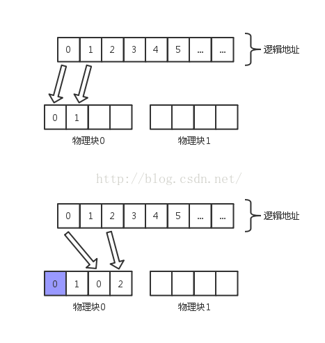
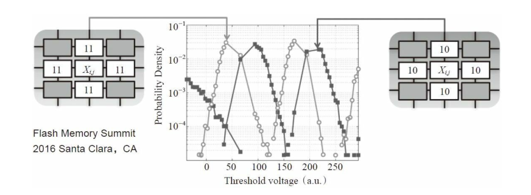

# FTL 基本功能

### 基本功能简介
FTL是Flash Translation Layer的缩写，是SSD的一个重要组成部分，实现了以下功能：

+ Interface Adapter： 在内部FTL中主要关联eMMC/SCSI/SATA/PCIe/NVMe等接口，而在外部FTL中主要关联Linux Block Device。
+ Address Translation： 地址映射，也可以叫做mapping，负责逻辑地址和物理地址之间的映射，多技术模块都以该机制为核心进行。众所周知，Nand Flash具有写时擦除的特性，因此写入数据时不得不异地更新。
+ 异处更新: Nand Flash编程操作只能把存储单元从1变为0，所以在重新编程之前需要进行擦除操作。而且编程以页为单位，擦除以块为单位(一个块包括多个页)。如果使用同处更新(in-place update)，就是把同逻辑地址重复更新到同样的位置上，那么每一次更新，都需要先进行一次擦除操作。由于擦除操作耗费时间和对Flash有损伤，所以一般FTL使用异处更新，把更新的数据映射到一个新的位置上。如下图，上层应用先写逻辑地址0、1，FTL把数据映射到Nand Flash的物理块0、1页上，然后上层应用又写逻辑地址0，此时物理块0第0页不能重新编程，所以FTL把数据存放在物理块0的第2页上。
  
+ Garbage Collection： 垃圾回收，简称GC，回收异地更新产生的脏数据所占空间的回收工作。
+ Wear Leveling： 磨损均衡，简称WL，避免某一个Nand Block很快坏去，使所有Block的PE Cycle均衡发展。因为flash的擦写次数是有限制的，如果不进行磨损均衡，整个SSD的有些block可能擦写次数不平衡很快坏去。
+ Power off Recovery： 掉电恢复，简称POR。正常掉电，SSD会把缓存中的数据刷新到闪存，重新加载保存的数据即可。如果是异常掉电，因为某些人为或自然外力的原因导致数据没有成功写入到Nand中，掉电恢复要恢复到掉电前的安全状态，比如恢复RAM中的数据和Address Translation中的映射表。
+ Parallelization and Load Balancing： SSD中存在的一定的并发性，利用这些并发性可以提供SSD的并发请求处理能力，提高其性能。
+ Cache Manager： Cache不仅可以存放用户数据，也可以存放FTL Metadata，对系统的整体性能有着天然的优势。
+  Error Handler： 处理读写操作中遇到的Fatal Error或ECC Error状况，以及Bad Block或Weak Block的管理。
   
## 地址映射的三种粒度

FTL 的核心是"逻辑页 → 物理页"的映射表，但表的粒度决定了代价：

| 粒度 | 映射项 | 表大小（512 GB / 4 KB 页） | 写放大 | 典型场景 |
|--|--|--|--|--|
| 块级（block-mapped） | 逻辑块号 → 物理块号 | 512 GB / 2 MB ≈ 26 万项 | 高（必须整块 RMW） | 早期/低成本控制器 |
| 页级（page-mapped） | 逻辑页号 → 物理页号 | 1.28 亿项 × 4 B ≈ 512 MB | 低 | 现代消费/企业级 |
| 混合（hybrid/log） | 数据块块级 + 日志块页级 | 取决于日志区大小 | 中 | 折中方案（如 FAST） |

**块级映射**的问题很直接：一个逻辑块内的任意一页被改写，都必须把整块读到 RAM、改一页、擦除原块、整块写回（read-modify-write）。对于 4 KB 随机写、2 MB 块，写放大会被放大到上百倍，因此现代 SSD 基本不用纯块级映射。

**页级映射**没有 RMW，但映射表本身巨大。512 MB 的表不可能全放 SRAM，因此需要：

- 映射表缓存（cache）：只把热页的映射放在 DRAM/L2P SRAM；
- 表项本身也要落盘，掉电后重新加载（见下文"掉电一致性"）；
- GC 搬迁有效页时必须同步更新映射表，这又反过来增加元数据写。

**混合映射**把"块内顺序写"作为基本假设：数据先写入日志块（页级映射），日志块写满后整体并入数据块（块级映射）。它在顺序写为主的负载下能把表压缩到很小，但随机写会让日志块频繁合并。

从内核角度看，这三者的区别完全不可见：块层只发 LBA，FTL 决定 PBA，`PBA` 从不出现在任何内核接口里。

## 垃圾回收：什么时候做、回收谁

GC 的本质是"把若干 block 里的有效页搬走，腾出整块再擦除"。它要回答两个问题：

**1. 何时触发？**

| 触发方式 | 条件 | 特点 |
|--|--|--|
| 后台 GC | 空闲块数低于低水位（low watermark） | 不阻塞主机写，但会与主机 I/O 争带宽 |
| 前台 GC | 主机写到来时已无可用块 | 写入延迟突增（尾延迟尖刺） |
| 强制/紧急 GC | 空闲块接近 0 | 可能触发大规模搬迁，性能骤降 |

预留空间（OP）越大，低水位可以设得越深，后台 GC 越从容，前台 GC 越少。

**2. 回收谁（victim 选择）？**

| 策略 | 依据 | 优点 | 缺点 |
|--|--|--|--|
| 贪心（greedy） | 选有效页最少的块 | 单次回收收益最大 | 忽略冷热，可能反复搬热数据 |
| cost-benefit | 有效页比例 + 数据年龄 | 兼顾收益与未来收益 | 需要维护年龄信息 |
| 磨损感知 | 叠加 P/E 次数 | 避免某些块先坏 | 增加决策复杂度 |

典型实现是"贪心 + 磨损修正"：先按无效页比例排序，再对 P/E 偏高的块降权。选错 victim 的代价会直接体现在写放大上——如果总挑"有效页很多"的块，每次回收都要搬大量数据，WA 飙升。

**GC 的完整步骤**：

```
选择 victim block
  → 读出其中所有有效页
  → 写到新的空闲页（并更新映射表）
  → 原子地切换映射（旧 PBA 作废）
  → 擦除 victim block
  → 放入 free block list
```

每一步都可能被掉电打断，因此需要"映射更新 + 擦除"之间的恢复机制，否则会出现"数据已搬走但映射还指向旧块"或"旧块已擦除但映射未更新"的悬挂状态。

## 写放大：定义、分解与估算

**写放大 WA = 介质实际写入量 / 主机请求写入量**。它的来源可以逐项拆开：

```
WA = 1（主机数据本身）
   + GC 搬迁的有效页
   + 小于页写的 read-modify-write
   + 映射表/日志等元数据
   + SLC 缓存折叠（SLC → TLC/QLC 的后台搬迁）
```

稳态下，如果用户数据占物理容量的比例为 `u`（`u = 1/(1+OP)`，OP 为预留比例），每次 GC 回收一个块时平均要搬走 `u` 比例的有效页，净腾出 `1-u`：

```
WA ≈ 1 / (1 - u) = (1 + OP) / OP
```

这是"均匀随机写 + 贪心 GC"的最坏情况上界模型。举例：

| OP | u | 模型 WA | 说明 |
|--|--|--|--|
| 7%（消费级默认） | 0.935 | ≈ 15 | 纯随机写的最坏上界 |
| 28%（企业级常见） | 0.78 | ≈ 4.5 | 企业级盘通常留更多 OP |
| 50%（重写盘） | 0.67 | ≈ 3 | 牺牲容量换寿命 |

真实盘会通过冷热数据分离、更大的有效 OP、SLC 缓存等把 WA 压到 2~4 的量级，但**趋势不变**：OP 越小、随机写越多，WA 越大。

内核侧能间接观察到 WA：

- `iostat -x` 的 `w/s` 是主机看到的写次数，不是介质写入量；
- NVMe 的 SMART/Health 日志里有 `Data Units Written`（以 1000×512 B 为单位），与主机写入量对比即可估算 WA；
- `nvme smart-log /dev/nvme0` 可直接读出该计数。

## OP 预留空间

OP = 物理容量 − 主机可见容量。它有三种来源：

1. **厂商默认预留**：标称 512 GB 的盘可能实装 544 GB，差额即 OP；
2. **用户主动预留**：不分区、或分区后对剩余空间发 `discard`/`trim`，让 FTL 视为空闲；
3. **ZNS 的 zone capacity**：每个 zone 的 `capacity` 小于 `len`，差额就是 zone 内 OP。

对内核可见的表现：

```bash
# 查看设备的 discard 能力（OP 相关的"可回收"边界）
cat /sys/block/nvme0n1/queue/discard_max_bytes
cat /sys/block/nvme0n1/queue/discard_granularity
```

```c
/* 内核接口：对一段 LBA 发 discard */
int blkdev_issue_discard(struct block_device *bdev, sector_t sector,
			 sector_t nr_sects, gfp_t gfp_mask);
```

驱动/sysfs 侧对应的队列限制是 `max_discard_sectors` 与 `discard_granularity`（`block/blk-sysfs.c` 中的 `QUEUE_LIM_RW_ENTRY(queue_max_discard_sectors, "discard_max_bytes")`）。

OP 的收益不是线性的：从 0% 提到 7% 对 WA 改善最大，从 28% 提到 50% 收益递减，但寿命几乎线性提升（可承载的主机写入总量 = 总 P/E 容量 / WA）。

## 掉电一致性与映射表持久化

映射表在 DRAM 里，掉电即失。恢复方案的核心是"checkpoint + journal"：

```
正常运行：
  主机写 → 写数据页到 NAND → 写映射日志（map journal）→ 返回完成
  映射日志积累到阈值 → 生成 checkpoint（全表/增量快照）写回 NAND

掉电后上电：
  读最后一个 checkpoint → 重放其后的映射日志 → 重建映射表
```

关键顺序约束：**先写数据，再写"数据已就位"的元数据，最后才向主机确认**。如果顺序反了，掉电后映射可能指向一个只写了一半的页。

内核对"何时算写完"的控制手段：

| 机制 | 内核表达 | 作用 |
|--|--|--|
| 写缓存 | NVMe VWC（Volatile Write Cache） | 盘内 DRAM 缓存，掉电丢失 |
| Flush | `REQ_PREFLUSH`、`blkdev_issue_flush()` | 要求设备把缓存刷到介质 |
| FUA | `REQ_FUA` | 单次写强制落介质，不经过易失缓存 |
| 文件系统 barrier | `blkdev_issue_flush()` / journal commit | 保证日志顺序 |

所以：

- 文件系统 `fsync()` 最终会落到 `REQ_PREFLUSH`/`REQ_FUA`，设备必须保证"返回时数据在 NAND 上"；
- 如果盘的映射日志还没落盘就报告 flush 完成，掉电后会出现"数据在、映射丢"的不可读块；
- 企业级盘通常靠电容（PLP）在掉电瞬间把 DRAM 中的映射与数据写完，消费级盘则依赖更保守的 checkpoint 频率。

## TRIM / DISCARD 在设备端做了什么

主机发 `REQ_OP_DISCARD`（对应 SATA TRIM、NVMe Dataset Management Deallocate）时，设备端并不擦除 NAND，而是：

1. 把该 LBA 范围对应的映射项标记为"无效/未映射"；
2. 让这些物理页在 GC 时被视为无效页，从而降低 victim 的有效页比例；
3. 读这些 LBA 返回全 0（或设备定义的"未写"状态）。

效果是"把未来的 GC 成本提前消掉"，所以 `fstrim` 之后随机写性能会恢复。内核里的相关约束：

| 约束 | 内核字段/函数 | 说明 |
|--|--|--|
| 单次 bio 大小 | `bio_discard_limit()`（`block/blk-lib.c`） | 按 `discard_granularity` 对齐，并限制在 `BIO_MAX_SIZE` 内；剩余部分循环拆成多个 bio |
| 请求级再切分 | `__bio_split_discard()`（`block/blk-merge.c`） | 再按 `max_discard_sectors` 与 granularity 切分，保证每段落在对齐边界 |
| 是否支持 | `bdev_max_discard_sectors() == 0` | `block/blk-core.c` 的 `submit_bio` 直接以 `BLK_STS_NOTSUPP` 拒绝，bio 以 `-EOPNOTSUPP` 结束 |
| 错误吞噬 | `blkdev_issue_discard()` | 把 `-EOPNOTSUPP` 改成 0 返回，因此"调用成功"不代表设备真的做了 discard |
| 安全擦除 | `blkdev_issue_secure_erase()` | 用于需要"不可恢复"的场景 |

文件系统侧通常有两种用法：挂载时 `discard`（每次删除立即下发，开销大）或定期 `fstrim`（批量下发，推荐）。

## 与内核 blk-zoned / mq-deadline 的交互

**mq-deadline** 只负责"按截止时间/优先级派发请求"，它不感知 NAND 内部的 GC 与写指针。因此：

- 设备内部 GC 造成的延迟尖刺，调度器无法提前规避；
- 顺序写之所以快，是因为 FTL 能把连续 LBA 映射到连续 PBA，从而减少 GC 与 RMW，而不是因为 mq-deadline 更"懂"顺序；
- 对随机写负载，`mq-deadline` 的合并与排序能减少请求数，但无法降低设备端的 WA。

**ZNS（Zoned Namespace）** 把"写指针"暴露给主机，等于把 FTL 的一部分上移：

```c
/* include/uapi/linux/blkzoned.h */
struct blk_zone {
	__u64	start;		/* Zone start sector */
	__u64	len;		/* Zone length in sectors */
	__u64	wp;		/* Zone write pointer location */
	__u8	type;		/* Zone type */
	__u8	cond;		/* Zone condition */
	__u8	non_seq;
	__u8	reset;
	__u32	capacity;	/* Zone usable capacity */
};
```

内核在处理顺序写约束时，7.2 已把"同一 zone 的写必须按 write pointer 顺序"下沉到 **zone write plugging**（`block/blk-zoned.c` 的 `struct blk_zone_wplug`），由它对同一 zone 的 bio 排队、更新 `wp_offset`、在 zone 满时切换状态；请求基于 mq 的设备（`disk_need_zone_resources()` 中 `queue_is_mq(disk)` 为真）自动启用。相关的队列限制包括：

```c
unsigned int	max_zone_append_sectors;
unsigned int	zone_write_granularity;
unsigned int	max_open_zones;
unsigned int	max_active_zones;
```

NVMe ZNS 设备在 `drivers/nvme/host/zns.c` 中通过 `nvme_update_zone_info()` 把 Identify Namespace 的 zone 信息写进 `queue_limits`，并解析 zone descriptor（`nvme_zone_parse_entry()`）。

本树 `CONFIG_BLK_DEV_ZONED` 未启用，因此上述 zone 路径属于"源码存在、当前配置未启用"；`CONFIG_MQ_IOSCHED_DEADLINE=y` 则说明 mq-deadline 是默认可用的调度器之一。

对 FTL 视角来说，ZNS 的收益是：

- 主机按 zone 顺序写 → 设备不需要"异地更新 + GC"来隐藏随机写；
- 写放大从"设备内部决定"变成"主机可预测、可控制"；
- OP 以 zone capacity 的形式显式暴露，主机必须自己管理空闲 zone。

## 读 FTL 时的一组自检问题

1. 这块盘的映射粒度是页级还是混合？——决定随机写 WA 的量级。
2. 空闲块低水位设在哪里？——决定后台 GC 是否有足够时间在主机空闲时完成。
3. victim 选择是否考虑 P/E？——决定寿命末期的坏块分布是否均匀。
4. 映射日志的 checkpoint 周期多长？——决定掉电恢复时间与 DRAM 需求。
5. 是否支持 discard？粒度与上限是多少？——决定 `fstrim` 能否真正降低 WA。
6. 是否有 SLC 缓存？折叠策略是什么？——决定持续写入时的"掉速"拐点。

这六个问题基本覆盖了"同一代 NAND、不同主控性能差异巨大"的原因：NAND 介质决定上限，FTL 策略决定实际表现。

### 闪存错误来源
1. 擦写次数过多,导致氧化层老化,电子易泄漏,读取数据异常.
2. cell中储存的电子自然流失,导致数据错误.
3. 读一个Wordline数据时，需要施加V pass 电压在其他Wordline上，导
致其他闪存页发生轻微写。如果读的次数过多，轻微写累积起来就会使
阈值电压分布发生右移，导致读数据时候发生误判，即读数据错误.
4. 存储单元相互干扰, 由于存储电子的浮栅极是导体，两个导体之间构成电容，一个存储单元电荷的变化会导致其他存储单元电荷变化，而受影响最大的就是与它相邻的存储单元。周围的单元是不同的状态时，中心单元的阈值电压是不一样的.
   
5. 写错误, 一般发生在MLC或者TLC 2-pass（先写Lower Page，然后再
写Upper Page）写过程中。写Upper Page的时候，它是基于之前Lower
Page的状态，然后再写每个存储单元到目标状态。如果写Upper Page的
时候，Lower Page数据已经出错（注意写Upper的时候，Lower Page的数
据是不会经过控制器ECC纠错的，写过程发生在闪存内部），就会导致
存储单元写到一个不期望的状态，即发生写错误。  
数据一开始就写错了，当然就别指望读对了。  
TLC 1-pass program则没有这个问题，因为Lower Page和Upper Page
是一次性同时写入，写Upper Page不依赖于Lower Page数据。当然，如
果一开始擦除状态就不对，那么还是会发生写错误。