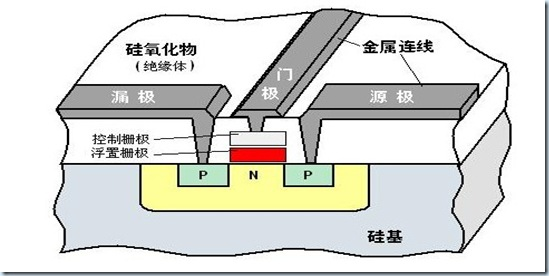
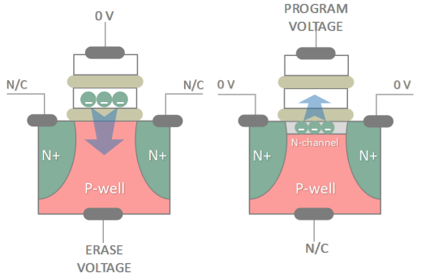
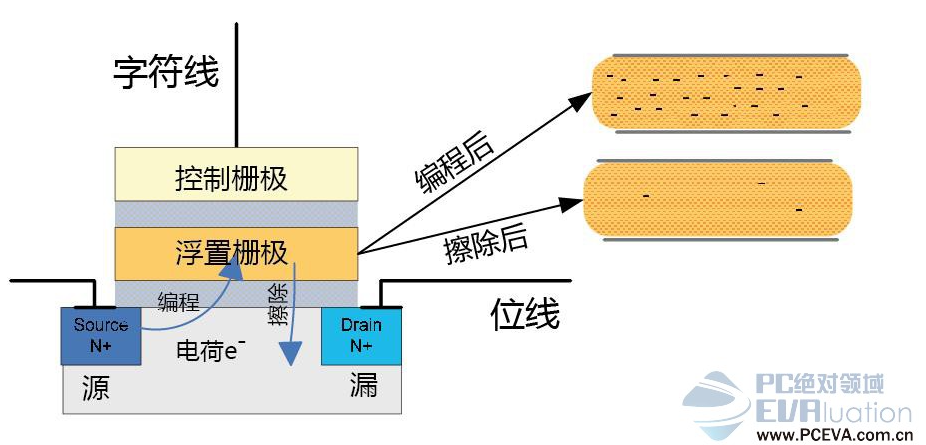
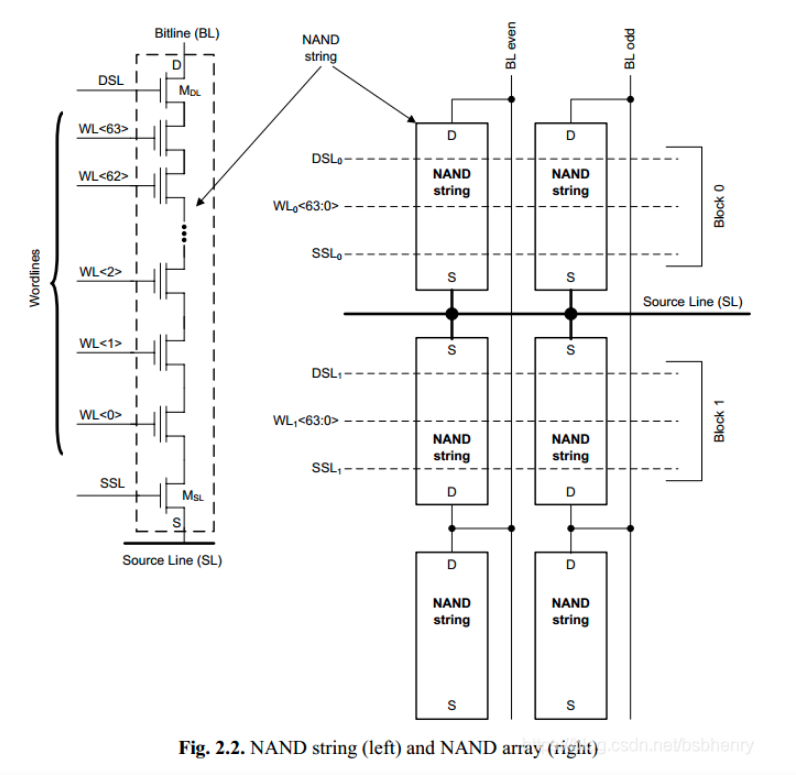
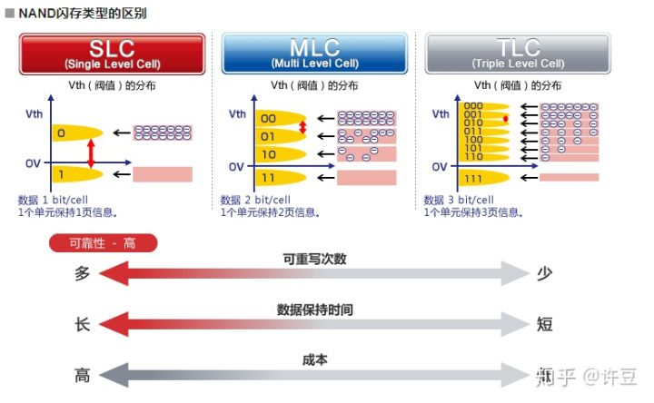

# 闪存内部原理

 ## 闪存内部原理

&nbsp;由其存储的颗粒结构，知道闪存式一种电压元件，其靠电压来存储数据，那么来看看其结构以及工作原理。闪存的内部存储结构是金属-氧化层-半导体-场效应管(MOSFET)：源极，漏极和栅极，其工作原理与场效应管类似，都是电压利用控制源极和漏极之间的通断，不同的是场效应管是单栅极结构，而闪存是双栅极结构，在栅极和硅衬底之间还有一个浮置栅极，浮置栅极是有氮化物夹在二氧化硅材料之间构成。





> 1. 对于闪存的写入，即控制栅极去充电，对栅极加压，使得浮置栅极存储的电荷越多，超过阈值，就表示0
> 2. 对于闪存的擦除，即对浮置栅极进行放电，低于阈值，就表示1
> 3. 读取数据时，我们同样会在控制闸施加电压，好吸住浮置闸里的电子，但不用到穿隧注入（Tunnel Injection）电子时那么高，同时让 N通道流过电流，利用电流来感应浮置闸里电子捕获量的多寡，靠感应强度转换为二进制的 0与1，最后输出成数据。

## Word Line


在String中，cell是串行方式连接的，一般32或64个一组，两端分别通过MSL连接到source line，MDL连接到bit line，并分别由晶体管控制开断。每个string和相邻的string（图中是上下方向）共用bit line。control gate是通过wordlines连接在一起。
Page是一个逻辑上的概念，page是由同一根wordline上的cell组成的。一根wordline上的page个数是由cell存储bit的能力决定的。SLC memory 单个cell可以存储1bit信息，MLC则可以存储2bit，TLC是3bit，QLC则是4bit。按照图中示意，bitline 分为even/odd两组，相应的cell也分为了两组，这两组分别属于两个page。
根据以上定义，则一个SLC的设备，一根wordline可以分为两个page，假设总共有65536个cell，则每个page的大小为4KB。
而MLC单个cell可以存储2bit的信息，则从逻辑上又可以进一步细分为两个page，一个是lower page，即由LSB（least significant bit）组成，一个是upper page,由MSL（most significant）组成。这样一个MLC的设备，一根wordline就分为了四个page。类似的，TLC单个cell可以存储3bit的信息，则有lower/middle/upper page。
对于擦除操作，同一组wordline上的所有string是一起进行的，它们组成了一个block。如上图，有两组wordline，WL0[63:0]和WL1[63:0]，对应的分别是block0，block1。

## 闪存寿命衰减原因
为什么没有机械结构的SSD还是出现寿命问题？因为按照工作原理，闪存单元每次写入或擦除的施加电压过程都会导致绝缘体硅氧化物的物理损耗。这东西本来就只有区区10纳米的厚度，每进行一次电子穿越就会变薄一些。

也正因为如此，硅氧化物越来越薄，电子可能会滞留在二氧化硅绝缘层，擦写时间也会因此延长，因为在达到何时的电压之前需要更长时间、更高的加压。主控制器是无法改变编程和擦写电压的。如果原本设计的电压值工作异常，主控就会尝试不同的电压，这自然需要时间，也会给硅氧化物带来更多压力，加速了损耗。

最后，主控控制编程和擦写一个TLC闪存单元所需要的时间也越来越长，最终达到严重影响性能、无法接受的地步，闪存区块也就废了。
## 闪存分类
**SLC MLC TLC介绍**

SLC Single-Level Cell，意味着每个存储单元只存放 1bit讯息，靠浮置闸里电子捕获状态的有或无来输出成数据（即使在 0的状态浮置闸里其实还是有电子，但不多），也就是最简单的 0与1；

MLC Multi-Level Cell，意味着每个存储单元可存放 2bit讯息，浮置闸里电子的量会分为高、中、低与无四种状态，转换为二进制后变成 00、01、10、11；

TLC Triple-Level Cell ，更进一步将浮置闸里的电子捕获状态分成八种，换算成二进制的 000、001、010、011、100、101、110、111，也就是3bit。

## SLC/MLC/TLC/QLC：电平数决定了什么

把"每个 cell 存几个 bit"翻译成物理量，就是**阈值电压被切成几个可区分的窗口**：

| 类型 | bit/cell | 电平数 | 每个窗口宽度 | 典型 P/E 量级 | 典型读延迟 | 典型用途 |
|--|--|--|--|--|--|--|
| SLC | 1 | 2 | 最宽 | 5 万~10 万 | 最低（单次比较） | 企业级缓存、工业 |
| MLC | 2 | 4 | 中 | 3 千~1 万 | 低 | 企业级/高端消费 |
| TLC | 3 | 8 | 窄 | 1 千~3 千 | 中 | 主流消费级 |
| QLC | 4 | 16 | 最窄 | 数百~1 千 | 高（需多次比较/软判） | 读多写少的容量盘 |

（P/E 数值是量级参考，随工艺代际、3D 堆叠层数与厂商差异很大。）

窗口越窄，三个后果同时出现：

1. **读判决变慢**：SLC 只需一次"高于/低于参考电压"；TLC 需要多次读不同参考电压才能定位 8 个状态之一，QLC 更多，且常需 LDPC 软判决（多次读 + 似然比）。
2. **可靠性余量变小**：同样的电荷泄漏（ retention）或读干扰造成的阈值漂移，在宽窗口里不算事，在窄窗口里就跨过了判决边界。
3. **编程更精细**：为把电子精确注入到 8/16 个目标窗口之一，需要更多"编程-校验"（program-verify）循环，写入变慢；这也是 TLC/QLC 盘普遍带 SLC 写缓存（把新写入先按 SLC 存，空闲时再搬成 TLC/QLC）的原因。

内核侧并不直接"理解"这些差异，它只在 MTD 层记录了每个 cell 的位数：

```c
/* include/linux/mtd/nand.h */
struct nand_memory_organization {
	unsigned int bits_per_cell;
	unsigned int pagesize;
	unsigned int oobsize;
	unsigned int pages_per_eraseblock;
	unsigned int eraseblocks_per_lun;
	...
};
```

`bits_per_cell` 大于 1 时，驱动还需要提供 page pairing（哪个 page 共享同一组 cell）：

```c
/* include/linux/mtd/mtd.h */
/*
 * NAND pairing scheme, only provided for MLC/TLC NANDs
 */
const struct mtd_pairing_scheme *pairing;
```

`mtd_pairing_scheme` 的 `get_info()`/`get_wunit()` 负责在"页号"和"pair + group（lower/upper/middle page）"之间转换。这是因为 MLC/TLC 的多个 page 共享同一批 cell，**写入 upper page 会改变 lower page 已写入的 cell 状态**，所以写顺序和掉电恢复都必须按 pairing 规则处理。

## 编程与擦除的物理机理：FN 隧穿

NAND 的"写 0 / 擦 1"本质上是"往浮栅里放进/取出电子"，靠的都是 **Fowler-Nordheim（FN）隧穿**：

```
编程（1 → 0，页为单位）
  控制栅加高电压 Vpgm，衬底接地
  → 氧化层承受强电场（约 10 MV/cm 量级）
  → 电子隧穿进入浮栅，阈值电压 Vth 右移
  → 逐级提高 Vpgm（ISPP：Incremental Step Pulse Programming），
    每步后做 program-verify 读回，直到达到目标窗口

擦除（0 → 1，块为单位）
  衬底/well 加高压，控制栅接地（或负压）
  → 电子从浮栅隧穿回衬底
  → Vth 左移，整块回到"全 1"状态
```

几个由此推出的工程事实：

- **擦除慢且必须按块**：擦除要把整块所有 cell 的浮栅同时放电，电压高、时间长（毫秒级），远慢于编程（微秒级）与读取（微秒级以下到十几微秒）。这就是"SSD 需要 FTL 做异地更新、需要 GC 回收整块"的根源。
- **编程只能 1→0**：FN 编程只能增加浮栅电子，擦除才能减少。因此对同一页重复写必须先擦除整块，FTL 才被迫使用"写新页 + 旧页作废"的异地更新。
- **页内的多个子页有顺序**：MLC/TLC 的 lower page 先写、upper page 后写，写 upper 时依赖 lower 的既有状态；若写 upper 期间掉电，同一组 cell 的 lower 数据也可能被破坏。这正是笔记里"写错误"一节的物理来源。
- **program disturb / read disturb**：编程某页时，同一条 wordline 或相邻 wordline 上的 cell 会承受 Vpass 电压；读某页时，其他 wordline 也要加 Vpass。每一次"路过"都可能让浮栅轻微注入或泄漏电子，累积后阈值漂移。SLC 窗口宽，能容忍更多次；TLC/QLC 窗口窄，容忍次数显著更低，因此企业级盘会定期做 **read reclaim**（把被读多次的数据搬走并重新编程）。

## P/E 循环退化、数据保持与温度

每次编程/擦除都会在隧穿氧化层（约 10 nm 的 SiO₂）中留下陷阱电荷、产生界面态，甚至形成微小漏电通路。宏观表现按时间顺序大致是：

| 阶段 | 现象 | 对上层的影响 |
|--|--|--|
| 初期（几十~几百 P/E） | 氧化层陷阱增多，Vth 分布变宽 | 误码率缓慢上升，ECC 尚能轻松纠正 |
| 中期（千级 P/E） | 编程窗口变窄、编程变慢，出现弱块（weak block） | 需要更强 ECC/读重试（read retry 调整参考电压） |
| 后期（接近寿命） | 数据保持能力显著下降，出现增长坏块 | 坏块管理接管；再恶化则整盘只读或报错 |

**数据保持（retention）** 是另一个独立维度：即使不通电，浮栅里的电子也会因热激发缓慢泄漏。泄漏速率近似服从 Arrhenius 关系，温度每升高约 10 ℃，退化速度显著加快（常被粗略描述为"翻倍"量级）。因此：

- 厂商的 retention 指标通常标注"在 xx ℃ 下断电保存 x 年"；
- 高温环境下（例如密闭机箱、车载）实际保持时间大幅缩短；
- 长期存放的盘首次上电时，读错误率会明显高于"刚写完"的状态，需要 ECC 甚至 read retry 才能读回；
- 这也解释了"冷数据"需要后台巡检（media scan / patrol read）：定期把数据读出来校验并在必要时重写，防止错误累积到不可纠正。

**读干扰（read disturb）** 与 retention 方向相反但同样致命：读一个 page 会在其他 wordline 上加 Vpass，导致这些 cell 的 Vth 缓慢右移。读得越多，漂移越大。它与 retention（左移/泄漏）叠加后，Vth 分布会向两侧同时"糊开"，最终超出 ECC 的纠错能力。

## 原始误码率 BER 与 ECC 强度匹配

**BER（raw Bit Error Rate）** 指"ECC 纠错之前，读出的 bit 中出错的比例"。它随以下因素单调恶化：

```
BER ↑
  ├─ P/E 次数（氧化层退化）
  ├─ retention 时间与温度
  ├─ 读干扰累积（读次数）
  ├─ 编程干扰 / 相邻 cell 耦合
  └─ 工艺代际（3D 堆叠层数越高，工艺越难均一）
```

ECC 的作用是把"原始 BER"压到"不可纠正错误率（UBER）"可接受的水平。现代 SSD 普遍把数据切成固定大小的 **ECC step**（如 1 KB 或 2 KB），每个 step 独立编码：

```
ECC step 内可纠正 bit 数 = strength
要求：strength > 最坏情况下该 step 的期望错误 bit 数 × 安全系数
```

以 TLC 为例，寿命末期原始 BER 可能达到 1e-2 量级，一个 1 KB（8192 bit）的 step 期望错误约 80 bit，因此需要每 1 KB 上百 bit 的纠错能力；这也是 TLC/QLC 普遍采用 LDPC（而非早期 BCH）的原因——LDPC 在同等冗余下纠错能力更强，且支持软判决。

内核对这套东西的抽象非常克制，只保留三个数：

```c
/* include/linux/mtd/mtd.h */
unsigned int ecc_step_size;	/* 每个 ECC step 的字节数 */
unsigned int ecc_strength;	/* 每个 step 最多可纠正的 bit 数 */
unsigned int bitflip_threshold;	/* 达到该值就返回 -EUCLEAN */

/* include/linux/mtd/nand.h */
struct nand_ecc_props {
	enum nand_ecc_engine_type engine_type;
	enum nand_ecc_placement placement;
	enum nand_ecc_algo algo;
	unsigned int strength;
	unsigned int step_size;
	unsigned int flags;
};
#define NAND_ECCREQ(str, stp) { .strength = (str), .step_size = (stp) }
#define NAND_ECC_MAXIMIZE_STRENGTH BIT(0)
```

驱动可以：

1. 从 ONFI Parameter Page 或 `nand_ecc_props.defaults/requirements` 读出器件要求；
2. 用 `NAND_ECC_MAXIMIZE_STRENGTH` 让核心在"OOB 空间允许"的范围内自动选最大强度：`nand_ecc_choose_conf()`（`drivers/mtd/nand/raw/nand_base.c`）在用户未显式指定 `ecc.size/ecc.strength` 时调用 `nand_maximize_ecc()`；软件 BCH 引擎（`ecc-sw-bch.c`）也直接读这个 flag；
3. 在 `mtd->ecc_stats` 中累计可纠正/不可纠正错误数，用户可通过 `ECCGETSTATS` ioctl 读取：

```c
/* include/uapi/mtd/mtd-abi.h */
struct mtd_ecc_stats {
	__u32 corrected;	/* number of corrected bits */
	__u32 failed;		/* number of uncorrectable errors */
	__u32 badblocks;	/* number of bad blocks in this partition */
	__u32 bbtblocks;	/* number of blocks reserved for bad block tables */
};
```

`bitflip_threshold` 是"告警线"而不是"纠错线"：当某个 step 的可纠正 bit 数达到该阈值，读操作返回 `-EUCLEAN`。上层据此安排数据刷新——UBI 的 `drivers/mtd/ubi/wl.c` 就把 `-EUCLEAN` 视为"发生了 bit flip，需把该 PEB 排入 scrubbing"，从而在错误真正变成不可纠正之前把数据搬到新位置。默认值等于 `ecc_strength`（即"接近极限才告警"），可在 sysfs 里按 `mtd->bitflip_threshold` 调整。

一条实用的判断链：

```
读返回 -EUCLEAN        → bitflip 达到阈值，数据仍正确，但该块该刷新
读返回 -EIO / failed++ → 不可纠正错误，数据已丢失
擦除返回 -EIO          → 目标是坏块/保留块（nanddev_erase() 直接拒绝）
```

`drivers/mtd/nand/core.c` 的 `nanddev_erase()` 就是这一层的守门人：

```c
static int nanddev_erase(struct nand_device *nand, const struct nand_pos *pos)
{
	if (nanddev_isbad(nand, pos) || nanddev_isreserved(nand, pos)) {
		pr_warn("attempt to erase a bad/reserved block @%llx\n",
			nanddev_pos_to_offs(nand, pos));
		return -EIO;
	}

	return nand->ops->erase(nand, pos);
}
```

## 小结：从物理到内核的一条链

```
cell 窗口宽度（SLC→QLC）
   → 可容忍的 Vth 漂移变小
   → 最坏 BER 变大
   → 需要更强 ECC / 更多 read retry / 更频繁 read reclaim
   → 写放大与延迟抖动变大
   → 内核侧表现为 -EUCLEAN、坏块增长、discard 后性能恢复
```

读物理篇时如果只记住一句话：**NAND 的所有"怪现象"都源自"电子只能按块擦除、按页注入，而电子会跑"**。

**性能 寿命 成本**
