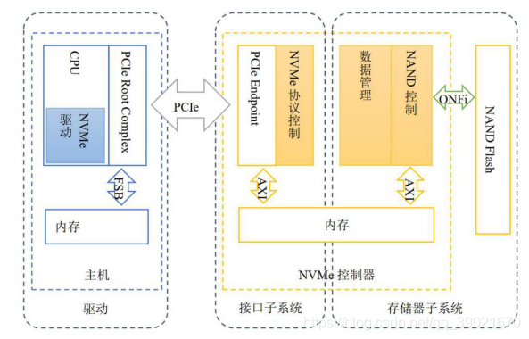
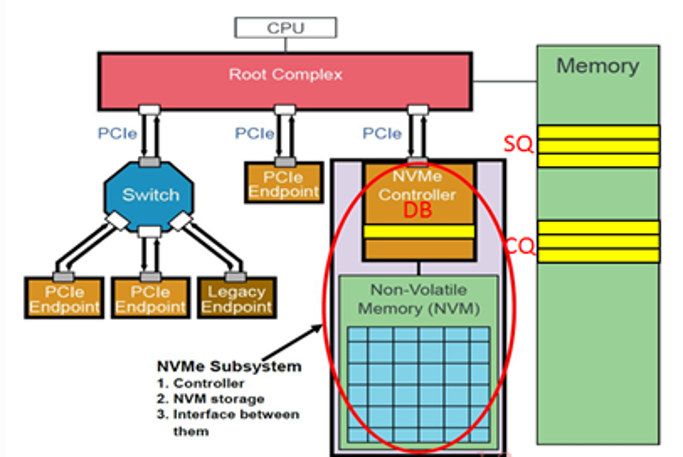
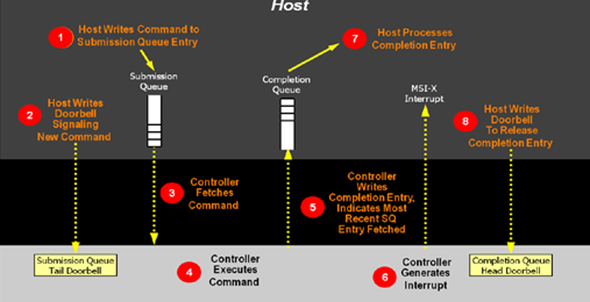

# NVMe 设备基本结构

## nvme设备基本结构


## nvme命令执行过程
SQ位于Host内存中，Host要发送命令时，先把准备好的命令放在SQ中，然后通知SSD来取；CQ也是位于Host内存中，一个命令执行完成，成功或失败，SSD总会往CQ中写入命令完成状态。DB则是在Host发送命令时，不是直接往SSD中发送命令的，而是把命令准备好放在自己的内存中，Host就是通过写SSD端的DB寄存器来告知SSD命令已经处理完毕，可以前来检阅。


## 从 PCIe 功能到 NVMe 控制器

一块 NVMe SSD 在 PCIe 总线上表现为一个（或多个）PCI Function。主机枚举到它之后，通过 BAR 映射控制器寄存器，通过 DMA 访问主机内存中的队列与数据缓冲区。

```text
+----------------------- NVMe SSD（PCIe Function） -----------------------+
| Controller                                                              |
|  ├─ PCIe 配置空间 / BAR0（MMIO 寄存器 + Doorbell）                       |
|  ├─ Admin Queue（qid 0）                                                 |
|  ├─ I/O Queues（qid 1..N）                                               |
|  ├─ Namespace 1（NSID=1）── LBA 0 .. N1-1                                |
|  ├─ Namespace 2（NSID=2）── LBA 0 .. N2-1                                |
|  └─ NAND 控制器：channel / die / plane                                    |
+-------------------------------------------------------------------------+
```

需要区分三个概念：

| 概念 | 含义 | 主机如何看到 |
|------|------|--------------|
| Controller | 管理队列、执行命令、上报状态的实体 | `/dev/nvme0` 字符设备、sysfs |
| Namespace | 一块可寻址的 LBA 空间 | `/dev/nvme0n1` 块设备 |
| NAND 介质 | 实际存储数据的颗粒 | 主机不可见，由 FTL 管理 |

一个控制器可以有多个 namespace，一个 namespace 也可以被多个控制器共享（多路径/双端口）。namespace 与 NAND 的物理布局没有固定对应关系，中间隔着 FTL。

### 控制器寄存器与状态机

控制器通过 BAR0 暴露的寄存器控制启动、复位与中断。最关键的几个：

| 寄存器 | 关键字段 | 作用 |
|--------|----------|------|
| CAP | MQES、CQR、TO、DSTRD、CSS、MPSMIN/MAX、CMBS | 控制器能力 |
| VS | 版本号 | 规范版本 |
| CC | EN、CSS、MPS、IOSQES、IOCQES、SHN | 配置控制器 |
| CSTS | RDY、CFS、SHST | 控制器状态 |
| AQA | ASQS、ACQS | Admin 队列深度 |
| ASQ / ACQ | 物理地址 | Admin SQ/CQ 基址 |
| INTMS / INTMC | 中断掩码 | 屏蔽/恢复 MSI-X |

控制器状态机可以简化为：

```text
上电/复位
   │  CC.EN = 0
   ▼
Disabled ── 配置 AQA/ASQ/ACQ ──► CC.EN = 1
   ▲                                      │
   │                                      ▼
   │                              等待 CSTS.RDY = 1
   │                                      │
   └──────── CC.EN = 0 ◄──────────── Ready（可执行命令）
                                          │
                                   CC.SHN = 1（正常关机）
                                          ▼
                                   CSTS.SHST = 10b
```

关键字段：

- **MQES**：最大队列深度减 1，16 位，因此单队列最多 65536 项；
- **CQR**：是否要求连续队列；
- **DSTRD**：doorbell 步长，0 表示每对队列间隔 8 字节；
- **CSS**：支持的命令集（NVM、ZNS 等）；
- **MPSMIN/MAX**：支持的页大小；
- **TO**：控制器超时时间。

### Namespace 的发现

主机通过 Admin 命令 `Identify`（`06h`）发现 namespace：

| CNS 值 | 返回内容 |
|--------|----------|
| `00h` | Identify Namespace（指定 NSID） |
| `01h` | Identify Controller |
| `02h` | Namespace ID 列表（活动） |
| `03h` | Namespace ID 列表（已分配） |
| `06h` | Identify Namespace 的 CSI 扩展 |
| `10h` | Namespace Attachment（namespace 与控制器/主机的挂接关系） |

内核在 `nvme_init_ctrl()` 之后扫描 namespace 列表，对每个 NSID 发 Identify Namespace，读取 `nsze/ncap/nuse/flbas/lbaf[]`，再创建 `gendisk`。如果设备支持 Namespace Management，还可以通过 Admin 命令动态创建/删除 namespace。

## SQ/CQ 队列对与 Doorbell

### 环形队列的内存布局

每个队列对由一段主机内存组成：

```text
SQ（depth = 8，64B/项）                      CQ（depth = 8，16B/项）
+------+------+------+------+------+        +------+------+------+------+
| SQE0 | SQE1 | SQE2 | SQE3 | ...  |        | CQE0 | CQE1 | CQE2 | ...  |
+------+------+------+------+------+        +------+------+------+------+
   ▲                    ▲                       ▲                  ▲
  head                 tail                    head               tail
（控制器维护）        （主机写）              （主机读）        （控制器写）
```

- **SQ**：主机写 SQE，更新 `sq_tail`，然后写 SQ Tail Doorbell；
- **CQ**：控制器写 CQE，更新内部 `cq_tail`，发中断；主机读 CQE，更新 `cq_head`，写 CQ Head Doorbell；
- **SQ Head** 由控制器维护，通过 CQE 的 `sq_head` 字段告知主机哪些槽位可回收；
- **CQ Tail** 不直接暴露，主机通过 **Phase Tag** 判断 CQE 是否是新写入的。

### Doorbell 地址

Doorbell 位于 BAR0 偏移 `0x1000` 之后，每个队列两个 32 位寄存器：

| 队列 | SQ Tail Doorbell | CQ Head Doorbell |
|------|------------------|------------------|
| Admin（qid 0） | `0x1000` | `0x1004` |
| I/O qid 1 | `0x1000 + 8` | `0x1000 + 12` |
| I/O qid 2 | `0x1000 + 16` | `0x1000 + 20` |
| ... | ... | ... |

若 `DSTRD > 0`，每对队列的间隔按 `4 << DSTRD` 字节扩展。内核用 `dev->db_stride = 1 << CAP.STRIDE` 表示以 32 位为单位的步长，doorbell 指针为：

```c
nvmeq->q_db = &dev->dbs[qid * 2 * dev->db_stride];
```

写 doorbell 的代码在 `nvme_write_sq_db()`，读完成后的 CQ Head 更新在 `nvme_ring_cq_doorbell()`。

### Phase Tag

CQ 是一个环形缓冲区，主机如何区分“新完成项”和“上一轮残留”？靠 CQE 的 `status` bit0——Phase Tag：

```text
初始：cq_phase = 1
控制器写 CQE 时，把当前 phase 写入 status.P
主机读取时比较 status.P 与 cq_phase：
  相等  → 新 CQE，消费
  不等  → 队列为空，停止
CQ 绕一圈后，控制器翻转 phase；主机也翻转 cq_phase
```

内核 `struct nvme_queue` 中的 `cq_phase` 就是主机期望的 phase。这个机制避免了额外的“有效位”数组，也让 CQ 可以完全由硬件写入。

### 内存序

队列是主机与设备共享内存，必须保证顺序：

- 主机先写 SQE 内容，再写 doorbell；中间需要写屏障，防止 doorbell 先于 SQE 到达；
- 主机读 CQE 后，先确认 phase，再读 `command_id`/`status`；需要读屏障；
- 控制器写 CQE 后，需要保证数据 DMA 完成再发中断。

内核在 `nvme_sq_copy_cmd()` 与 `nvme_write_sq_db()` 之间、`nvme_poll_cq()` 中都有相应的屏障与注释。

## Admin 队列与 I/O 队列

| 维度 | Admin 队列 | I/O 队列 |
|------|------------|----------|
| qid | 0 | 1..N |
| 数量 | 固定 1 对 | 最多 64K 对 |
| 建立方式 | 通过 AQA/ASQ/ACQ 寄存器 | Admin 命令 Create CQ/SQ |
| 默认深度 | 32（`NVME_AQ_DEPTH`） | CAP.MQES+1，内核默认 1024 |
| 中断向量 | 通常 vector 0 | 每队列一个 MSI-X 向量 |
| 典型命令 | Identify、Set/Get Features、Create/Delete 队列、日志、固件 | Read、Write、Flush、DSM、Write Zeroes |
| 提交方式 | 同步等待（`nvme_submit_sync_cmd()`） | blk-mq 异步提交 |
| 生命周期 | 控制器使能即存在 | 驱动 probe 时创建，reset 时重建 |

### 创建 I/O 队列

I/O 队列不是靠寄存器配置，而是靠 Admin 命令：

```text
Create I/O Completion Queue（05h）
  ├─ QID      队列 ID
  ├─ QSIZE    队列深度 - 1
  ├─ PC       物理连续标志
  ├─ IEN      是否使能中断
  ├─ IV       中断向量
  └─ CQID     该 CQ 的 ID

Create I/O Submission Queue（01h）
  ├─ QID      队列 ID
  ├─ QSIZE    队列深度 - 1
  ├─ PC       物理连续标志
  ├─ QPRIO    优先级
  └─ CQID     关联的 CQ
```

删除顺序相反：先 Delete SQ（`00h`），再 Delete CQ（`04h`）。队列数量通过 Set Features 的 Feature ID `07h`（Number of Queues）协商，控制器返回实际分配的 SQ/CQ 数量。

内核在 `nvme_setup_io_queues()` 中：

1. 读取 CAP.MQES 与 `io_queue_depth`，确定 `dev->q_depth`；
2. 根据 CPU 数量、`write_queues`、`poll_queues` 计算所需 I/O 队列数；
3. 申请 MSI-X 向量（`pci_alloc_irq_vectors_affinity()`）；
4. 为每个队列分配 SQ/CQ 内存与 tag；
5. 通过 Admin 命令逐个 Create CQ/SQ；
6. 把队列注册到 blk-mq tagset。

## 数据寻址：PRP 与 SGL

命令只携带数据缓冲区的“描述”，真正的数据由控制器 DMA 读写。NVMe 支持两种描述方式。

### PRP（Physical Region Page）

PRP 是物理页描述符，每个 8 字节：

```text
PRP1 ──► 第一个数据页（允许页内偏移）
PRP2 ──► 第二个数据页
          或
          PRP List 页 ──► [PRP entry 0]
                          [PRP entry 1]
                          ...
                          [PRP entry 510]
                          [指向下一个 PRP List 页]
```

规则：

- PRP entry 指向的地址必须页对齐（第一页的 PRP1 可以带偏移）；
- 一个 4 KB 的 PRP List 页可放 512 个 8 字节 entry，但最后一个通常用于链接下一页，因此内核 `PRPS_PER_PAGE` 为 511；
- 首尾允许页内偏移，传输长度不要求是页大小的整数倍；
- PRP List 本身也必须页对齐。

举例：

| 传输大小 | PRP 使用方式 |
|----------|--------------|
| ≤ 4 KB | 只用 PRP1 |
| 4–8 KB | PRP1 + PRP2 |
| > 8 KB | PRP1 + PRP2 指向 PRP List |

内核在 `nvme_map_data()` 中把 `bio_vec`/`scatterlist` 映射成 PRP 或 SGL，并处理首尾偏移。`NVME_MAX_SEGS` 与 `PRPS_PER_PAGE` 定义了单条命令能描述的最大分散段数。

### SGL（Scatter Gather List）

SGL 是更通用的描述符，每个 16 字节（Keyed SGL 为 24 字节），支持：

- 数据块描述符（地址 + 长度）；
- 段描述符（指向下一段 SGL）；
- Bit Bucket（丢弃数据）；
- Last Segment 标志；
- Keyed SGL（NVMe-oF 使用）。

SGL 可以放在 SQE 内（小传输），也可以放在主机内存中（大传输）。SQE 的 `flags.PSDT` 选择 PRP 还是 SGL：

| PSDT | 含义 |
|------|------|
| `00b` | PRP |
| `01b` | SGL |
| `10b` | 保留/命令特定 |
| `11b` | 保留 |

普通块 I/O 通常用 PRP；NVMe-oF 与需要复杂分散/聚集的场景用 SGL。控制器在 Identify Controller 中报告是否支持 SGL。

## 中断、完成与轮询

### MSI-X

NVMe 使用 MSI-X 中断，每个 CQ 可以绑定一个独立向量：

```text
vector 0  ── Admin CQ
vector 1  ── I/O CQ 1
vector 2  ── I/O CQ 2
...
```

内核通过 `pci_alloc_irq_vectors_affinity()` 申请向量，并把每个队列的中断亲和到提交该队列的 CPU。这样完成中断在本 CPU 上处理，缓存局部性最好。

`INTMS`/`INTMC` 可以屏蔽/恢复中断；中断合并（Interrupt Coalescing，Feature ID `08h`）可以设置聚合阈值与超时，在高 IOPS 下减少中断次数。

### 完成处理

```text
MSI-X 中断
   │
   ▼
nvme_irq()
   │
   ▼
nvme_poll_cq()  ── 逐项检查 phase
   │
   ▼
nvme_handle_cqe()
   │
   ├─ 读取 command_id，找到对应请求
   ├─ 检查 status（SC/SCT）
   └─ blk_mq_complete_request()
   │
   ▼
nvme_ring_cq_doorbell()  ── 更新 CQ Head
```

关键点：

- 一次中断可能对应多个 CQE，`nvme_poll_cq()` 会一直消费到 phase 不匹配为止；
- 只有消费完一批 CQE 后才写一次 CQ Head Doorbell，减少 MMIO；
- 完成项中的 `sq_head` 告诉主机 SQ 中哪些槽位已经可以复用；
- 错误通过 `status` 的 SC/SCT 返回，core 层决定重试、失败或复位控制器。

### 轮询模式

对延迟敏感的场景可以不用中断：

- **poll queue**：`poll_queues` 模块参数指定若干 I/O 队列不申请中断，由 `nvme_poll()` 主动轮询 CQ；
- **io_uring IOPOLL**：用户态直接轮询完成，避免中断与上下文切换；
- **混合轮询**：先短暂忙等，超时后再睡眠等中断。

在 `CONFIG_PREEMPT_RT=y` 的内核上，MSI-X 中断默认线程化，完成路径会多一次唤醒；poll 模式可以绕过这部分开销，但会占用 CPU。

## 命令执行全流程

把前面的部件串起来，一条读命令的完整生命周期如下：

```text
主机                                                          控制器
 │                                                              │
 ├─ 1. blk-mq 取出请求，调用 nvme_queue_rq()                     │
 ├─ 2. nvme_setup_cmd() 填 64B SQE（opcode=Read, nsid, slba…）   │
 ├─ 3. nvme_map_data() 生成 PRP/SGL，DMA map                     │
 ├─ 4. nvme_sq_copy_cmd() 把 SQE 拷到 SQ[sq_tail]                │
 ├─ 5. nvme_write_sq_db() 写 SQ Tail Doorbell ─────────────────► │
 │                                                              ├─ 6. DMA 读 SQE
 │                                                              ├─ 7. 校验命令、定位 namespace/LBA
 │                                                              ├─ 8. FTL 查表，读 NAND page
 │                                                              ├─ 9. DMA 写数据到 PRP/SGL
 │                                                              ├─ 10. 写 16B CQE 到 CQ
 │ ◄──────────────────────────── 11. MSI-X 中断 ────────────────┤
 ├─ 12. nvme_irq() → nvme_poll_cq()                             │
 ├─ 13. 检查 phase、command_id、status                          │
 ├─ 14. blk_mq_complete_request() 完成请求                      │
 ├─ 15. nvme_ring_cq_doorbell() 写 CQ Head ───────────────────► │
 └─ 16. 释放 tag，请求结束                                       │
```

### Admin 命令的同步路径

Admin 命令通常需要“发出去等结果”，内核用同步方式：

```text
nvme_submit_sync_cmd()
  ├─ nvme_alloc_request()      分配 request 与 tag
  ├─ nvme_setup_cmd()          填 SQE
  ├─ nvme_execute_rq()         提交到 admin 队列
  ├─ wait_for_completion()     等待 CQE
  └─ 返回 result / status
```

Admin 队列使用独立的 tagset，不与 I/O 队列争用 tag；`NVME_AQ_DEPTH` 为 32。

### 门铃合并与完成批处理

每条命令都写一次 doorbell 会造成大量 MMIO。内核做了两级优化：

- **提交批处理**：blk-mq 一次可能下发多个请求，`nvme_write_sq_db(nvmeq, bd->last)` 只在最后一个请求时敲门铃；
- **完成批处理**：`nvme_poll_cq()` 消费完一批 CQE 后只写一次 CQ Head。

在虚拟化场景下还有 **shadow doorbell buffer**（`dbbuf`）：主机把 doorbell 写到共享内存，控制器批量读取，减少 VM exit。

## 队列深度与性能

### 理论吞吐

在忽略设备内部限制时：

```text
IOPS ≈ 队列深度 / 单次延迟
```

以 10 µs 延迟为例：

| 队列深度 | 理论 IOPS（单队列） |
|----------|---------------------|
| 1 | 100 K |
| 32 | 3.2 M |
| 128 | 12.8 M |
| 1024 | 102 M |

现实中设备受 NAND 并行度、FTL、ECC、PCIe 带宽限制，远达不到这些数字；但这个模型说明了为什么 NVMe 要把队列深度做大。

### 延迟与队列深度的关系

- **低 QD**：延迟接近单次 I/O 的介质+协议开销，IOPS 上不去；
- **中 QD**：设备内部并行性被填满，IOPS 线性上升；
- **高 QD**：内部队列饱和，延迟快速上升，IOPS 趋于平台。

因此调优时不能只看“最大 QD”，要看目标负载下的延迟拐点。

### 队列数量与 CPU

内核按 CPU 数量创建 I/O 队列（受控制器能力与模块参数限制）：

- 每个 CPU 一个队列，避免跨 CPU 锁竞争；
- 读/写队列可以分开（`write_queues`），避免读被写阻塞；
- poll 队列单独划分（`poll_queues`），服务低延迟轮询 I/O；
- 队列太多会增加中断与内存开销，太少则无法利用多核。

### 内存开销

每队列的内存：

```text
SQ: depth × 64 B
CQ: depth × 16 B
合计 ≈ depth × 80 B
```

depth=1024 时约 80 KB/队列；64 个队列约 5 MB。这也是为什么内核默认 `io_queue_depth=1024` 而不是直接用 64K。

### CMB、PMR 与 HMB

| 机制 | 位置 | 用途 |
|------|------|------|
| CMB（Controller Memory Buffer） | 控制器内部 | 存放 SQ/CQ 或数据，减少主机内存往返 |
| PMR（Persistent Memory Region） | 控制器内部 | 持久内存语义 |
| HMB（Host Memory Buffer） | 主机内存 | 低成本控制器借用主机内存做缓存 |
| Shadow Doorbell | 主机内存 | 虚拟化下减少 MMIO/VM exit |

内核在 `pci.c` 中通过 `nvme_map_cmb()`、`host_mem_size`、`dbbuf` 等字段支持这些能力。

## 内核对象映射

| 概念 | 内核结构/函数 | 位置 |
|------|---------------|------|
| PCIe 设备与队列集合 | `struct nvme_dev` | `drivers/nvme/host/pci.c:294` |
| 单个队列 | `struct nvme_queue` | `drivers/nvme/host/pci.c:365` |
| 控制器通用对象 | `struct nvme_ctrl` | `drivers/nvme/host/nvme.h` |
| namespace | `struct nvme_ns` | `drivers/nvme/host/nvme.h` |
| 命令构造 | `nvme_setup_cmd()` | `drivers/nvme/host/core.c:1097` |
| 提交请求 | `nvme_queue_rq()` | `drivers/nvme/host/pci.c:1436` |
| 数据映射 | `nvme_map_data()` | `drivers/nvme/host/pci.c:1245` |
| 写 SQE | `nvme_sq_copy_cmd()` | `drivers/nvme/host/pci.c:735` |
| 写 SQ doorbell | `nvme_write_sq_db()` | `drivers/nvme/host/pci.c:718` |
| 中断处理 | `nvme_irq()` | `drivers/nvme/host/pci.c:1630` |
| 轮询 CQ | `nvme_poll_cq()` | `drivers/nvme/host/pci.c:1609` |
| 处理 CQE | `nvme_handle_cqe()` | `drivers/nvme/host/pci.c:1562` |
| 写 CQ doorbell | `nvme_ring_cq_doorbell()` | `drivers/nvme/host/pci.c:1546` |

`struct nvme_queue` 中的关键字段与硬件一一对应：

| 字段 | 含义 |
|------|------|
| `sq_cmds` / `sq_dma_addr` | SQ 虚拟地址 / DMA 地址 |
| `cqes` / `cq_dma_addr` | CQ 虚拟地址 / DMA 地址 |
| `q_db` | 该队列的 doorbell 指针 |
| `q_depth` | 队列深度 |
| `sq_tail` | 主机写指针 |
| `cq_head` | 主机读指针 |
| `cq_phase` | 期望的 Phase Tag |
| `cq_vector` | MSI-X 向量 |
| `sqes` | SQE 大小编码（6 表示 64B，7 表示 128B） |
| `qid` | 队列 ID |

`struct nvme_dev` 则保存 `bar`（BAR0 映射）、`dbs`（doorbell 基址）、`q_depth`、`db_stride`、`tagset`、`queues[]` 等全局信息。

## 小结

- NVMe 控制器通过 BAR0 暴露寄存器与 doorbell，通过主机内存中的 SQ/CQ 传递命令与完成；
- Admin 队列负责管理，I/O 队列负责数据，二者都是 SQ/CQ 对 + doorbell；
- 主机只写 SQ Tail 与 CQ Head，控制器维护 SQ Head 与 CQ Tail，Phase Tag 区分新旧完成项；
- PRP/SGL 描述数据缓冲区，PRP 适合普通块 I/O，SGL 更通用；
- 命令执行是“写 SQE → 敲门铃 → 控制器 DMA → 写 CQE → 中断 → 主机消费 → 回 CQ Head”的闭环；
- 队列数量与深度决定并行性，门铃合并、完成批处理、poll 队列、CMB/HMB 是主要优化手段。

相关文档：[NVMe 简介](intro.md)、[NVMe 数据结构定义](define.md)、[NVMe 命令](cmd.md)。
